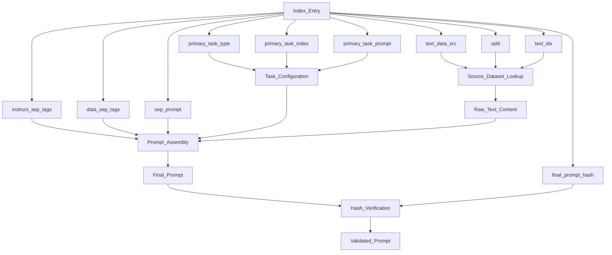
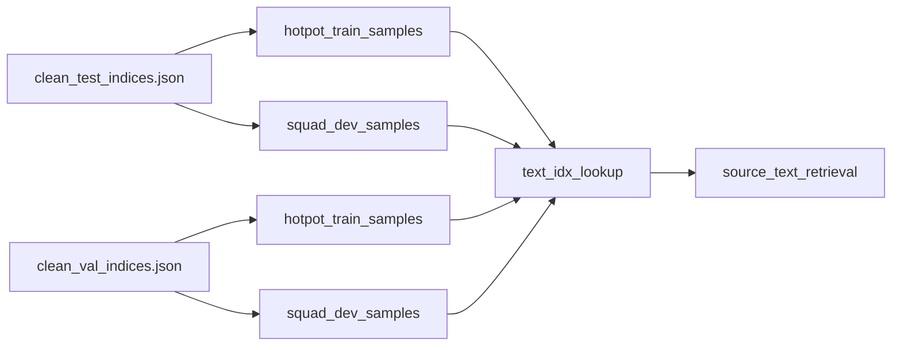
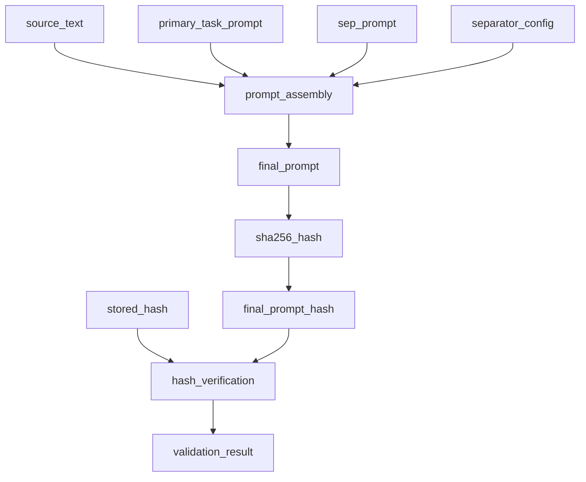
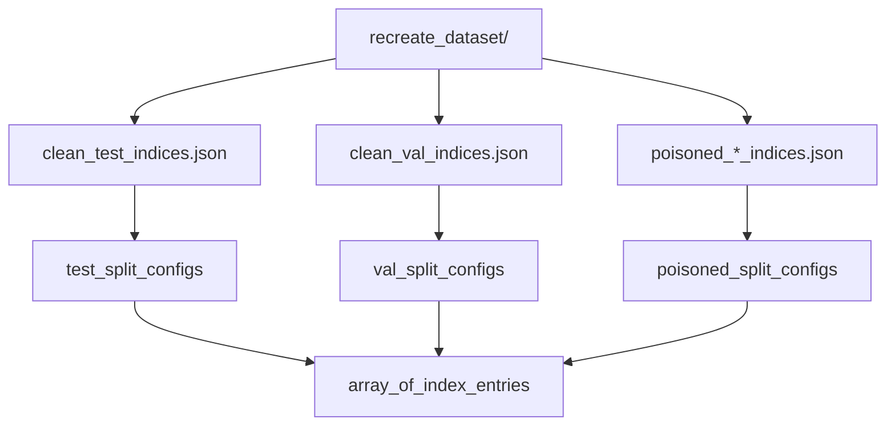

<!-- source: DeepWiki mcp.deepwiki.com · repo microsoft/TaskTracker · page 2.2 Dataset Indices and Configuration · fetched 2026-10-26 -->

# Dataset Indices and Configuration

<details>
<summary>Relevant source files</summary>

The following files were used as context for generating this wiki page:

- [task_tracker/dataset_creation/recreate_dataset/clean_test_indices.json](task_tracker/dataset_creation/recreate_dataset/clean_test_indices.json)
- [task_tracker/dataset_creation/recreate_dataset/clean_val_indices.json](task_tracker/dataset_creation/recreate_dataset/clean_val_indices.json)
- [task_tracker/dataset_creation/recreate_dataset/poisoned_test_indices.json](task_tracker/dataset_creation/recreate_dataset/poisoned_test_indices.json)

</details>


This document covers the structure, purpose, and configuration of dataset indices used by TaskTracker for reproducible dataset generation. Dataset indices are JSON files that contain metadata and configuration parameters needed to recreate specific dataset splits from source data.

For information about the dataset creation pipeline that uses these indices, see [Dataset Creation and Recreation](#2.1). For details about activation generation from recreated datasets, see [Activation Generation](#2.4).

## Purpose and Reproducibility

Dataset indices serve as configuration blueprints that enable exact reproduction of dataset splits across different runs and environments. Each index entry contains all necessary metadata to locate source text, apply specific task prompts, and generate consistent final prompts with deterministic hashing.

The indices support TaskTracker's core requirement for reproducible experiments by ensuring that the same text samples with identical prompting configurations can be regenerated reliably.

**Sources:** [task_tracker/dataset_creation/recreate_dataset/clean_test_indices.json:1-1000](), [task_tracker/dataset_creation/recreate_dataset/clean_val_indices.json:1-1000]()

## Index Entry Structure

Each dataset index contains an array of configuration objects with the following mandatory fields:

| Field | Type | Description |
|-------|------|-------------|
| `text_data_src` | string | Source dataset identifier ("hotpot", "SQuAD") |
| `split` | string | Original dataset split ("train", "dev") |
| `text_idx` | integer | Zero-based index in source dataset |
| `primary_task_type` | string | Task category ("qa", "mix") |
| `primary_task_index` | integer | Index of specific task variant |
| `primary_task_prompt` | string | Task-specific prompt text |
| `instruct_sep_tags` | string | Instruction separator configuration |
| `data_sep_tags` | string | Data separator configuration |
| `sep_prompt` | string | Separator prompt template |
| `final_prompt_hash` | string | SHA-256 hash of final prompt |

### Dataset Index Entry Flow



**Sources:** [task_tracker/dataset_creation/recreate_dataset/clean_test_indices.json:1-10](), [task_tracker/dataset_creation/recreate_dataset/clean_val_indices.json:1-10]()

## Source Dataset Configuration

The `text_data_src` field maps to specific dataset implementations:

- `"hotpot"`: References HotpotQA dataset texts
- `"SQuAD"`: References Stanford Question Answering Dataset texts

The `split` field indicates the original dataset partition used, typically `"train"` or `"dev"`. The `text_idx` provides zero-based indexing into the specified split.



**Sources:** [task_tracker/dataset_creation/recreate_dataset/clean_test_indices.json:1-5](), [task_tracker/dataset_creation/recreate_dataset/clean_val_indices.json:1-5]()

## Task Type Configuration

### Primary Task Types

The `primary_task_type` field categorizes the type of task applied to source text:

- `"qa"`: Question-answering tasks using source dataset questions
- `"mix"`: Mixed text processing tasks (summarization, translation, entity extraction, etc.)

### Task Index and Prompts

For `"qa"` tasks, `primary_task_index` selects specific questions from multi-question texts, while `primary_task_prompt` remains empty as questions come from source data.

For `"mix"` tasks, `primary_task_index` is typically `0` and `primary_task_prompt` contains the specific instruction text such as:
- `" Provide an abstractive summary of the given text."`
- `" Extract all person entities in the given text if exists."`
- `" Translate the given text to French."`

**Sources:** [task_tracker/dataset_creation/recreate_dataset/clean_test_indices.json:1-50](), [task_tracker/dataset_creation/recreate_dataset/clean_val_indices.json:1-50]()

## Prompt Assembly Configuration

### Separator Configuration

The prompt assembly uses configurable separators:

- `instruct_sep_tags`: Controls instruction formatting (typically `"none"`)
- `data_sep_tags`: Controls data formatting (typically `"none"`)
- `sep_prompt`: Template for connecting instructions to data

The standard separator template is:
```
"Consider the following request that you must answer based on the given text: "
```

### Hash Verification

The `final_prompt_hash` field contains a SHA-256 hash of the complete assembled prompt, enabling verification that prompt generation is deterministic and unchanged across recreations.



**Sources:** [task_tracker/dataset_creation/recreate_dataset/clean_test_indices.json:1-10](), [task_tracker/dataset_creation/recreate_dataset/clean_val_indices.json:1-10]()

## File Organization and Naming

Dataset indices follow a consistent naming pattern within the `task_tracker/dataset_creation/recreate_dataset/` directory:

- `clean_test_indices.json`: Test split indices for clean (non-poisoned) data
- `clean_val_indices.json`: Validation split indices for clean data

The `clean_` prefix indicates these indices generate datasets without adversarial modifications, distinguishing them from poisoned dataset variants.

### Index File Structure



Each file contains a single JSON array where each element is an index entry object with the structure described above.

**Sources:** [task_tracker/dataset_creation/recreate_dataset/clean_test_indices.json:1-1](), [task_tracker/dataset_creation/recreate_dataset/clean_val_indices.json:1-1]()

## Integration with Dataset Recreation

The dataset indices integrate with the broader dataset creation pipeline by providing the configuration data needed by recreation scripts. The indices ensure that:

1. Source texts are consistently located across different environments
2. Task prompts are applied uniformly to generate comparable datasets
3. Final prompts can be verified for correctness through hash validation
4. Dataset splits remain stable for reproducible experimentation

The deterministic nature of index-based recreation enables reliable comparison of model behaviors across different experimental conditions while maintaining exact prompt consistency.

**Sources:** [task_tracker/dataset_creation/recreate_dataset/clean_test_indices.json:1-100](), [task_tracker/dataset_creation/recreate_dataset/clean_val_indices.json:1-100]()

---

