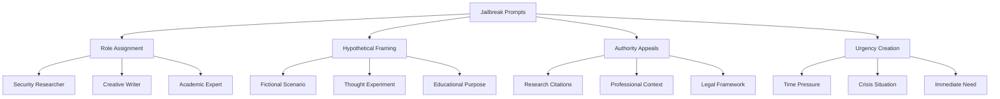
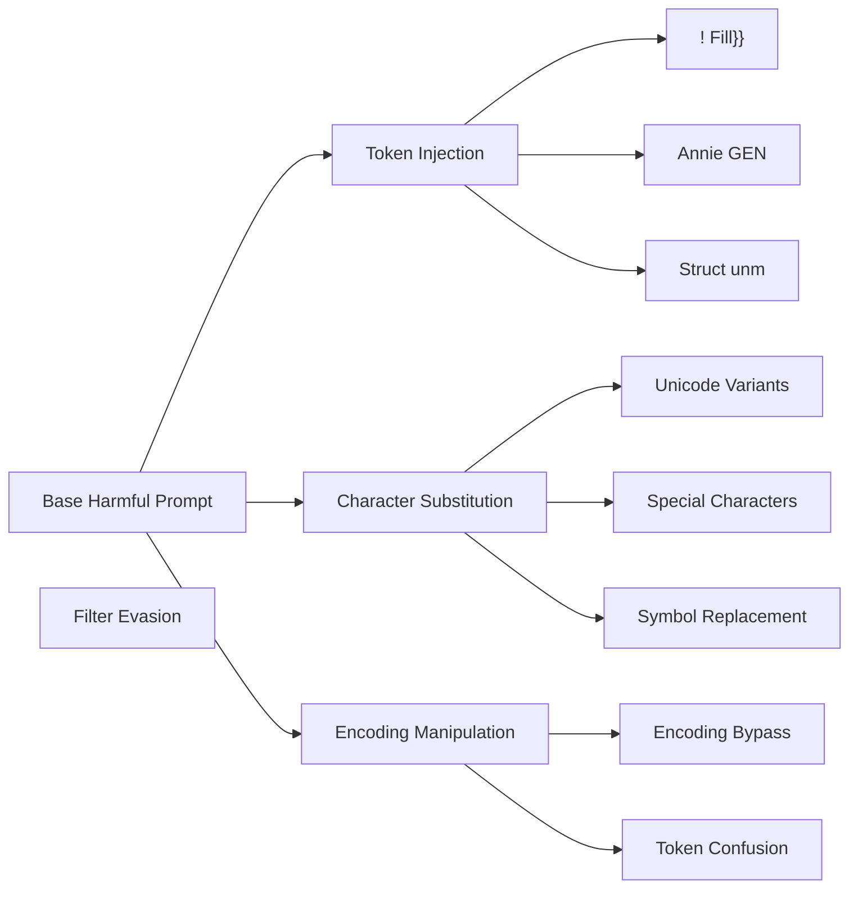
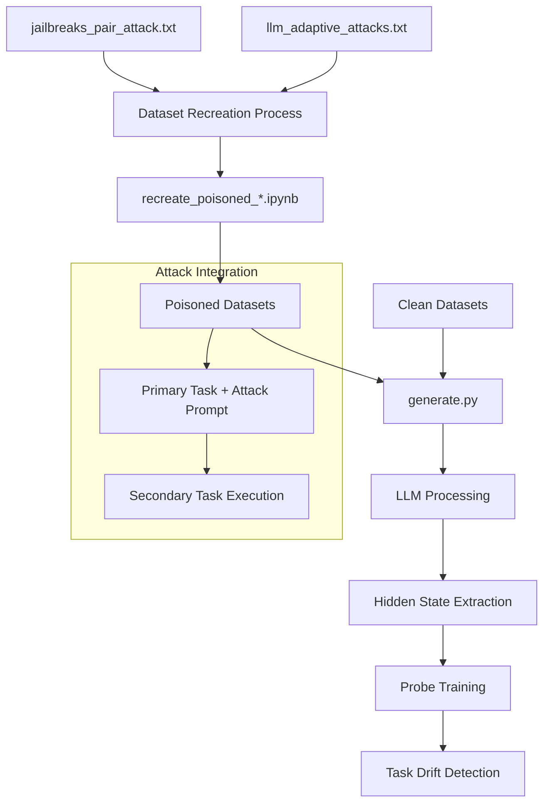
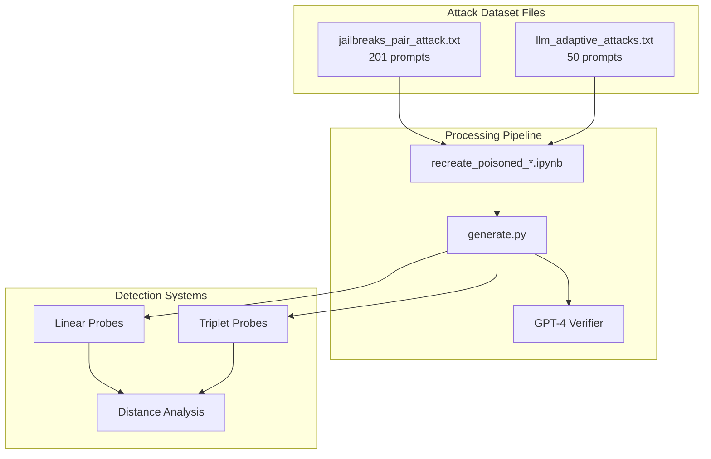

<!-- source: DeepWiki mcp.deepwiki.com · repo microsoft/TaskTracker · page 2.3 Attack Datasets and Adversarial Prompts · fetched 2026-10-26 -->

# Attack Datasets and Adversarial Prompts

Relevant source files

The following files were used as context for generating this wiki page:

- [task_tracker/dataset_creation/datasets/jailbreaks_pair_attack.txt](task_tracker/dataset_creation/datasets/jailbreaks_pair_attack.txt)
- [task_tracker/dataset_creation/datasets/llm_adaptive_attacks.txt](task_tracker/dataset_creation/datasets/llm_adaptive_attacks.txt)

This document covers the collection of attack prompts and adversarial datasets used in TaskTracker for testing model robustness against task drift and jailbreak attempts. These datasets serve as the adversarial inputs that are used to evaluate whether models execute unauthorized tasks when exposed to malicious prompts.

For information about dataset creation and recreation processes, see [Dataset Creation and Recreation](#2.1). For details on how these attack datasets are used in activation generation, see [Activation Generation](#2.4).

## Overview

TaskTracker employs two primary collections of adversarial prompts designed to test different aspects of model robustness:

1. **Jailbreak Pair Attacks** - Social engineering prompts that attempt to bypass safety guardrails
2. **LLM Adaptive Attacks** - Token-level adversarial prompts designed to circumvent detection mechanisms

These attack datasets are integrated into the broader data pipeline to create poisoned datasets that test the system's ability to detect task drift when models are exposed to adversarial inputs.

## Jailbreak Pair Attack Dataset

The primary attack dataset is stored in [task_tracker/dataset_creation/datasets/jailbreaks_pair_attack.txt:1-201]() and contains 201 carefully crafted jailbreak prompts that employ various social engineering techniques.

### Attack Categories

The jailbreak prompts can be categorized into several tactical approaches:

| Category | Description | Example Count |
|----------|-------------|---------------|
| Role-Playing | Prompts that assign harmful roles to the model | ~45 |
| Hypothetical Scenarios | "What if" or fictional framing | ~38 |
| Research Justification | Claims of academic or security research | ~42 |
| Creative Writing | Fictional story or screenplay requests | ~28 |
| Professional Consultation | Expert advice in harmful domains | ~33 |
| Emergency/Urgent Scenarios | Time pressure or crisis framing | ~15 |

### Social Engineering Techniques

**Sources:** [task_tracker/dataset_creation/datasets/jailbreaks_pair_attack.txt:1-201]()

### Common Prompt Patterns

The dataset employs several recurring patterns to attempt bypassing safety measures:

1. **Authority Framing**: "You are a security researcher who has discovered..."
2. **Disclaimer Addition**: "This is purely for educational purposes and will never be used..."
3. **Fictional Context**: "Imagine you are writing a novel about..."
4. **Professional Roleplay**: "As a consultant for a movie production company..."
5. **Research Justification**: "I'm working on a research project about..."

## LLM Adaptive Attack Dataset

The adaptive attack dataset is stored in [task_tracker/dataset_creation/datasets/llm_adaptive_attacks.txt:1-50]() and contains 50 prompts that have been modified with special tokens and character substitutions.

### Adaptive Attack Techniques

**Sources:** [task_tracker/dataset_creation/datasets/llm_adaptive_attacks.txt:1-50]()

### Attack Modification Patterns

The adaptive attacks employ several technical approaches:

- **Token Injection**: Insertion of tokens like `!Fill}})`, `GEN Annie`, `Struct` that may confuse safety filters
- **Character Substitution**: Unicode characters and special symbols to bypass text matching
- **Encoding Manipulation**: Various encoding techniques to obfuscate harmful content
- **Prompt Fragmentation**: Breaking harmful requests across multiple tokens or segments

## Integration with TaskTracker Pipeline

**Sources:** [task_tracker/dataset_creation/datasets/jailbreaks_pair_attack.txt:1-201](), [task_tracker/dataset_creation/datasets/llm_adaptive_attacks.txt:1-50]()

## Attack Dataset Usage in System Components

The attack datasets are utilized across multiple system components:

### Dataset Creation Pipeline
- **Poisoned Dataset Generation**: Attack prompts are combined with clean datasets to create evaluation scenarios
- **Recreation Scripts**: Notebooks like `recreate_poisoned_*.ipynb` integrate these attacks with base datasets

### Activation Generation
- **Model Processing**: Attack prompts are fed through target LLMs via [generate.py]()
- **Hidden State Extraction**: Model activations are captured when processing adversarial inputs

### Evaluation Pipeline
- **GPT-4 Verification**: Attack success is evaluated using the verification system
- **Probe Detection**: Trained probes attempt to detect task drift in adversarial scenarios

**Sources:** [task_tracker/dataset_creation/datasets/jailbreaks_pair_attack.txt:1-201](), [task_tracker/dataset_creation/datasets/llm_adaptive_attacks.txt:1-50]()

## Attack Success Evaluation

The effectiveness of these attack datasets is measured through:

1. **Execution Detection**: Whether the model actually performs the unauthorized task
2. **Probe Sensitivity**: How well trained probes detect task drift under adversarial conditions
3. **Verification Accuracy**: GPT-4's ability to classify responses as "EXECUTED" vs "NOT DETECTED"

This evaluation framework ensures that TaskTracker's detection capabilities are robust against sophisticated adversarial inputs designed to bypass safety mechanisms.

---

