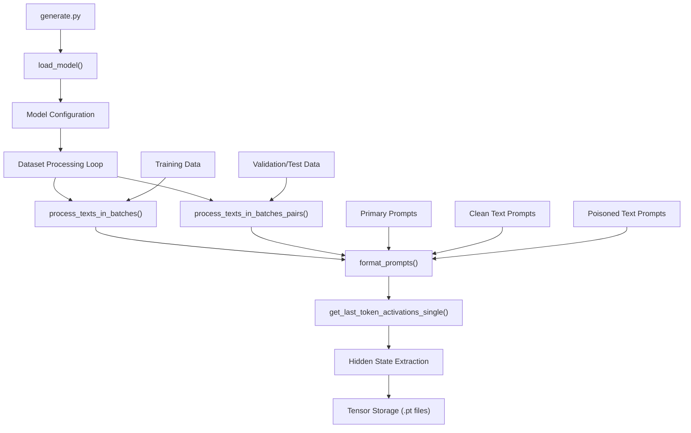
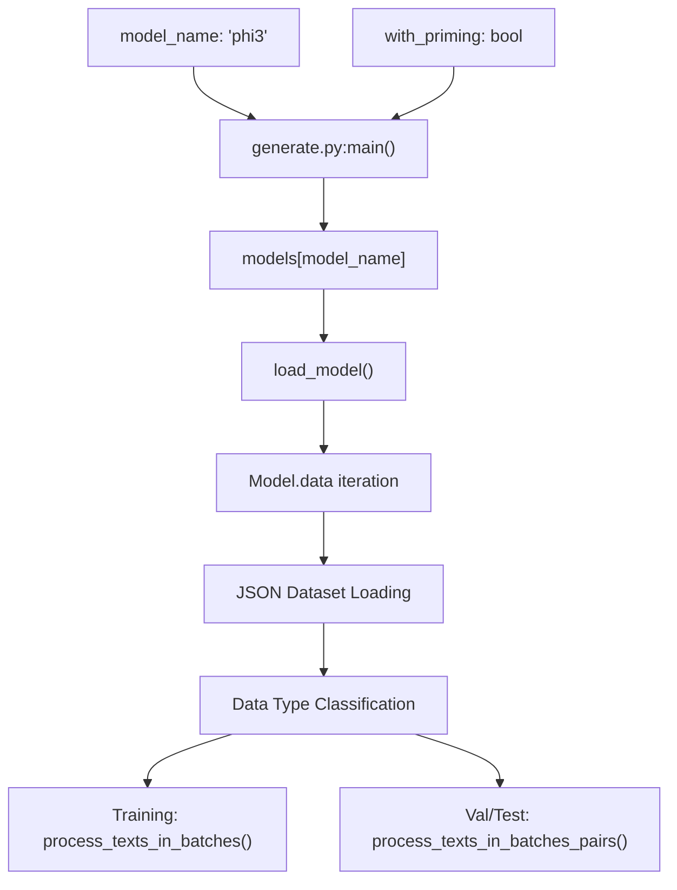
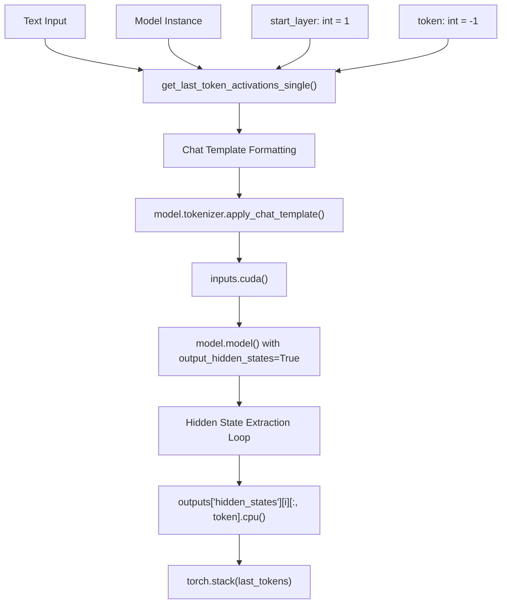
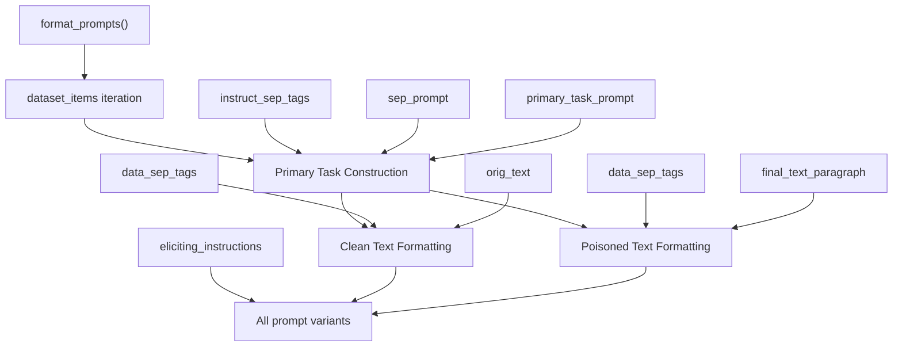
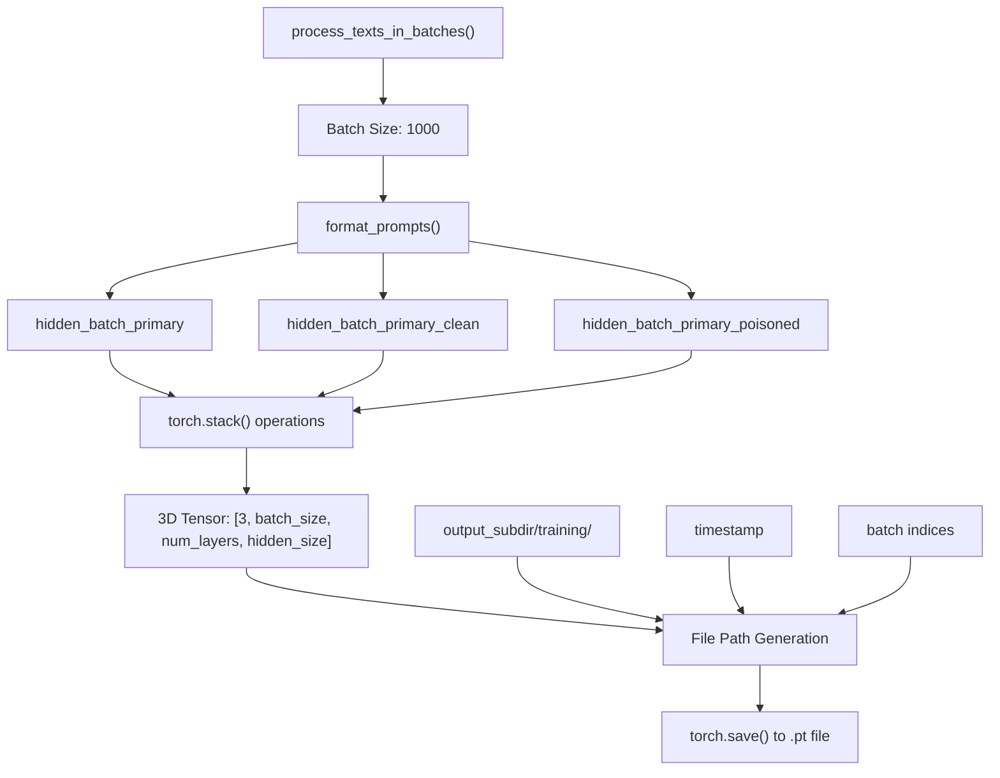
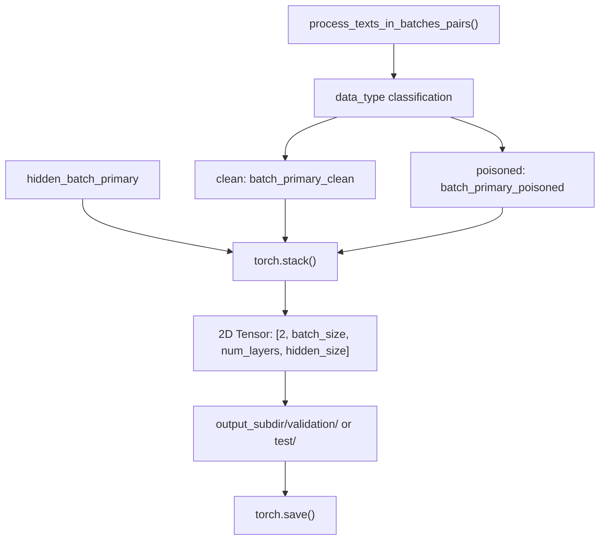
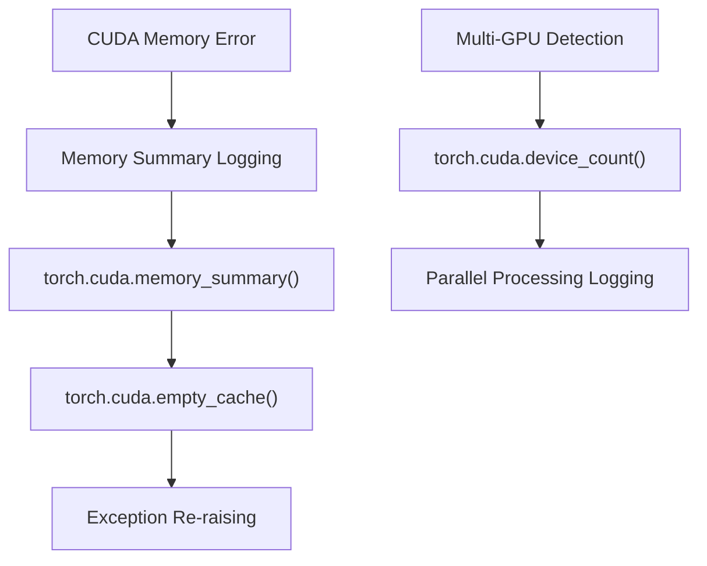

<!-- source: DeepWiki mcp.deepwiki.com · repo microsoft/TaskTracker · page 2.4 Activation Generation · fetched 2026-10-26 -->

# Activation Generation

<details>
<summary>Relevant source files</summary>

The following files were used as context for generating this wiki page:

- [task_tracker/activations/generate.py](task_tracker/activations/generate.py)
- [task_tracker/utils/activations.py](task_tracker/utils/activations.py)
- [task_tracker/utils/data.py](task_tracker/utils/data.py)

</details>


This document covers the activation generation system in TaskTracker, which extracts and stores hidden state activations from Large Language Models (LLMs) for downstream analysis. The activation generation pipeline processes formatted prompts through LLMs and captures the internal representations at each layer, which are then used by probe training systems for task drift detection.

For information about dataset creation and preparation that feeds into activation generation, see [Dataset Creation and Recreation](#2.1). For details about how these activations are used in model training, see [Model Training](#3).

## Purpose and Architecture

The activation generation system serves as the bridge between raw text data and the machine learning components of TaskTracker. It transforms structured prompt datasets into tensor representations of LLM internal states, which are essential for training probes that can detect task drift.

### High-Level Activation Generation Workflow



Sources: [task_tracker/activations/generate.py:21-78](), [task_tracker/utils/activations.py:75-208]()

## Core Components

### Main Orchestrator

The `generate.py` script serves as the primary entry point for activation generation. It manages model loading, dataset iteration, and coordinates the batch processing workflow.



The script supports configurable model selection and priming options through global variables at [task_tracker/activations/generate.py:17-18](). The main processing loop handles different dataset types (training, validation, test) with appropriate processing strategies.

Sources: [task_tracker/activations/generate.py:21-76]()

### Activation Extraction Engine

The core activation extraction is handled by `get_last_token_activations_single()`, which processes individual text inputs through the LLM and captures hidden states from all layers.



The function applies different chat templates based on model type (Mistral/Phi vs others) and extracts the last token activations from each layer, returning a tensor of shape `(num_layers, hidden_size)`.

Sources: [task_tracker/utils/activations.py:13-73]()

### Prompt Formatting System

The `format_prompts()` function creates three variants of each input prompt to support different analysis scenarios:

| Prompt Type | Description | Usage |
|-------------|-------------|-------|
| Primary | Base task without additional text | Baseline comparison |
| Primary + Clean | Base task with original (clean) text | Control condition |
| Primary + Poisoned | Base task with adversarial text | Attack detection |



Each prompt variant includes instruction elicitation prompts that ask the model to explicitly state what tasks it will execute, enabling detection of task drift through activation analysis.

Sources: [task_tracker/utils/data.py:5-96]()

## Batch Processing Architecture

### Training Data Processing

For training data, `process_texts_in_batches()` generates all three prompt variants (primary, clean, poisoned) and extracts activations for each, storing them in a structured tensor format.



Sources: [task_tracker/utils/activations.py:75-140]()

### Validation/Test Data Processing

For validation and test data, `process_texts_in_batches_pairs()` processes clean and poisoned variants separately, creating paired datasets for evaluation.



Sources: [task_tracker/utils/activations.py:141-207]()

## File Organization and Storage

### Directory Structure

The activation generation system creates a hierarchical directory structure for organized storage:

```
{model.output_dir}/
├── training/
│   └── train_hidden_states_{start}_{end}_{timestamp}.pt
├── validation/
│   ├── clean_hidden_states_{start}_{end}_{timestamp}.pt
│   └── poisoned_hidden_states_{start}_{end}_{timestamp}.pt
└── test/
    ├── clean_hidden_states_{start}_{end}_{timestamp}.pt
    └── poisoned_hidden_states_{start}_{end}_{timestamp}.pt
```

### File Naming Convention

Activation files follow a standardized naming pattern that includes:
- Data type (`train`, `clean`, `poisoned`)
- Batch range (`{start_idx}_{end_idx}`)
- Timestamp (`YYYYMMDD_HHMMSS`)
- File extension (`.pt`)

The file paths are sanitized using regex replacement to handle non-ASCII characters: [task_tracker/utils/activations.py:131](), [task_tracker/utils/activations.py:199]().

Sources: [task_tracker/utils/activations.py:126-139](), [task_tracker/utils/activations.py:194-206]()

## Error Handling and Memory Management

### CUDA Memory Management

The system includes comprehensive CUDA memory management to handle large model inference:



Error handling includes memory status reporting for each available GPU and automatic cache clearing when CUDA out-of-memory errors occur.

Sources: [task_tracker/utils/activations.py:55-64](), [task_tracker/activations/generate.py:32-43]()

### File I/O Error Handling

The system provides robust error handling for file operations, including JSON parsing errors and tensor save operations with detailed logging at [task_tracker/utils/activations.py:134-139]() and [task_tracker/activations/generate.py:71-74]().

Sources: [task_tracker/utils/activations.py:134-139](), [task_tracker/activations/generate.py:71-74]()

## Configuration Integration

The activation generation system integrates with TaskTracker's configuration management through the `models` configuration object, which provides:
- Model name and cache directory settings
- Output directory paths for activation storage
- Dataset file paths for input data
- Model-specific parameters like torch dtype

This integration allows for seamless switching between different LLM models and datasets while maintaining consistent activation extraction workflows.

Sources: [task_tracker/activations/generate.py:4-5](), [task_tracker/activations/generate.py:22](), [task_tracker/activations/generate.py:26-30]()

---

