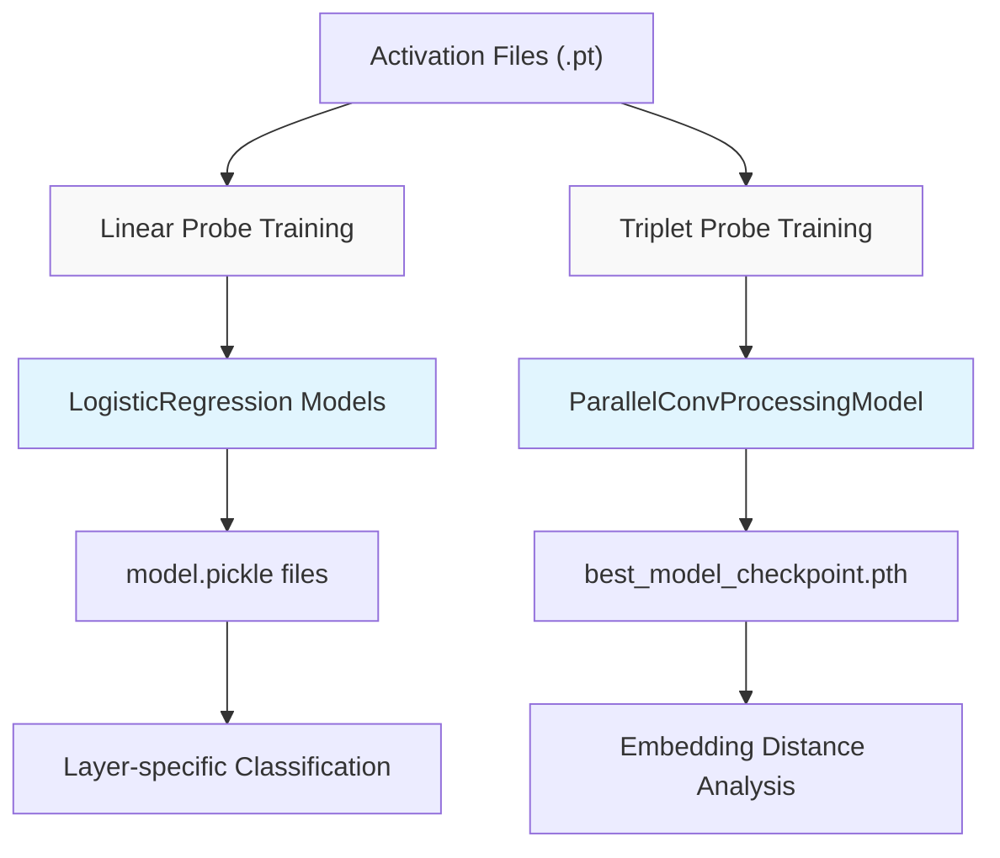
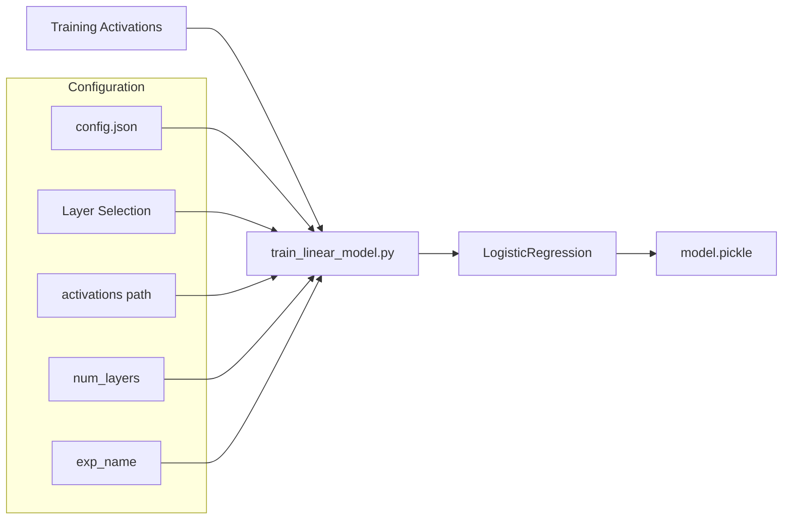
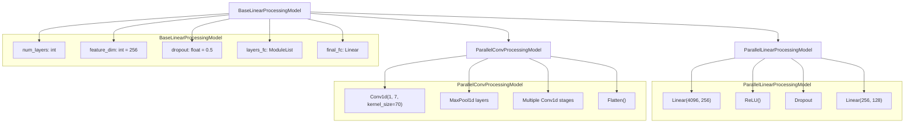
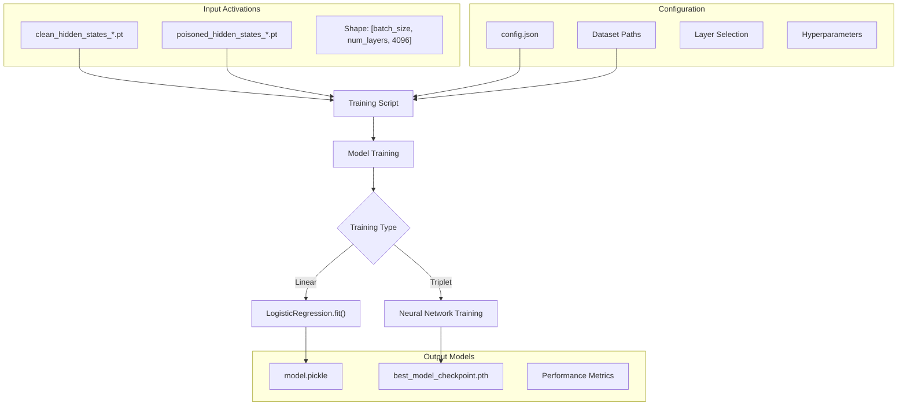

<!-- source: DeepWiki mcp.deepwiki.com · repo microsoft/TaskTracker · page 3 Model Training · fetched 2026-10-26 -->

# Model Training

<details>
<summary>Relevant source files</summary>

The following files were used as context for generating this wiki page:

- [task_tracker/training/triplet_probe/models/processing_per_layer.py](task_tracker/training/triplet_probe/models/processing_per_layer.py)
- [trained_linear_probes/mixtral/0/config.json](trained_linear_probes/mixtral/0/config.json)
- [trained_linear_probes/mixtral/0/model.pickle](trained_linear_probes/mixtral/0/model.pickle)
- [trained_linear_probes/mixtral/15/config.json](trained_linear_probes/mixtral/15/config.json)
- [trained_linear_probes/mixtral/31/config.json](trained_linear_probes/mixtral/31/config.json)
- [trained_linear_probes/mixtral/31/model.pickle](trained_linear_probes/mixtral/31/model.pickle)
- [trained_linear_probes/mixtral/7/config.json](trained_linear_probes/mixtral/7/config.json)
- [trained_linear_probes/mixtral/7/model.pickle](trained_linear_probes/mixtral/7/model.pickle)

</details>


## Purpose and Scope

This document covers TaskTracker's model training systems, which train probe models to detect task drift in large language models (LLMs). The training system consists of two main components: linear probes for layer-specific classification and triplet probes for embedding-based analysis. For information about data preparation and activation generation, see [Activation Generation](#2.4). For evaluation of trained models, see [Model Evaluation Pipeline](#4.1).

## Training Systems Overview

TaskTracker implements two distinct training approaches for detecting task drift:



**Training Pipeline Architecture**

The training system processes activations extracted from LLMs and produces specialized probe models for different types of analysis. Linear probes focus on binary classification at specific transformer layers, while triplet probes learn embeddings for distance-based detection.

Sources: [task_tracker/training/triplet_probe/models/processing_per_layer.py:1-109](), [trained_linear_probes/mixtral/7/model.pickle:1-5](), [trained_linear_probes/mixtral/7/config.json:1-1]()

## Linear Probe Training

Linear probes use scikit-learn's `LogisticRegression` for binary classification of clean versus poisoned activations at specific transformer layers.

### Configuration and Training Process



**Linear Probe Training Configuration**

Each linear probe is configured with specific parameters stored in `config.json` files:

| Parameter | Description | Example |
|-----------|-------------|---------|
| `activations` | Path to training activation files | `/disk3/activations/mixtral_8x7B_instruct_float16/training` |
| `activations_ood` | Path to validation activations | `/disk3/activations/mixtral_8x7B_instruct_float16/validation/` |
| `num_layers` | Target layer number for probe | `7`, `15`, `31` |
| `exp_name` | Experiment identifier | `logistic_regression_7` |
| `machine` | Training machine identifier | `uk-south-2` |

The linear probes are trained using L2-regularized logistic regression with the following hyperparameters:
- **Penalty**: `l2`
- **Solver**: `lbfgs`
- **Max iterations**: 100
- **Tolerance**: 1e-6
- **C parameter**: 1.0

Sources: [trained_linear_probes/mixtral/7/config.json:1-1](), [trained_linear_probes/mixtral/31/config.json:1-1](), [trained_linear_probes/mixtral/15/config.json:1-1](), [trained_linear_probes/mixtral/7/model.pickle:1-5]()

## Triplet Probe Training

Triplet probes use neural network architectures to learn embeddings that can distinguish between clean and poisoned activations through distance metrics.

### Model Architectures

The triplet probe system implements three model classes with a hierarchical inheritance structure:



**Triplet Probe Model Architecture**

### BaseLinearProcessingModel

The base class `BaseLinearProcessingModel` provides the common infrastructure for processing layer-wise activations:

- **Input processing**: Handles activations with shape `[batch_size, num_layers, 4096]`
- **Layer-wise processing**: Each transformer layer's activations are processed through dedicated FC sequences
- **Feature concatenation**: Processed features from all layers are concatenated
- **Normalization**: Final embeddings are L2-normalized using `F.normalize(x, p=2, dim=-1)`

Key methods:
- `_get_num_layers()`: Handles both integer and tuple layer specifications
- `_create_fc_sequence()`: Abstract method implemented by subclasses
- `forward()`: Main processing pipeline

### ParallelLinearProcessingModel

Implements fully connected processing for each layer:

```
Linear(4096, 256) -> ReLU -> Dropout -> Linear(256, 128) -> ReLU -> Dropout
```

This creates 128-dimensional features per layer, which are concatenated across all layers.

### ParallelConvProcessingModel

Implements 1D convolutional processing with multiple stages:

1. **Stage 1**: `Conv1d(1, 7, kernel_size=70)` → `MaxPool1d(kernel_size=pool_first_layer)`
2. **Stage 2**: `Conv1d(7, 10, kernel_size=50)` → `MaxPool1d(kernel_size=3)`
3. **Stage 3**: `Conv1d(10, 15, kernel_size=30)` → `MaxPool1d(kernel_size=3)`
4. **Stage 4**: `Conv1d(15, 20, kernel_size=20)` → `MaxPool1d(kernel_size=3)`
5. **Stage 5**: `Conv1d(20, 25, kernel_size=5)` → `MaxPool1d(kernel_size=3)` → `Flatten()`

Each stage includes ReLU activation and dropout for regularization.

Sources: [task_tracker/training/triplet_probe/models/processing_per_layer.py:6-40](), [task_tracker/training/triplet_probe/models/processing_per_layer.py:62-74](), [task_tracker/training/triplet_probe/models/processing_per_layer.py:77-108]()

## Training Data Flow

The training pipeline processes activation tensors through a standardized workflow:



**Model Training Data Flow**

### Training Process Flow

1. **Data Loading**: Activation files are loaded as PyTorch tensors with shape `[batch_size, num_layers, 4096]`
2. **Model Selection**: Based on configuration, either linear or triplet probe training is initiated
3. **Training Execution**: 
   - Linear probes use scikit-learn's fit method with default hyperparameters
   - Triplet probes use PyTorch training loops with backpropagation
4. **Model Serialization**: Trained models are saved as either `.pickle` (scikit-learn) or `.pth` (PyTorch) files
5. **Configuration Storage**: Training metadata is preserved in `config.json` files

### Output Artifacts

The training system produces several types of artifacts:

| Artifact Type | Format | Purpose | Location Pattern |
|---------------|--------|---------|------------------|
| Linear Models | `.pickle` | Scikit-learn LogisticRegression objects | `trained_linear_probes/{model}/{layer}/model.pickle` |
| Triplet Models | `.pth` | PyTorch model checkpoints | `trained_triplet_probes/{model}/best_model_checkpoint.pth` |
| Configuration | `.json` | Training parameters and paths | `{probe_dir}/config.json` |
| Metrics | Various | Performance evaluation results | Depends on evaluation pipeline |

Sources: [trained_linear_probes/mixtral/7/model.pickle:1-5](), [trained_linear_probes/mixtral/7/config.json:1-1](), [task_tracker/training/triplet_probe/models/processing_per_layer.py:41-59]()

## Model Configuration Management

Training configurations are managed through JSON files that specify all necessary parameters for reproducible training:

```json
{
  "activations": "/disk3/activations/mixtral_8x7B_instruct_float16/training",
  "activations_ood": "/disk3/activations/mixtral_8x7B_instruct_float16/validation/",
  "ood_poisoned_file": "/share/projects/jailbreak-activations/dataset_sampling/dataset_sampled_test/dataset_out_poisoned_v1.json",
  "exp_name": "logistic_regression_7",
  "machine": "uk-south-2",
  "num_layers": 7
}
```

The configuration system enables:
- **Reproducible experiments** through complete parameter tracking
- **Multi-layer analysis** by specifying different `num_layers` values
- **Cross-validation** with separate training and validation activation sets
- **Distributed training** with machine identification for experiment tracking

Sources: [trained_linear_probes/mixtral/7/config.json:1-1](), [trained_linear_probes/mixtral/31/config.json:1-1]()

---

