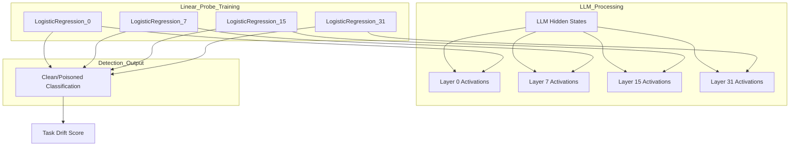
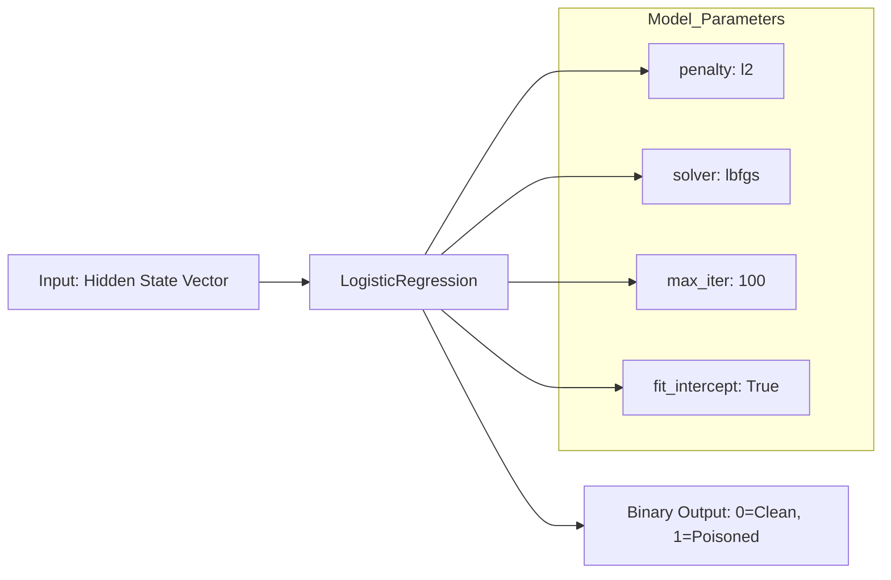
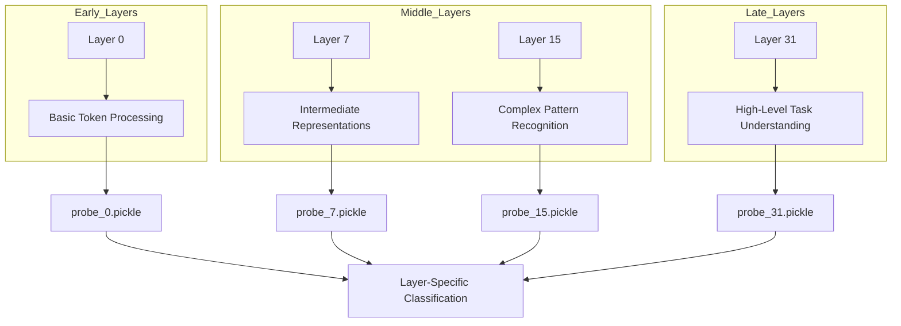
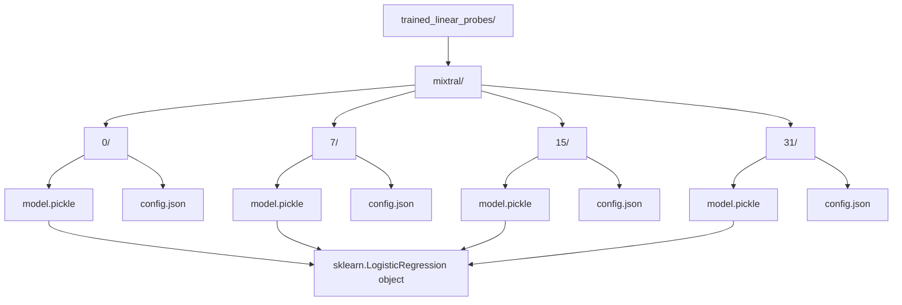
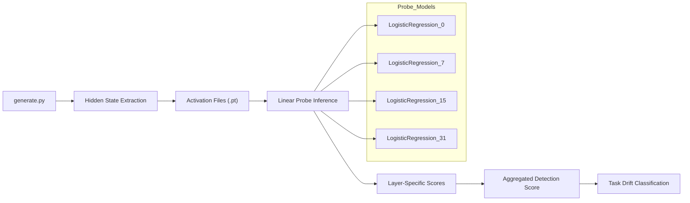

<!-- source: DeepWiki mcp.deepwiki.com · repo microsoft/TaskTracker · page 3.1 Linear Probes · fetched 2026-10-26 -->

# Linear Probes

Relevant source files

The following files were used as context for generating this wiki page:

- [trained_linear_probes/mixtral/0/config.json](trained_linear_probes/mixtral/0/config.json)
- [trained_linear_probes/mixtral/0/model.pickle](trained_linear_probes/mixtral/0/model.pickle)
- [trained_linear_probes/mixtral/15/config.json](trained_linear_probes/mixtral/15/config.json)
- [trained_linear_probes/mixtral/31/config.json](trained_linear_probes/mixtral/31/config.json)
- [trained_linear_probes/mixtral/31/model.pickle](trained_linear_probes/mixtral/31/model.pickle)
- [trained_linear_probes/mixtral/7/config.json](trained_linear_probes/mixtral/7/config.json)
- [trained_linear_probes/mixtral/7/model.pickle](trained_linear_probes/mixtral/7/model.pickle)

Linear probes are binary classification models that form a core component of TaskTracker's task drift detection system. They analyze LLM hidden state activations to distinguish between clean and poisoned (task-drifted) behavior at each layer of the target language model.

For information about triplet probes, which provide complementary embedding-based analysis, see [Triplet Probes](#3.2). For the broader model training infrastructure, see [Model Training](#3).

## Architecture Overview

Linear probes in TaskTracker are implemented as `LogisticRegression` models from scikit-learn, trained to perform binary classification on LLM activations. Each probe corresponds to a specific layer of the target language model and learns to identify patterns indicative of task drift.

Sources: [trained_linear_probes/mixtral/7/config.json:1](), [trained_linear_probes/mixtral/31/config.json:1](), [trained_linear_probes/mixtral/0/config.json:1](), [trained_linear_probes/mixtral/15/config.json:1]()

## Training Configuration

Each linear probe is configured through JSON files that specify the training parameters and data paths. The configuration follows a consistent structure across all layers:

| Parameter | Description | Example Value |
|-----------|-------------|---------------|
| `activations` | Path to training activation files | `/disk3/activations/mixtral_8x7B_instruct_float16/training` |
| `activations_ood` | Path to validation activation files | `/disk3/activations/mixtral_8x7B_instruct_float16/validation/` |
| `ood_poisoned_file` | Poisoned dataset for evaluation | `/share/projects/jailbreak-activations/dataset_sampling/dataset_sampled_test/dataset_out_poisoned_v1.json` |
| `exp_name` | Experiment identifier | `logistic_regression_7` |
| `machine` | Training machine identifier | `uk-south-2` |
| `num_layers` | Target layer number | `7` |

Sources: [trained_linear_probes/mixtral/7/config.json:1](), [trained_linear_probes/mixtral/31/config.json:1]()

## Model Architecture

Linear probes use scikit-learn's `LogisticRegression` with the following standardized parameters:

The models are binary classifiers that output:
- **Class 0**: Clean behavior (following original task instructions)
- **Class 1**: Poisoned behavior (exhibiting task drift)

Sources: [trained_linear_probes/mixtral/7/model.pickle:1-3](), [trained_linear_probes/mixtral/31/model.pickle:1-3]()

## Layer-Specific Analysis

Linear probes are trained independently for different layers of the target LLM, enabling layer-by-layer analysis of task drift patterns:

This layer-wise approach allows TaskTracker to:
- Identify at which layers task drift becomes detectable
- Understand the progression of malicious behavior through the model
- Optimize detection strategies based on layer-specific patterns

Sources: [trained_linear_probes/mixtral/0/config.json:1](), [trained_linear_probes/mixtral/7/config.json:1](), [trained_linear_probes/mixtral/15/config.json:1](), [trained_linear_probes/mixtral/31/config.json:1]()

## File Structure and Artifacts

Linear probe artifacts are organized in a hierarchical directory structure:

Each layer directory contains:
- **`model.pickle`**: Serialized `LogisticRegression` model with trained weights
- **`config.json`**: Training configuration and metadata

The pickle files contain complete sklearn model objects with:
- Learned coefficients (`coef_`)
- Intercept terms (`intercept_`)
- Training metadata (`n_features_in_`, `classes_`, `n_iter_`)

Sources: [trained_linear_probes/mixtral/7/model.pickle:1](), [trained_linear_probes/mixtral/7/config.json:1](), [trained_linear_probes/mixtral/31/model.pickle:1](), [trained_linear_probes/mixtral/31/config.json:1]()

## Integration with Detection Pipeline

Linear probes integrate with TaskTracker's broader detection system by providing layer-specific classification scores that contribute to the overall task drift assessment:

This integration enables TaskTracker to leverage the discriminative power of linear classification while maintaining interpretability and computational efficiency across multiple model layers.

Sources: [trained_linear_probes/mixtral/7/config.json:1](), [trained_linear_probes/mixtral/31/config.json:1]()

---

