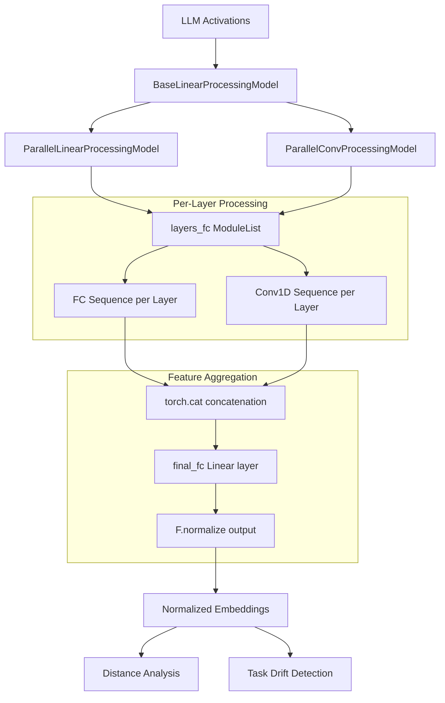
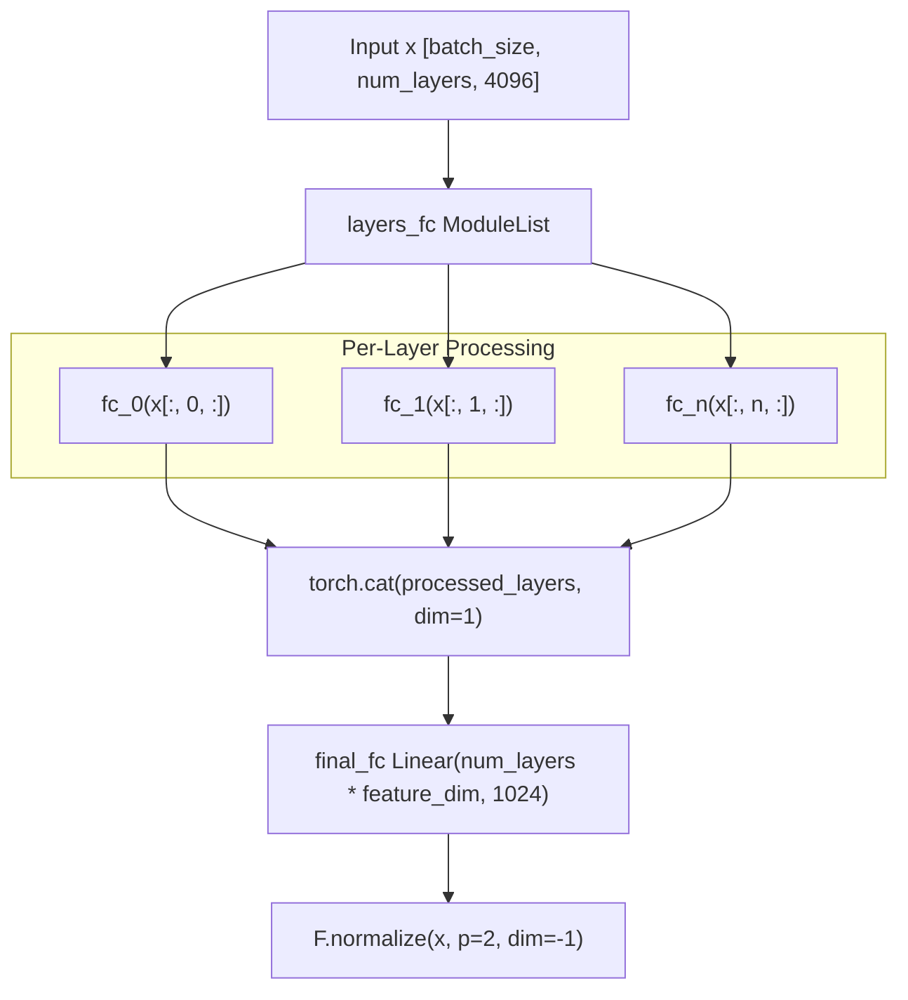
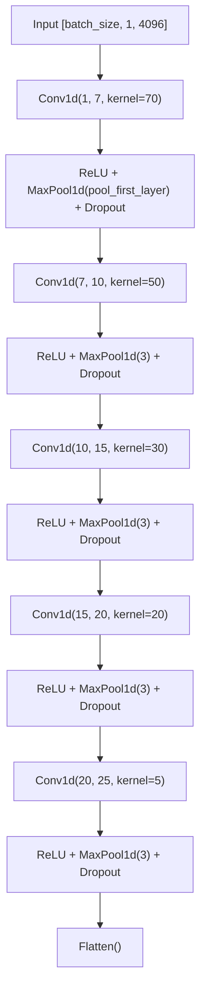
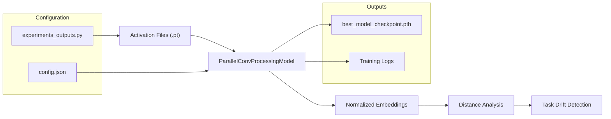

<!-- source: DeepWiki mcp.deepwiki.com · repo microsoft/TaskTracker · page 3.2 Triplet Probes · fetched 2026-10-26 -->

# Triplet Probes

Relevant source files

The following files were used as context for generating this wiki page:

- [task_tracker/training/triplet_probe/models/processing_per_layer.py](task_tracker/training/triplet_probe/models/processing_per_layer.py)
- [trained_triplet_probes/llama3_70b_best/best_model_checkpoint.pth](trained_triplet_probes/llama3_70b_best/best_model_checkpoint.pth)
- [trained_triplet_probes/llama3_70b_best/config.json](trained_triplet_probes/llama3_70b_best/config.json)

## Purpose and Scope

This document covers the triplet probe system in TaskTracker, which generates normalized embeddings from LLM activations for task drift detection. Triplet probes use neural network architectures to process multi-layer activations and produce embeddings that can be used for distance-based analysis to detect when models execute unauthorized tasks.

For information about linear probe training, see [Linear Probes](#3.1). For details about activation generation that feeds into triplet probes, see [Activation Generation](#2.4).

## System Architecture

Triplet probes in TaskTracker follow a hierarchical architecture where each layer of LLM activations is processed through dedicated neural networks, and the results are concatenated to produce final normalized embeddings.

### Triplet Probe Processing Pipeline

Sources: [task_tracker/training/triplet_probe/models/processing_per_layer.py:1-109]()

## Model Architectures

### BaseLinearProcessingModel

The `BaseLinearProcessingModel` serves as the foundation for all triplet probe architectures. It defines the core structure for processing multi-layer activations.

| Parameter | Type | Purpose |
|-----------|------|---------|
| `num_layers` | `Union[int, Tuple[int, int]]` | Number of layers or layer range to process |
| `feature_dim` | `int` | Final feature dimension per layer (default: 256) |
| `dropout` | `float` | Dropout rate (default: 0.5) |
| `conv` | `bool` | Whether to use convolutional processing |
| `layer_norm` | `bool` | Whether to apply layer normalization |
| `pool_first_layer` | `int` | Pooling size for first layer (default: 3) |

The base model creates a `ModuleList` called `layers_fc` containing one processing sequence per layer, and a `final_fc` linear layer that processes concatenated features from all layers.

Sources: [task_tracker/training/triplet_probe/models/processing_per_layer.py:6-60]()

### ParallelLinearProcessingModel

The `ParallelLinearProcessingModel` implements fully connected processing sequences for each layer. Each layer's activations are processed through identical FC sequences.

The `_create_fc_sequence` method creates:
- `Linear(4096, 256)` → `ReLU()` → `Dropout` → `Linear(256, 128)` → `ReLU()` → `Dropout`

This architecture reduces the 4096-dimensional activation vectors to 128 dimensions per layer before concatenation.

Sources: [task_tracker/training/triplet_probe/models/processing_per_layer.py:62-75]()

### ParallelConvProcessingModel

The `ParallelConvProcessingModel` uses 1D convolutional sequences to process each layer's activations. This architecture treats the 4096-dimensional activation vector as a 1D signal.

#### Convolutional Architecture

The convolutional approach progressively reduces spatial dimensions while increasing channel depth, ultimately flattening to a feature vector for concatenation with other layers.

Sources: [task_tracker/training/triplet_probe/models/processing_per_layer.py:77-108]()

## Training Configuration

Triplet probe training is configured through JSON files that specify model architecture, training parameters, and data paths. The configuration system supports different model types and layer ranges.

### Configuration Parameters

| Parameter | Example Value | Purpose |
|-----------|---------------|---------|
| `activations` | `/disk3/activations/llama_3_70B_Instruct/training` | Path to training activation files |
| `activations_ood` | `/disk3/activations/llama_3_70B_Instruct/validation` | Path to validation activation files |
| `margin` | `0.3` | Triplet loss margin parameter |
| `epochs` | `6` | Number of training epochs |
| `num_layers` | `[1, 15]` | Layer range to process |
| `batch_size` | `2500` | Training batch size |
| `learning_rate` | `0.0005` | Optimizer learning rate |
| `feature_dim` | `350` | Feature dimension per layer |
| `conv` | `true` | Use ParallelConvProcessingModel |
| `dropout` | `0.5` | Dropout rate |

Sources: [trained_triplet_probes/llama3_70b_best/config.json:1-1]()

## Integration with TaskTracker

Triplet probes integrate into the broader TaskTracker system by generating embeddings that enable distance-based task drift detection. The normalized embeddings from triplet probes are used to compute distances between clean and potentially poisoned activations.

### Triplet Probe Data Flow

The triplet probe system produces trained model checkpoints that can be loaded for inference on new activation data, enabling real-time task drift detection during LLM operation.

Sources: [task_tracker/training/triplet_probe/models/processing_per_layer.py:1-109](), [trained_triplet_probes/llama3_70b_best/config.json:1-1]()

---

