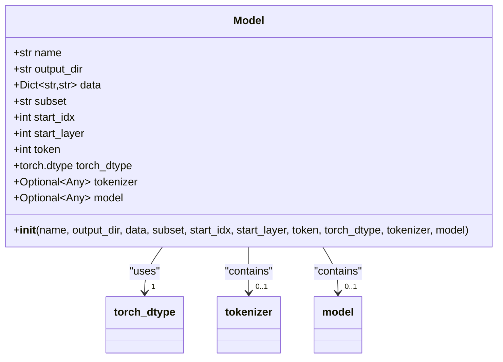
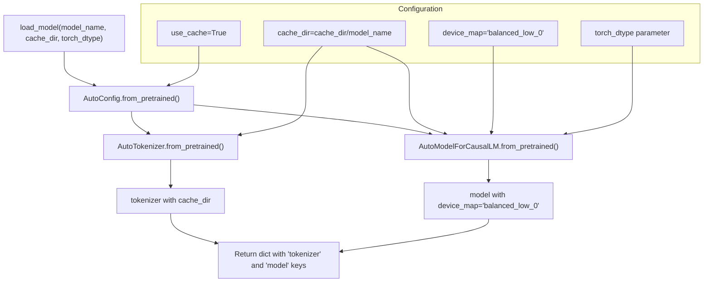
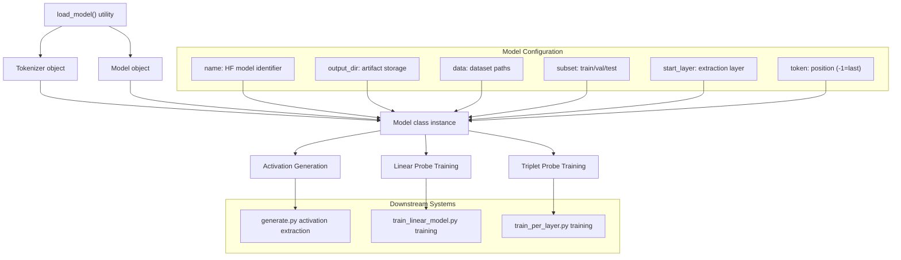
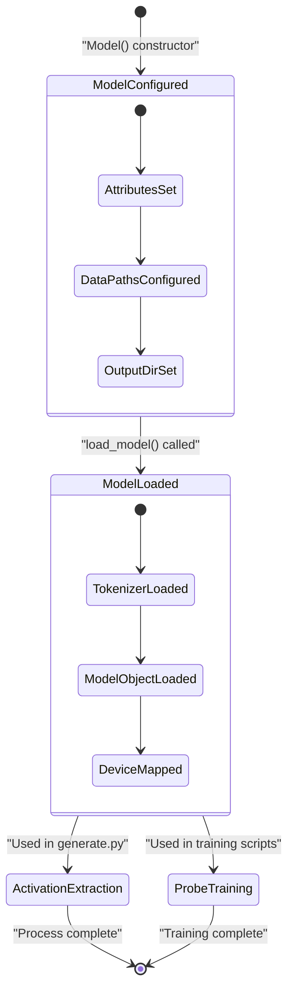

<!-- source: DeepWiki mcp.deepwiki.com · repo microsoft/TaskTracker · page 3.3 Model Utilities and Core Classes · fetched 2026-10-26 -->

# Model Utilities and Core Classes

Relevant source files

The following files were used as context for generating this wiki page:

- [task_tracker/models/model.py](task_tracker/models/model.py)
- [task_tracker/utils/model.py](task_tracker/utils/model.py)

This page documents the core model management infrastructure in TaskTracker, specifically the `Model` class and associated utility functions used for loading and configuring Language Learning Models (LLMs). These components serve as the foundation for activation generation and training pipeline operations.

For information about activation generation processes, see [Activation Generation](#2.4). For details about training systems that use these model utilities, see [Linear Probes](#3.1) and [Triplet Probes](#3.2).

## Core Model Class

The `Model` class serves as a central configuration container that encapsulates all the metadata and parameters needed for LLM operations within TaskTracker. This class standardizes how models are represented across the system and provides a consistent interface for activation generation and training processes.

### Model Class Structure

**Model Class Architecture and Attributes**

Sources: [task_tracker/models/model.py:5-49]()

The `Model` class [task_tracker/models/model.py:5]() defines the following key attributes:

| Attribute | Type | Default | Purpose |
|-----------|------|---------|---------|
| `name` | `str` | Required | Hugging Face model identifier |
| `output_dir` | `str` | Required | Directory for storing generated outputs |
| `data` | `Dict[str, str]` | Required | Paths to train/validation/test datasets |
| `subset` | `str` | Required | Active dataset subset ('train', 'validation', 'test') |
| `start_idx` | `int` | 0 | Starting index for data processing |
| `start_layer` | `int` | 0 | Starting layer for activation extraction |
| `token` | `int` | -1 | Token position (-1 for last token activation) |
| `torch_dtype` | `torch.dtype` | `torch.float32` | Model precision configuration |
| `tokenizer` | `Optional[Any]` | `None` | Loaded tokenizer object |
| `model` | `Optional[Any]` | `None` | Loaded model object |

The `token` attribute specifically controls activation extraction positioning, where `-1` represents the last token activation in the residual stream [task_tracker/models/model.py:16-17]().

## Model Loading Utilities

The `load_model()` function provides standardized model loading functionality optimized for TaskTracker's requirements, including caching, device mapping, and precision configuration.

### Model Loading Process

**Model Loading Function Signature and Behavior**

Sources: [task_tracker/utils/model.py:6-21]()

The `load_model()` function [task_tracker/utils/model.py:6]() accepts three parameters:
- `model_name`: Hugging Face model identifier
- `cache_dir`: Base cache directory for model storage
- `torch_dtype`: PyTorch data type for model precision

The function returns a dictionary containing both the tokenizer and model objects [task_tracker/utils/model.py:8-20](), using the `device_map="balanced_low_0"` configuration for optimal GPU utilization.

## Integration with TaskTracker Systems

The model utilities integrate with multiple TaskTracker subsystems to provide consistent model access across the pipeline.

### Model Class Integration Flow

**System Integration Points**

Sources: [task_tracker/models/model.py:1-49](), [task_tracker/utils/model.py:1-21]()

The `Model` class serves as a configuration bridge between:

1. **Activation Generation**: The `token` and `start_layer` attributes control which activations are extracted during the generation process
2. **Training Systems**: The `data` and `subset` attributes specify which datasets to use for probe training
3. **Output Management**: The `output_dir` attribute ensures consistent artifact storage across all operations

The separation between the `Model` configuration class and the `load_model()` utility function allows for lazy loading of actual model objects, enabling efficient memory management during batch processing operations.

### Model Lifecycle Management

**Configuration vs Runtime Separation**

Sources: [task_tracker/models/model.py:47-48](), [task_tracker/utils/model.py:8-20]()

The architecture separates configuration-time concerns (handled by the `Model` class) from runtime concerns (handled by `load_model()`). The `Model` class can be instantiated with `tokenizer` and `model` attributes set to `None` [task_tracker/models/model.py:47-48](), allowing for deferred loading of heavyweight objects until they are actually needed in the processing pipeline.

This design pattern enables efficient batch processing where multiple `Model` configurations can be prepared without loading actual model weights until required, optimizing memory usage across the TaskTracker system.

---

