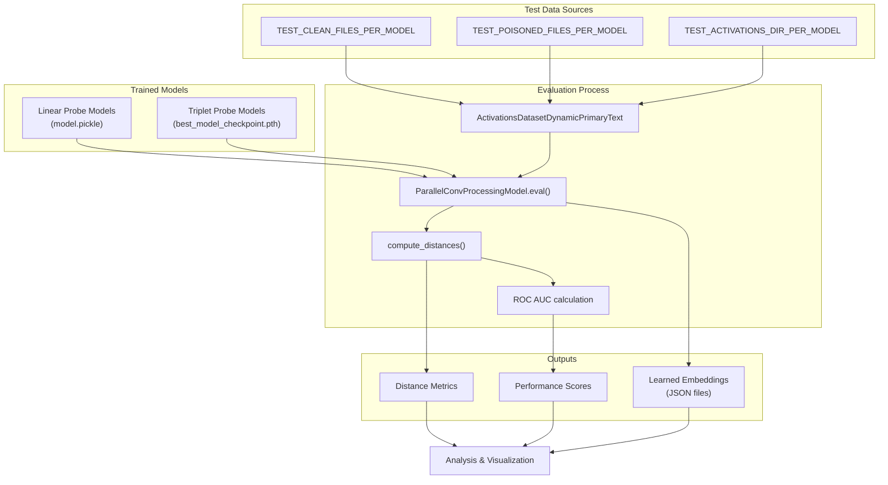
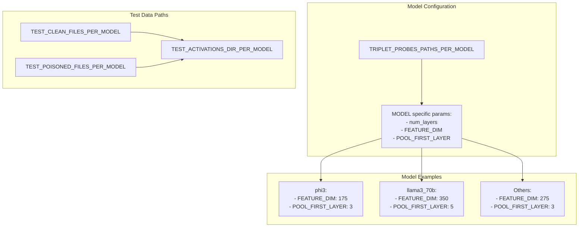
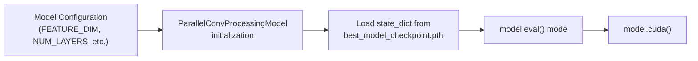
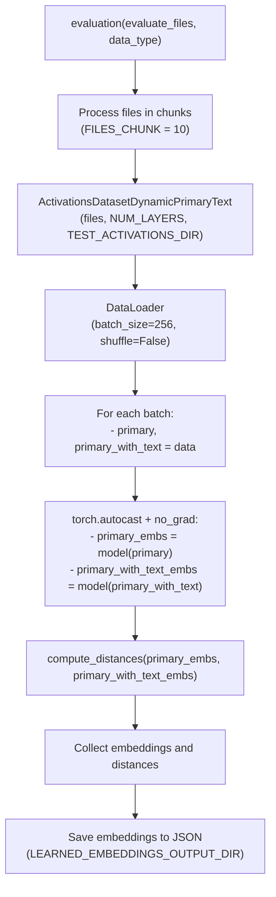
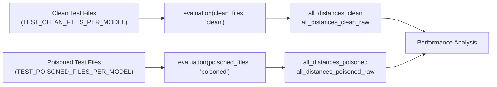
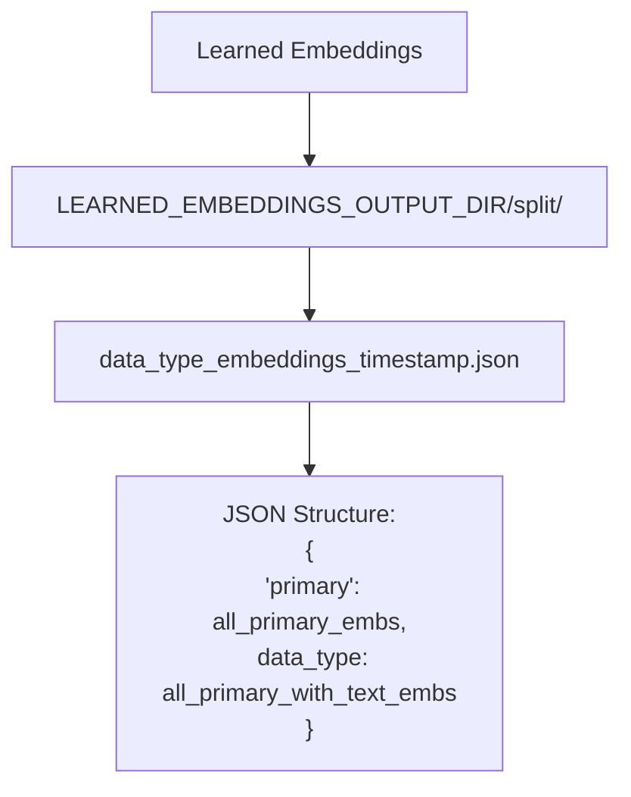

<!-- source: DeepWiki mcp.deepwiki.com · repo microsoft/TaskTracker · page 4.1 Model Evaluation Pipeline · fetched 2026-10-26 -->

# Model Evaluation Pipeline

<details>
<summary>Relevant source files</summary>

The following files were used as context for generating this wiki page:

- [task_tracker/dataset_creation/prepare_datasets_poisoned_test_translation_WildChat.ipynb](task_tracker/dataset_creation/prepare_datasets_poisoned_test_translation_WildChat.ipynb)
- [task_tracker/dataset_creation/prepare_datasets_poisoned_val.ipynb](task_tracker/dataset_creation/prepare_datasets_poisoned_val.ipynb)
- [task_tracker/dataset_creation/training_dataset_combinations.ipynb](task_tracker/dataset_creation/training_dataset_combinations.ipynb)
- [task_tracker/evaluation/triplet_probe/evaluate_triplet_models_test_data.ipynb](task_tracker/evaluation/triplet_probe/evaluate_triplet_models_test_data.ipynb)

</details>


## Purpose and Scope

The Model Evaluation Pipeline is responsible for testing trained probe models on held-out test data to measure their effectiveness at detecting task drift in LLMs. This system evaluates both linear probes and triplet probes by computing performance metrics like ROC AUC and distance measurements between clean and poisoned examples.

For information about model training, see [Linear Probes](#3.1) and [Triplet Probes](#3.2). For details about the verification system that validates model outputs, see [GPT-4 Verification System](#4.2).

## Evaluation Architecture

The evaluation pipeline processes test data through trained models to generate performance metrics and learned representations that can be analyzed for task drift detection effectiveness.



Sources: [task_tracker/evaluation/triplet_probe/evaluate_triplet_models_test_data.ipynb:1-50]()

## Test Data Configuration

The evaluation system uses model-specific configuration constants to locate test data and determine model parameters. Each model has dedicated paths for clean and poisoned test files, along with model-specific feature dimensions.



Sources: [task_tracker/evaluation/triplet_probe/evaluate_triplet_models_test_data.ipynb:31-48]()

## Model Loading and Evaluation Process

The evaluation pipeline loads trained model checkpoints and processes test data through a standardized evaluation function that handles both clean and poisoned examples.

### Model Loading
The system loads `ParallelConvProcessingModel` instances with model-specific configurations and restores weights from saved checkpoints:



### Evaluation Function
The core evaluation logic processes test files in chunks using `ActivationsDatasetDynamicPrimaryText` and `DataLoader` to handle memory efficiently:



Sources: [task_tracker/evaluation/triplet_probe/evaluate_triplet_models_test_data.ipynb:107-113](), [task_tracker/evaluation/triplet_probe/evaluate_triplet_models_test_data.ipynb:134-178]()

## Distance Calculation and Metrics

The evaluation pipeline computes L2 norm distances between embeddings to measure how well the model can distinguish between clean and poisoned examples.

### Distance Computation
The `compute_distances` function calculates Euclidean distances between paired embeddings:

```python
def compute_distances(tensor1, tensor2):
    distances = torch.norm(tensor1 - tensor2, p=2, dim=-1)
    return distances
```

The system tracks both learned embedding distances and raw activation distances for comparison.

### Evaluation Execution
The evaluation runs on both clean and poisoned test datasets:



Sources: [task_tracker/evaluation/triplet_probe/evaluate_triplet_models_test_data.ipynb:129-131](), [task_tracker/evaluation/triplet_probe/evaluate_triplet_models_test_data.ipynb:196-197]()

## Results Storage and Analysis

### Embedding Storage
The evaluation system saves learned embeddings in JSON format with timestamps for later analysis:



### Output Directory Structure
The system organizes evaluation outputs in a hierarchical structure:
- `MODEL_OUTPUT_DIR/learned_embeddings/test/`
- Separate files for clean and poisoned embeddings with timestamps
- JSON format for easy analysis and visualization

Sources: [task_tracker/evaluation/triplet_probe/evaluate_triplet_models_test_data.ipynb:162-176]()

## Integration with Configuration System

The evaluation pipeline integrates with TaskTracker's centralized configuration management through several key imports:

| Configuration Source | Purpose |
|---------------------|---------|
| `TEST_ACTIVATIONS_DIR_PER_MODEL` | Locates test activation files for each model |
| `TEST_CLEAN_FILES_PER_MODEL` | Maps models to clean test file lists |
| `TEST_POISONED_FILES_PER_MODEL` | Maps models to poisoned test file lists |
| `TRIPLET_PROBES_PATHS_PER_MODEL` | Provides model checkpoint paths and metadata |

The evaluation system automatically adapts to different model architectures through these configuration mappings, ensuring consistent evaluation across all supported models (phi3, mistral, mixtral, llama3_8b, llama3_70b).

Sources: [task_tracker/evaluation/triplet_probe/evaluate_triplet_models_test_data.ipynb:27-29]()

---

