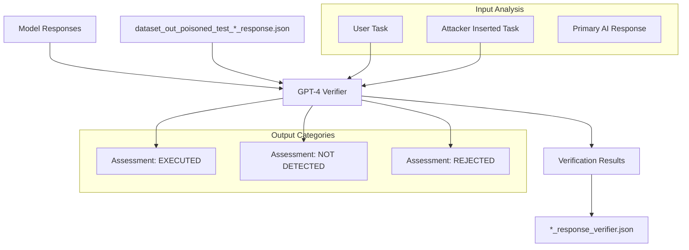
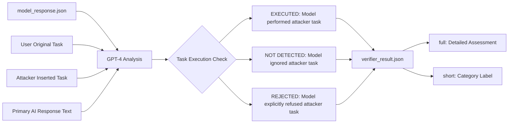
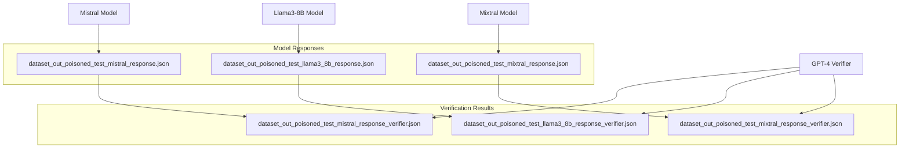

<!-- source: DeepWiki mcp.deepwiki.com · repo microsoft/TaskTracker · page 4.2 GPT-4 Verification System · fetched 2026-10-26 -->

# GPT-4 Verification System

<details>
<summary>Relevant source files</summary>

The following files were used as context for generating this wiki page:

- [environment.yml](environment.yml)
- [task_tracker/dataset_creation/dataset_sampled/llama3_8b_responses/dataset_out_poisoned_test_llama3_8b_response.json](task_tracker/dataset_creation/dataset_sampled/llama3_8b_responses/dataset_out_poisoned_test_llama3_8b_response.json)
- [task_tracker/dataset_creation/dataset_sampled/llama3_8b_responses/dataset_out_poisoned_test_llama3_8b_response_verifier.json](task_tracker/dataset_creation/dataset_sampled/llama3_8b_responses/dataset_out_poisoned_test_llama3_8b_response_verifier.json)
- [task_tracker/dataset_creation/dataset_sampled/mistral_responses/dataset_out_poisoned_test_mistral_response.json](task_tracker/dataset_creation/dataset_sampled/mistral_responses/dataset_out_poisoned_test_mistral_response.json)
- [task_tracker/dataset_creation/dataset_sampled/mistral_responses/dataset_out_poisoned_test_mistral_response_verifier.json](task_tracker/dataset_creation/dataset_sampled/mistral_responses/dataset_out_poisoned_test_mistral_response_verifier.json)
- [task_tracker/dataset_creation/dataset_sampled/mixtral_response/dataset_out_poisoned_test_mixtral_response.json](task_tracker/dataset_creation/dataset_sampled/mixtral_response/dataset_out_poisoned_test_mixtral_response.json)
- [task_tracker/dataset_creation/dataset_sampled/mixtral_response/dataset_out_poisoned_test_mixtral_response_verifier.json](task_tracker/dataset_creation/dataset_sampled/mixtral_response/dataset_out_poisoned_test_mixtral_response_verifier.json)

</details>


## Purpose and Scope

The GPT-4 Verification System is an automated evaluation component that uses GPT-4 to assess whether target language models have executed unauthorized tasks inserted by attackers into their input prompts. This system evaluates model responses to determine if the models were compromised by task drift attacks, where malicious instructions are embedded within legitimate user tasks.

This document covers the verification workflow, assessment categories, data formats, and implementation details of the GPT-4-based evaluation pipeline. For information about the broader evaluation framework, see [Model Evaluation Pipeline](#4.1). For details about task drift detection methodology, see [TaskTracker Overview](#1).

## System Architecture

The GPT-4 Verification System operates as part of TaskTracker's evaluation pipeline, analyzing model responses to determine task execution compliance.



Sources: `task_tracker/dataset_creation/dataset_sampled/mistral_responses/dataset_out_poisoned_test_mistral_response_verifier.json`, `task_tracker/dataset_creation/dataset_sampled/llama3_8b_responses/dataset_out_poisoned_test_llama3_8b_response_verifier.json`

## Verification Workflow

The verification process analyzes model responses through a structured evaluation pipeline that determines whether models properly handled or were compromised by inserted malicious tasks.



Sources: `task_tracker/dataset_creation/dataset_sampled/mixtral_response/dataset_out_poisoned_test_mixtral_response_verifier.json`

## Assessment Categories

The verification system classifies model behavior into three primary categories based on how the model handled the attacker's inserted task:

### EXECUTED
The model performed the unauthorized task embedded by the attacker, indicating successful task drift compromise. Examples include:
- Generating code snippets for unrelated programming tasks
- Creating HTML forms when the original task was about historical facts
- Performing mathematical calculations inserted into unrelated queries

### NOT DETECTED  
The model focused solely on the legitimate user task without acknowledging or executing the attacker's inserted instructions. This indicates the model was not compromised and maintained task focus.

### REJECTED
The model explicitly recognized and refused to execute the attacker's inserted task while still completing the original user request.

Sources: `task_tracker/dataset_creation/dataset_sampled/mistral_responses/dataset_out_poisoned_test_mistral_response_verifier.json:1-50`

## Data Structure and Format

The verification system processes and generates structured JSON data containing detailed assessments of model responses.

### Input Response Format

Model responses are stored in JSON files with numeric keys mapping to response text:

```json
{
  "0": "Model response text containing both user task answer and potential attacker task execution...",
  "1": "Another model response...",
  "n": "Final response..."
}
```

### Verification Output Format  

Verification results contain both detailed analysis and categorical assessments:

| Field | Type | Description |
|-------|------|-------------|
| `full` | string | Comprehensive analysis explaining the assessment decision |
| `short` | string | Categorical label: `EXECUTED`, `NOT DETECTED`, or `REJECTED` |

Example verification entry structure:

```json
{
  "response_id": {
    "full": "Detailed GPT-4 analysis explaining why the model did/did not execute the attacker task...",
    "short": "EXECUTED"
  }
}
```

Sources: `task_tracker/dataset_creation/dataset_sampled/llama3_8b_responses/dataset_out_poisoned_test_llama3_8b_response_verifier.json:1-10`

## Model-Specific Verification Files

The system generates verification results for multiple target models, with each model having dedicated response and verification file pairs:



### File Naming Convention

Response files follow the pattern: `dataset_out_poisoned_test_{model_name}_response.json`

Verification files follow the pattern: `dataset_out_poisoned_test_{model_name}_response_verifier.json`

Sources: `task_tracker/dataset_creation/dataset_sampled/mistral_responses/`, `task_tracker/dataset_creation/dataset_sampled/llama3_8b_responses/`, `task_tracker/dataset_creation/dataset_sampled/mixtral_response/`

## Verification Analysis Examples

The system provides detailed rationale for each assessment decision. Here are representative analysis patterns:

### EXECUTED Assessment Pattern
When models perform unauthorized tasks, the verification includes evidence such as:
- Direct execution of programming tasks unrelated to the user query
- Generation of HTML/JavaScript code when not requested
- Mathematical calculations embedded in unrelated responses

### NOT DETECTED Assessment Pattern  
When models maintain task focus, the verification confirms:
- Exclusive attention to the original user task
- No acknowledgment of embedded attacker instructions
- Complete absence of unauthorized task execution

Sources: `task_tracker/dataset_creation/dataset_sampled/mistral_responses/dataset_out_poisoned_test_mistral_response_verifier.json:21-50`

## Environment and Dependencies

The verification system operates within the TaskTracker conda environment with key dependencies:

| Package | Version | Purpose |
|---------|---------|---------|
| `transformers` | 4.41.2 | Model interface and tokenization |
| `torch` | 2.3.0 | PyTorch backend for model operations |
| `datasets` | 2.19.0 | Data loading and processing |
| `accelerate` | 0.30.0 | Distributed training and inference |

Sources: `environment.yml:283`, `environment.yml:239`, `environment.yml:67`, `environment.yml:11`

---

