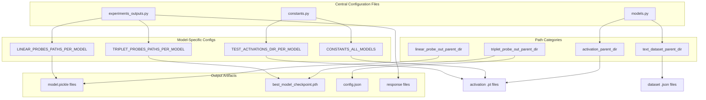
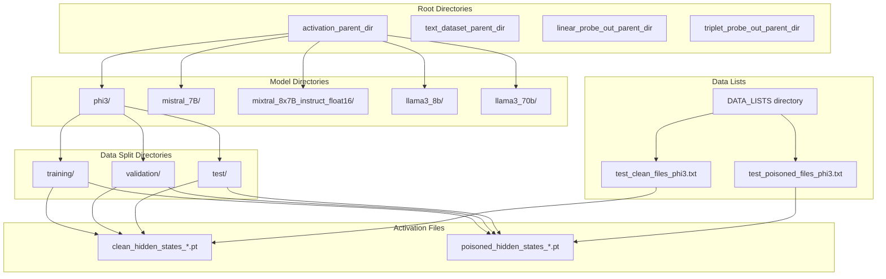
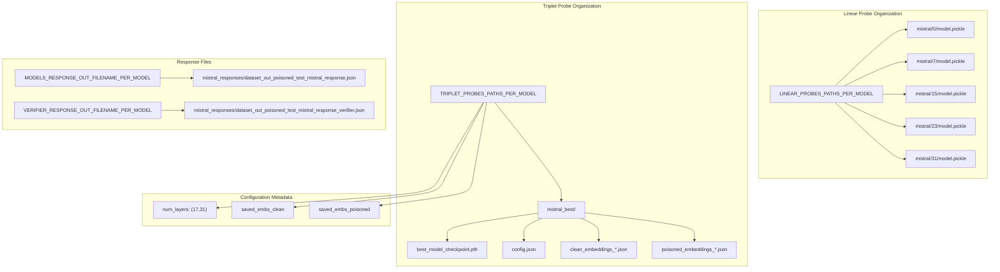

<!-- source: DeepWiki mcp.deepwiki.com · repo microsoft/TaskTracker · page 5 Configuration Management · fetched 2026-10-26 -->

# Configuration Management

<details>
<summary>Relevant source files</summary>

The following files were used as context for generating this wiki page:

- [task_tracker/data/test_clean_files_phi3.txt](task_tracker/data/test_clean_files_phi3.txt)
- [task_tracker/data/test_poisoned_files_phi3.txt](task_tracker/data/test_poisoned_files_phi3.txt)
- [task_tracker/experiments_outputs.py](task_tracker/experiments_outputs.py)
- [task_tracker/training/utils/constants.py](task_tracker/training/utils/constants.py)
- [trained_triplet_probes/mistral_best/best_model_checkpoint.pth](trained_triplet_probes/mistral_best/best_model_checkpoint.pth)
- [trained_triplet_probes/phi3_best/best_model_checkpoint.pth](trained_triplet_probes/phi3_best/best_model_checkpoint.pth)
- [trained_triplet_probes/phi3_best/config.json](trained_triplet_probes/phi3_best/config.json)

</details>


This document covers TaskTracker's configuration management system, which handles path management, experiment organization, and model configuration across different LLMs and training scenarios. The configuration system provides centralized management of file paths, model artifacts, and experiment outputs to ensure reproducible and organized experiments.

For information about dataset creation and data organization, see [Dataset Creation and Recreation](#2.1). For details about model training artifacts and checkpoints, see [Model Training](#3).

## Configuration Architecture Overview

TaskTracker's configuration system is built around three main components: centralized experiment outputs, path management constants, and model-specific configurations. The system supports multiple LLM models (phi3, mistral, mixtral, llama3_8b, llama3_70b) and manages both training and evaluation artifacts.



Sources: [task_tracker/experiments_outputs.py:1-106](), [task_tracker/training/utils/constants.py:1-104]()

## Path Management System

The path management system provides a hierarchical structure for organizing different types of data and model artifacts. Each model has dedicated directories for training, validation, and test data, with consistent naming conventions across the system.



Sources: [task_tracker/training/utils/constants.py:25-81](), [task_tracker/data/test_clean_files_phi3.txt:1-33](), [task_tracker/data/test_poisoned_files_phi3.txt:1-33]()

## Model Configuration Structure

Each model in TaskTracker has a consistent configuration structure that defines paths for activations, training data, and validation data. The `CONSTANTS_ALL_MODELS` dictionary provides model-specific configurations while maintaining a uniform interface.

| Model | Activation Directory | Validation Directory | Special Notes |
|-------|---------------------|---------------------|---------------|
| `phi3` | `/phi3/training` | `/phi3/validation` | Standard configuration |
| `mistral` | `/mistral_7B/training` | `/mistral_7B/validation` | With priming |
| `mistral_no_priming` | `/mistral_no_priming/training` | `/mistral_no_priming/test` | Without priming variant |
| `mixtral` | `/mixtral_8x7B_instruct_float16/` | `/mixtral_8x7B_instruct_float16/validation/` | Float16 precision |
| `llama3_8b` | `/llama3_8b/training` | `/llama3_8b/validation/` | 8B parameter model |
| `llama3_70b` | `/llama_3_70B_Instruct/training` | `/llama_3_70B_Instruct/validation` | 70B parameter model |

The system also maintains separate dictionaries for test data file lists, accessible through `TEST_CLEAN_FILES_PER_MODEL` and `TEST_POISONED_FILES_PER_MODEL`.

Sources: [task_tracker/training/utils/constants.py:25-69](), [task_tracker/training/utils/constants.py:84-101]()

## Experiment Output Organization

Experiment outputs are organized hierarchically by model type and training configuration. Linear probes are stored with layer-specific paths, while triplet probes include additional metadata for layer ranges and embedding files.



Sources: [task_tracker/experiments_outputs.py:25-77](), [task_tracker/experiments_outputs.py:81-106](), [task_tracker/experiments_outputs.py:11-22]()

## Training Configuration Management

Individual training runs are configured through JSON configuration files that specify model parameters, training hyperparameters, and data paths. These configurations ensure reproducible training across different experiments.

Example configuration structure from triplet probe training:

```json
{
  "model": "phi3",
  "activations": "/disk1/activations//phi3/training",
  "activations_ood": "/disk1/activations//phi3/validation",
  "exp_name": "phi3_0_5",
  "margin": 0.3,
  "epochs": 6,
  "num_layers": [0, 5],
  "batch_size": 2500,
  "learning_rate": 0.0005,
  "feature_dim": 175
}
```

Key configuration parameters include:
- **Model identification**: `model` field specifies which LLM is being used
- **Data paths**: `activations` and `activations_ood` specify training and validation data
- **Architecture**: `num_layers`, `feature_dim`, `conv` control model architecture
- **Training**: `epochs`, `batch_size`, `learning_rate`, `margin` control training process
- **Output**: `out_dir` and `exp_name` control where results are saved

Sources: [trained_triplet_probes/phi3_best/config.json:1-1]()

## Data File List Management

The system maintains text files that list activation files for different data splits and models. These lists enable efficient batch processing and ensure consistent data access across training and evaluation.

The data list structure follows the pattern:
- `test_clean_files_{model}.txt` - Lists clean activation files for testing
- `test_poisoned_files_{model}.txt` - Lists poisoned activation files for testing
- Files contain timestamped activation file names: `{type}_hidden_states_{start}_{end}_{timestamp}.pt`

Example file naming convention:
```
clean_hidden_states_0_1000_20240717_105456.pt
poisoned_hidden_states_0_1000_20240717_115335.pt
```

The `constants.py` file automatically loads these lists into dictionaries:
- `TEST_CLEAN_FILES_PER_MODEL` - Clean activation files per model
- `TEST_POISONED_FILES_PER_MODEL` - Poisoned activation files per model

Sources: [task_tracker/training/utils/constants.py:84-101](), [task_tracker/data/test_clean_files_phi3.txt:1-33](), [task_tracker/data/test_poisoned_files_phi3.txt:1-33]()

---

