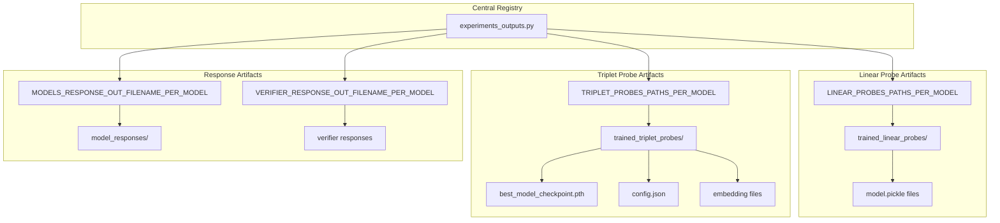
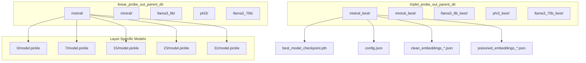
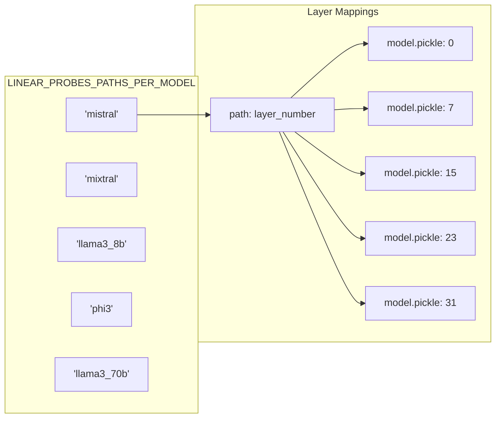
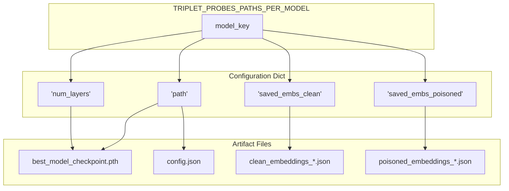
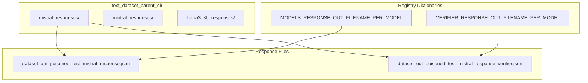
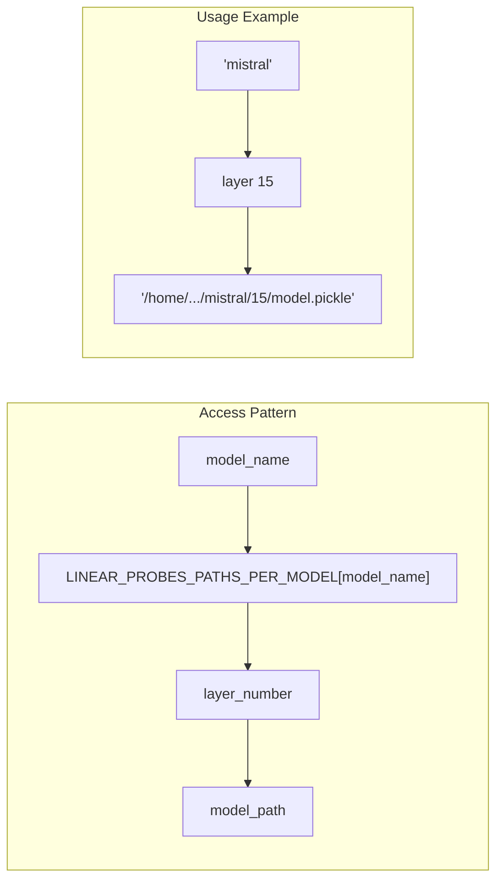

<!-- source: DeepWiki mcp.deepwiki.com · repo microsoft/TaskTracker · page 5.1 Experiment Outputs and Artifacts · fetched 2026-10-26 -->

# Experiment Outputs and Artifacts

Relevant source files

The following files were used as context for generating this wiki page:

- [task_tracker/experiments_outputs.py](task_tracker/experiments_outputs.py)
- [trained_triplet_probes/mistral_best/best_model_checkpoint.pth](trained_triplet_probes/mistral_best/best_model_checkpoint.pth)
- [trained_triplet_probes/phi3_best/best_model_checkpoint.pth](trained_triplet_probes/phi3_best/best_model_checkpoint.pth)
- [trained_triplet_probes/phi3_best/config.json](trained_triplet_probes/phi3_best/config.json)

This document covers TaskTracker's system for organizing and managing experiment outputs and artifacts. It explains the directory structure, file naming conventions, and centralized configuration that enables reproducible access to trained models, model responses, verification results, and associated metadata.

For information about the underlying path management utilities and constants, see [Constants and Path Management](#5.2). For details about how these artifacts are created during training, see [Linear Probes](#3.1) and [Triplet Probes](#3.2).

## Artifact Organization Overview

TaskTracker maintains a structured approach to organizing experiment outputs across multiple artifact types. The system uses centralized path registries to ensure consistent access to trained models, evaluation results, and associated metadata files.

**Sources:** [task_tracker/experiments_outputs.py:1-106]()

## Directory Structure and Path Management

The artifact organization follows a hierarchical structure with dedicated parent directories for each artifact type. The system maintains separation between different model architectures and training configurations.

| Artifact Type | Parent Directory | Structure |
|---------------|------------------|-----------|
| Linear Probes | `/home/saabdelnabi/TaskTracker/trained_linear_probes/` | `{model_name}/{layer_number}/model.pickle` |
| Triplet Probes | `/home/saabdelnabi/TaskTracker/trained_triplet_probes/` | `{model_name}_best/` |
| Model Responses | `{text_dataset_parent_dir}/{model_name}_responses/` | `dataset_out_poisoned_test_{model}_response.json` |
| Verifier Responses | `{text_dataset_parent_dir}/{model_name}_responses/` | `dataset_out_poisoned_test_{model}_response_verifier.json` |

**Sources:** [task_tracker/experiments_outputs.py:7-10](), [task_tracker/experiments_outputs.py:25-77](), [task_tracker/experiments_outputs.py:81-106]()

## Linear Probe Artifacts

Linear probe artifacts are organized by model and layer, with each trained probe stored as a pickled `LogisticRegression` model. The `LINEAR_PROBES_PATHS_PER_MODEL` dictionary provides direct access to these models with their corresponding layer indices.

### Path Structure for Linear Probes

### Model-Specific Layer Coverage

Different models have varying numbers of layers, reflected in their probe coverage:

| Model | Standard Layers | Extended Layers (70B only) |
|-------|----------------|----------------------------|
| mistral, mixtral, llama3_8b, phi3 | 0, 7, 15, 23, 31 | N/A |
| llama3_70b | 0, 7, 15, 23, 31 | 39, 47, 55, 63, 71, 79 |

**Sources:** [task_tracker/experiments_outputs.py:26-76]()

## Triplet Probe Artifacts

Triplet probe artifacts include trained models, configuration files, and pre-computed embeddings. Each model configuration specifies the optimal layer range and associated embedding files.

### Triplet Probe Configuration Structure

### Layer Range Specifications

Each triplet probe is optimized for specific layer ranges:

| Model | Layer Range | Path | Clean Embeddings | Poisoned Embeddings |
|-------|-------------|------|------------------|---------------------|
| mistral | (17, 31) | `mistral_best` | `clean_embeddings_20240718-141006.json` | `poisoned_embeddings_20240718-141438.json` |
| mixtral | (0, 5) | `mixtral_best` | `clean_embeddings_20240725-161155.json` | `poisoned_embeddings_20240725-161339.json` |
| llama3_70b | (1, 15) | `llama3_70b_best` | `clean_embeddings_20240725-162801.json` | `poisoned_embeddings_20240725-163550.json` |
| llama3_8b | (0, 5) | `llama3_8b_best` | `clean_embeddings_20240725-155626.json` | `poisoned_embeddings_20240725-160631.json` |
| phi3 | (0, 5) | `phi3_best` | `clean_embeddings_20240725-154429.json` | `poisoned_embeddings_20240725-154632.json` |

**Sources:** [task_tracker/experiments_outputs.py:81-106]()

## Model Response and Verification Artifacts

TaskTracker maintains model responses and their corresponding GPT-4 verification results in dedicated response directories. These artifacts support evaluation and analysis workflows.

### Response File Organization

### Supported Models for Response Generation

The system currently supports response generation and verification for three primary models:

| Model Key | Response File | Verifier File |
|-----------|---------------|---------------|
| `mistral` | `dataset_out_poisoned_test_mistral_response.json` | `dataset_out_poisoned_test_mistral_response_verifier.json` |
| `mixtral` | `dataset_out_poisoned_test_mixtral_response.json` | `dataset_out_poisoned_test_mixtral_response_verifier.json` |
| `llama3_8b` | `dataset_out_poisoned_test_llama3_8b_response.json` | `dataset_out_poisoned_test_llama3_8b_response_verifier.json` |

**Sources:** [task_tracker/experiments_outputs.py:11-22]()

## Configuration File Structure

Training configurations are preserved alongside trained models to ensure reproducibility. The triplet probe configuration files contain comprehensive training parameters and data paths.

### Example Configuration Schema

Based on the phi3 best model configuration, training configs include:

| Parameter | Purpose | Example Value |
|-----------|---------|---------------|
| `model` | Target model identifier | `"phi3"` |
| `activations` | Training activation path | `"/disk1/activations//phi3/training"` |
| `activations_ood` | Validation activation path | `"/disk1/activations//phi3/validation"` |
| `num_layers` | Layer range for training | `[0, 5]` |
| `margin` | Triplet loss margin | `0.3` |
| `epochs` | Training epochs | `6` |
| `batch_size` | Training batch size | `2500` |
| `learning_rate` | Optimizer learning rate | `0.0005` |
| `feature_dim` | Output feature dimension | `175` |

**Sources:** [trained_triplet_probes/phi3_best/config.json:1-1]()

## Artifact Access Patterns

The centralized registries in `experiments_outputs.py` enable programmatic access to artifacts through standardized dictionary lookups. This design supports both individual model analysis and cross-model comparative studies.

The system's artifact organization supports both automated workflows and manual inspection, ensuring that experiment results remain accessible and reproducible across different analysis contexts.

**Sources:** [task_tracker/experiments_outputs.py:1-106]()

---

