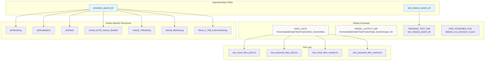
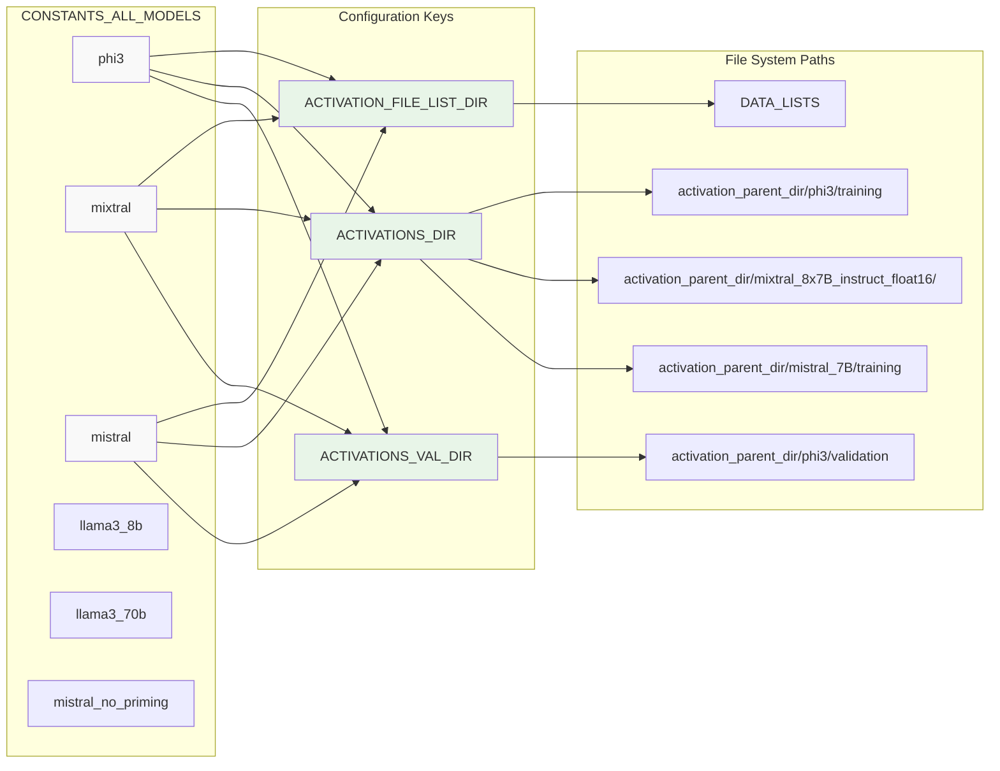

<!-- source: DeepWiki mcp.deepwiki.com · repo microsoft/TaskTracker · page 5.2 Constants and Path Management · fetched 2026-10-26 -->

# Constants and Path Management

<details>
<summary>Relevant source files</summary>

The following files were used as context for generating this wiki page:

- [task_tracker/data/test_clean_files_phi3.txt](task_tracker/data/test_clean_files_phi3.txt)
- [task_tracker/data/test_poisoned_files_phi3.txt](task_tracker/data/test_poisoned_files_phi3.txt)
- [task_tracker/training/utils/constants.py](task_tracker/training/utils/constants.py)

</details>


## Purpose and Scope

This document covers TaskTracker's centralized constants and path management system, which provides standardized configurations for file paths, activation directories, and model-specific settings across the entire system. The constants system ensures consistent data organization and simplifies experiment management by centralizing path definitions.

For information about experiment outputs and artifact management, see [Experiment Outputs and Artifacts](#5.1). For details about the overall configuration architecture, see [System Architecture](#1.2).

## Constants System Overview

TaskTracker's constants management is centralized in the `constants.py` file, which defines global paths and model-specific configurations. The system is designed to handle multiple LLM models with different directory structures while maintaining consistency across experiments.

The constants system provides:
- Global directory paths for common resources
- Model-specific activation and text data directories  
- Dynamic loading of activation file lists
- Separation of training, validation, and test data paths

**Sources:** [task_tracker/training/utils/constants.py:1-104]()

## Path Hierarchy Structure

The following diagram shows how TaskTracker organizes its directory structure and path management:



**Sources:** [task_tracker/training/utils/constants.py:10-21](), [task_tracker/training/utils/constants.py:3-4]()

## Model Configuration Mapping

The `CONSTANTS_ALL_MODELS` dictionary provides model-specific path configurations. Each model has standardized directory structures for different data types:

| Model | Activation Directory Pattern | Validation Directory Pattern |
|-------|------------------------------|------------------------------|
| `phi3` | `{activation_parent_dir}/phi3/training` | `{activation_parent_dir}/phi3/validation` |
| `mixtral` | `{activation_parent_dir}mixtral_8x7B_instruct_float16/` | `{activation_parent_dir}/mixtral_8x7B_instruct_float16/validation/` |
| `mistral` | `{activation_parent_dir}/mistral_7B/training` | `{activation_parent_dir}/mistral_7B/validation` |
| `llama3_8b` | `{activation_parent_dir}/llama3_8b/training` | `{activation_parent_dir}/llama3_8b/validation/` |
| `llama3_70b` | `{activation_parent_dir}/llama_3_70B_Instruct/training` | `{activation_parent_dir}/llama_3_70B_Instruct/validation` |
| `mistral_no_priming` | `{activation_parent_dir}/mistral_no_priming/training` | `{activation_parent_dir}/mistral_no_priming/test` |

**Sources:** [task_tracker/training/utils/constants.py:25-69]()

## Model-Specific Configuration Architecture

The following diagram illustrates how model configurations map to file system paths and activation files:



**Sources:** [task_tracker/training/utils/constants.py:25-69]()

## Test Data Path Management

TaskTracker maintains separate dictionaries for test activation directories and file lists. The `TEST_ACTIVATIONS_DIR_PER_MODEL` dictionary maps each model to its test activation directory:

```python
TEST_ACTIVATIONS_DIR_PER_MODEL = {
    'mistral': activation_parent_dir + '/mistral_7B/test',
    'mixtral': activation_parent_dir + '/mixtral_8x7B_instruct_float16/test',
    'llama3_8b': activation_parent_dir + '/llama3_8b/test/',
    'phi3': activation_parent_dir + '/phi3/test',
    'mistral_no_priming': activation_parent_dir + '/mistral_no_priming/test',
    'llama3_70b': activation_parent_dir + '/llama_3_70B_Instruct/test'
}
```

**Sources:** [task_tracker/training/utils/constants.py:72-81]()

## Dynamic File List Loading

The constants system dynamically loads activation file lists from text files stored in the `DATA_LISTS` directory. This approach provides flexibility for managing large numbers of activation files without hardcoding filenames.

### Clean and Poisoned File Management

Two dictionaries manage test file lists for clean and poisoned data:

- `TEST_CLEAN_FILES_PER_MODEL`: Loads clean activation file lists
- `TEST_POISONED_FILES_PER_MODEL`: Loads poisoned activation file lists

Each dictionary reads from model-specific text files using list comprehensions:

```python
TEST_CLEAN_FILES_PER_MODEL = {
    'phi3': [file.strip() for file in open(os.path.join(DATA_LISTS, 'test_clean_files_phi3.txt'))]
}
```

The text files contain activation filenames with timestamp patterns, such as:
- `clean_hidden_states_0_1000_20240717_105456.pt`
- `poisoned_hidden_states_0_1000_20240717_115335.pt`

**Sources:** [task_tracker/training/utils/constants.py:84-101](), [task_tracker/data/test_clean_files_phi3.txt:1-32](), [task_tracker/data/test_poisoned_files_phi3.txt:1-32]()

## File Naming Conventions

TaskTracker follows consistent naming conventions for activation files:

### Activation File Pattern
- **Clean data**: `clean_hidden_states_{start}_{end}_{timestamp}.pt`
- **Poisoned data**: `poisoned_hidden_states_{start}_{end}_{timestamp}.pt`

Where:
- `{start}` and `{end}` represent the sample range (e.g., 0_1000)
- `{timestamp}` follows the format `YYYYMMDD_HHMMSS`

### Directory Structure Pattern
- **Training**: `{model_name}/training/`
- **Validation**: `{model_name}/validation/`
- **Test**: `{model_name}/test/`

**Sources:** [task_tracker/data/test_clean_files_phi3.txt:1-32](), [task_tracker/data/test_poisoned_files_phi3.txt:1-32]()

## Integration with Model Configuration

The constants system integrates with the broader model configuration system by importing base directory paths from `task_tracker.config.models`. The `text_dataset_parent_dir` and `activation_parent_dir` variables provide the foundation for all model-specific path construction.

This design allows the constants system to remain flexible while maintaining centralized control over base directory locations. The separation between global constants and model-specific configurations enables easy addition of new models without modifying the core path management logic.

**Sources:** [task_tracker/training/utils/constants.py:3-4](), [task_tracker/training/utils/constants.py:18-21]()

---

