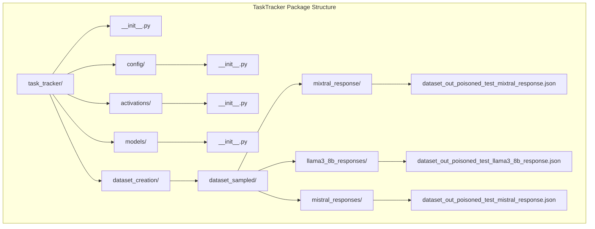
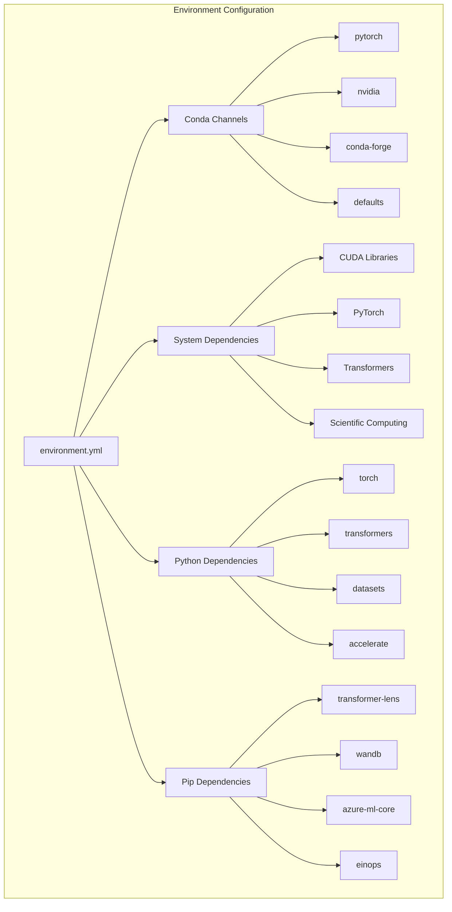
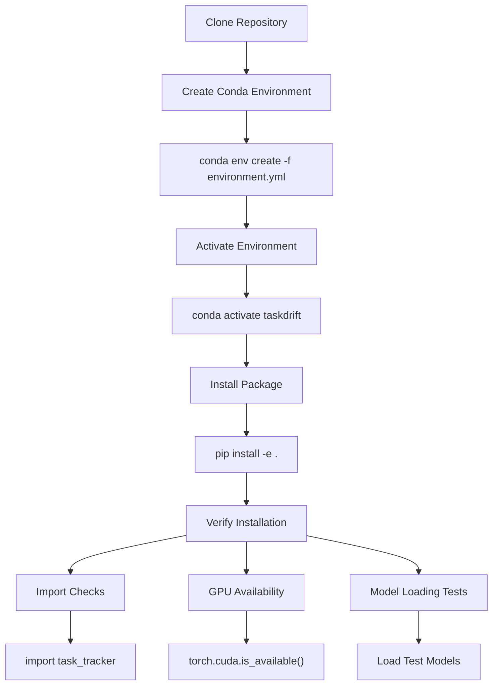
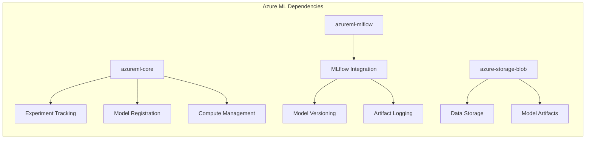

<!-- source: DeepWiki mcp.deepwiki.com · repo microsoft/TaskTracker · page 5.3 Environment Setup · fetched 2026-10-26 -->

# Environment Setup

<details>
<summary>Relevant source files</summary>

The following files were used as context for generating this wiki page:

- [environment.yml](environment.yml)
- [setup.py](setup.py)
- [task_tracker/__init__.py](task_tracker/__init__.py)
- [task_tracker/activations/__init__.py](task_tracker/activations/__init__.py)
- [task_tracker/config/__init__.py](task_tracker/config/__init__.py)
- [task_tracker/dataset_creation/dataset_sampled/llama3_8b_responses/dataset_out_poisoned_test_llama3_8b_response.json](task_tracker/dataset_creation/dataset_sampled/llama3_8b_responses/dataset_out_poisoned_test_llama3_8b_response.json)
- [task_tracker/dataset_creation/dataset_sampled/llama3_8b_responses/dataset_out_poisoned_test_llama3_8b_response_verifier.json](task_tracker/dataset_creation/dataset_sampled/llama3_8b_responses/dataset_out_poisoned_test_llama3_8b_response_verifier.json)
- [task_tracker/dataset_creation/dataset_sampled/mistral_responses/dataset_out_poisoned_test_mistral_response.json](task_tracker/dataset_creation/dataset_sampled/mistral_responses/dataset_out_poisoned_test_mistral_response.json)
- [task_tracker/dataset_creation/dataset_sampled/mistral_responses/dataset_out_poisoned_test_mistral_response_verifier.json](task_tracker/dataset_creation/dataset_sampled/mistral_responses/dataset_out_poisoned_test_mistral_response_verifier.json)
- [task_tracker/dataset_creation/dataset_sampled/mixtral_response/dataset_out_poisoned_test_mixtral_response.json](task_tracker/dataset_creation/dataset_sampled/mixtral_response/dataset_out_poisoned_test_mixtral_response.json)
- [task_tracker/dataset_creation/dataset_sampled/mixtral_response/dataset_out_poisoned_test_mixtral_response_verifier.json](task_tracker/dataset_creation/dataset_sampled/mixtral_response/dataset_out_poisoned_test_mixtral_response_verifier.json)
- [task_tracker/models/__init__.py](task_tracker/models/__init__.py)

</details>


This document covers TaskTracker's package structure, dependencies, and environment configuration requirements. It provides guidance for setting up a development environment and understanding the project's organizational structure.

For information about configuration management and path organization, see [Configuration Management](#5) and [Constants and Path Management](#5.2).

## Package Structure

TaskTracker is organized as a Python package with several core modules that handle different aspects of the system functionality.



Sources: [task_tracker/__init__.py:1](), [task_tracker/config/__init__.py:1](), [task_tracker/activations/__init__.py:1](), [task_tracker/models/__init__.py:1](), [task_tracker/dataset_creation/dataset_sampled/mixtral_response/dataset_out_poisoned_test_mixtral_response.json:1]()

The package follows a modular design with clear separation of concerns:

| Module | Purpose |
|--------|---------|
| `task_tracker` | Root package containing core functionality |
| `config` | Configuration management and settings |
| `activations` | LLM activation processing and analysis |
| `models` | Model definitions and utilities |
| `dataset_creation` | Dataset generation and management |

## Environment Dependencies

TaskTracker uses conda for environment management with support for GPU acceleration and machine learning workflows.



Sources: [environment.yml:1-302]()

### Core Dependencies

The environment includes several critical dependency categories:

**GPU and CUDA Support:**
- CUDA runtime libraries (version 12.1)
- PyTorch with CUDA support
- GPU-accelerated libraries for model inference

**Machine Learning Frameworks:**
- PyTorch 2.3.0 with CUDA 12.1 support
- Transformers 4.41.2 for LLM handling
- Datasets 2.19.0 for data management
- Accelerate 0.30.0 for distributed training

**Specialized Libraries:**
- `transformer-lens` for activation analysis
- `wandb` for experiment tracking
- `einops` for tensor manipulation
- `safetensors` for secure model serialization

## Development Setup Process

The setup process involves both conda environment creation and Python package installation.



Sources: [environment.yml:1-2](), [setup.py:1-24]()

### Environment Name and Location

The conda environment is configured with:
- **Name:** `taskdrift` 
- **Default Location:** `/home/azureuser/.conda/envs/taskdrift`
- **Python Version:** 3.12.2

### Package Installation

The `setup.py` configuration defines the installable package:

```python
name="task_tracker"
version="0.1"
packages=find_packages()
install_requires=["torch"]
```

Sources: [setup.py:3-11]()

## GPU and CUDA Configuration

TaskTracker requires GPU support for efficient LLM processing and activation extraction.

| Component | Version | Purpose |
|-----------|---------|---------|
| CUDA Runtime | 12.1.105 | GPU computation support |
| PyTorch CUDA | 12.1 | GPU-accelerated tensor operations |
| cuDNN | 8.9.2 | Deep learning primitives |
| NVIDIA Libraries | Various | Specialized GPU operations |

The environment includes comprehensive CUDA library support:
- `cuda-cudart`, `cuda-cupti`, `cuda-libraries`
- `libcublas`, `libcufft`, `libcurand`, `libcusolver`
- GPU-optimized versions of PyTorch and related libraries

Sources: [environment.yml:55-61](), [environment.yml:130-158](), [environment.yml:239-241]()

## Azure ML Integration

TaskTracker includes Azure Machine Learning integration for cloud-based experimentation and model management.



Sources: [environment.yml:318-319](), [environment.yml:317]()

The Azure integration enables:
- Remote experiment execution and tracking
- Model artifact storage and versioning
- Integration with Azure compute resources
- Distributed training capabilities

## Dependency Management

The project uses a hybrid approach combining conda and pip for dependency management, optimizing for both performance and compatibility.

**Conda Dependencies:** Core system libraries, CUDA support, and performance-critical packages
**Pip Dependencies:** Specialized ML libraries and packages not available through conda

This approach ensures reliable GPU support while maintaining access to the latest ML research tools and libraries.

Sources: [environment.yml:303-358](), [setup.py:8-11]()

---

