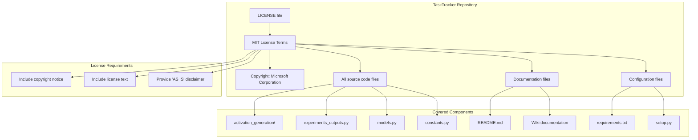
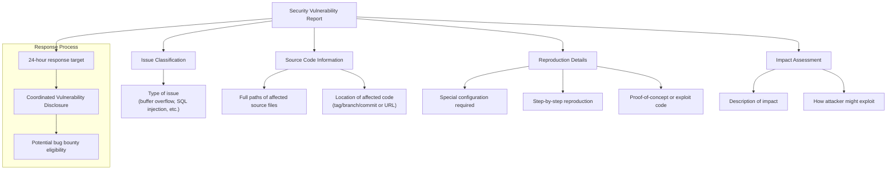
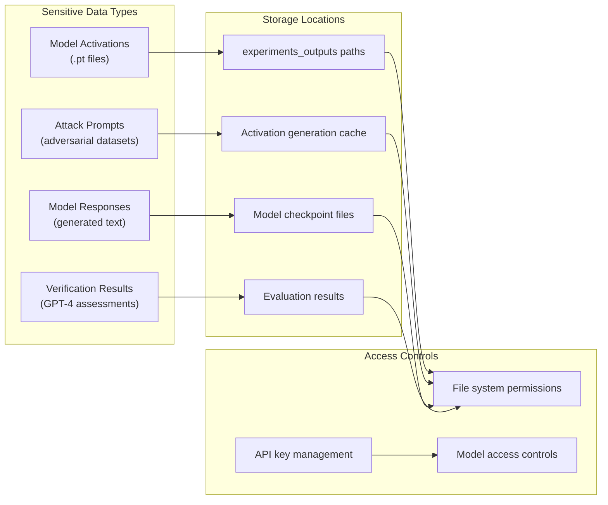

<!-- source: DeepWiki mcp.deepwiki.com · repo microsoft/TaskTracker · page 6 Legal and Security · fetched 2026-10-26 -->

# Legal and Security

Relevant source files

The following files were used as context for generating this wiki page:

- [LICENSE](LICENSE)
- [SECURITY.md](SECURITY.md)

This document covers the licensing terms and security vulnerability reporting procedures for the TaskTracker system. It provides essential legal and security information for developers, researchers, and users working with the TaskTracker codebase.

For information about system configuration and environment setup, see [Environment Setup](#5.3). For details about the overall system architecture, see [System Architecture](#1.2).

## Licensing

The TaskTracker project is released under the MIT License, as specified in the [LICENSE:1-22]() file. This license grants broad permissions for use, modification, and distribution of the software.

### License Terms

The MIT License provides the following key permissions and conditions:

| Permission | Description |
|------------|-------------|
| **Use** | Use the software for any purpose |
| **Modify** | Modify the source code |
| **Distribute** | Distribute copies of the software |
| **Sublicense** | Grant sublicenses to third parties |
| **Sell** | Sell copies of the software |

The license requires that the copyright notice and license text be included in all copies or substantial portions of the software, as specified in [LICENSE:12-13]().

### License Coverage

**License Coverage Diagram**
*Shows how the MIT License applies to all components of the TaskTracker system*

Sources: [LICENSE:1-22]()

### Warranty Disclaimer

The software is provided "AS IS" without warranty of any kind, as stated in [LICENSE:15-21](). The copyright holders disclaim all warranties including:

- **MERCHANTABILITY**: No guarantee the software is suitable for commercial use
- **FITNESS FOR PARTICULAR PURPOSE**: No guarantee the software meets specific requirements  
- **NONINFRINGEMENT**: No guarantee the software doesn't violate third-party rights

## Security Vulnerability Reporting

TaskTracker follows Microsoft's standard security vulnerability disclosure process as outlined in [SECURITY.md:1-42](). Microsoft takes security seriously across all repositories under their GitHub organizations.

### Reporting Process

**Do not report security vulnerabilities through public GitHub issues** as specified in [SECURITY.md:11](). Instead, use the following channels:

| Reporting Method | Details |
|------------------|---------|
| **Primary** | Microsoft Security Response Center (MSRC) URL: https://msrc.microsoft.com/create-report |
| **Alternative** | Email: secure@microsoft.com |
| **Encrypted** | Use Microsoft's PGP key for sensitive reports |

### Required Information

When reporting a security vulnerability, include the following information as specified in [SECURITY.md:19-28]():

**Security Reporting Process Flow**
*Shows the required information and process flow for security vulnerability reports*

Sources: [SECURITY.md:9-31]()

### Response Timeline

- **Initial Response**: Within 24 hours as stated in [SECURITY.md:17]()
- **Follow-up**: Additional communication at microsoft.com/msrc
- **Process**: Microsoft follows Coordinated Vulnerability Disclosure principles per [SECURITY.md:39]()

### Bug Bounty Program

Security reports may be eligible for Microsoft's Bug Bounty Program. More complete reports with detailed reproduction steps and impact analysis can contribute to higher bounty awards, as mentioned in [SECURITY.md:31]().

## Security Considerations for TaskTracker

### Model Security

TaskTracker works with large language models and analyzes their behavior for task drift detection. Key security considerations include:

- **Model Inputs**: The system processes potentially adversarial prompts from attack datasets
- **Activation Data**: Stores sensitive model activation data in `.pt` tensor files
- **External Dependencies**: Relies on external LLM APIs and libraries

### Data Protection

**Data Security Architecture**
*Shows sensitive data types, storage locations, and access control considerations*

Sources: [SECURITY.md:1-42](), [LICENSE:15-21]()

### Communication Preferences

All security communications should be conducted in English, as specified in [SECURITY.md:35](). This ensures clear communication during the vulnerability disclosure process.

Sources: [SECURITY.md:1-42](), [LICENSE:1-22]()