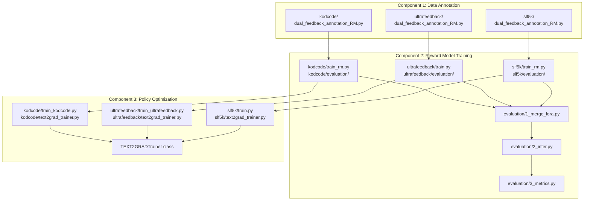
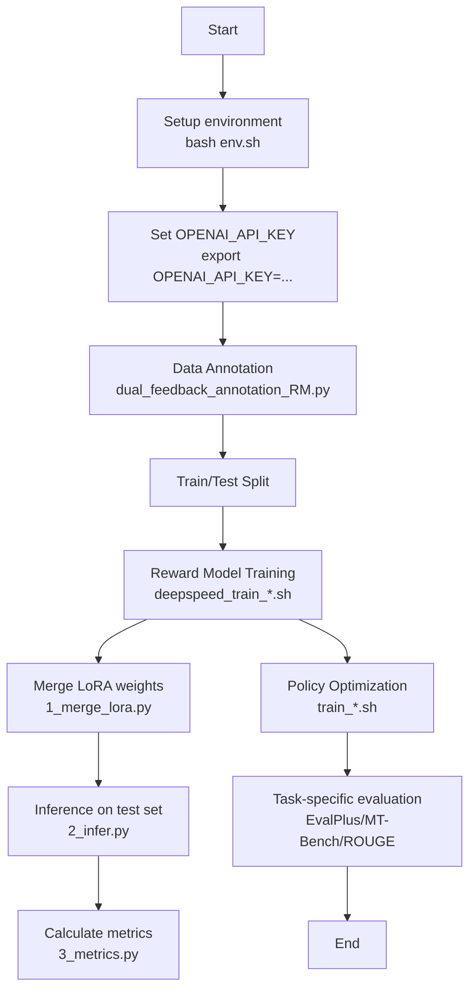

<!-- source: DeepWiki mcp.deepwiki.com · repo microsoft/Text2Grad · page 1 Home · fetched 2026-10-26 -->

# Home

<details>
<summary>Relevant source files</summary>

The following files were used as context for generating this wiki page:

- [README.md](README.md)

</details>


## Purpose and Scope

This wiki documents the Text2Grad system, a reinforcement learning framework that converts natural language feedback into fine-grained gradient signals for language model optimization. Text2Grad operates on span-level and word-level feedback rather than scalar rewards, enabling precise, interpretable model improvements across code generation, question answering, and summarization tasks.

This page provides an overview of the system architecture and its three-component pipeline. For installation instructions, see [Installation](#2.1). For detailed component documentation, see [System Architecture](#3). For task-specific workflows, see [Task-Specific Guides](#7).

**Sources:** [README.md:1-52]()

---

## System Overview

Text2Grad is a research framework for training language models using natural language feedback. Traditional RLHF (Reinforcement Learning from Human Feedback) assigns scalar rewards to entire generated sequences, losing fine-grained information about which specific parts of the output are good or problematic. Text2Grad addresses this by:

1. **Annotating** natural language feedback with specific token spans
2. **Training reward models** to predict word-level scores and generate critiques
3. **Optimizing policies** using span-level gradients through PPO

The system is task-agnostic and supports three domains:
- **Code Generation** (KodCode dataset) - evaluated on HumanEval+ and MBPP+
- **Question Answering** (UltraFeedback dataset) - evaluated on MT-Bench and ARC-C
- **Summarization** (SLF5K dataset) - evaluated with ROUGE, BERTScore, and GPT-4

**Sources:** [README.md:33-38](), [README.md:53-62]()

---

## Three-Component Architecture

### Architecture Diagram: Core Components and File Structure



**Sources:** [README.md:127-145]()

### Component Descriptions

| Component | Directory | Key Files | Purpose |
|-----------|-----------|-----------|---------|
| **Data Annotation** | `rm_data_anno/` | `dual_feedback_annotation_RM.py` | Converts raw natural language feedback into structured dual-feedback format with span annotations |
| **Reward Model** | `nl_reward_model/` | `train_rm.py`, `train.py`, evaluation scripts | Trains models to predict word-level scores and generate critiques from annotated data |
| **Policy Optimization** | `nl_gradient_policy_optimization/` | `train_*.py`, `text2grad_trainer.py` | Implements PPO training with `TEXT2GRADTrainer` using reward model feedback |

**Sources:** [README.md:127-145](), [README.md:147-218]()

---

## Data Flow and Key Classes

### System Data Flow Diagram

```mermaid
graph LR
    subgraph Input["Input Data"]
        DS_K["KodCode-Light-RL-10K"]
        DS_U["ultrafeedback_binarized"]
        DS_S["SLF5K"]
    end
    
    subgraph Annotation["Annotation Scripts"]
        ANNO["dual_feedback_annotation_RM.py<br/>generate_annotated_data()"]
    end
    
    subgraph RMTraining["RM Training"]
        QAC["QACDataset class<br/>__getitem__()"]
        DS_TRAIN["DeepSpeed with ZeRO-3<br/>train_rm.py main()"]
        LORA["LoraConfig<br/>r=16, alpha=32"]
    end
    
    subgraph RMInfer["RM Inference"]
        VLLM["vllm.LLM pipeline<br/>2_infer.py"]
        PARSE["parse_response()<br/>extract spans/scores"]
    end
    
    subgraph PolicyOpt["Policy Optimization"]
        T2G["TEXT2GRADTrainer<br/>step()"]
        GEN["generate()<br/>policy responses"]
        REWARD["get_reward_from_rm()<br/>fuzzy matching"]
        REMATCH["rematch_scores()<br/>token alignment"]
        PPO["ppo_update()<br/>clipped objective"]
    end
    
    DS_K --> ANNO
    DS_U --> ANNO
    DS_S --> ANNO
    
    ANNO --> QAC
    QAC --> DS_TRAIN
    LORA --> DS_TRAIN
    
    DS_TRAIN --> VLLM
    VLLM --> PARSE
    
    PARSE --> T2G
    T2G --> GEN
    GEN --> REWARD
    REWARD --> REMATCH
    REMATCH --> PPO
    PPO --> T2G
```



**Sources:** [README.md:94-122](), [README.md:147-218](), [README.md:220-273]()

### Core Class Abstractions

The system is built around several key abstractions:

| Class/Function | Location | Purpose |
|----------------|----------|---------|
| `QACDataset` | `nl_reward_model/*/train*.py` | Tokenizes and formats question-answer-critique triples for reward model training |
| `TEXT2GRADTrainer` | `nl_gradient_policy_optimization/*/text2grad_trainer.py` | Extends TRL's PPO trainer with span-level reward processing |
| `PPOConfig` | Configuration object | Defines hyperparameters for PPO training (learning rate, KL penalty, batch sizes) |
| `LoraConfig` | From PEFT library | Configures parameter-efficient fine-tuning (rank, alpha, target modules) |
| `parse_response()` | `nl_reward_model/*/evaluation/2_infer.py` | Extracts structured feedback from LLM JSON outputs with fallback parsing |
| `rematch_scores()` | `nl_gradient_policy_optimization/*/text2grad_trainer.py` | Aligns word-level scores to token-level rewards for gradient computation |

**Sources:** [README.md:220-273]()

---

## Multi-Task Support

Text2Grad follows a parallel pipeline structure where each task domain has its own data processing, reward model, and policy optimization components, but all share the same underlying abstractions.

### Task-Specific Pipeline Structure

```mermaid
graph TB
    subgraph KodCode["Code Generation (KodCode)"]
        K_DATA["KodCode-Light-RL-10K<br/>question + solution + test"]
        K_ANNO["rm_data_anno/kodcode/<br/>dual_feedback_annotation_RM.py"]
        K_RM["nl_reward_model/kodcode/<br/>train_rm.py"]
        K_PPO["nl_gradient_policy_optimization/kodcode/<br/>train_kodcode.py + text2grad_trainer.py"]
        K_EVAL["EvalPlus benchmarks<br/>HumanEval+, MBPP+"]
        
        K_DATA --> K_ANNO
        K_ANNO --> K_RM
        K_RM --> K_PPO
        K_PPO --> K_EVAL
    end
    
    subgraph UltraFeedback["Question Answering (UltraFeedback)"]
        U_DATA["ultrafeedback_binarized<br/>prompt + chosen + rejected"]
        U_ANNO["rm_data_anno/ultrafeedback/<br/>dual_feedback_annotation_RM.py"]
        U_RM["nl_reward_model/ultrafeedback/<br/>train.py"]
        U_PPO["nl_gradient_policy_optimization/ultrafeedback/<br/>train_ultrafeedback.py + text2grad_trainer.py"]
        U_EVAL["MT-Bench, ARC-C<br/>AlpacaEval 2.0"]
        
        U_DATA --> U_ANNO
        U_ANNO --> U_RM
        U_RM --> U_PPO
        U_PPO --> U_EVAL
    end
    
    subgraph SLF5K["Summarization (SLF5K)"]
        S_DATA["SLF5K<br/>post + generated_summary"]
        S_ANNO["rm_data_anno/slf5k/<br/>dual_feedback_annotation_RM.py"]
        S_RM["nl_reward_model/slf5k/<br/>train_rm.py"]
        S_PPO["nl_gradient_policy_optimization/slf5k/<br/>train.py + text2grad_trainer.py"]
        S_EVAL["ROUGE, BLEU, BERTScore<br/>GPT-4 as judge"]
        
        S_DATA --> S_ANNO
        S_ANNO --> S_RM
        S_RM --> S_PPO
        S_PPO --> S_EVAL
    end
```



**Sources:** [README.md:94-122](), [README.md:127-145]()

### Dataset Formats

Each task uses a specific JSON format for input data:

**KodCode Format:**
```json
{
    "question": "You are given a 0-indexed...",
    "solution": "def function_name():\n    ...",
    "test": "def test_function():\n    assert ...",
    "question_id": "Leetcode_36406_I"
}
```

**UltraFeedback Format:**
```json
{
    "prompt": "In this task...",
    "prompt_id": "333685aaf...",
    "response": [
        {"content": "...", "role": "user"},
        {"content": "...", "role": "assistant"}
    ],
    "is_chosen": true,
    "score": 4.0
}
```

**SLF5K Format:**
```json
{
    "t3_132suw": {
        "Post": "My girlfriend is studying...",
        "generated_summary": "My girlfriend is premed..."
    }
}
```

**Sources:** [README.md:160-217]()

---

## Technology Stack and Dependencies

Text2Grad integrates with the Hugging Face ecosystem and leverages several key libraries:

| Component | Library | Purpose |
|-----------|---------|---------|
| Model Loading | `transformers` | AutoModel, AutoTokenizer for LLM access |
| Parameter-Efficient Tuning | `peft` | LoRA adapters for memory-efficient training |
| Distributed Training | `accelerate`, `deepspeed` | Multi-GPU training with ZeRO optimization |
| PPO Implementation | `trl` | Base PPO trainer extended by `TEXT2GRADTrainer` |
| Fast Inference | `vllm` | Batch inference for reward model evaluation |
| Experiment Tracking | `wandb` | Logging metrics and training progress |
| Code Evaluation | `evalplus` | Functional correctness testing for code generation |

The system uses Llama-3.1-8B-Instruct as the base model for both reward models and policy models, with LoRA adapters (rank=16, alpha=32) for efficient fine-tuning.

**Sources:** [README.md:76-92](), [README.md:220-273]()

---

## Training Workflow

### Standard Training Pipeline



**Sources:** [README.md:147-294]()

### Typical Command Sequence

For code generation (KodCode):

```bash
# 1. Annotate data
cd rm_data_anno/kodcode
python dual_feedback_annotation_RM.py --data_path path/to/kodcode

# 2. Train reward model
cd ../../nl_reward_model/kodcode
bash deepspeed_train_kodcode.sh

# 3. Evaluate reward model
cd evaluation
python 1_merge_lora.py --base_model meta-llama/Llama-3.1-8B-Instruct \
    --lora_model ../ckpt/llama31-8B-kodcode/0_4400 \
    --save_dir ../ckpt/llama31-8B-kodcode/0_4400_merge

python 2_infer.py --model_path ../ckpt/llama31-8B-kodcode/0_4400_merge \
    --dataset_path ../data/KodCode/kodcode_test.json

python 3_metrics.py --input_file inference_results_0_4400.json

# 4. Train policy with NL-gradients
cd ../../../nl_gradient_policy_optimization/kodcode
bash train_kodcode.sh
```

**Sources:** [README.md:147-273](), [README.md:277-293]()

---

## Key Innovation: Span-Level Feedback

The core innovation of Text2Grad is converting natural language feedback into token-level gradient signals. Traditional RLHF assigns a single scalar reward to an entire sequence. Text2Grad instead:

1. **Identifies specific spans** of text that are good (+1), neutral (0), or poor (-1)
2. **Generates natural language critiques** explaining why each span has its score
3. **Uses fuzzy string matching** to locate spans in generated text
4. **Aligns word-level scores to tokens** via the `rematch_scores()` function
5. **Backpropagates token-level rewards** through PPO for fine-grained optimization

This enables the model to learn precisely which parts of its output need improvement, rather than receiving only holistic feedback.

**Sources:** [README.md:33-38](), [README.md:53-62]()

---

## Directory Organization

The repository follows a three-tier structure mirroring the three pipeline components:

```
Text2Grad/
├── rm_data_anno/              # Tier 1: Data annotation
│   ├── kodcode/
│   ├── slf5k/
│   └── ultrafeedback/
│
├── nl_reward_model/           # Tier 2: Reward model training
│   ├── kodcode/
│   │   ├── train_rm.py
│   │   ├── evaluation/
│   │   │   ├── 1_merge_lora.py
│   │   │   ├── 2_infer.py
│   │   │   └── 3_metrics.py
│   ├── slf5k/
│   └── ultrafeedback/
│
└── nl_gradient_policy_optimization/  # Tier 3: Policy training
    ├── kodcode/
    │   ├── train_kodcode.py
    │   └── text2grad_trainer.py
    ├── slf5k/
    └── ultrafeedback/
```

Each task subdirectory contains task-specific training scripts, but all share the same `TEXT2GRADTrainer` abstraction and evaluation methodology.

**Sources:** [README.md:127-145]()

---

## Evaluation and Benchmarks

Text2Grad models are evaluated using domain-appropriate benchmarks:

| Task | Benchmarks | Metrics |
|------|-----------|---------|
| **Code Generation** | HumanEval+, MBPP+ via EvalPlus | Functional correctness (pass@k) |
| **Question Answering** | MT-Bench, ARC-C, AlpacaEval 2.0 | Conversation quality, reasoning accuracy |
| **Summarization** | SLF5K validation set | ROUGE-1/2/L, BLEU, BERTScore, GPT-4 judge |

Reward models are evaluated using:
- **Word-level metrics**: Precision/Recall/F1 for score predictions (-1, 0, +1)
- **Span-overlap metrics**: IoU-based boundary alignment (for UltraFeedback)
- **ROUGE scores**: Textual feedback quality

**Sources:** [README.md:297-353]()

---

## Next Steps

- **Installation**: See [Installation](#2.1) for environment setup
- **Quick Start**: See [Quick Start](#2.2) for a complete walkthrough
- **Architecture Details**: See [System Architecture](#3) for component deep dives
- **Task-Specific Guides**: See [Code Generation](#7.1), [Question Answering](#7.2), or [Summarization](#7.3)
- **API Reference**: See [TEXT2GRADTrainer API](#9.1) for detailed class documentation

**Sources:** [README.md:1-372]()

---

