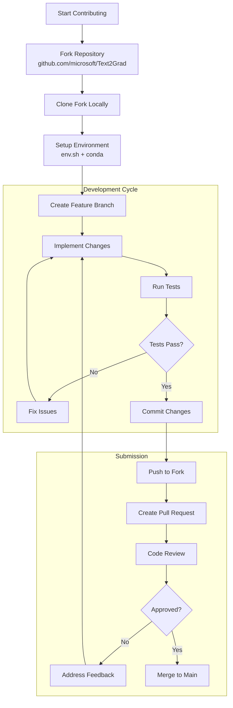

<!-- source: DeepWiki mcp.deepwiki.com · repo microsoft/Text2Grad · page 10 Contributing · fetched 2026-10-26 -->

# Contributing

<details>
<summary>Relevant source files</summary>

The following files were used as context for generating this wiki page:

- [CODE_OF_CONDUCT.md](CODE_OF_CONDUCT.md)
- [LICENSE](LICENSE)
- [SUPPORT.md](SUPPORT.md)

</details>


This page provides guidance for contributing to the Text2Grad project, including development workflow, community guidelines, and support resources. Text2Grad is an open-source research framework for natural language gradient-based policy optimization.

For specific community policies, see [Code of Conduct](#10.1). For security issues, see [Security Policy](#10.2). For getting help, see [Getting Support](#10.3). For licensing terms, see [License](#10.4).

---

## Purpose and Scope

Text2Grad is a Microsoft open-source project that welcomes contributions from the community. This document covers:

- Ways to contribute to the project
- Development workflow and testing procedures
- Where different types of contributions fit in the codebase
- Community guidelines and support channels

The codebase is structured around three main components (Data Annotation, Reward Models, Policy Optimization) across three task domains (KodCode, UltraFeedback, SLF5K). See [Three-Component Pipeline](#3.1) and [Multi-Task Design](#3.2) for architectural context.

**Sources:** [CODE_OF_CONDUCT.md:1-10](), [SUPPORT.md:1-26](), [LICENSE:1-22]()

---

## Ways to Contribute

### Research Extensions

The Text2Grad framework supports multiple contribution types:

| Contribution Type | Component | Examples |
|------------------|-----------|----------|
| **New Task Domains** | All three components | Add support for translation, dialogue, or other generation tasks |
| **Data Annotation Methods** | `rm_data_anno/` | Alternative annotation strategies for dual-feedback generation |
| **Reward Model Architectures** | `nl_reward_model/` | Different base models, training methods, or feedback formats |
| **Policy Optimization Algorithms** | `nl_gradient_policy_optimization/` | Extensions to `TEXT2GRADTrainer`, alternative RL algorithms |
| **Evaluation Metrics** | `nl_reward_model/*/evaluation/` | New metrics for span-level or text-level assessment |
| **Infrastructure Improvements** | All | Performance optimizations, distributed training enhancements |

### Bug Reports and Feature Requests

The project uses GitHub Issues for tracking bugs and feature requests. See [Getting Support](#10.3) for details on filing issues.

**Sources:** [SUPPORT.md:15-17]()

---

## Development Workflow

### Contribution Process Diagram



**Workflow Steps:**

1. **Fork and Clone**: Fork the repository and clone your fork locally
2. **Environment Setup**: Run [env.sh:1-29]() to install dependencies via conda
3. **Create Branch**: Create a feature branch for your changes
4. **Implement Changes**: Make code modifications (see Component Structure below)
5. **Run Tests**: Validate changes against task-specific evaluation pipelines
6. **Submit PR**: Push to your fork and create a pull request
7. **Code Review**: Address reviewer feedback iteratively
8. **Merge**: Changes are merged after approval

**Sources:** [SUPPORT.md:15-17](), repository structure from system diagrams

---

## Component Structure for Contributors

This diagram maps contribution types to specific directories and files in the codebase:

```mermaid
graph TB
    subgraph "Data Annotation Pipeline"
        ANNO_BASE["rm_data_anno/"]
        ANNO_KC["rm_data_anno/kodcode/<br/>dual_feedback_annotation_RM.py"]
        ANNO_UF["rm_data_anno/ultrafeedback/<br/>dual_feedback_annotation_RM.py"]
        ANNO_SL["rm_data_anno/slf5k/<br/>dual_feedback_annotation_RM.py"]
        
        ANNO_BASE --> ANNO_KC
        ANNO_BASE --> ANNO_UF
        ANNO_BASE --> ANNO_SL
    end
    
    subgraph "Reward Model Component"
        RM_BASE["nl_reward_model/"]
        
        RM_TRAIN_KC["nl_reward_model/kodcode/train_rm.py"]
        RM_EVAL_KC["nl_reward_model/kodcode/evaluation/<br/>1_merge_lora.py<br/>2_infer.py<br/>3_metrics.py"]
        
        RM_TRAIN_UF["nl_reward_model/ultrafeedback/train_rm.py"]
        RM_EVAL_UF["nl_reward_model/ultrafeedback/evaluation/<br/>2_infer.py<br/>3_metrics.py"]
        
        RM_TRAIN_SL["nl_reward_model/slf5k/train_rm.py"]
        RM_EVAL_SL["nl_reward_model/slf5k/evaluation/<br/>2_infer.py<br/>3_metrics.py"]
        
        RM_BASE --> RM_TRAIN_KC
        RM_BASE --> RM_EVAL_KC
        RM_BASE --> RM_TRAIN_UF
        RM_BASE --> RM_EVAL_UF
        RM_BASE --> RM_TRAIN_SL
        RM_BASE --> RM_EVAL_SL
    end
    
    subgraph "Policy Optimization Component"
        PPO_BASE["nl_gradient_policy_optimization/"]
        
        PPO_KC["nl_gradient_policy_optimization/kodcode/<br/>train_kodcode.py<br/>text2grad_trainer.py"]
        PPO_UF["nl_gradient_policy_optimization/ultrafeedback/<br/>train_ultrafeedback.py<br/>text2grad_trainer.py"]
        PPO_SL["nl_gradient_policy_optimization/slf5k/<br/>train.py<br/>text2grad_trainer.py"]
        
        PPO_BASE --> PPO_KC
        PPO_BASE --> PPO_UF
        PPO_BASE --> PPO_SL
    end
    
    subgraph "Shared Utilities"
        ENV["env.sh"]
        README["README.md"]
    end
    
    CONTRIB_TYPE_1["Contribution:<br/>New Task Domain"]
    CONTRIB_TYPE_2["Contribution:<br/>RM Architecture"]
    CONTRIB_TYPE_3["Contribution:<br/>PPO Algorithm"]
    CONTRIB_TYPE_4["Contribution:<br/>Evaluation Metrics"]
    
    CONTRIB_TYPE_1 -.->|Create parallel structure| ANNO_BASE
    CONTRIB_TYPE_1 -.->|Create parallel structure| RM_BASE
    CONTRIB_TYPE_1 -.->|Create parallel structure| PPO_BASE
    
    CONTRIB_TYPE_2 -.->|Modify training logic| RM_TRAIN_KC
    CONTRIB_TYPE_2 -.->|Modify training logic| RM_TRAIN_UF
    CONTRIB_TYPE_2 -.->|Modify training logic| RM_TRAIN_SL
    
    CONTRIB_TYPE_3 -.->|Extend TEXT2GRADTrainer| PPO_KC
    CONTRIB_TYPE_3 -.->|Extend TEXT2GRADTrainer| PPO_UF
    CONTRIB_TYPE_3 -.->|Extend TEXT2GRADTrainer| PPO_SL
    
    CONTRIB_TYPE_4 -.->|Add metric functions| RM_EVAL_KC
    CONTRIB_TYPE_4 -.->|Add metric functions| RM_EVAL_UF
    CONTRIB_TYPE_4 -.->|Add metric functions| RM_EVAL_SL
```



### Key Files for Common Contributions

| Contribution Goal | Primary Files to Modify | Key Classes/Functions |
|------------------|------------------------|----------------------|
| **New annotation method** | `rm_data_anno/{task}/dual_feedback_annotation_RM.py` | Annotation logic, prompt formatting |
| **Custom reward model** | `nl_reward_model/{task}/train_rm.py` | `QACDataset`, training loop, model architecture |
| **Extend TEXT2GRADTrainer** | `nl_gradient_policy_optimization/{task}/text2grad_trainer.py` | `TEXT2GRADTrainer`, `step()`, `_generate_batched()` |
| **New evaluation metric** | `nl_reward_model/{task}/evaluation/3_metrics.py` | Metric calculation functions |
| **Inference optimization** | `nl_reward_model/{task}/evaluation/2_infer.py` | VLLM pipeline, batch processing |
| **Response parsing** | `nl_reward_model/{task}/evaluation/2_infer.py` | `parse_response()`, regex fallbacks |

**Sources:** Repository structure from system diagrams, [rm_data_anno/kodcode/dual_feedback_annotation_RM.py](), [nl_reward_model/kodcode/train_rm.py](), [nl_gradient_policy_optimization/ultrafeedback/text2grad_trainer.py]()

---

## Testing Your Changes

### Testing Strategy by Component

Each component has domain-specific testing requirements:

#### Data Annotation Testing
- **Validate output format**: Ensure annotated data matches expected dual-feedback schema
- **Check span consistency**: Verify spans reference valid token positions
- **Test edge cases**: Empty feedback, overlapping spans, special characters

#### Reward Model Testing
1. **Training Validation**:
   - Monitor loss convergence during training
   - Check checkpoint files are created: `adapter_model.bin`, `adapter_config.json`
   - Verify LoRA parameters are saved correctly [nl_reward_model/kodcode/train_rm.py]()

2. **Inference Validation**:
   - Run [nl_reward_model/{task}/evaluation/2_infer.py]() on test split
   - Verify JSON output format with `good_spans`, `poor_spans`, `textual_feedback`
   - Test parsing fallback strategies handle malformed outputs

3. **Metric Validation**:
   - Run [nl_reward_model/{task}/evaluation/3_metrics.py]() to compute precision/recall/F1
   - Compare against baseline metrics to ensure improvements

#### Policy Optimization Testing
1. **Training Validation**:
   - Run [nl_gradient_policy_optimization/{task}/train*.py]() for small number of steps
   - Check WandB logs for reward trends, KL divergence, loss curves
   - Verify checkpoints saved in `{output_dir}/checkpoint-{step}/`

2. **Generation Quality**:
   - Test generation on validation set
   - For **KodCode**: Run EvalPlus to check code correctness
   - For **UltraFeedback**: Evaluate on MT-Bench, ARC-C
   - For **SLF5K**: Compute ROUGE, BERTScore

### Running Task-Specific Evaluations

```bash
# KodCode: Test code generation with HumanEval+
cd nl_gradient_policy_optimization/kodcode/
python evaluate_humaneval.py --model_path {checkpoint_path}

# UltraFeedback: Test on MT-Bench
cd nl_gradient_policy_optimization/ultrafeedback/
python evaluate_mtbench.py --model_path {checkpoint_path}

# SLF5K: Compute similarity metrics
cd nl_gradient_policy_optimization/slf5k/
python evaluate_rouge.py --model_path {checkpoint_path}
```

**Sources:** [nl_reward_model/kodcode/evaluation/2_infer.py](), [nl_reward_model/kodcode/evaluation/3_metrics.py](), [nl_gradient_policy_optimization/ultrafeedback/train_ultrafeedback.py]()

---

## Code Quality Guidelines

### Style and Documentation

The codebase follows these conventions:

1. **Type Hints**: Use Python type hints for function signatures
2. **Docstrings**: Document classes and non-trivial functions
3. **Comments**: Explain complex algorithms (e.g., fuzzy matching, token alignment)
4. **Logging**: Use appropriate log levels (INFO, WARNING, ERROR)

### Key Code Patterns

**DeepSpeed Configuration**: When modifying training scripts, maintain DeepSpeed ZeRO-3 configuration structure:

```python
# Example from train_rm.py
deepspeed_config = {
    "train_batch_size": "auto",
    "gradient_accumulation_steps": "auto",
    "zero_optimization": {
        "stage": 3,
        "offload_optimizer": {"device": "cpu"},
        # ... additional config
    }
}
```

**LoRA Configuration**: When adding parameter-efficient fine-tuning:

```python
# Example pattern from reward model training
from peft import LoraConfig, get_peft_model

lora_config = LoraConfig(
    r=16,               # LoRA rank
    lora_alpha=32,      # Scaling factor
    target_modules=["q_proj", "k_proj", "v_proj", "o_proj"],
    lora_dropout=0.05,
    bias="none",
    task_type="CAUSAL_LM"
)
```

**TEXT2GRADTrainer Extensions**: When extending the trainer:

```python
# Example pattern from text2grad_trainer.py
class CustomTEXT2GRADTrainer(TEXT2GRADTrainer):
    def step(self, queries, responses, model_inputs):
        # 1. Get rewards from reward model
        # 2. Align word scores to tokens
        # 3. Compute PPO loss with clipped objective
        # 4. Update policy and value networks
        pass
```

**Sources:** [nl_reward_model/kodcode/train_rm.py](), [nl_gradient_policy_optimization/ultrafeedback/text2grad_trainer.py]()

---

## Pull Request Guidelines

### PR Content Requirements

A complete pull request should include:

| Component | Required Elements |
|-----------|------------------|
| **Description** | Clear explanation of changes, motivation, related issues |
| **Code Changes** | Well-structured, documented code following project patterns |
| **Tests** | Validation that changes work as expected |
| **Documentation** | Update README.md or wiki pages if adding features |
| **Dependencies** | Update [env.sh:1-29]() if adding new packages |

### PR Review Process

1. **Automated Checks**: Ensure code passes any CI/CD checks (if configured)
2. **Peer Review**: At least one project maintainer reviews changes
3. **Testing**: Reviewers may request additional testing on specific benchmarks
4. **Discussion**: Address questions and suggested changes
5. **Approval**: Maintainer approval required before merge

### Example PR Structure

```markdown
## Description
Add support for GPT-2 as a base model for reward model training.

## Changes
- Modified `nl_reward_model/kodcode/train_rm.py` to support GPT-2 architecture
- Added GPT-2-specific tokenization handling in `QACDataset`
- Updated inference script to handle different model types

## Testing
- Trained GPT-2 reward model on 1K examples
- Verified inference generates valid JSON feedback
- Metrics comparable to Llama-based models (F1: 0.78 vs 0.80)

## Related Issues
Closes #42
```

**Sources:** [SUPPORT.md:15-17]()

---

## Community Guidelines

### Microsoft Open Source Code of Conduct

Text2Grad has adopted the **Microsoft Open Source Code of Conduct**. All contributors, maintainers, and participants are expected to abide by this code.

**Key Resources:**
- [Microsoft Open Source Code of Conduct](https://opensource.microsoft.com/codeofconduct/)
- [Code of Conduct FAQ](https://opensource.microsoft.com/codeofconduct/faq/)
- Contact: [opencode@microsoft.com](mailto:opencode@microsoft.com) for questions or concerns

See [Code of Conduct](#10.1) for full details.

**Sources:** [CODE_OF_CONDUCT.md:1-10]()

---

## Getting Support

### Reporting Issues

Use **GitHub Issues** to:
- Report bugs with detailed reproduction steps
- Request new features with use cases
- Ask questions about implementation details

When filing issues:
1. Search existing issues to avoid duplicates
2. Provide system information (OS, Python version, GPU type)
3. Include error messages and stack traces
4. Attach minimal reproduction code if reporting bugs

### Support Scope

Support for Text2Grad is limited to:
- Issues filed on the GitHub repository
- Community discussion on GitHub
- Documentation provided in this wiki

For detailed support information, see [Getting Support](#10.3).

**Sources:** [SUPPORT.md:15-17](), [SUPPORT.md:23-25]()

---

## Security Vulnerabilities

Security vulnerabilities should be reported responsibly through Microsoft's security response channels, **not** through public GitHub issues.

See [Security Policy](#10.2) for reporting procedures.

**Sources:** Implied from standard Microsoft open source practices

---

## License

Text2Grad is released under the **MIT License**. This license allows:

- **Commercial use**: Use in proprietary software
- **Modification**: Create derivative works
- **Distribution**: Share the software
- **Private use**: Use for private purposes

**Requirements:**
- Include the license and copyright notice in distributions
- No warranty provided

See [License](#10.4) for full legal text.

**Sources:** [LICENSE:1-22]()

---

## Acknowledgments

Contributions to Text2Grad help advance research in natural language gradient-based optimization. Thank you to all contributors who improve the framework through:

- Code contributions
- Bug reports and fixes
- Documentation improvements
- Feature suggestions
- Community support

---

## Summary Checklist

Before submitting a contribution:

- [ ] Code follows existing patterns in the component
- [ ] Changes tested on relevant task domain
- [ ] Documentation updated if adding features
- [ ] Pull request includes clear description
- [ ] Microsoft Open Source Code of Conduct reviewed
- [ ] Dependencies updated in [env.sh]() if needed
- [ ] Checkpoint files excluded from commits (add to `.gitignore`)
- [ ] WandB API keys and secrets not committed

**Sources:** [CODE_OF_CONDUCT.md:1-10](), [SUPPORT.md:1-26](), [LICENSE:1-22](), repository structure from system diagrams

---

