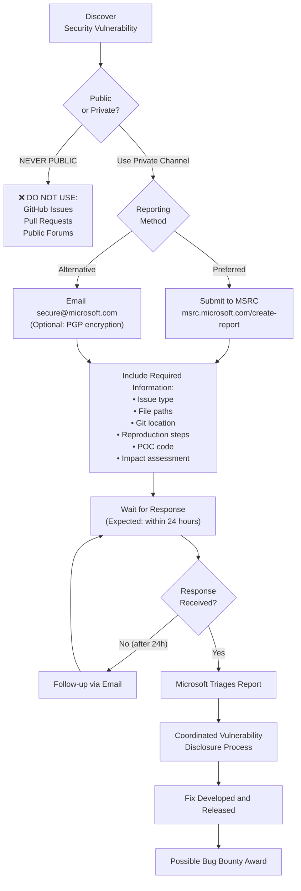
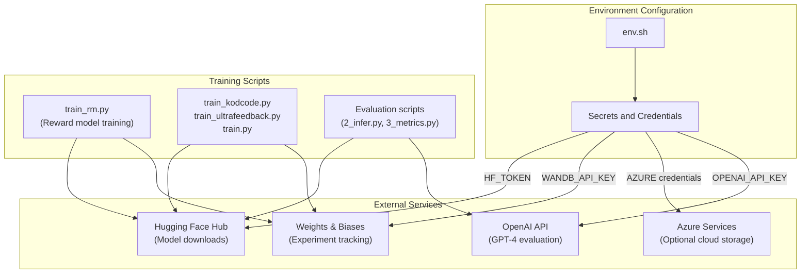

<!-- source: DeepWiki mcp.deepwiki.com · repo microsoft/Text2Grad · page 10.2 Security Policy · fetched 2026-10-26 -->

# Security Policy

<details>
<summary>Relevant source files</summary>

The following files were used as context for generating this wiki page:

- [SECURITY.md](SECURITY.md)

</details>


## Purpose and Scope

This document describes the security policy for the Text2Grad project and how to responsibly report security vulnerabilities. It covers:

- The process for reporting security issues to Microsoft
- Security considerations when working with Text2Grad
- Security-sensitive components in the codebase
- Best practices for protecting credentials and data

For general contribution guidelines, see [Code of Conduct](#10.1). For getting help with non-security issues, see [Getting Support](#10.3).

---

## Reporting Security Vulnerabilities

Microsoft takes the security of the Text2Grad project seriously. If you discover a security vulnerability, follow the responsible disclosure process outlined below.

### Critical: Do Not Use Public Channels

**Never report security vulnerabilities through public GitHub issues, pull requests, or discussions.** Public disclosure of security issues can put users at risk before fixes are available.

**Sources:** [SECURITY.md:11-11]()

### Primary Reporting Channel: Microsoft Security Response Center (MSRC)

Submit security vulnerability reports to the Microsoft Security Response Center at:

**https://msrc.microsoft.com/create-report**

This is the preferred and fastest method for reporting security issues.

**Sources:** [SECURITY.md:13-13]()

### Alternative Reporting: Email

If you prefer not to use the web portal, send email to:

**secure@microsoft.com**

For sensitive reports, encrypt your message using Microsoft's PGP key available at:

**https://aka.ms/security.md/msrc/pgp**

You should receive a response within 24 hours. If you do not receive acknowledgment, follow up via email to ensure your report was received.

**Sources:** [SECURITY.md:15-17]()

---

## Security Vulnerability Report Content

To help Microsoft triage and address your report quickly, include the following information:

| Information Category | Description | Examples |
|---------------------|-------------|----------|
| **Issue Type** | Classification of the vulnerability | Buffer overflow, injection attack, privilege escalation, credential exposure |
| **Affected Files** | Full paths to source files related to the issue | `nl_gradient_policy_optimization/kodcode/train_kodcode.py`, `nl_reward_model/ultrafeedback/train_rm.py` |
| **Source Location** | Git reference where the issue exists | Tag, branch name, commit hash, or direct URL |
| **Reproduction Configuration** | Special setup required to trigger the issue | Specific DeepSpeed config, particular model checkpoint, environment variables |
| **Reproduction Steps** | Step-by-step instructions | Detailed commands and expected vs actual behavior |
| **Proof of Concept** | Exploit code or demonstration | Script, command sequence, or minimal example |
| **Impact Assessment** | How an attacker could exploit the issue | Data exfiltration, unauthorized access, denial of service |

More complete reports may qualify for higher awards under the [Microsoft Bug Bounty Program](https://aka.ms/security.md/msrc/bounty).

**Sources:** [SECURITY.md:19-31]()

---

## Security Reporting Workflow



**Sources:** [SECURITY.md:1-41]()

---

## Security-Sensitive Components in Text2Grad

The Text2Grad codebase interacts with external services and handles sensitive data. Understanding security-relevant components helps identify potential vulnerabilities.

### External Service Authentication



**Sources:** Based on system architecture, though specific env.sh security details not provided in source files

---

## Security Considerations by Component

### 1. API Key Management

**Risk Areas:**
- OpenAI API keys for GPT-4 evaluation
- Weights & Biases API keys for experiment tracking
- Azure credentials for cloud storage
- Hugging Face tokens for private model access

**Best Practices:**
- Never commit API keys to version control
- Use environment variables or secure secret management
- Rotate keys periodically
- Use least-privilege access for service accounts

**Related Files:**
- Environment setup scripts that configure credentials
- Training scripts that authenticate to external services

### 2. Model Checkpoint Security

**Risk Areas:**
- Model checkpoints may contain sensitive training data patterns
- Adapter weights could leak proprietary information
- Value head parameters might encode reward signals

**Best Practices:**
- Restrict access to checkpoint directories
- Use encryption for checkpoint storage in cloud environments
- Audit checkpoint sharing and distribution
- Sanitize checkpoints before public release

**Related Components:**
- Checkpoint saving in TEXT2GRADTrainer
- Model merging in `1_merge_lora.py`
- Distributed checkpoint handling with DeepSpeed

### 3. Training Data Security

**Risk Areas:**
- Datasets may contain PII (personally identifiable information)
- Code examples might include proprietary algorithms
- Feedback annotations could reveal sensitive information

**Best Practices:**
- Anonymize datasets before training
- Audit data for sensitive content
- Implement data access controls
- Follow data retention policies

**Related Components:**
- Dataset loading in QACDataset
- Dual-feedback annotation scripts
- Data preprocessing and tokenization

### 4. External Service Connections

**Risk Areas:**
- Unencrypted communication with external APIs
- Man-in-the-middle attacks on model downloads
- Credential exposure in logs or error messages

**Best Practices:**
- Use HTTPS for all external communications
- Verify SSL certificates
- Sanitize logs to remove credentials
- Implement request rate limiting

**Related Components:**
- VLLM pipeline for inference
- OpenAI API calls for evaluation
- Hugging Face Hub interactions for model downloads

### 5. Logging and Monitoring

**Risk Areas:**
- API keys logged to WandB or console
- Sensitive data in error tracebacks
- Generated outputs containing private information

**Best Practices:**
- Implement credential filtering in logging
- Sanitize exception messages
- Audit WandB experiment logs
- Use log levels appropriately (avoid DEBUG in production)

**Related Components:**
- WandB integration in training scripts
- Error handling throughout codebase
- Accelerator logging in distributed training

---

## Security-Sensitive Code Patterns

### Pattern 1: Credential Loading

When loading credentials from environment variables or configuration files, ensure:

```
✅ CORRECT: Load from environment
api_key = os.getenv("OPENAI_API_KEY")
if not api_key:
    raise ValueError("OPENAI_API_KEY not set")

❌ INCORRECT: Hardcoded credentials
api_key = "sk-proj-abc123..."  # Never do this
```

### Pattern 2: API Request Logging

When logging API interactions, sanitize sensitive data:

```
✅ CORRECT: Sanitized logging
logger.info(f"Making API request to {endpoint}")

❌ INCORRECT: Credential exposure
logger.debug(f"Request: {headers}")  # May contain Authorization header
```

### Pattern 3: Checkpoint Paths

When handling checkpoint paths, validate and sanitize:

```
✅ CORRECT: Path validation
checkpoint_path = os.path.abspath(os.path.join(base_dir, checkpoint_name))
if not checkpoint_path.startswith(base_dir):
    raise ValueError("Invalid checkpoint path")

❌ INCORRECT: Path traversal vulnerability
checkpoint_path = f"{base_dir}/{user_input}"  # Vulnerable to ../../../etc/passwd
```

---

## Coordinated Vulnerability Disclosure

Microsoft follows the principle of [Coordinated Vulnerability Disclosure](https://aka.ms/security.md/cvd):

1. **Private Reporting**: Vulnerability is reported privately to Microsoft
2. **Assessment**: Microsoft security team evaluates severity and impact
3. **Fix Development**: Microsoft develops and tests a fix
4. **Coordinated Disclosure**: Microsoft and reporter agree on disclosure timeline
5. **Public Release**: Fix is released, followed by public disclosure
6. **Credit**: Reporter receives credit (if desired) in security advisory

This approach protects users while giving researchers recognition for their work.

**Sources:** [SECURITY.md:39-39]()

---

## Language Preference

All security communications should be in English to ensure efficient triage and response.

**Sources:** [SECURITY.md:33-35]()

---

## Additional Security Resources

| Resource | Description | URL |
|----------|-------------|-----|
| Microsoft Security Response Center | Main security portal | https://microsoft.com/msrc |
| Microsoft Bug Bounty Program | Eligibility and rewards | https://aka.ms/security.md/msrc/bounty |
| Microsoft Security Definition | What qualifies as a security vulnerability | https://aka.ms/security.md/definition |
| PGP Key for Encryption | Public key for encrypted reports | https://aka.ms/security.md/msrc/pgp |

**Sources:** [SECURITY.md:1-41]()

---

## Summary Checklist

When working with Text2Grad, follow these security guidelines:

- [ ] **Never commit credentials** to version control
- [ ] **Use environment variables** for API keys and tokens
- [ ] **Sanitize logs** to prevent credential leakage
- [ ] **Validate file paths** to prevent traversal attacks
- [ ] **Audit training data** for sensitive content
- [ ] **Encrypt checkpoints** when storing in cloud
- [ ] **Report vulnerabilities privately** via MSRC
- [ ] **Use HTTPS** for all external service calls
- [ ] **Rotate credentials** periodically
- [ ] **Follow least-privilege** principle for service accounts

---

**Sources:** [SECURITY.md:1-41]()

---

