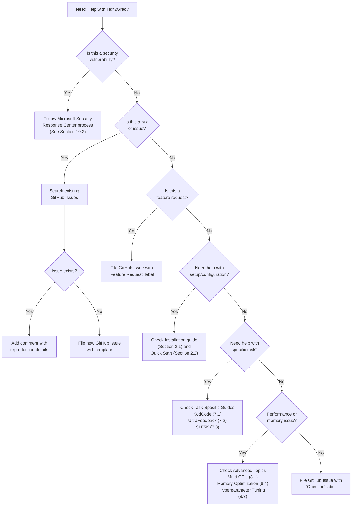
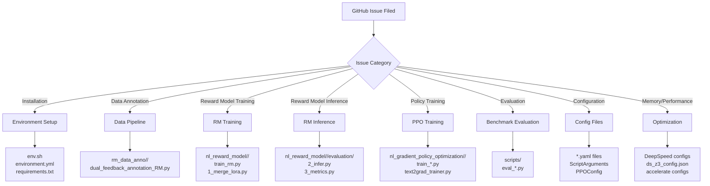
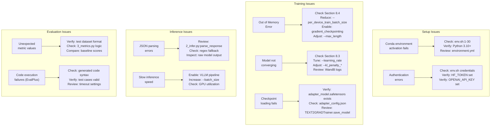

<!-- source: DeepWiki mcp.deepwiki.com · repo microsoft/Text2Grad · page 10.3 Getting Support · fetched 2026-10-26 -->

# Getting Support

<details>
<summary>Relevant source files</summary>

The following files were used as context for generating this wiki page:

- [SUPPORT.md](SUPPORT.md)

</details>


This page documents how to get help with Text2Grad, report bugs and issues, request features, and engage with the community. It covers support channels, issue filing procedures, and self-service troubleshooting resources mapped to specific code components.

For information about reporting security vulnerabilities, see [Security Policy](#10.2). For contribution guidelines, see [Code of Conduct](#10.1).

**Sources:** [SUPPORT.md:1-26]()

---

## Support Channels

Text2Grad provides multiple support channels depending on the type of assistance needed. The project uses GitHub Issues as the primary mechanism for tracking bugs, feature requests, and documentation improvements.

### Support Channel Decision Tree



**Sources:** [SUPPORT.md:13-21]()

---

## Filing GitHub Issues

All bugs, feature requests, and questions should be filed as GitHub Issues at `https://github.com/microsoft/Text2Grad/issues`. Before filing a new issue, search existing issues to avoid duplicates.

### Issue Types and Templates

| Issue Type | When to Use | Required Information |
|------------|-------------|---------------------|
| **Bug Report** | Code crashes, incorrect results, unexpected behavior | Error messages, stack traces, reproduction steps, environment details |
| **Feature Request** | Propose new functionality or enhancements | Use case, proposed API, alternatives considered |
| **Documentation** | Errors, unclear explanations, missing information | Specific page/section, suggested improvements |
| **Installation/Setup** | Problems during environment setup | Operating system, Python version, conda environment output, error logs |
| **Training Issue** | Model convergence, OOM errors, checkpoint problems | Hyperparameters, GPU specs, logs from WandB, checkpoint paths |
| **Evaluation Issue** | Incorrect metrics, evaluation failures | Dataset used, model checkpoint, evaluation command, expected vs actual results |

### Issue Triage and Code Component Mapping



**Sources:** [SUPPORT.md:13-17]()

---

## Self-Service Troubleshooting

Many common issues can be resolved by consulting specific wiki sections or examining particular code components.

### Common Issues and Resolution Paths



### Code Component Reference Table

| Problem Area | Relevant Files | Key Classes/Functions | Wiki Section |
|--------------|----------------|----------------------|--------------|
| **Environment Setup** | `env.sh`, `environment.yml` | N/A | [Installation](#2.1) |
| **Dataset Loading** | `rm_data_anno/*/dual_feedback_annotation_RM.py` | Dataset processing functions | [Input Data Formats](#4.1) |
| **Tokenization** | `nl_reward_model/*/train_rm.py` | `QACDataset.__getitem__` | [LoRA and DeepSpeed Configuration](#5.2) |
| **LoRA Configuration** | `nl_reward_model/*/train_rm.py:30-50` | `LoraConfig`, `get_peft_model` | [LoRA and DeepSpeed Configuration](#5.2) |
| **DeepSpeed Setup** | `ds_z3_config.json`, `train_rm.py` | `deepspeed.initialize` | [LoRA and DeepSpeed Configuration](#5.2) |
| **Model Merging** | `nl_reward_model/*/evaluation/1_merge_lora.py` | `merge_and_save_model` | [Reward Model Inference](#5.3) |
| **Batch Inference** | `nl_reward_model/*/evaluation/2_infer.py` | `vllm.LLM`, `generate_batch` | [Reward Model Inference](#5.3) |
| **Response Parsing** | `nl_reward_model/*/evaluation/2_infer.py` | `parse_response`, `extract_with_regex` | [Response Parsing Strategies](#5.4) |
| **Metrics Calculation** | `nl_reward_model/*/evaluation/3_metrics.py` | `calculate_word_metrics`, `calculate_span_metrics` | [Evaluation Metrics](#5.5) |
| **PPO Initialization** | `nl_gradient_policy_optimization/*/train_*.py` | `TEXT2GRADTrainer.__init__` | [TEXT2GRADTrainer Architecture](#6.1) |
| **Reward Processing** | `nl_gradient_policy_optimization/*/text2grad_trainer.py` | `_fuzzy_match`, `rematch_scores` | [Reward Processing Pipeline](#6.3) |
| **Forward Pass** | `nl_gradient_policy_optimization/*/text2grad_trainer.py` | `batched_forward_pass` | [Forward Pass and Masking](#6.5) |
| **Loss Calculation** | `nl_gradient_policy_optimization/*/text2grad_trainer.py` | `_loss`, `compute_advantages` | [Loss Calculation and Updates](#6.6) |
| **Checkpoint Saving** | `nl_gradient_policy_optimization/*/text2grad_trainer.py` | `save_model`, `_save_checkpoint` | [Checkpoint Management](#6.7) |
| **Multi-GPU** | `nl_gradient_policy_optimization/*/text2grad_trainer.py` | `accelerator.gather`, `accelerator.save_state` | [Distributed Training](#6.8), [Multi-GPU Configuration](#8.1) |

**Sources:** [SUPPORT.md:19-21](), Multiple training and evaluation files

---

## Reporting Bugs

When reporting a bug, include the following information to help maintainers reproduce and diagnose the issue:

### Required Information

1. **Environment Details**
   - Operating system and version
   - Python version: `python --version`
   - CUDA version (if using GPU): `nvcc --version`
   - Conda environment snapshot: `conda list > env_snapshot.txt`
   - GPU information: `nvidia-smi`

2. **Reproduction Steps**
   - Exact command used (sanitize any tokens/credentials)
   - Configuration files or command-line arguments
   - Dataset being used (KodCode/UltraFeedback/SLF5K)
   - Minimal reproducible example

3. **Error Information**
   - Complete error message and stack trace
   - Relevant log files (training logs, inference logs)
   - WandB run URL (if applicable)
   - Screenshots (for UI-related issues)

4. **Expected vs Actual Behavior**
   - What you expected to happen
   - What actually happened
   - Any workarounds you've tried

### Example Bug Report Structure

```markdown
## Bug Description
[Clear, concise description of the bug]

## Environment
- OS: Ubuntu 20.04
- Python: 3.10.12
- CUDA: 11.8
- GPU: NVIDIA A100 80GB

## Reproduction Steps
1. Run command: `bash train_ultrafeedback.sh --learning_rate 1e-5`
2. Training progresses to step 100
3. OOM error occurs

## Error Message
```
OutOfMemoryError: CUDA out of memory. Tried to allocate 2.50 GiB 
(GPU 0; 79.35 GiB total capacity; 76.85 GiB already allocated...)
```

## Expected Behavior
Training should complete without OOM with default hyperparameters on A100 80GB

## Actual Behavior
OOM at step 100 during PPO update phase

## Additional Context
- Batch size: 4
- Max length: 512
- Using DeepSpeed ZeRO Stage 3
- Log file attached: training.log
```

**Sources:** [SUPPORT.md:13-17]()

---

## Feature Requests

Feature requests help guide the development roadmap. When proposing a new feature:

### Feature Request Guidelines

1. **Use Case**: Describe the problem you're trying to solve
2. **Proposed Solution**: Explain how the feature would work
3. **Alternatives Considered**: Other approaches you've evaluated
4. **Impact Assessment**: Which components would be affected
5. **Backward Compatibility**: Whether existing functionality would break

### Component Impact Analysis

When requesting features, consider which system components would be affected:

| Component | Considerations | Example Features |
|-----------|----------------|------------------|
| **Data Annotation** | Data format changes, new annotation types | Support for multi-turn dialogue, image inputs |
| **Reward Model** | Model architecture, training objectives | Multi-objective rewards, confidence scores |
| **Policy Optimization** | Training algorithms, reward processing | New RL algorithms (DPO, RLOO), adaptive KL penalties |
| **Evaluation** | New metrics, benchmark integration | Custom evaluation scripts, new datasets |
| **Infrastructure** | Distributed training, cloud integration | TPU support, Kubernetes deployment |

**Sources:** [SUPPORT.md:13-17]()

---

## Community Engagement

Text2Grad is an open-source research project. Community contributions in the form of bug reports, feature requests, documentation improvements, and code contributions are welcome.

### Ways to Contribute

1. **Issue Reporting**: File detailed bug reports and feature requests
2. **Documentation**: Improve wiki pages, fix typos, add examples
3. **Code Contributions**: Submit pull requests (see contribution guidelines)
4. **Testing**: Test pre-release versions and report findings
5. **Discussion**: Engage in GitHub Discussions on architectural decisions

### Response Times

As a research project, Text2Grad does not guarantee specific response times. However:

- **Security issues**: Reviewed within 24-48 hours (see [Security Policy](#10.2))
- **Bugs with reproduction steps**: Typically reviewed within 1-2 weeks
- **Feature requests**: Evaluated based on project roadmap and community interest
- **Questions**: Best-effort basis, check existing issues and wiki first

**Sources:** [SUPPORT.md:11-26]()

---

## Microsoft Support Policy

Support for Text2Grad is limited to the community resources listed in this document. This is a research project released under the MIT License (see [License](#10.4)) without warranty or official Microsoft product support.

### Limitations

- **No SLA**: No service-level agreement or guaranteed response times
- **Community-Driven**: Support provided by maintainers and community on best-effort basis
- **No Priority Support**: All issues handled equally regardless of organization
- **Research Focus**: Project optimized for research reproducibility, not production deployment

### Support Scope

**In Scope:**
- Bugs in documented functionality
- Documentation errors or omissions
- Setup/installation issues on supported platforms
- Questions about design decisions or implementation details

**Out of Scope:**
- Custom modifications or extensions
- Production deployment support
- Integration with proprietary systems
- Performance tuning for specific hardware beyond documentation
- Data preprocessing for custom datasets beyond provided examples

**Sources:** [SUPPORT.md:23-26]()

---

## Debugging Resources

### Log File Locations

Logs are stored in task-specific directories and provide detailed debugging information:

```
nl_reward_model/<task>/
├── training_logs/          # Training logs from DeepSpeed
├── checkpoints/            # Model checkpoints
└── evaluation/
    └── results/            # Inference outputs and metrics

nl_gradient_policy_optimization/<task>/
├── logs/                   # PPO training logs
├── output/                 # Model checkpoints and adapters
└── wandb/                  # WandB experiment tracking
```

### WandB Integration

All training runs log to Weights & Biases. To debug issues:

1. **Check WandB URL** in console output at training start
2. **Review metrics**: Loss curves, reward distributions, KL divergence
3. **Inspect examples**: Logged prompt/response pairs in training loop
4. **Compare runs**: Use WandB's comparison tools for hyperparameter analysis

### Common Log Patterns

| Log Pattern | Indication | Action |
|-------------|-----------|--------|
| `CUDA out of memory` | Insufficient GPU memory | Reduce batch size, enable gradient checkpointing |
| `Loss is nan` | Numerical instability | Lower learning rate, check gradient clipping |
| `AssertionError: sizes mismatch` | Token alignment issue | Verify tokenizer consistency, check `rematch_scores` |
| `JSON parsing failed` | Malformed model output | Check prompt format, review `parse_response` fallback |
| `No module named...` | Missing dependency | Re-run `source env.sh`, check conda environment |
| `checkpoint.pth not found` | Checkpoint path error | Verify `--output_dir`, check `save_strategy` |

**Sources:** Multiple training and inference files with logging functionality

---

## Quick Reference: Getting Help


**Key Contacts:**
- GitHub Issues: `https://github.com/microsoft/Text2Grad/issues`
- Security Issues: Follow process in [Security Policy](#10.2)
- Code of Conduct Violations: `opencode@microsoft.com`

**Sources:** [SUPPORT.md:1-26]()

---

