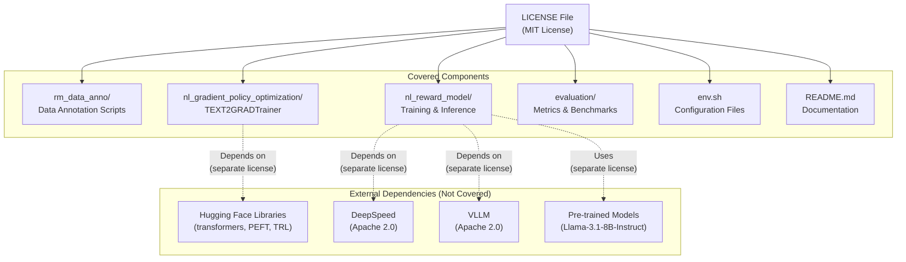
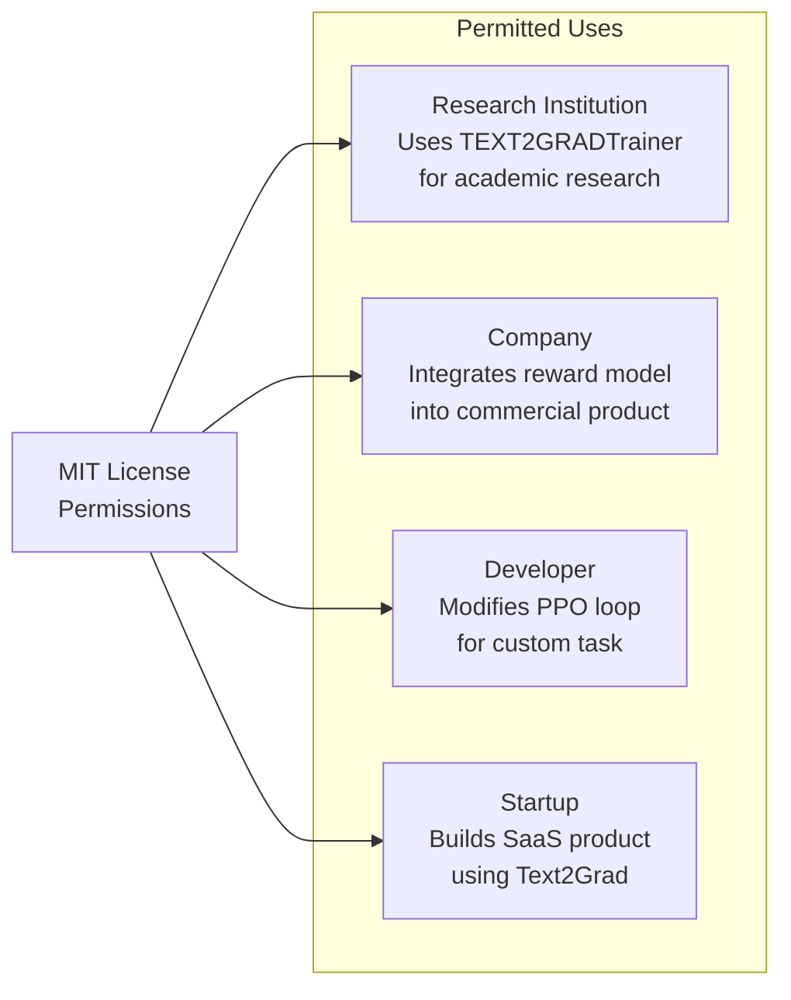
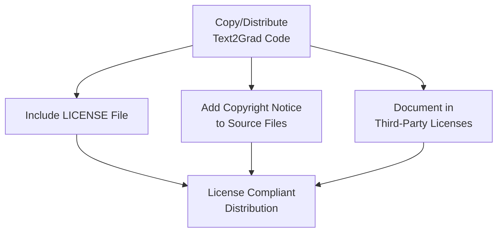
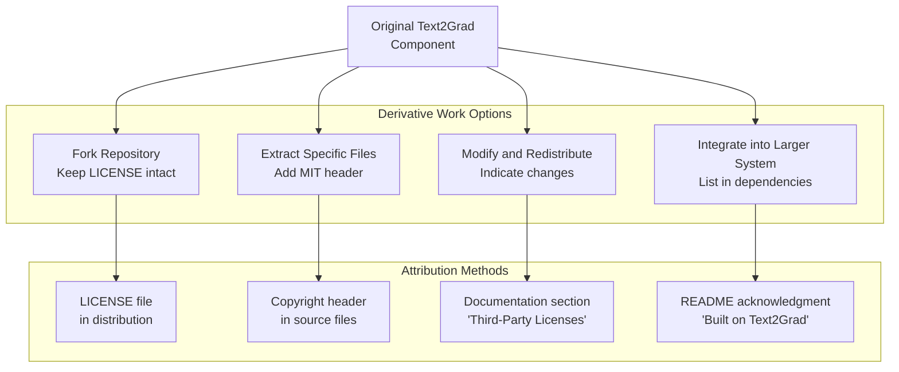
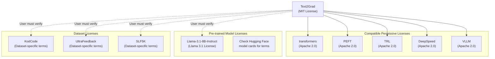

<!-- source: DeepWiki mcp.deepwiki.com · repo microsoft/Text2Grad · page 10.4 License · fetched 2026-10-26 -->

# License

<details>
<summary>Relevant source files</summary>

The following files were used as context for generating this wiki page:

- [LICENSE](LICENSE)

</details>


This page documents the licensing terms for the Text2Grad system. It explains the MIT License under which the software is distributed, the permissions it grants, and the limitations it imposes. For information about contributing to the project, see [Contributing](#10). For security policies, see [Security Policy](#10.2).

## License Overview

The Text2Grad system is released under the **MIT License**, a permissive open-source license. The complete license text is located in [LICENSE:1-22]().

**Copyright Holder**: Microsoft Corporation

**License Type**: MIT License (Massachusetts Institute of Technology License)

The MIT License is one of the most permissive and widely-used open-source licenses, allowing broad freedom to use, modify, and redistribute the software with minimal restrictions.

**Sources**: [LICENSE:1-22]()

## License Scope

The MIT License applies to all components of the Text2Grad repository located at https://github.com/microsoft/Text2Grad. This includes:

| Component Category | Coverage |
|-------------------|----------|
| **Source Code** | All Python scripts in `rm_data_anno/`, `nl_reward_model/`, `nl_gradient_policy_optimization/` |
| **Training Scripts** | `train_rm.py`, `train_kodcode.py`, `train_ultrafeedback.py`, `train.py` |
| **Core Classes** | `TEXT2GRADTrainer`, `QACDataset`, and all supporting classes |
| **Configuration Files** | `env.sh`, DeepSpeed configs, LoRA configs |
| **Evaluation Scripts** | `1_merge_lora.py`, `2_infer.py`, `3_metrics.py` and evaluation tools |
| **Documentation** | README files, inline comments, docstrings |



**Important**: The MIT License applies only to the Text2Grad codebase itself. External dependencies (Hugging Face libraries, DeepSpeed, VLLM, pre-trained models) are governed by their own respective licenses. Users must comply with all applicable licenses when using the complete system.

**Sources**: [LICENSE:1-22]()

## Permissions Granted

The MIT License grants the following permissions to any person obtaining a copy of the Text2Grad software [LICENSE:5-10]():

### Full Usage Rights

| Permission | Description | Scope |
|-----------|-------------|-------|
| **Use** | Run the software for any purpose | Commercial or non-commercial use |
| **Copy** | Make copies of the software | Unlimited distribution |
| **Modify** | Alter the source code | Create derivative works |
| **Merge** | Combine with other software | Integration into larger systems |
| **Publish** | Release modified versions | Public or private repositories |
| **Distribute** | Share with others | Any medium or format |
| **Sublicense** | Grant rights to others | Licensing derivative works |
| **Sell** | Monetize the software | Commercial offerings |

### Practical Examples



All of these use cases are explicitly permitted under the MIT License without requiring permission from Microsoft Corporation, provided the license conditions are met.

**Sources**: [LICENSE:5-10]()

## License Conditions

The MIT License imposes only two conditions for using the software [LICENSE:10-13]():

### 1. Copyright Notice Requirement

**Requirement**: The copyright notice must be included in all copies or substantial portions of the software.

**Copyright Notice** [LICENSE:3]():
```
Copyright (c) Microsoft Corporation.
```

**Full Notice** [LICENSE:1-13]():
```
MIT License

Copyright (c) Microsoft Corporation.

Permission is hereby granted, free of charge, to any person obtaining a copy
of this software and associated documentation files (the "Software"), to deal
in the Software without restriction, including without limitation the rights
to use, copy, modify, merge, publish, distribute, sublicense, and/or sell
copies of the Software, and to permit persons to whom the Software is
furnished to do so, subject to the following conditions:

The above copyright notice and this permission notice shall be included in all
copies or substantial portions of the Software.
```

### 2. License Text Inclusion

The complete license text [LICENSE:1-22]() must be included with any distribution of the software. This can be accomplished by:

- Including the original `LICENSE` file in your distribution
- Embedding the license text in your documentation
- Including it as a comment header in source files (for substantial portions)

### Compliance Examples

| Scenario | Compliance Method |
|----------|------------------|
| **Forking the repository** | Keep the original `LICENSE` file in the root directory |
| **Copying specific scripts** | Add MIT License header to copied files with Microsoft copyright |
| **Building derived system** | Include `LICENSE` file in distribution package |
| **Integrating into product** | Include attribution in "About" or "Licenses" section |



**Sources**: [LICENSE:10-13]()

## Warranty Disclaimer and Liability Limitation

The MIT License includes standard disclaimers that limit liability for the copyright holder [LICENSE:15-21]().

### No Warranty

The software is provided **"AS IS"** without any warranty [LICENSE:15-17]():

| Warranty Type | Status |
|--------------|--------|
| **Express Warranty** | None provided |
| **Implied Warranty** | Explicitly disclaimed |
| **Merchantability** | No guarantee |
| **Fitness for Purpose** | No guarantee |
| **Non-infringement** | No guarantee |

**Implication**: Users accept the software in its current state. There is no guarantee that:
- The `TEXT2GRADTrainer` will converge for all tasks
- The reward models will generate valid JSON
- The evaluation metrics will execute without errors
- The code will work in all environments

### Limited Liability

Microsoft Corporation and other contributors shall not be liable for any claims, damages, or liabilities arising from the software [LICENSE:18-21](), including:

- Direct damages
- Indirect damages
- Incidental damages
- Consequential damages
- Special damages

**Implication**: If the `train_rm.py` script corrupts data, or if a trained model produces incorrect outputs causing business loss, the copyright holder cannot be held legally responsible.

**Sources**: [LICENSE:15-21]()

## Code Attribution and Derived Works

When creating derivative works or integrating Text2Grad components, proper attribution helps maintain transparency in the open-source ecosystem.

### Attribution Best Practices



### Example Attribution Header

For files derived from or substantially copied from Text2Grad:

```python
# Based on Text2Grad (https://github.com/microsoft/Text2Grad)
# Copyright (c) Microsoft Corporation.
# Licensed under the MIT License.
#
# Modified by [Your Name/Organization] for [purpose].
```

### Indicating Modifications

When distributing modified versions, it is good practice (though not legally required by MIT) to:
- Document what was changed
- Use version numbers to distinguish from the original
- Avoid implying endorsement by Microsoft

**Sources**: [LICENSE:1-22]()

## Interaction with External Licenses

Text2Grad depends on numerous external libraries and resources. The MIT License of Text2Grad does not override or supersede these external licenses.

### Dependency License Compatibility



### License Compliance Checklist

When deploying a system built with Text2Grad, verify compliance with:

| Component | License Type | Action Required |
|-----------|-------------|-----------------|
| **Text2Grad code** | MIT | Include LICENSE file |
| **transformers, PEFT, TRL** | Apache 2.0 | Include Apache 2.0 license |
| **DeepSpeed, VLLM** | Apache 2.0 | Include Apache 2.0 license |
| **Llama models** | Llama Community License | Review and comply with Meta's terms |
| **Training datasets** | Varies | Check individual dataset licenses |
| **Evaluation benchmarks** | Varies | Verify terms for HumanEval, MT-Bench, etc. |

**Important**: The MIT License on Text2Grad's code does not grant rights to use Llama models or proprietary datasets. Users must independently obtain appropriate licenses or permissions for these components.

**Sources**: [LICENSE:1-22]()

## Commercial Use

The MIT License explicitly permits commercial use of Text2Grad without restrictions beyond the basic conditions.

### Permitted Commercial Activities

| Activity | Permitted | Conditions |
|----------|-----------|------------|
| Using Text2Grad in commercial products | ✓ Yes | Include LICENSE file |
| Selling software that includes Text2Grad | ✓ Yes | Include LICENSE file |
| Offering Text2Grad as a service (SaaS) | ✓ Yes | Include LICENSE file |
| Training models for commercial purposes | ✓ Yes | Verify model licenses separately |
| Consulting services using Text2Grad | ✓ Yes | Include LICENSE file |
| Proprietary extensions to Text2Grad | ✓ Yes | Can keep extensions private |

### No Royalties or Fees

The MIT License grants rights "free of charge" [LICENSE:5](). This means:
- No licensing fees to Microsoft
- No royalty payments required
- No need to register commercial use
- No requirement to share revenue

### Trademark Notice

While the MIT License grants broad permissions for the code, it does not grant rights to use Microsoft trademarks. When creating commercial products:
- Do not use "Microsoft" branding to imply endorsement
- Do not use Microsoft logos or trademarks
- You may state "Built with Text2Grad" or similar factual statements

**Sources**: [LICENSE:5-10]()

## Full License Text

The complete, authoritative license text is reproduced below from [LICENSE:1-22]():

```
MIT License

Copyright (c) Microsoft Corporation.

Permission is hereby granted, free of charge, to any person obtaining a copy
of this software and associated documentation files (the "Software"), to deal
in the Software without restriction, including without limitation the rights
to use, copy, modify, merge, publish, distribute, sublicense, and/or sell
copies of the Software, and to permit persons to whom the Software is
furnished to do so, subject to the following conditions:

The above copyright notice and this permission notice shall be included in all
copies or substantial portions of the Software.

THE SOFTWARE IS PROVIDED "AS IS", WITHOUT WARRANTY OF ANY KIND, EXPRESS OR
IMPLIED, INCLUDING BUT NOT LIMITED TO THE WARRANTIES OF MERCHANTABILITY,
FITNESS FOR A PARTICULAR PURPOSE AND NONINFRINGEMENT. IN NO EVENT SHALL THE
AUTHORS OR COPYRIGHT HOLDERS BE LIABLE FOR ANY CLAIM, DAMAGES OR OTHER
LIABILITY, WHETHER IN AN ACTION OF CONTRACT, TORT OR OTHERWISE, ARISING FROM,
OUT OF OR IN CONNECTION WITH THE SOFTWARE OR THE USE OR OTHER DEALINGS IN THE
SOFTWARE
```

For questions about licensing, see [Getting Support](#10.3).

**Sources**: [LICENSE:1-22]()