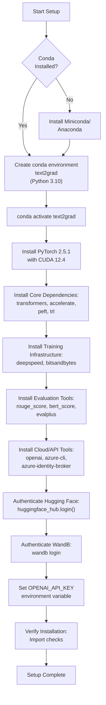
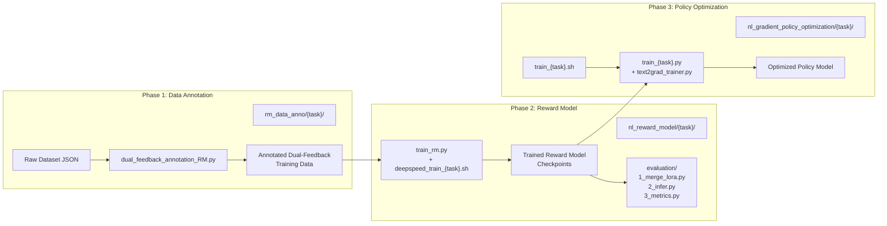
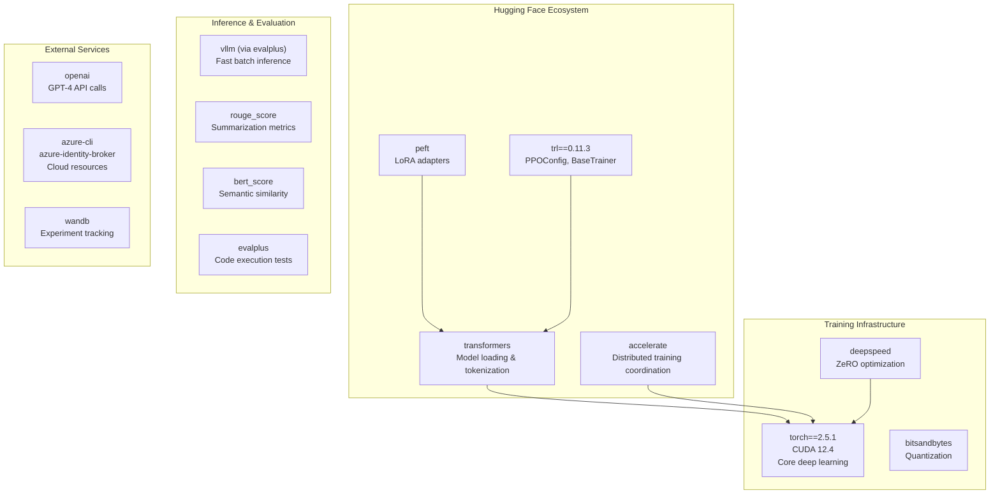
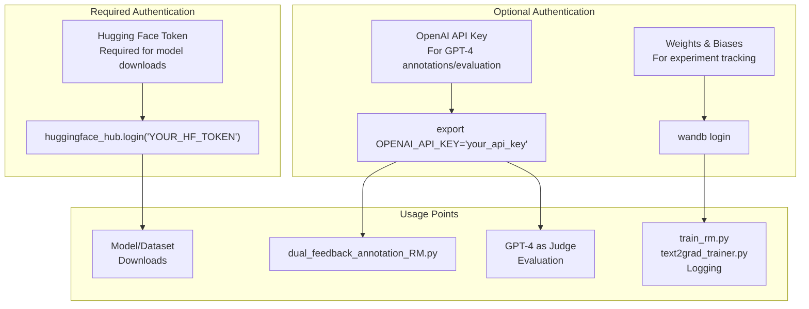

<!-- source: DeepWiki mcp.deepwiki.com · repo microsoft/Text2Grad · page 2 Getting Started · fetched 2026-10-26 -->

# Getting Started

<details>
<summary>Relevant source files</summary>

The following files were used as context for generating this wiki page:

- [README.md](README.md)
- [env.sh](env.sh)

</details>


This page provides an overview of the initial setup process and the basic workflow for using Text2Grad. It covers prerequisites, environment setup, and the three-phase pipeline structure. For detailed installation instructions, see [Installation](#2.1). For a complete walkthrough of running the pipeline on a specific task, see [Quick Start](#2.2).

## Prerequisites

Before setting up Text2Grad, ensure you have the following prerequisites:

| Requirement | Details | Purpose |
|------------|---------|---------|
| **Operating System** | Linux (recommended) or macOS | DeepSpeed and distributed training support |
| **Python** | 3.8 or higher (3.10 recommended) | Core runtime environment |
| **Conda** | Miniconda or Anaconda | Environment management |
| **CUDA** | 12.4 or compatible | GPU acceleration for training |
| **GPU Memory** | Minimum 24GB VRAM per GPU | Model training and inference |
| **Disk Space** | 50GB+ available | Models, datasets, and checkpoints |
| **API Keys** | OpenAI API key (optional) | Data annotation and GPT-4 evaluation |
| **Accounts** | Hugging Face account | Model and dataset downloads |
| **Accounts** | Weights & Biases account (optional) | Experiment tracking |

**Sources:** [README.md:1-93](), [env.sh:1-58]()

## Setup Overview

The setup process consists of three main stages: environment preparation, dependency installation, and service authentication.



**Setup Workflow**: The diagram shows the complete setup process from environment creation through authentication. The [env.sh:1-58]() script automates most of these steps.

**Sources:** [env.sh:1-58](), [README.md:76-92]()

## Three-Phase Pipeline Structure

Text2Grad follows a three-phase pipeline architecture. Each phase corresponds to specific directories and scripts in the codebase:



**Pipeline Architecture**: This diagram maps the conceptual three-phase pipeline to actual code locations and scripts. The `{task}` placeholder represents `kodcode`, `ultrafeedback`, or `slf5k`.

**Sources:** [README.md:127-145](), [README.md:149-294]()

## Task-Specific Directory Structure

Each task domain (code generation, question answering, summarization) follows the same directory structure across all three phases:

| Task | Directory Suffix | Dataset | Primary Evaluation |
|------|-----------------|---------|-------------------|
| **Code Generation** | `kodcode/` | KodCode-Light-RL-10K | EvalPlus (HumanEval+, MBPP+) |
| **Question Answering** | `ultrafeedback/` | UltraFeedback-Binarized | MT-Bench, ARC-C, AlpacaEval 2.0 |
| **Summarization** | `slf5k/` | SLF5K | ROUGE, BERTScore, GPT-4 |

**Example paths for KodCode:**
- Data annotation: `rm_data_anno/kodcode/dual_feedback_annotation_RM.py`
- Reward model training: `nl_reward_model/kodcode/train_rm.py`
- Policy optimization: `nl_gradient_policy_optimization/kodcode/train_kodcode.py`

**Sources:** [README.md:127-145](), [README.md:100-123](), [README.md:297-353]()

## Key Dependencies and Their Roles



**Dependency Graph**: Shows the hierarchical relationship between key dependencies. Core packages (Hugging Face ecosystem) build on PyTorch, while specialized tools serve specific purposes.

**Sources:** [env.sh:20-49](), [README.md:73-74]()

## Environment Setup Script

The [env.sh:1-58]() script automates the entire setup process. Key sections:

| Script Section | Lines | Purpose |
|---------------|-------|---------|
| Conda environment creation | [env.sh:8-18]() | Creates `text2grad` environment with Python 3.10 |
| PyTorch installation | [env.sh:20-22]() | Installs PyTorch 2.5.1 with CUDA 12.4 support |
| Core packages | [env.sh:24-32]() | Installs transformers, peft, trl, accelerate |
| Evaluation tools | [env.sh:33-35]() | Installs rouge, bert_score, evalplus |
| Cloud/API packages | [env.sh:37-43]() | Installs openai, azure-cli, azure-identity-broker |
| Service authentication | [env.sh:45-55]() | Sets up wandb and huggingface_hub |

**Running the setup:**
```bash
bash env.sh
```

The script will prompt for Weights & Biases login. This is optional and can be skipped by pressing Ctrl+C.

**Sources:** [env.sh:1-58](), [README.md:76-85]()

## Authentication Requirements

Different phases of the pipeline require different authentication tokens:



**Authentication Flow**: Shows when each authentication token is used during the pipeline execution.

**Setting OpenAI API key:**
```bash
export OPENAI_API_KEY="your_api_key"
```

**Logging in to Hugging Face:**
```bash
python -c "from huggingface_hub import login; login('YOUR_HF_TOKEN')"
```

**Sources:** [README.md:87-92](), [env.sh:45-55]()

## Verification Steps

After running [env.sh:1-58](), verify the installation:

**1. Check conda environment:**
```bash
conda activate text2grad
python --version  # Should show Python 3.10.x
```

**2. Verify PyTorch and CUDA:**
```bash
python -c "import torch; print(f'PyTorch: {torch.__version__}'); print(f'CUDA Available: {torch.cuda.is_available()}'); print(f'CUDA Version: {torch.version.cuda}')"
```

Expected output:
```
PyTorch: 2.5.1
CUDA Available: True
CUDA Version: 12.4
```

**3. Verify core dependencies:**
```bash
python -c "import transformers, peft, trl, accelerate, deepspeed; print('Core packages OK')"
```

**4. Verify evaluation tools:**
```bash
python -c "import rouge_score, bert_score; print('Evaluation packages OK')"
```

**5. Check GPU availability:**
```bash
nvidia-smi
```

Should display GPU information with available memory.

**Sources:** [env.sh:1-58](), [README.md:76-85]()

## Pipeline Execution Overview

Once setup is complete, the typical workflow for any task follows this sequence:

| Step | Action | Script/Command | Output |
|------|--------|----------------|--------|
| **1** | Annotate raw data | `python dual_feedback_annotation_RM.py` | Dual-feedback training data |
| **2** | Train reward model | `bash deepspeed_train_{task}.sh` | Reward model checkpoints |
| **3** | Evaluate reward model | `python 1_merge_lora.py`<br/>`python 2_infer.py`<br/>`python 3_metrics.py` | Evaluation metrics |
| **4** | Train policy with NL-gradients | `bash train_{task}.sh` | Optimized policy model |
| **5** | Evaluate policy | Task-specific benchmarks | Performance metrics |

**Sources:** [README.md:147-294]()

## Dataset Acquisition

Before running the pipeline, download the appropriate dataset:

**Code Generation (KodCode):**
```bash
# Available at: https://huggingface.co/datasets/KodCode/KodCode-Light-RL-10K
```

**Question Answering (UltraFeedback):**
```bash
# Available at: https://huggingface.co/datasets/HuggingFaceH4/ultrafeedback_binarized
```

**Summarization (SLF5K):**
```bash
# Available at: https://huggingface.co/datasets/JeremyAlain/SLF5K
```

All datasets are downloaded automatically by the scripts if you have authenticated with Hugging Face. See [Input Data Formats](#4.1) for details on expected JSON structures.

**Sources:** [README.md:94-123]()

## Common Setup Issues

| Issue | Symptom | Solution |
|-------|---------|----------|
| **Conda not found** | `env.sh` exits with "Conda not found" | Install Miniconda from https://docs.conda.io/en/latest/miniconda.html |
| **CUDA version mismatch** | `torch.cuda.is_available()` returns `False` | Check NVIDIA driver supports CUDA 12.4: `nvidia-smi` |
| **Out of memory** | Training crashes with OOM | Reduce batch size, enable gradient checkpointing, use ZeRO Stage 3 |
| **Hugging Face authentication** | Cannot download models | Run `huggingface_hub.login()` or set HF_TOKEN environment variable |
| **OpenAI API key** | Annotation scripts fail | Set `export OPENAI_API_KEY="your_api_key"` |
| **DeepSpeed errors** | Training fails to initialize | Check CUDA, PyTorch, and DeepSpeed versions are compatible |

For detailed troubleshooting, see [Error Handling and Logging](#8.2).

**Sources:** [env.sh:1-58](), [README.md:76-92]()

## Next Steps

After completing the setup:

1. **Follow the detailed installation guide:** See [Installation](#2.1) for step-by-step instructions and troubleshooting.

2. **Run the quick start tutorial:** See [Quick Start](#2.2) for a complete walkthrough of the pipeline on one task.

3. **Understand the architecture:** See [System Architecture](#3) to understand how the three components interact.

4. **Choose your task:**
   - Code Generation: See [Code Generation (KodCode)](#7.1)
   - Question Answering: See [Question Answering (UltraFeedback)](#7.2)
   - Summarization: See [Summarization (SLF5K)](#7.3)

5. **Explore advanced topics:** See [Advanced Topics](#8) for multi-GPU configuration, hyperparameter tuning, and memory optimization.

**Sources:** [README.md:1-372]()

---

