<!-- source: DeepWiki mcp.deepwiki.com · repo microsoft/Text2Grad · page 2.1 Installation · fetched 2026-10-26 -->

# Installation

<details>
<summary>Relevant source files</summary>

The following files were used as context for generating this wiki page:

- [README.md](README.md)
- [env.sh](env.sh)

</details>


This page provides detailed instructions for setting up the Text2Grad development environment. It covers prerequisite software, dependency installation, and authentication with external services. For information about running your first end-to-end pipeline after installation, see [Quick Start](#2.2).

## Prerequisites

Before beginning installation, ensure the following software is available on your system:

| Requirement | Version | Purpose |
|-------------|---------|---------|
| Conda (Miniconda or Anaconda) | Any recent version | Python environment management |
| Git | Any recent version | Repository cloning and version control |
| CUDA Toolkit | 12.4 or compatible | GPU acceleration for PyTorch |
| NVIDIA GPU | - | Required for training and inference |

The installation script [env.sh:8-17]() checks for conda availability and exits if not found. Ensure conda is in your system PATH before proceeding.

**Sources:** [env.sh:1-18]()

## Installation Workflow

```mermaid
graph TB
    START["User"] --> CLONE["Clone Repository<br/>git clone"]
    CLONE --> CHECK{["conda command<br/>available?"]}
    CHECK -->|No| ERROR["Exit with error<br/>Install Miniconda/Anaconda"]
    CHECK -->|Yes| CREATE["conda create -n text2grad<br/>python=3.10"]
    CREATE --> ACTIVATE["conda activate text2grad"]
    ACTIVATE --> TORCH["Install PyTorch 2.5.1<br/>with CUDA 12.4"]
    TORCH --> CORE["Install Core Packages<br/>trl, transformers, peft,<br/>accelerate, deepspeed"]
    CORE --> ML["Install ML Utilities<br/>scikit-learn, pandas,<br/>numpy==1.26.4"]
    ML --> EVAL["Install Evaluation Tools<br/>rouge, bert_score,<br/>evalplus with vllm"]
    EVAL --> CLOUD["Install Cloud/API Packages<br/>azure-cli, openai,<br/>azure-identity-broker"]
    CLOUD --> WANDB["Install wandb<br/>Prompt for login"]
    WANDB --> HF["Install huggingface_hub<br/>Instructions for login"]
    HF --> COMPLETE["Environment Ready"]
    
    COMPLETE -.-> VERIFY["Verification:<br/>Import checks,<br/>GPU availability"]
```

**Sources:** [README.md:76-85](), [env.sh:1-58]()

## Step-by-Step Installation

### 1. Clone the Repository

```bash
git clone https://github.com/microsoft/Text2Grad
cd Text2Grad
```

The repository URL in [README.md:80]() may differ from the canonical Microsoft repository. Use the appropriate URL for your fork or the official repository.

**Sources:** [README.md:78-81]()

### 2. Run the Installation Script

Execute the environment setup script:

```bash
bash env.sh
```

This script [env.sh:1-58]() performs all installation steps automatically. The following sections detail what each step accomplishes.

**Sources:** [README.md:84](), [env.sh:1-4]()

### 3. Conda Environment Creation

The script creates a conda environment named `text2grad` with Python 3.10:

```bash
conda create -n text2grad python=3.10 -y
```

The environment is activated using [env.sh:13]():

```bash
eval "$(conda shell.bash hook)"
conda activate text2grad
```

If conda is not found, the script exits with an error at [env.sh:16-18]().

**Sources:** [env.sh:8-18]()

### 4. PyTorch Installation

PyTorch 2.5.1 is installed with CUDA 12.4 support from [env.sh:21-22]():

```bash
pip install torch==2.5.1 torchvision==0.20.1 torchaudio==2.5.1 \
    --index-url https://download.pytorch.org/whl/cu124
```

This specific version ensures compatibility with the CUDA kernels used by DeepSpeed and other acceleration libraries.

**Sources:** [env.sh:20-22]()

## Core Dependencies

The following diagram maps each dependency to its role in the Text2Grad system:

```mermaid
graph TB
    subgraph "Training Framework"
        TRL["trl==0.11.3<br/>PPOTrainer, PPOConfig"]
        PEFT["peft<br/>LoRA adapters"]
        TRANS["transformers<br/>AutoModel, AutoTokenizer"]
        ACC["accelerate<br/>Distributed training"]
        DS["deepspeed<br/>ZeRO optimization"]
    end
    
    subgraph "Model Serving"
        VLLM["evalplus[vllm]<br/>Fast inference pipeline"]
        BNB["bitsandbytes<br/>Quantization"]
    end
    
    subgraph "Evaluation Metrics"
        ROUGE["rouge, rouge_score<br/>N-gram overlap"]
        BERT["bert_score<br/>Semantic similarity"]
        EVALPLUS["evalplus<br/>Code execution tests"]
    end
    
    subgraph "Data Processing"
        SKL["scikit-learn<br/>Metrics, utilities"]
        PANDAS["pandas<br/>Data manipulation"]
        NUMPY["numpy==1.26.4<br/>Array operations"]
    end
    
    subgraph "External Services"
        OPENAI["openai<br/>GPT-4 API client"]
        AZURE["azure-cli, azure-identity-broker<br/>Cloud authentication"]
        WANDB["wandb<br/>Experiment tracking"]
        HF["huggingface_hub<br/>Model hub access"]
    end
    
    TRL --> TEXT2GRAD["TEXT2GRADTrainer<br/>nl_gradient_policy_optimization"]
    PEFT --> RM["Reward Model Training<br/>nl_reward_model"]
    DS --> TRAIN["DeepSpeed Training Scripts<br/>deepspeed_train_*.sh"]
    VLLM --> INFER["Inference Scripts<br/>2_infer.py"]
    EVALPLUS --> EVAL["Code Evaluation<br/>HumanEval, MBPP"]
    WANDB --> LOG["Training Logs<br/>Metrics tracking"]
```



**Sources:** [env.sh:25-35](), [env.sh:41-48]()

### Package Installation Details

The core packages are installed in [env.sh:25-35]():

| Package | Version | Installation Note |
|---------|---------|-------------------|
| `trl` | 0.11.3 | Provides `PPOTrainer` base class used by `TEXT2GRADTrainer` |
| `peft` | Latest | Installed with `--no-dependencies` to avoid conflicts |
| `transformers` | Latest | Core library for loading Llama models |
| `numpy` | 1.26.4 | Pinned version for compatibility |
| `accelerate` | Latest | Required for multi-GPU training coordination |
| `bitsandbytes` | Latest | GPU quantization support |
| `deepspeed` | Latest | ZeRO Stage 3 optimization |

The `peft` package is installed with `--no-dependencies` at [env.sh:28]() to prevent version conflicts with other packages that may have stricter dependency requirements.

**Sources:** [env.sh:25-32]()

### Evaluation and Utility Packages

Evaluation tools are installed at [env.sh:33-35]():

```bash
pip install rouge rouge_score
pip install bert_score deepspeed azure-cli
pip install --upgrade "evalplus[vllm] @ git+https://github.com/evalplus/evalplus"
```

- `rouge` and `rouge_score`: Used in [nl_reward_model/*/evaluation/3_metrics.py]() for text similarity
- `bert_score`: Semantic similarity metrics for summarization evaluation
- `evalplus[vllm]`: Code generation evaluation framework with VLLM inference backend, installed from git repository

**Sources:** [env.sh:33-35]()

## External Service Authentication

### OpenAI API Configuration

The OpenAI API is used for GPT-4-based evaluation and data annotation. Configure the API key as an environment variable:

```bash
export OPENAI_API_KEY="your_api_key"
```

This can be added to your shell configuration file (`~/.bashrc`, `~/.zshrc`, etc.) for persistence across sessions. The key is accessed by scripts in [rm_data_anno/]() for dual-feedback annotation.

**Sources:** [README.md:87-92]()

### Weights & Biases Setup

The installation script prompts for WandB login at [env.sh:46-49]():

```bash
pip install wandb
wandb login
```

WandB tracks training metrics in all policy optimization scripts. The login prompt can be skipped with Ctrl+C if you prefer to configure WandB later or disable logging.

To disable WandB logging entirely, set:

```bash
export WANDB_MODE=disabled
```

**Sources:** [env.sh:45-49]()

### Hugging Face Hub Authentication

The Hugging Face Hub provides access to pre-trained models (Llama-3.1-8B-Instruct) and datasets (KodCode, UltraFeedback, SLF5K). The installation script at [env.sh:52-55]() provides instructions:

```bash
pip install huggingface_hub
python -c "from huggingface_hub import login; login('YOUR_HF_TOKEN')"
```

Obtain a token from [https://huggingface.co/settings/tokens](https://huggingface.co/settings/tokens). For some models (particularly Llama variants), you may need to accept license agreements on the model's Hugging Face page before downloading.

**Sources:** [env.sh:51-55]()

### Azure Configuration (Optional)

Azure CLI and identity broker are installed at [env.sh:34]() and [env.sh:43](). These are optional and used only if running on Azure infrastructure:

```bash
pip install azure-cli
pip install azure-identity-broker --upgrade
```

Most users can ignore these packages for local development.

**Sources:** [env.sh:34](), [env.sh:41-43]()

## Post-Installation Verification

After installation completes, verify the environment:

### 1. Activate Environment

```bash
conda activate text2grad
```

Note: The script output at [env.sh:57]() incorrectly references `conda activate ppo`. The correct environment name is `text2grad`.

**Sources:** [env.sh:57]()

### 2. Check PyTorch and CUDA

```python
import torch
print(f"PyTorch version: {torch.__version__}")
print(f"CUDA available: {torch.cuda.is_available()}")
print(f"CUDA version: {torch.version.cuda}")
print(f"GPU count: {torch.cuda.device_count()}")
```

Expected output:
```
PyTorch version: 2.5.1
CUDA available: True
CUDA version: 12.4
GPU count: <number of available GPUs>
```

### 3. Verify Core Imports

```python
# Training framework
from trl import PPOConfig
from peft import LoraConfig
from transformers import AutoModelForCausalLM, AutoTokenizer
from accelerate import Accelerator

# Inference and evaluation  
import vllm
from rouge_score import rouge_scorer
from bert_score import score

# External services
import openai
import wandb
from huggingface_hub import login
```

If any import fails, reinstall the corresponding package.

**Sources:** [env.sh:25-48]()

## Troubleshooting

### Conda Activation Fails

If `conda activate text2grad` fails with "command not found", initialize conda for your shell:

```bash
conda init bash  # or zsh, fish, etc.
# Restart your shell
conda activate text2grad
```

**Sources:** [env.sh:12-14]()

### CUDA Version Mismatch

If your system CUDA version differs from 12.4, install the appropriate PyTorch build:

```bash
# For CUDA 11.8
pip install torch==2.5.1 torchvision==0.20.1 torchaudio==2.5.1 \
    --index-url https://download.pytorch.org/whl/cu118

# For CUDA 12.1
pip install torch==2.5.1 torchvision==0.20.1 torchaudio==2.5.1 \
    --index-url https://download.pytorch.org/whl/cu121
```

Verify compatibility with your GPU driver using `nvidia-smi`.

**Sources:** [env.sh:20-22]()

### DeepSpeed Installation Issues

DeepSpeed requires CUDA development headers. On Ubuntu/Debian:

```bash
sudo apt-get install libcudnn8-dev
```

If build errors persist, install pre-built wheels:

```bash
pip install deepspeed --no-build-isolation
```

### EvalPlus Installation Fails

The EvalPlus installation at [env.sh:35]() uses git installation, which requires git credentials if the repository is private. If this fails:

```bash
pip install evalplus[vllm]
```

This installs from PyPI instead of the git repository.

**Sources:** [env.sh:35]()

### WandB Login Hangs

If the WandB login prompt at [env.sh:49]() hangs, skip it with Ctrl+C and configure later:

```bash
wandb login --relogin
```

Or use an API key directly:

```bash
export WANDB_API_KEY="your_key"
```

**Sources:** [env.sh:46-49]()

## Environment File Structure

After successful installation, the conda environment contains:

```
$CONDA_PREFIX/text2grad/
├── bin/
│   ├── python          # Python 3.10 interpreter
│   ├── deepspeed       # DeepSpeed launcher
│   ├── wandb           # WandB CLI
│   └── ...
├── lib/python3.10/site-packages/
│   ├── torch/          # PyTorch with CUDA 12.4
│   ├── transformers/   # Hugging Face transformers
│   ├── trl/            # TRL with PPOTrainer
│   ├── peft/           # PEFT with LoRA
│   ├── deepspeed/      # DeepSpeed optimization
│   ├── vllm/           # VLLM inference engine
│   └── ...
└── ...
```

**Sources:** [env.sh:1-58]()

## Next Steps

After successful installation:

1. **Test the environment**: Follow the [Quick Start](#2.2) guide to run a minimal training pipeline
2. **Download datasets**: See [Datasets](#-datasets) section in README for links to KodCode, UltraFeedback, and SLF5K
3. **Configure task-specific paths**: Update file paths in training scripts under [nl_gradient_policy_optimization/]()

For detailed information about the system architecture and how components interact, see [System Architecture](#3).

**Sources:** [README.md:1-372]()

---

