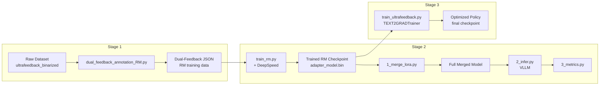
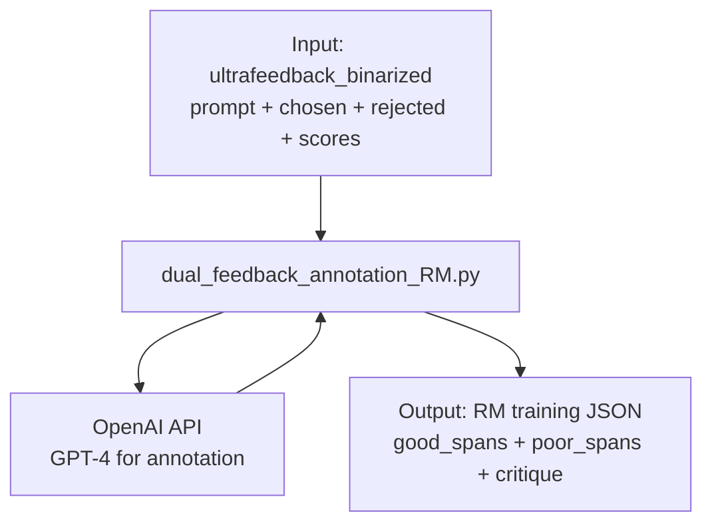
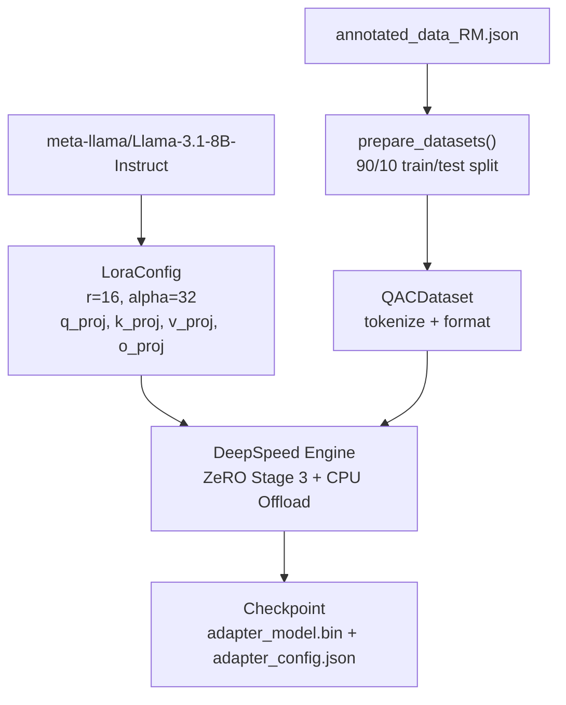
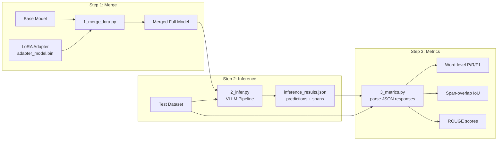
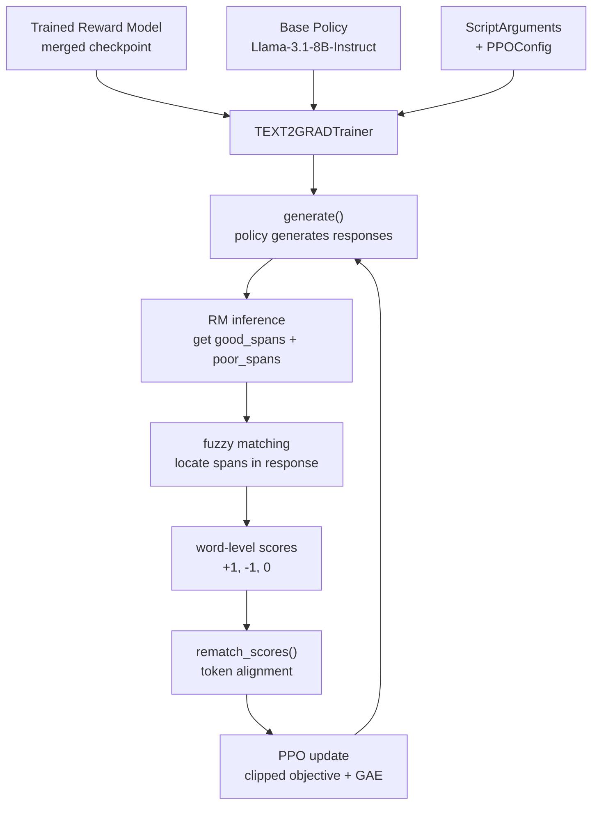

<!-- source: DeepWiki mcp.deepwiki.com · repo microsoft/Text2Grad · page 2.2 Quick Start · fetched 2026-10-26 -->

# Quick Start

<details>
<summary>Relevant source files</summary>

The following files were used as context for generating this wiki page:

- [README.md](README.md)
- [nl_reward_model/kodcode/train_rm.py](nl_reward_model/kodcode/train_rm.py)

</details>


This guide walks through running the complete Text2Grad pipeline on the **UltraFeedback** question-answering task, from raw data annotation through policy optimization. By the end, you will have trained a reward model and optimized a policy model using natural language gradients.

**Scope**: This page covers the practical steps to run one complete pipeline. For detailed explanations of the architecture, see [System Architecture](#3). For task-specific details on other domains, see [Task-Specific Guides](#7). For installation prerequisites, see [Installation](#2.1).

---

## Pipeline Overview

The Text2Grad system consists of three sequential stages. This quick start executes all three for the UltraFeedback task:



**Sources**: [README.md:147-293]()

---

## Prerequisites

Before starting, ensure you have:
1. Completed the [Installation](#2.1) steps
2. Set your OpenAI API key (used for annotation): `export OPENAI_API_KEY="your_key"`
3. At least 2 GPUs with 30GB+ VRAM for training

**Sources**: [README.md:76-92]()

---

## Stage 1: Data Annotation

### Overview

The annotation stage converts raw UltraFeedback data into dual-feedback format by pairing natural language critiques with specific token spans.



### Input Format

UltraFeedback data contains prompt-response pairs with preference scores. Example structure:

| Field | Description | Type |
|-------|-------------|------|
| `prompt` | User question/instruction | string |
| `response` | List of conversational turns | list[dict] |
| `is_chosen` | Whether this is the preferred response | boolean |
| `score_chosen` | Quality score for chosen response | float |
| `score_rejected` | Quality score for rejected response | float |
| `critique` | Natural language feedback | string |

**Sources**: [README.md:173-196]()

### Running Annotation

```bash
cd rm_data_anno/ultrafeedback
python dual_feedback_annotation_RM.py \
    --data_path path/to/ultrafeedback_binarized.json
```

The script processes each example through the OpenAI API to generate structured annotations. The output file contains:
- `good_spans`: List of text spans that are high-quality
- `poor_spans`: List of text spans that need improvement
- `critique`: Natural language explanation of the feedback

**Expected Runtime**: ~2-4 hours for 10K examples (depends on API rate limits)

**Output Location**: `rm_data_anno/ultrafeedback/annotated_data_RM.json`

**Sources**: [README.md:149-158]()

---

## Stage 2: Reward Model Training

### Overview

The reward model learns to predict span-level rewards and generate explanatory critiques. Training uses LoRA for parameter efficiency and DeepSpeed ZeRO-3 for memory optimization.



### Training Command

Navigate to the reward model directory and run the training script:

```bash
cd nl_reward_model/ultrafeedback
bash deepspeed_train_ultrafeedback.sh
```

The shell script internally calls `train_rm.py` with DeepSpeed configuration. Key components:

| Component | Implementation | File Reference |
|-----------|---------------|----------------|
| Dataset class | `QACDataset` | [nl_reward_model/kodcode/train_rm.py:22-121]() |
| Data splitting | `prepare_datasets()` | [nl_reward_model/kodcode/train_rm.py:124-156]() |
| LoRA application | `apply_lora()` | [nl_reward_model/kodcode/train_rm.py:183-206]() |
| DeepSpeed config | `get_deepspeed_config()` | [nl_reward_model/kodcode/train_rm.py:209-260]() |
| Training loop | `train()` | [nl_reward_model/kodcode/train_rm.py:325-402]() |

### Key Configuration Parameters

From the training script configuration:

```python
config = {
    "model_name": "meta-llama/Llama-3.1-8B-Instruct",
    "batch_size": 2,
    "epochs": 3,
    "prompt_max_length": 900,
    "max_length": 1250,
}
```

**Expected Runtime**: ~8-12 hours on 2x A100 GPUs for 3 epochs

**Output Location**: `nl_reward_model/ultrafeedback/ckpt/text2grad_ultrafeedback_RM/`

Checkpoints are saved every 400 steps after step 200: `{epoch}_{step}/adapter_model.bin`

**Sources**: [nl_reward_model/kodcode/train_rm.py:1-426](), [README.md:222-233]()

---

## Stage 3: Reward Model Evaluation

### Overview

Evaluation consists of three sequential steps that merge the LoRA adapters, run inference on test data, and calculate metrics.



### Step 3.1: Merge LoRA Weights

Combine the trained LoRA adapters with the base model:

```bash
cd nl_reward_model/ultrafeedback/evaluation
python 1_merge_lora.py \
    --base_model "meta-llama/Llama-3.1-8B-Instruct" \
    --lora_model "../ckpt/text2grad_ultrafeedback_RM/0_4400" \
    --save_dir "../ckpt/text2grad_ultrafeedback_RM/0_4400_merge" \
    --merge_and_save True
```

### Step 3.2: Run Inference

Generate predictions on the test dataset using VLLM for efficient batch processing:

```bash
python 2_infer.py \
    --model_path "../ckpt/text2grad_ultrafeedback_RM/0_4400_merge" \
    --dataset_path "../data/ultrafeedback_test.json" \
    --output_file "inference_results_0_4400.json" \
    --batch_size 40 \
    --prompt_max_length 1000 \
    --max_length 1600 \
    --max_new_tokens 350 \
    --gpu_ids "0,1" \
    --gpu_memory "30GiB"
```

**Key Parameters**:
- `batch_size`: Number of examples processed simultaneously (adjust based on GPU memory)
- `gpu_ids`: Comma-separated GPU indices to use
- `gpu_memory`: Memory limit per GPU

**Expected Runtime**: ~1-2 hours for 1K test examples

### Step 3.3: Calculate Metrics

Compute evaluation metrics comparing predictions to ground truth:

```bash
python 3_metrics.py \
    --input_file "inference_results_0_4400.json" \
    --output_file "word_level_evaluation_results.json"
```

The script calculates:

| Metric Type | Measures | Output Fields |
|-------------|----------|---------------|
| Word-level | Precision/Recall/F1 for each score class (-1, 0, +1) | `word_level_metrics` |
| Span-level | IoU-based overlap for contiguous spans | `span_metrics` |
| Text-level | ROUGE-1/2/L for critique quality | `rouge_scores` |

**Sources**: [README.md:236-273]()

---

## Stage 4: Policy Optimization with NL-Gradients

### Overview

The final stage uses the trained reward model to optimize a policy model via PPO with natural language gradients. The `TEXT2GRADTrainer` manages the training loop.



### Training Command

```bash
cd nl_gradient_policy_optimization/ultrafeedback
bash train_ultrafeedback.sh
```

### Core Training Components

The training script uses the following key classes and functions:

| Component | Class/Function | Purpose |
|-----------|----------------|---------|
| Trainer | `TEXT2GRADTrainer` | Main training loop coordinator |
| Config | `PPOConfig` | PPO hyperparameters |
| Arguments | `ScriptArguments` | Paths, model names, generation params |
| Generation | `ppo_trainer.generate()` | Generate responses from policy |
| Reward Extraction | Pipeline in training loop | Extract spans from RM feedback |
| Score Alignment | `rematch_scores()` | Align word scores to tokens |
| PPO Update | `step()` method | Compute advantages and update policy |

### Key Hyperparameters

Typical configuration from training scripts:

```python
# Generation parameters
max_new_tokens = 512
temperature = 0.7
top_p = 0.9

# PPO parameters
learning_rate = 1.41e-5
batch_size = 16
mini_batch_size = 4
gradient_accumulation_steps = 1

# Reward parameters
kl_penalty = "kl"  # KL penalty type
init_kl_coef = 0.05  # Initial KL coefficient
```

**Expected Runtime**: ~24-48 hours for full training depending on dataset size and hardware

**Output Location**: `nl_gradient_policy_optimization/ultrafeedback/ckpt/`

Checkpoints are saved periodically and include:
- `adapter_model.bin`: LoRA adapter weights
- `value_head.bin`: Value network weights
- `optimizer.pt`: Optimizer state for resumption

**Sources**: [README.md:277-293]()

---

## Verification and Next Steps

### Verify Outputs

After completing all stages, you should have:

1. **Annotated Data**: `rm_data_anno/ultrafeedback/annotated_data_RM.json`
2. **Reward Model**: `nl_reward_model/ultrafeedback/ckpt/text2grad_ultrafeedback_RM/{epoch}_{step}_merge/`
3. **Evaluation Metrics**: `nl_reward_model/ultrafeedback/evaluation/word_level_evaluation_results.json`
4. **Optimized Policy**: `nl_gradient_policy_optimization/ultrafeedback/ckpt/final_checkpoint/`

### Check Training Logs

All training runs log to Weights & Biases (WandB). Check your project dashboard for:
- Training loss curves
- Evaluation metrics over time
- Generated examples with feedback
- KL divergence and reward statistics

### Evaluate Final Model

For comprehensive evaluation of the optimized policy, use task-specific benchmarks:

- **MT-Bench**: Multi-turn conversation quality
- **ARC-C**: Reasoning capability
- **AlpacaEval 2.0**: General instruction-following

See [UltraFeedback Evaluation](#7.2.4) for detailed evaluation instructions.

### Explore Other Tasks

Once you've completed the UltraFeedback pipeline, try:
- [Code Generation (KodCode)](#7.1) for code optimization with execution feedback
- [Summarization (SLF5K)](#7.3) for text summarization with word-level annotations

Each task follows the same three-stage pipeline with task-specific data formats and evaluation metrics.

**Sources**: [README.md:297-359]()

---

## Common Issues and Solutions

| Issue | Cause | Solution |
|-------|-------|----------|
| Out of memory during RM training | Large model + batch size | Reduce `batch_size` in config, enable gradient checkpointing |
| Slow annotation | API rate limits | Process in smaller batches, use parallel workers |
| VLLM inference fails | GPU memory fragmentation | Reduce `batch_size` or `gpu_memory` parameter |
| NaN losses during PPO | Learning rate too high | Reduce `learning_rate` or increase `init_kl_coef` |
| Checkpoint not found | Incorrect path | Verify paths match between training and evaluation scripts |

For advanced troubleshooting, see [Error Handling and Logging](#8.2).

**Sources**: General system knowledge from codebase structure

---

