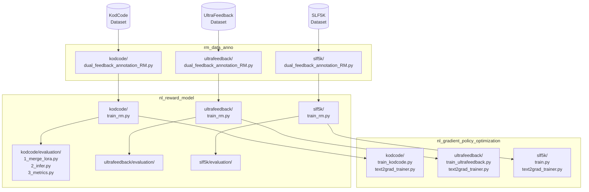
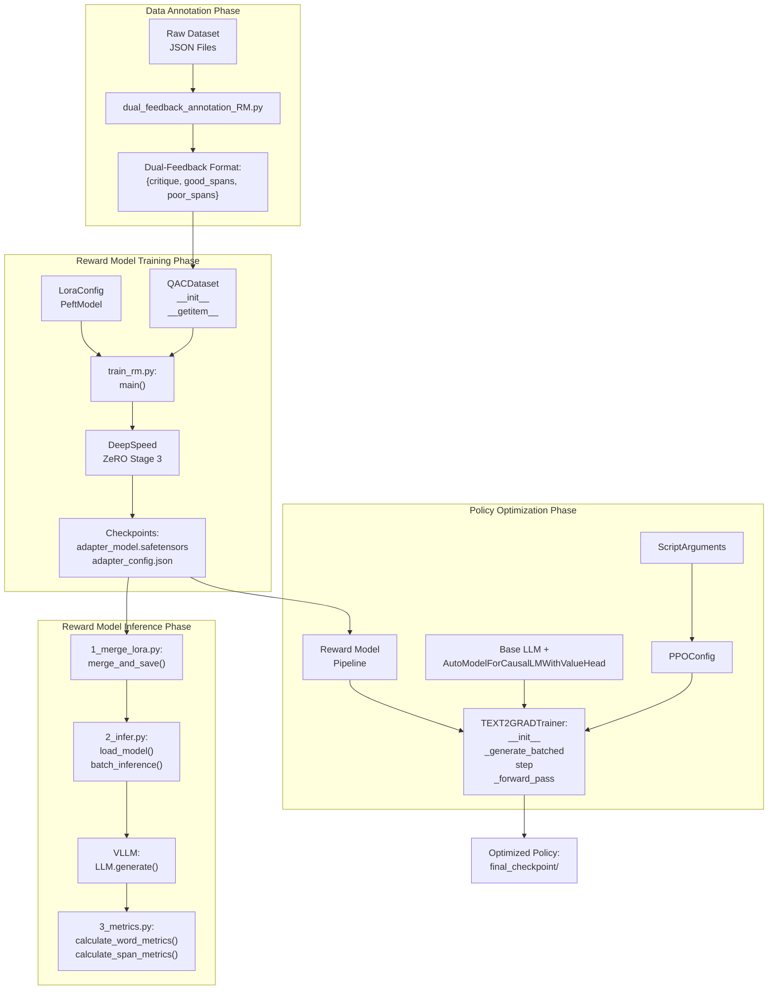

<!-- source: DeepWiki mcp.deepwiki.com · repo microsoft/Text2Grad · page 3 System Architecture · fetched 2026-10-26 -->

# System Architecture

<details>
<summary>Relevant source files</summary>

The following files were used as context for generating this wiki page:

- [README.md](README.md)

</details>


## Purpose and Scope

This page describes the overall architecture of the Text2Grad system, including its three-component pipeline, component interactions, and directory organization. For detailed information about each component's implementation, see [Three-Component Pipeline](#3.1). For task-specific configurations and workflows, see [Multi-Task Design](#3.2).

The Text2Grad system implements a novel approach to reinforcement learning from human feedback (RLHF) by converting natural language critiques into fine-grained, token-level gradients. Unlike traditional RLHF systems that operate on scalar rewards, Text2Grad maintains span-level feedback throughout the training pipeline.

---

## Architectural Overview

Text2Grad follows a modular, three-stage architecture where each component produces outputs consumed by the next stage. The system supports multiple tasks (code generation, question answering, summarization) through parallel pipelines that share common abstractions.

### Three-Component Pipeline

The system consists of three sequential components:

| Component | Directory | Key Outputs | Consumed By |
|-----------|-----------|-------------|-------------|
| **Data Annotation** | `rm_data_anno/{task}/` | Dual-feedback JSON files with spans and critiques | Reward Model Training |
| **Reward Model** | `nl_reward_model/{task}/` | Trained models that predict span-level rewards | Policy Optimization |
| **Policy Optimization** | `nl_gradient_policy_optimization/{task}/` | Optimized policy models | Downstream evaluation |

Each component is task-agnostic in design but task-specific in instantiation, allowing the same architectural patterns to apply across code generation (KodCode), question answering (UltraFeedback), and summarization (SLF5K).

**Sources:** [README.md:53-62](), [README.md:127-145]()

---

## Component Interaction and Data Flow

### System-Level Component Diagram



**Diagram: Directory structure showing three parallel task pipelines**

This diagram maps the conceptual three-component architecture to actual directories and files in the codebase. Each task (KodCode, UltraFeedback, SLF5K) has its own isolated pipeline with identical structure but task-specific implementations.

**Sources:** [README.md:127-145](), [README.md:149-218]()

---

### Class and Function-Level Interaction



**Diagram: Class-level interactions across all three components**

This diagram bridges natural language concepts to concrete code entities. Key classes include:
- `QACDataset`: Tokenizes and formats question-answer-critique triplets for training
- `TEXT2GRADTrainer`: Extends TRL's `PPOTrainer` with span-level reward processing
- `AutoModelForCausalLMWithValueHead`: Adds value estimation head to base language model
- `PeftModel`: Wraps LoRA adapter functionality

**Sources:** [README.md:221-274](), [README.md:277-293]()

---

## Component Responsibilities

### 1. Data Annotation Pipeline

**Primary Script:** `rm_data_anno/{task}/dual_feedback_annotation_RM.py`

**Responsibility:** Convert raw dataset formats into structured dual-feedback annotations that pair natural language critiques with specific token spans.

**Key Outputs:**
- `critique`: Natural language explanation of quality issues
- `good_spans`: List of token ranges with positive contributions
- `poor_spans`: List of token ranges with negative contributions

The annotation format is consistent across all tasks, enabling the reward model to learn unified feedback generation patterns.

**Sources:** [README.md:149-218]()

### 2. Fine-Grained Reward Model

**Training Script:** `nl_reward_model/{task}/train_rm.py`  
**Dataset Class:** `QACDataset`  
**Inference Scripts:** `nl_reward_model/{task}/evaluation/1_merge_lora.py`, `2_infer.py`, `3_metrics.py`

**Responsibility:** Train models to predict span-level rewards and generate explanatory critiques. The reward model learns from annotated data to identify which parts of generated text are high or low quality.

**Key Capabilities:**
- Generate structured JSON feedback with span annotations
- Predict word-level scores (-1, 0, +1)
- Provide natural language explanations for quality judgments

The reward model uses LoRA for parameter-efficient fine-tuning and DeepSpeed for scalable training on large models.

**Sources:** [README.md:221-274]()

### 3. NL-Gradient Policy Optimization

**Training Scripts:** `nl_gradient_policy_optimization/{task}/train_{task}.py`  
**Core Trainer:** `text2grad_trainer.py` (defines `TEXT2GRADTrainer` class)

**Responsibility:** Optimize policy models using PPO with token-level rewards derived from natural language feedback. The trainer converts span-level feedback into fine-grained gradient signals.

**Key Workflow:**
1. Generate responses using current policy
2. Send responses to reward model for span-level feedback
3. Use fuzzy string matching to locate spans in generated text
4. Convert span scores to token-level rewards via `rematch_scores()`
5. Apply PPO updates with clipped objective function

The `TEXT2GRADTrainer` extends TRL's base `PPOTrainer` with span-aware reward processing.

**Sources:** [README.md:277-293]()

---

## Directory Organization and Task Structure

The codebase follows a three-level hierarchy:

```
Component Level (3 directories)
├── Task Level (3 subdirectories per component)
│   ├── Script Level (training, inference, evaluation scripts)
│   └── Configuration Files (shell scripts, configs)
```

Each task directory contains:

| File Type | Purpose | Examples |
|-----------|---------|----------|
| **Training Scripts** | Main entry points for training | `train_rm.py`, `train_kodcode.py`, `train_ultrafeedback.py` |
| **Shell Scripts** | Launch distributed training | `deepspeed_train_*.sh`, `train_*.sh` |
| **Utility Modules** | Shared functionality | `text2grad_trainer.py`, dataset classes |
| **Evaluation Scripts** | Model assessment | `1_merge_lora.py`, `2_infer.py`, `3_metrics.py` |
| **Data Files** | Task-specific datasets | `kodcode_train.json`, `ultrafeedback_test.json` |

This organization allows:
- **Independent development**: Changes to one task don't affect others
- **Shared abstractions**: Common patterns (LoRA, DeepSpeed, PPO) reused across tasks
- **Parallel execution**: Multiple tasks can be trained simultaneously

**Sources:** [README.md:127-145]()

---

## Key Architectural Decisions

### Parameter-Efficient Fine-Tuning with LoRA

All models use LoRA (Low-Rank Adaptation) for efficient fine-tuning:
- Only adapter weights are trained and saved
- Base models remain frozen, reducing memory requirements
- Adapters can be merged back into base model for deployment

**Configuration:** Typical LoRA config uses `r=16`, `alpha=32`, targeting attention layers.

### DeepSpeed ZeRO Stage 3 Optimization

Training leverages DeepSpeed's ZeRO (Zero Redundancy Optimizer) Stage 3:
- **Parameter partitioning**: Each GPU holds a subset of model parameters
- **Gradient partitioning**: Gradients distributed across devices
- **Optimizer state partitioning**: Optimizer states offloaded to CPU
- **Memory savings**: Enables training 8B parameter models on consumer GPUs

**Invocation:** Training scripts use `deepspeed` launcher with custom ZeRO configs.

### Modular Reward Model Pipeline

The reward model is completely decoupled from policy training:
- Trained independently using supervised learning on annotated data
- Frozen during policy optimization
- Loaded via separate pipeline for inference
- Can be upgraded without retraining policy

This separation allows reward model improvements without restarting expensive policy training.

### Shared TEXT2GRADTrainer Abstraction

All three tasks share the same `TEXT2GRADTrainer` class with task-specific configurations:
- Same PPO update logic across tasks
- Task-specific prompt formatting via configuration
- Unified span matching and token alignment algorithms
- Common checkpointing and logging infrastructure

This reduces code duplication and ensures consistent behavior across tasks.

**Sources:** [README.md:53-75](), [README.md:221-293]()

---

## Component Independence and Interfaces

### Interface 1: Annotation → Reward Model

**Format:** JSON files with structure:
```
{
  "question": <input prompt>,
  "answer": <generated response>,
  "critique": <natural language feedback>,
  "good_spans": [list of positive token ranges],
  "poor_spans": [list of negative token ranges]
}
```

This interface is task-agnostic and consumed by `QACDataset` class.

### Interface 2: Reward Model → Policy Optimizer

**Format:** Structured JSON output from reward model:
```
{
  "critique": <explanation>,
  "good_spans": [list of good phrases],
  "poor_spans": [list of poor phrases]
}
```

The `TEXT2GRADTrainer` parses this output and uses fuzzy string matching to locate spans in generated text, converting them to token-level rewards.

### Interface 3: Policy Optimizer → Evaluation

**Format:** Model checkpoints saved as:
- `adapter_model.safetensors` (LoRA weights)
- `adapter_config.json` (LoRA configuration)
- `value_head.bin` (value function weights)
- `optimizer.pt` (optimizer state for resumption)

These checkpoints can be loaded for inference or merged with base models for deployment.

**Sources:** [README.md:163-216](), [README.md:237-270]()

---

## Scalability and Extensibility

The architecture supports extension in multiple dimensions:

### Adding New Tasks
1. Create directories under each component: `rm_data_anno/{newtask}/`, `nl_reward_model/{newtask}/`, `nl_gradient_policy_optimization/{newtask}/`
2. Implement task-specific annotation script following dual-feedback format
3. Configure `QACDataset` tokenization for task data format
4. Create training script inheriting from `TEXT2GRADTrainer`
5. Define task-specific evaluation metrics

### Upgrading Models
- Reward models can be retrained independently with improved annotations
- Policy models can switch base LLMs by changing `model_name_or_path` in configs
- LoRA adapters are modular and can be swapped without full retraining

### Scaling Training
- DeepSpeed configuration can be adjusted for more GPUs
- Batch sizes and gradient accumulation steps are configurable
- ZeRO stage can be increased (Stage 1 → 2 → 3) for memory optimization

**Sources:** [README.md:65-75](), [README.md:127-145]()

---

