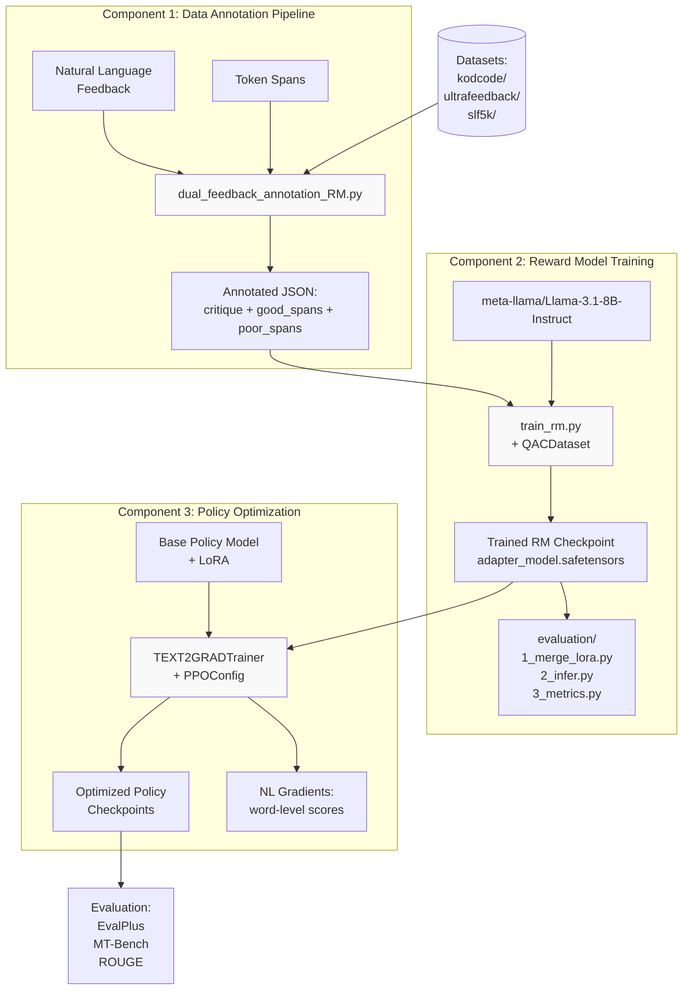
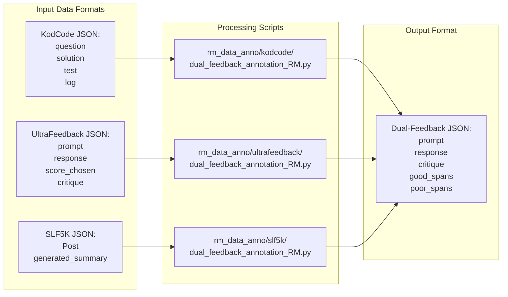
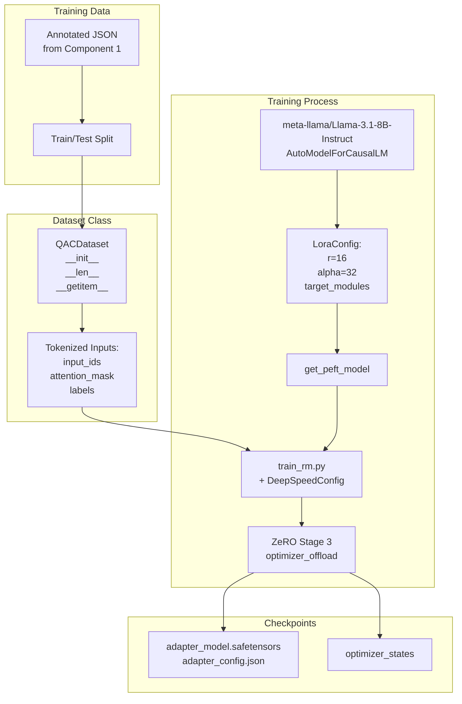
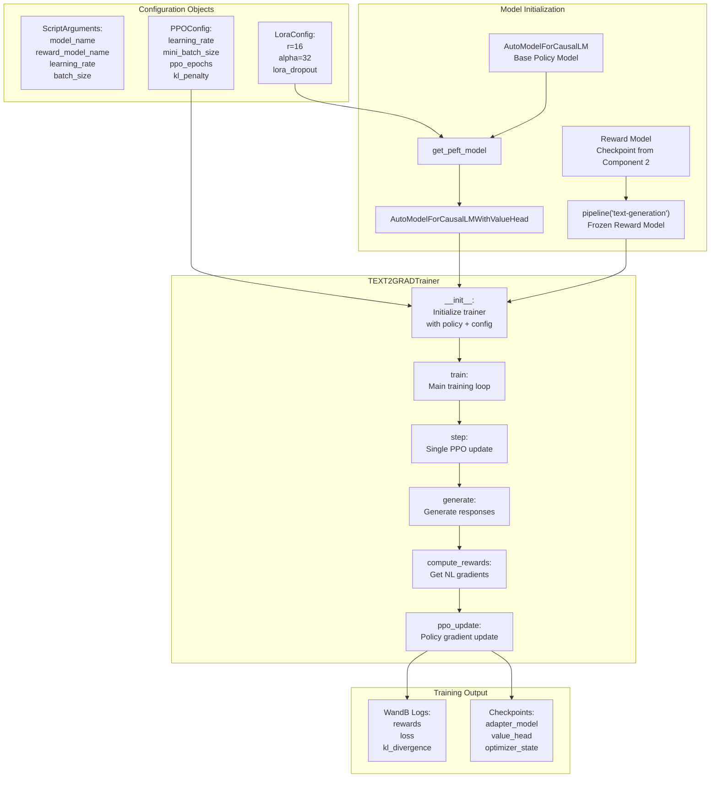

<!-- source: DeepWiki mcp.deepwiki.com · repo microsoft/Text2Grad · page 3.1 Three-Component Pipeline · fetched 2026-10-26 -->

# Three-Component Pipeline

<details>
<summary>Relevant source files</summary>

The following files were used as context for generating this wiki page:

- [README.md](README.md)

</details>


## Purpose and Scope

This page provides a detailed technical explanation of the three-component architecture that forms the core of the Text2Grad system. Each component is an independent stage in the pipeline that processes data, trains models, or optimizes policies using natural language feedback as gradient signals.

For task-specific implementation details, see [Multi-Task Design](#3.2). For detailed training procedures, see [Training Reward Models](#5.1) and [PPO Training Loop](#6.2).

---

## Architecture Overview

The Text2Grad system implements a sequential three-stage pipeline where each component feeds into the next. The components are:

1. **Data Annotation Pipeline**: Converts raw natural language feedback into structured dual-feedback format
2. **Fine-Grained Reward Model**: Trains models to predict span-level rewards and generate explanatory critiques
3. **NL-Gradient Policy Optimization**: Uses PPO with token-level rewards derived from natural language feedback



**Sources:** [README.md:1-372]()

---

## Component 1: Data Annotation Pipeline

### Purpose

The data annotation pipeline transforms raw datasets containing natural language feedback into a structured **dual-feedback format** that pairs textual critiques with specific token spans. This format enables fine-grained learning by explicitly marking which parts of a response are good or poor.

### Directory Structure

Each task has its own annotation directory under `rm_data_anno/`:

| Task | Directory | Main Script |
|------|-----------|-------------|
| Code Generation | `rm_data_anno/kodcode/` | `dual_feedback_annotation_RM.py` |
| Question Answering | `rm_data_anno/ultrafeedback/` | `dual_feedback_annotation_RM.py` |
| Summarization | `rm_data_anno/slf5k/` | `dual_feedback_annotation_RM.py` |

### Dual-Feedback Format

The annotation scripts generate JSON data with this structure:

```json
{
    "prompt": "Question or instruction text",
    "response": "Generated response to annotate",
    "critique": "Natural language explanation of issues/strengths",
    "good_spans": [[start_idx, end_idx], ...],
    "poor_spans": [[start_idx, end_idx], ...]
}
```

Each span is a character-level index pair `[start, end]` that identifies a substring in the response. The `critique` field provides natural language explanation, while the spans provide precise localization.

### Code-to-Concept Mapping



### Usage Example

```bash
cd rm_data_anno/ultrafeedback
python dual_feedback_annotation_RM.py \
    --data_path path/to/ultrafeedback_binarized \
    --output_path annotated_data.json
```

The annotation process is task-specific but produces a unified output format that Component 2 can consume.

**Sources:** [README.md:149-217]()

---

## Component 2: Fine-Grained Reward Model

### Purpose

The reward model component trains a language model to predict span-level rewards and generate explanatory critiques. It learns to identify which parts of a generated response are high-quality (good spans) or problematic (poor spans), providing the foundation for gradient signals in Component 3.

### Training Architecture



### Key Files and Classes

| Component | File Path | Key Classes/Functions |
|-----------|-----------|----------------------|
| Dataset | Task-specific under `nl_reward_model/{task}/` | `QACDataset` |
| Training | `nl_reward_model/{task}/train_rm.py` | `main()`, `train()` |
| Configuration | Task-specific shell scripts | DeepSpeed config, LoRA config |
| Evaluation | `nl_reward_model/{task}/evaluation/1_merge_lora.py` | `merge_lora_weights()` |
| Inference | `nl_reward_model/{task}/evaluation/2_infer.py` | `run_inference()` |
| Metrics | `nl_reward_model/{task}/evaluation/3_metrics.py` | `calculate_metrics()` |

### Training Commands by Task

| Task | Training Script | Checkpoint Output |
|------|----------------|-------------------|
| KodCode | `nl_reward_model/kodcode/deepspeed_train_kodcode.sh` | `ckpt/llama31-8B-kodcode/` |
| UltraFeedback | `nl_reward_model/ultrafeedback/deepspeed_train_ultrafeedback.sh` | `ckpt/llama31-8B-ultrafeedback/` |
| SLF5K | `nl_reward_model/slf5k/deepspeed_train_slf5k.sh` | `ckpt/llama31-8B-slf5k/` |

### Inference Pipeline

After training, the reward model is used in three steps:

1. **Merge LoRA**: `1_merge_lora.py` combines adapter weights with base model
2. **Batch Inference**: `2_infer.py` generates structured feedback using VLLM pipeline
3. **Compute Metrics**: `3_metrics.py` evaluates word-level and span-level accuracy

The model outputs JSON with the same structure as the training data:

```json
{
    "critique": "The response correctly identifies...",
    "good_spans": [[5, 42], [50, 78]],
    "poor_spans": [[85, 120]]
}
```

**Sources:** [README.md:221-274]()

---

## Component 3: NL-Gradient Policy Optimization

### Purpose

The policy optimization component uses Proximal Policy Optimization (PPO) enhanced with natural language gradients. Instead of scalar rewards, it operates on token-level feedback derived from the reward model's span-level annotations, enabling precise, targeted model improvements.

### Core Classes and Architecture



### TEXT2GRADTrainer Workflow

The `TEXT2GRADTrainer` class extends the TRL library's `BaseTrainer` and implements the natural language gradient mechanism:

1. **Generation**: Policy model generates responses for batch of prompts
2. **RM Inference**: Frozen reward model produces structured feedback (good_spans, poor_spans)
3. **Fuzzy Matching**: Locate identified spans in generated text using string similarity
4. **Word-Level Scoring**: Assign scores (+1, -1, 0) to each word based on span membership
5. **Token Alignment**: Map word-level scores to token-level rewards via `rematch_scores()`
6. **PPO Update**: Compute advantages and update policy using clipped objective

### Key Method Signatures

| Method | Location | Purpose |
|--------|----------|---------|
| `TEXT2GRADTrainer.__init__()` | Task-specific `text2grad_trainer.py` | Initialize trainer with models and config |
| `TEXT2GRADTrainer.step()` | Task-specific `text2grad_trainer.py` | Single PPO training step |
| `compute_rewards()` | Task-specific `text2grad_trainer.py` | Convert NL feedback to token rewards |
| `rematch_scores()` | Task-specific `text2grad_trainer.py` | Align word scores to token positions |
| `batched_forward_pass()` | Task-specific `text2grad_trainer.py` | Compute logprobs and values |

### Training Commands

| Task | Training Script | Main Training File |
|------|----------------|-------------------|
| KodCode | `nl_gradient_policy_optimization/kodcode/train_kodcode.sh` | `train_kodcode.py` |
| UltraFeedback | `nl_gradient_policy_optimization/ultrafeedback/train_ultrafeedback.sh` | `train_ultrafeedback.py` |
| SLF5K | `nl_gradient_policy_optimization/slf5k/train_slf5k.sh` | `train.py` |

Each training script instantiates `TEXT2GRADTrainer` and calls its `train()` method, which internally loops over batches calling `step()`.

**Sources:** [README.md:277-294]()

---

## Data Flow Between Components

### Component Dependencies

```mermaid
graph LR
    subgraph C1["Component 1"]
        A1["dual_feedback_annotation_RM.py"]
        O1["annotated_train.json<br/>annotated_test.json"]
        A1 --> O1
    end
    
    subgraph C2["Component 2"]
        I2["QACDataset loads<br/>annotated JSON"]
        T2["train_rm.py trains model"]
        O2["RM checkpoint:<br/>adapter_model.safetensors"]
        I2 --> T2
        T2 --> O2
    end
    
    subgraph C3["Component 3"]
        I3["Load RM checkpoint<br/>as frozen pipeline"]
        T3["TEXT2GRADTrainer.step:<br/>generate + get rewards<br/>+ ppo_update"]
        O3["Optimized policy<br/>checkpoints"]
        I3 --> T3
        T3 --> O3
    end
    
    O1 -->|"File I/O"| I2
    O2 -->|"Model loading"| I3
    
    style O1 fill:#f9f9f9
    style O2 fill:#f9f9f9
    style O3 fill:#f9f9f9
```



### Information Flow

1. **Component 1 → Component 2**: Annotated JSON files are read by `QACDataset` during reward model training
2. **Component 2 → Component 3**: Trained reward model checkpoint is loaded as a frozen inference pipeline
3. **Component 3 Output**: Optimized policy model used for final evaluation on benchmarks

Each component is **independent** and can be run, debugged, or improved separately:

- Annotation can be re-run with different prompting strategies
- Reward models can be retrained with different architectures or hyperparameters
- Policy optimization can experiment with different PPO variants or reward processing

### Component Independence Benefits

| Aspect | Benefit |
|--------|---------|
| **Modularity** | Each component has its own codebase and can be modified independently |
| **Debugging** | Issues can be isolated to a specific component |
| **Experimentation** | Try different reward models without re-annotating data |
| **Parallelization** | Multiple reward models can be trained simultaneously for different tasks |
| **Reusability** | A single reward model can be used for multiple PPO training runs |

**Sources:** [README.md:53-62](), [README.md:127-145]()

---

## Component Location Reference

### File System Mapping

The three-component architecture maps directly to the repository's directory structure:

```
Text2Grad/
├── rm_data_anno/              # Component 1: Data Annotation
│   ├── kodcode/
│   │   └── dual_feedback_annotation_RM.py
│   ├── ultrafeedback/
│   │   └── dual_feedback_annotation_RM.py
│   └── slf5k/
│       └── dual_feedback_annotation_RM.py
│
├── nl_reward_model/           # Component 2: Reward Model
│   ├── kodcode/
│   │   ├── train_rm.py
│   │   ├── deepspeed_train_kodcode.sh
│   │   └── evaluation/
│   │       ├── 1_merge_lora.py
│   │       ├── 2_infer.py
│   │       └── 3_metrics.py
│   ├── ultrafeedback/
│   │   └── [similar structure]
│   └── slf5k/
│       └── [similar structure]
│
└── nl_gradient_policy_optimization/  # Component 3: Policy Optimization
    ├── kodcode/
    │   ├── train_kodcode.py
    │   ├── text2grad_trainer.py
    │   └── train_kodcode.sh
    ├── ultrafeedback/
    │   ├── train_ultrafeedback.py
    │   ├── text2grad_trainer.py
    │   └── train_ultrafeedback.sh
    └── slf5k/
        ├── train.py
        ├── text2grad_trainer.py
        └── train_slf5k.sh
```

### Common Patterns Across Tasks

While each task (KodCode, UltraFeedback, SLF5K) has task-specific code, they follow identical structural patterns:

| Component | Pattern | Purpose |
|-----------|---------|---------|
| Component 1 | `dual_feedback_annotation_RM.py` in each task dir | Annotation script with task-specific parsing |
| Component 2 | `train_rm.py` + `evaluation/` in each task dir | Training and evaluation with shared logic |
| Component 3 | `train_{task}.py` + `text2grad_trainer.py` | Task-specific trainer extending shared patterns |

This consistency enables developers to understand one task and quickly navigate to others.

**Sources:** [README.md:127-145]()

---

