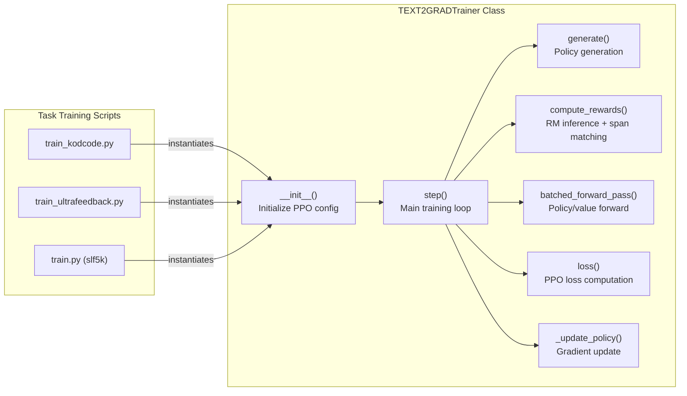
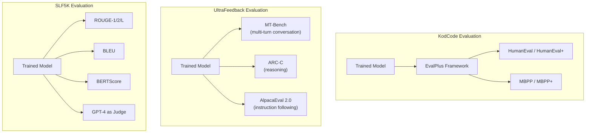
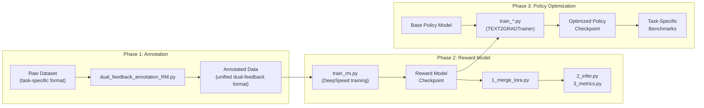

<!-- source: DeepWiki mcp.deepwiki.com · repo microsoft/Text2Grad · page 3.2 Multi-Task Design · fetched 2026-10-26 -->

# Multi-Task Design

<details>
<summary>Relevant source files</summary>

The following files were used as context for generating this wiki page:

- [README.md](README.md)

</details>


## Purpose and Scope

This document explains how Text2Grad implements multi-task support, enabling the same framework to handle Code Generation (KodCode), Question Answering (UltraFeedback), and Summarization (SLF5K) tasks. The design uses a parallel pipeline structure where each task maintains independent implementations while sharing core abstractions and interfaces.

For details on individual task workflows, see [Code Generation (KodCode)](#7.1), [Question Answering (UltraFeedback)](#7.2), and [Summarization (SLF5K)](#7.3). For the overall system architecture, see [Three-Component Pipeline](#3.1).

**Sources:** [README.md:1-372]()

---

## Design Philosophy

Text2Grad follows a **parallel pipeline architecture** where each task domain operates independently but follows an identical three-phase structure. This design enables:

1. **Task-specific optimization** without cross-task interference
2. **Independent development cycles** for each domain
3. **Reusable core components** (trainers, datasets, evaluation logic)
4. **Easy extensibility** for adding new tasks

The framework does not attempt to create a single unified model for all tasks. Instead, it provides a consistent workflow pattern that task-specific implementations follow.

```mermaid
graph TB
    subgraph SharedAbstractions["Shared Abstractions Layer"]
        TRAINER["TEXT2GRADTrainer<br/>(text2grad_trainer.py)"]
        QACDS["QACDataset<br/>(QACDataset class)"]
        PPOCONF["PPOConfig<br/>(TRL library)"]
        DEEPSPEED["DeepSpeed<br/>(ZeRO Stage 3)"]
    end
    
    subgraph KodCode["KodCode Task Pipeline"]
        KC_ANNO["rm_data_anno/kodcode/<br/>dual_feedback_annotation_RM.py"]
        KC_RM["nl_reward_model/kodcode/<br/>train_rm.py"]
        KC_PPO["nl_gradient_policy_optimization/kodcode/<br/>train_kodcode.py"]
        
        KC_ANNO --> KC_RM
        KC_RM --> KC_PPO
    end
    
    subgraph UltraFeedback["UltraFeedback Task Pipeline"]
        UF_ANNO["rm_data_anno/ultrafeedback/<br/>dual_feedback_annotation_RM.py"]
        UF_RM["nl_reward_model/ultrafeedback/<br/>train_rm.py"]
        UF_PPO["nl_gradient_policy_optimization/ultrafeedback/<br/>train_ultrafeedback.py"]
        
        UF_ANNO --> UF_RM
        UF_RM --> UF_PPO
    end
    
    subgraph SLF5K["SLF5K Task Pipeline"]
        SL_ANNO["rm_data_anno/slf5k/<br/>dual_feedback_annotation_RM.py"]
        SL_RM["nl_reward_model/slf5k/<br/>train_rm.py"]
        SL_PPO["nl_gradient_policy_optimization/slf5k/<br/>train.py"]
        
        SL_ANNO --> SL_RM
        SL_RM --> SL_PPO
    end
    
    TRAINER -.->|"instantiated by"| KC_PPO
    TRAINER -.->|"instantiated by"| UF_PPO
    TRAINER -.->|"instantiated by"| SL_PPO
    
    QACDS -.->|"used in"| KC_RM
    QACDS -.->|"used in"| UF_RM
    QACDS -.->|"used in"| SL_RM
    
    PPOCONF -.->|"configured by"| KC_PPO
    PPOCONF -.->|"configured by"| UF_PPO
    PPOCONF -.->|"configured by"| SL_PPO
    
    DEEPSPEED -.->|"used by"| KC_RM
    DEEPSPEED -.->|"used by"| UF_RM
    DEEPSPEED -.->|"used by"| SL_RM
```



**Diagram: Multi-Task Architecture with Shared Abstractions**

This diagram shows how task-specific implementations in three parallel pipelines reuse shared abstractions. The `TEXT2GRADTrainer` class, `QACDataset`, `PPOConfig`, and DeepSpeed infrastructure are common across all tasks, while each task maintains its own training scripts and data processing pipelines.

**Sources:** [README.md:127-145](), [README.md:220-294]()

---

## Directory Organization

The codebase follows a three-level hierarchy: **component → task → implementation**. Each of the three main components (Data Annotation, Reward Model, Policy Optimization) contains subdirectories for each supported task.

### Top-Level Structure

```
Text2Grad/
├── rm_data_anno/                    # Component 1: Data Annotation
│   ├── kodcode/                     # Code generation task
│   ├── slf5k/                       # Summarization task
│   └── ultrafeedback/               # Question answering task
│
├── nl_reward_model/                 # Component 2: Reward Model
│   ├── kodcode/                     # Code generation reward model
│   ├── slf5k/                       # Summarization reward model
│   └── ultrafeedback/               # Question answering reward model
│
└── nl_gradient_policy_optimization/ # Component 3: Policy Optimization
    ├── kodcode/                     # Code generation PPO training
    ├── slf5k/                       # Summarization PPO training
    └── ultrafeedback/               # Question answering PPO training
```

### Task Directory Contents

Each task subdirectory typically contains:

| Component | Typical Files | Purpose |
|-----------|---------------|---------|
| **Data Annotation** | `dual_feedback_annotation_RM.py` | Converts raw task data to dual-feedback format |
| **Reward Model** | `train_rm.py`, `deepspeed_train_*.sh`, `evaluation/` | Trains and evaluates reward models |
| **Policy Optimization** | `train_*.py`, `train_*.sh`, `text2grad_trainer.py` | PPO training with NL-gradients |

**Sources:** [README.md:127-145]()

---

## Shared Abstractions

While tasks operate independently, they share several core abstractions that ensure consistency and reduce code duplication.

### TEXT2GRADTrainer Class

The `TEXT2GRADTrainer` class is the primary shared component for policy optimization across all tasks. Located in `text2grad_trainer.py` within each task's policy optimization directory, it provides:

- PPO training loop implementation
- Reward model integration and inference
- Span-to-token alignment logic
- Value head and advantage computation
- Checkpoint management
- Distributed training coordination



**Diagram: TEXT2GRADTrainer Integration Pattern**

Each task's training script instantiates `TEXT2GRADTrainer` with task-specific configurations, but the core training logic remains identical.

**Sources:** [README.md:277-294]()

### QACDataset Class

The `QACDataset` class handles data formatting for reward model training. It converts task-specific JSON formats into a unified structure containing:
- `question`: The input prompt or context
- `answer`: The model-generated response
- `critique`: Natural language feedback with span annotations

All three tasks use the same `QACDataset` class, passing different data formats that get normalized during initialization.

**Sources:** [README.md:149-217]()

### Configuration Objects

All tasks use standardized configuration from the TRL library:

- **`PPOConfig`**: Defines learning rate, batch size, KL penalty, generation parameters
- **`LoraConfig`** (from PEFT): Specifies LoRA rank, alpha, target modules
- **DeepSpeed Config**: ZeRO Stage 3 optimization settings

These configurations are instantiated in task-specific training scripts but follow the same schema.

**Sources:** [README.md:220-275]()

---

## Task-Specific Implementations

While sharing abstractions, each task customizes several aspects to match its domain requirements.

### Data Format Differences

Each task processes different input formats during annotation:

| Task | Key Fields | Data Source |
|------|------------|-------------|
| **KodCode** | `question`, `solution`, `test`, `log` | [KodCode-Light-RL-10K](https://huggingface.co/datasets/KodCode/KodCode-Light-RL-10K) |
| **UltraFeedback** | `prompt`, `response`, `score_chosen`, `score_rejected`, `critique` | [UltraFeedback-Binarized](https://huggingface.co/datasets/HuggingFaceH4/ultrafeedback_binarized) |
| **SLF5K** | `Post`, `generated_summary` | [SLF5K](https://huggingface.co/datasets/JeremyAlain/SLF5K) |

The `dual_feedback_annotation_RM.py` script in each task directory handles format-specific parsing and normalization.

**Sources:** [README.md:163-216]()

### Evaluation Benchmarks

Each task uses domain-appropriate evaluation metrics:



**Diagram: Task-Specific Evaluation Benchmarks**

**Sources:** [README.md:297-353]()

### Reward Model Prompt Formatting

Each task formats prompts differently when querying the reward model during PPO training:

- **KodCode**: Includes the programming problem description, generated code solution, and test cases
- **UltraFeedback**: Includes the question prompt and generated answer
- **SLF5K**: Includes the original post and generated summary

The `compute_rewards()` method in `TEXT2GRADTrainer` calls task-specific formatting functions before invoking the reward model.

**Sources:** [README.md:277-294]()

---

## Task Configuration Matrix

The following table summarizes key configuration differences across tasks:

| Configuration | KodCode | UltraFeedback | SLF5K |
|---------------|---------|---------------|-------|
| **Base Model** | Llama-3.1-8B-Instruct | Llama-3.1-8B-Instruct | Llama-3.1-8B-Instruct |
| **LoRA Rank** | 16 | 16 | 16 |
| **LoRA Alpha** | 32 | 32 | 32 |
| **Training Script** | `train_kodcode.py` | `train_ultrafeedback.py` | `train.py` |
| **Launch Script** | `train_kodcode.sh` | `train_ultrafeedback.sh` | `train_slf5k.sh` |
| **Annotation Script** | `dual_feedback_annotation_RM.py` | `dual_feedback_annotation_RM.py` | `dual_feedback_annotation_RM.py` |
| **RM Training Script** | `train_rm.py` | `train_rm.py` | `train_rm.py` |
| **RM Launch Script** | `deepspeed_train_kodcode.sh` | `deepspeed_train_ultrafeedback.sh` | `deepspeed_train_slf5k.sh` |
| **Primary Metric** | Pass@1 (code correctness) | MT-Bench score | ROUGE-L |
| **Evaluation Framework** | EvalPlus | MT-Bench/ARC-C | ROUGE/BERTScore |

**Sources:** [README.md:220-294]()

---

## Workflow Consistency Across Tasks

Despite differences in data formats and evaluation metrics, all tasks follow the identical three-phase workflow:



**Diagram: Universal Three-Phase Workflow**

This workflow consistency means:
1. **Scripts have predictable names**: `dual_feedback_annotation_RM.py`, `train_rm.py`, `train_*.py`
2. **Directory structures are uniform**: `rm_data_anno/{task}/`, `nl_reward_model/{task}/`, `nl_gradient_policy_optimization/{task}/`
3. **Data flows are identical**: Raw → Annotated → RM → Policy → Evaluation

**Sources:** [README.md:147-294]()

---

## Adding New Tasks

The parallel pipeline design makes extending Text2Grad to new tasks straightforward. The process involves:

### 1. Create Task Directories

```bash
# Create directory structure for new task "mytask"
mkdir -p rm_data_anno/mytask
mkdir -p nl_reward_model/mytask
mkdir -p nl_gradient_policy_optimization/mytask
```

### 2. Implement Data Annotation

Create `rm_data_anno/mytask/dual_feedback_annotation_RM.py` that:
- Reads the task-specific raw data format
- Uses LLM API to generate span-level annotations
- Outputs unified dual-feedback JSON format with `question`, `answer`, `critique` fields

Follow the pattern from existing tasks ([rm_data_anno/kodcode/dual_feedback_annotation_RM.py](), [rm_data_anno/ultrafeedback/dual_feedback_annotation_RM.py](), [rm_data_anno/slf5k/dual_feedback_annotation_RM.py]()).

### 3. Configure Reward Model Training

Create `nl_reward_model/mytask/train_rm.py` that:
- Instantiates `QACDataset` with task-specific data path
- Configures LoRA parameters (typically r=16, alpha=32)
- Defines DeepSpeed configuration for ZeRO Stage 3
- Implements task-specific prompt formatting

Create `nl_reward_model/mytask/deepspeed_train_mytask.sh` to launch training.

### 4. Implement Policy Optimization

Create `nl_gradient_policy_optimization/mytask/train_mytask.py` that:
- Instantiates `TEXT2GRADTrainer` with task-specific reward model
- Defines generation parameters (max_length, temperature, etc.)
- Implements reward model prompt formatting for this task
- Configures PPO hyperparameters (learning_rate, KL penalty, etc.)

Copy `text2grad_trainer.py` from an existing task (or symlink to a shared version).

Create `nl_gradient_policy_optimization/mytask/train_mytask.sh` to launch training.

### 5. Define Evaluation Metrics

Create `nl_reward_model/mytask/evaluation/` directory with:
- `1_merge_lora.py`: Merge LoRA adapters with base model
- `2_infer.py`: Run batch inference on test set
- `3_metrics.py`: Compute task-appropriate metrics (word-level, span-level, text-level)

Adapt these scripts from existing task implementations.

### 6. Document Task-Specific Configuration

Update README.md to document:
- Dataset source and format
- Evaluation benchmarks used
- Training commands for all three phases
- Expected performance metrics

**Sources:** [README.md:127-145](), [README.md:147-294]()

---

## Benefits of Multi-Task Design

The parallel pipeline architecture provides several advantages:

### Modularity
Each task is self-contained with its own data processing, training, and evaluation logic. Changes to one task do not affect others.

### Independent Scaling
Tasks can be developed, trained, and evaluated independently. Resource allocation (GPU hours, storage) can be optimized per task.

### Code Reusability
Shared abstractions (`TEXT2GRADTrainer`, `QACDataset`, DeepSpeed config) are written once and reused across all tasks, reducing maintenance burden.

### Experimentation Flexibility
Researchers can experiment with task-specific modifications (custom reward shaping, different architectures) without affecting the broader framework.

### Clear Boundaries
The three-phase structure provides clear boundaries between data processing, reward modeling, and policy optimization, making debugging and profiling easier.

**Sources:** [README.md:1-372]()

---

## Summary

Text2Grad's multi-task design balances **consistency** (shared abstractions, uniform workflows) with **flexibility** (task-specific implementations). The parallel pipeline structure ensures that:

1. **Each task follows the same three-phase workflow**: Annotation → Reward Model → Policy Optimization
2. **Core components are shared**: `TEXT2GRADTrainer`, `QACDataset`, DeepSpeed/LoRA configurations
3. **Task-specific aspects are isolated**: Data formats, evaluation benchmarks, prompt formatting
4. **Extension is straightforward**: Adding new tasks requires implementing the three-phase pipeline with existing abstractions

This design enables Text2Grad to support diverse domains (code, QA, summarization) while maintaining a coherent, maintainable codebase.

**Sources:** [README.md:1-372]()

---

