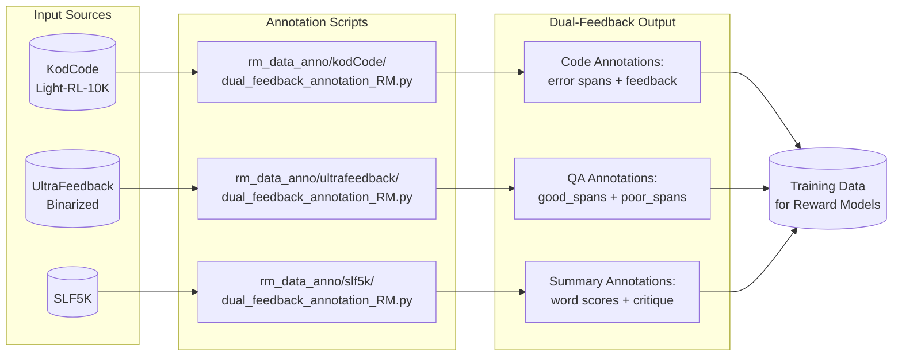
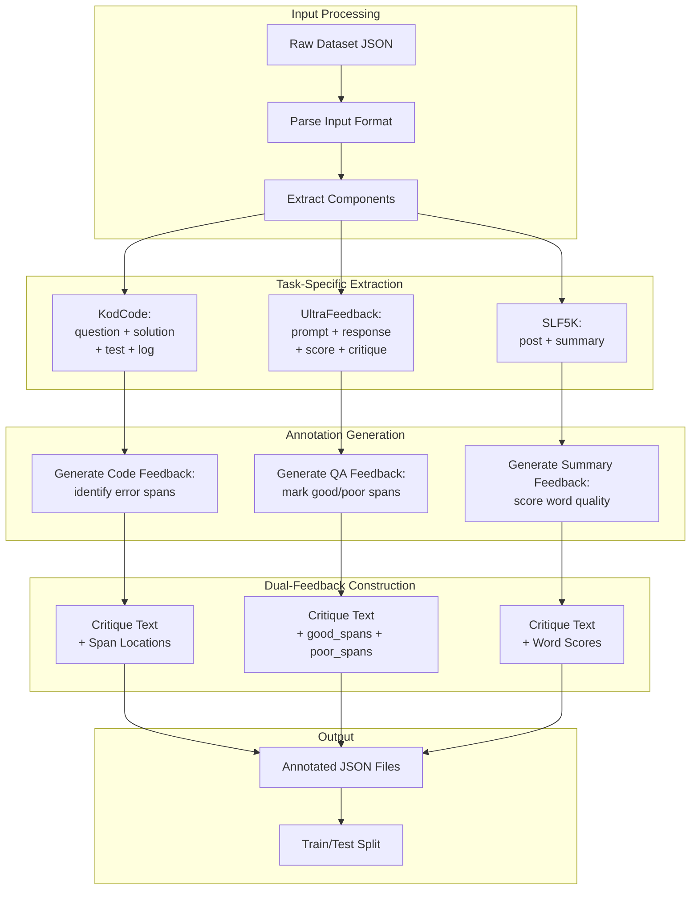
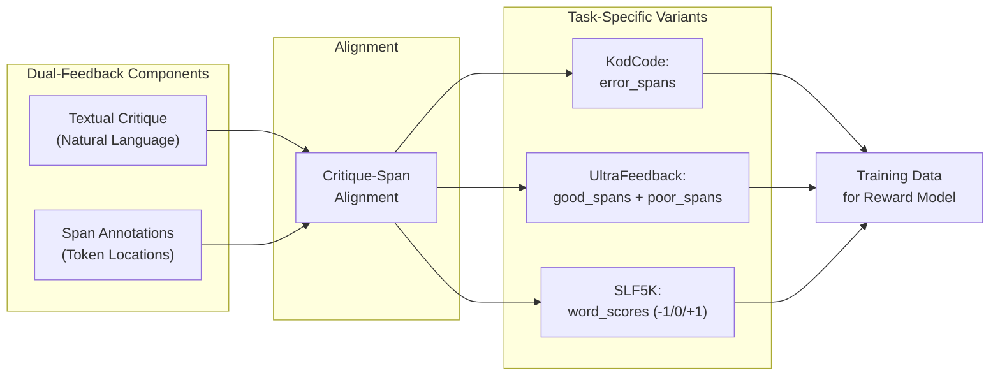
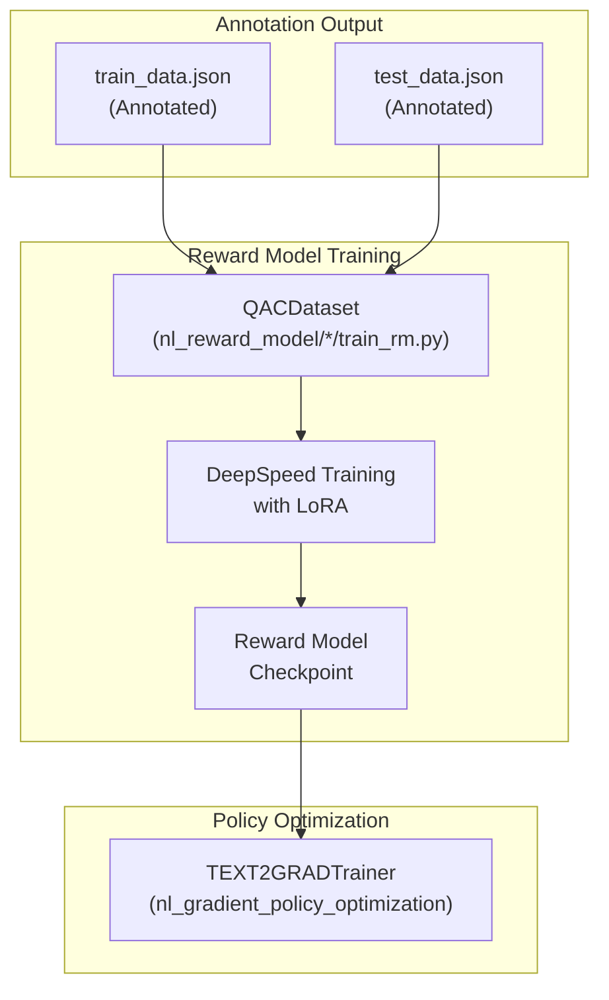

<!-- source: DeepWiki mcp.deepwiki.com · repo microsoft/Text2Grad · page 4 Data Annotation Pipeline · fetched 2026-10-26 -->

# Data Annotation Pipeline

<details>
<summary>Relevant source files</summary>

The following files were used as context for generating this wiki page:

- [README.md](README.md)

</details>


## Purpose and Scope

The Data Annotation Pipeline is the first component of the Text2Grad system, responsible for converting raw natural language feedback into structured dual-feedback annotations. This pipeline pairs textual critiques with specific token spans, creating the training data foundation for fine-grained reward models.

This document provides an overview of the annotation architecture, workflow, and multi-task structure. For detailed information about input data formats, see [Input Data Formats](#4.1). For the dual-feedback format specification, see [Dual-Feedback Annotation](#4.2).

**Sources:** [README.md:1-372]()

## System Overview

The Data Annotation Pipeline processes three types of inputs across different tasks:



**Diagram: Multi-Task Annotation Architecture**

Each task has its own annotation script that processes task-specific data formats into a unified dual-feedback structure. The output serves as training data for task-specific reward models.

**Sources:** [README.md:129-145](), [README.md:149-217]()

## Directory Structure

The annotation pipeline is organized by task domain:

| Directory | Task | Script | Dataset Source |
|-----------|------|--------|----------------|
| `rm_data_anno/kodCode/` | Code Generation | `dual_feedback_annotation_RM.py` | KodCode-Light-RL-10K |
| `rm_data_anno/ultrafeedback/` | Question Answering | `dual_feedback_annotation_RM.py` | UltraFeedback-Binarized |
| `rm_data_anno/slf5k/` | Summarization | `dual_feedback_annotation_RM.py` | SLF5K |

Each directory contains:
- The annotation script (`dual_feedback_annotation_RM.py`)
- Task-specific data processing logic
- Output directory for annotated training data

**Sources:** [README.md:129-145]()

## Annotation Workflow

The following diagram illustrates the complete annotation process from raw data to structured dual-feedback:



**Diagram: Annotation Workflow from Raw Data to Dual-Feedback**

The workflow operates in four stages:
1. **Input Processing**: Load and parse raw JSON data according to task-specific format
2. **Component Extraction**: Extract relevant fields (questions, responses, existing feedback)
3. **Annotation Generation**: Apply annotation logic to identify spans and generate critiques
4. **Dual-Feedback Construction**: Combine textual feedback with span-level annotations

**Sources:** [README.md:149-217]()

## Input Data Formats

The pipeline accepts three distinct input formats, each structured for its task domain:

### KodCode Format

```json
{
  "version": "v1.0",
  "style": "instruct",
  "subset": "Leetcode",
  "question_id": "Leetcode_36406_I",
  "question": "You are given a 0-indexed ...",
  "solution": "def max_height_diff_after_removal(heights):\n  ...",
  "test": "def test_max_height_diff_after_removal_all_equal():\n    ...",
  "gpt_pass_trial_num": 2,
  "gpt_difficulty": "hard",
  "gpt_pass_percentage": 0.2,
  "log": "..."
}
```

Key fields:
- `question`: Problem statement
- `solution`: Generated code solution
- `test`: Test cases for validation
- `log`: Execution feedback or error messages

### UltraFeedback Format

```json
{
  "prompt": "In this task, you are given ... \n\nA:",
  "prompt_id": "333685aaf217d34921dac65dbea023fe1180b5c1973dbb6554bc022d74b54e0c",
  "score_chosen": 4.0,
  "score_rejected": 4.0,
  "response": [
    {
      "content": "In this task, you are given ... \n\nA:",
      "role": "user"
    },
    {
      "content": "Could you provide ... ",
      "role": "assistant"
    }
  ],
  "is_chosen": true,
  "score": 4.0,
  "critique": ""
}
```

Key fields:
- `prompt`: Input question
- `response`: Conversation history with role markers
- `score_chosen`/`score_rejected`: Quality ratings
- `critique`: Optional existing feedback text

### SLF5K Format

```json
{
  "t3_132suw": {
    "generated_summary": "My girlfriend is premed and ...",
    "Post": "My girlfriend is studying something she won't ever use ..."
  }
}
```

Key fields:
- Post ID as key (e.g., `t3_132suw`)
- `Post`: Original text to summarize
- `generated_summary`: Model-generated summary

For complete format specifications, see [Input Data Formats](#4.1).

**Sources:** [README.md:163-216]()

## Dual-Feedback Output Structure

The annotation pipeline produces dual-feedback data that combines:

1. **Textual Critique**: Natural language explanation of quality issues or strengths
2. **Span-Level Annotations**: Specific token/word locations marked with quality indicators



**Diagram: Dual-Feedback Structure and Task Variants**

The dual-feedback format ensures that every critique is grounded in specific text locations, enabling fine-grained reward model training. Task-specific variants include:

- **KodCode**: Error spans indicating problematic code regions
- **UltraFeedback**: Good spans (positive examples) and poor spans (negative examples)
- **SLF5K**: Word-level scores (-1 for poor, 0 for neutral, +1 for good)

For detailed format specifications, see [Dual-Feedback Annotation](#4.2).

**Sources:** [README.md:55-62]()

## Usage Example

To run the annotation pipeline for UltraFeedback:

```bash
cd rm_data_anno/ultrafeedback
python dual_feedback_annotation_RM.py \
    --data_path path/to/ultrafeedback_data
```

The script processes the input dataset and generates annotated output files in JSON format, ready for reward model training.

**Command-line arguments:**
- `--data_path`: Path to input dataset JSON file
- Additional task-specific parameters may be available (see task-specific scripts)

**Sources:** [README.md:153-158]()

## Integration with Reward Model Training

The annotated data flows directly into the reward model training pipeline:



**Diagram: Data Flow from Annotation to Policy Training**

The annotated JSON files serve as input to:
1. **Reward Model Training** ([train_rm.py](#5.1)): Learns to predict span-level rewards and generate critiques
2. **Policy Optimization** ([TEXT2GRADTrainer](#6.1)): Uses reward model for fine-grained gradient signals

**Sources:** [README.md:55-62](), [README.md:220-233]()

## Key Characteristics

The Data Annotation Pipeline exhibits several important properties:

| Property | Description |
|----------|-------------|
| **Task-Agnostic Design** | Shared annotation script name (`dual_feedback_annotation_RM.py`) across tasks |
| **Format Flexibility** | Handles diverse input formats (code, QA pairs, summaries) |
| **Structured Output** | Produces consistent dual-feedback format for downstream training |
| **Span-Level Precision** | Maps critiques to specific token/word locations |
| **Train/Test Split** | Generates separate datasets for training and evaluation |

This modular design allows independent development and tuning of annotation logic for each task while maintaining a consistent output interface for reward model training.

**Sources:** [README.md:55-62](), [README.md:129-145]()

## Next Steps

After completing data annotation:

1. **Verify Output**: Inspect generated JSON files for correct dual-feedback structure
2. **Proceed to Reward Model Training**: Use annotated data to train task-specific reward models (see [Training Reward Models](#5.1))
3. **Evaluate Annotation Quality**: Check span alignment and critique relevance

For detailed information about:
- Input format specifications: see [Input Data Formats](#4.1)
- Dual-feedback format details: see [Dual-Feedback Annotation](#4.2)
- Reward model training: see [Training Reward Models](#5.1)

**Sources:** [README.md:1-372]()

---

