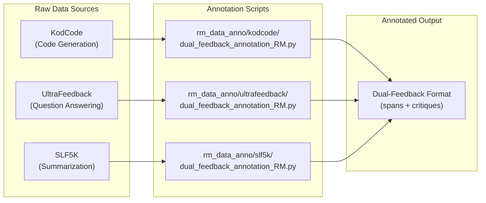
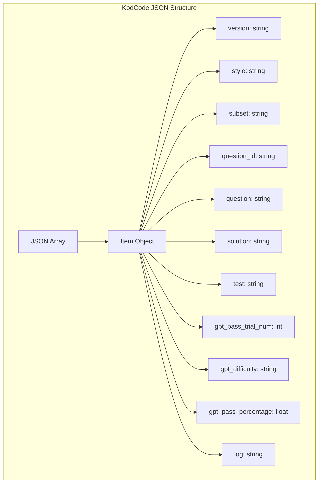
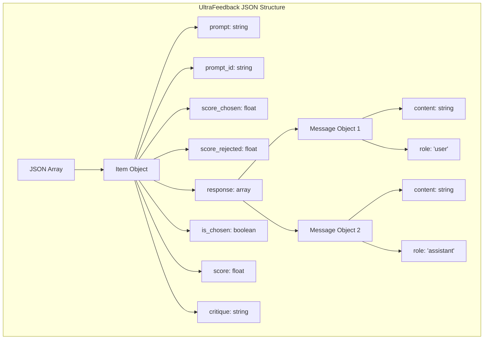
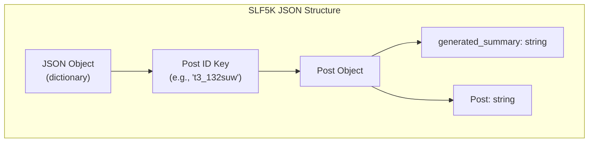
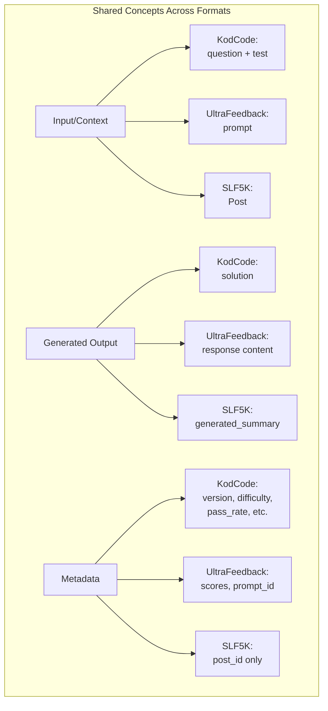
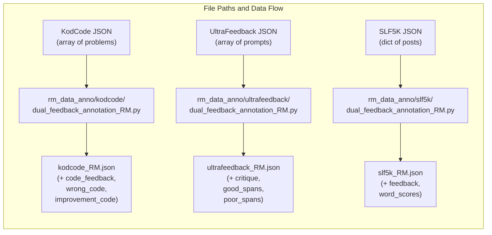

<!-- source: DeepWiki mcp.deepwiki.com · repo microsoft/Text2Grad · page 4.1 Input Data Formats · fetched 2026-10-26 -->

# Input Data Formats

<details>
<summary>Relevant source files</summary>

The following files were used as context for generating this wiki page:

- [README.md](README.md)
- [nl_reward_model/kodcode/train_rm.py](nl_reward_model/kodcode/train_rm.py)

</details>


## Purpose and Scope

This page documents the expected JSON formats for the three datasets used as input to the Text2Grad data annotation pipeline: **KodCode** (code generation), **UltraFeedback** (question answering), and **SLF5K** (summarization). These formats represent the raw, unannotated data before it is processed by the dual-feedback annotation scripts.

For information about how these raw formats are transformed into dual-feedback annotations with span-level labels, see [Dual-Feedback Annotation](#4.2). For details on specific annotation scripts, see the task-specific guides: [KodCode Dataset Format](#7.1.1), [UltraFeedback Dataset Format](#7.2.1), and [SLF5K Dataset Format](#7.3.1).

**Sources:** [README.md:161-217]()

---

## Overview

The Text2Grad system supports three distinct datasets, each serving a different NLP task domain. Each dataset has its own JSON format tailored to the requirements of its task:



**Diagram: Raw Data Flow into Annotation Pipeline**

Each dataset format is designed to capture:
- **Task-specific input** (problem statement, prompt, or document)
- **Generated or candidate output** (solution, response, or summary)
- **Metadata** for tracking and evaluation

**Sources:** [README.md:94-145]()

---

## KodCode Format Specification

### Overview

KodCode is a code generation dataset containing programming problems with solutions and test cases. The format is optimized for reinforcement learning on code generation tasks.

**Dataset Sources:**
- [KodCode-Light-RL-10K](https://huggingface.co/datasets/KodCode/KodCode-Light-RL-10K)
- [KodCode-V1-SFT-4o](https://huggingface.co/datasets/KodCode/KodCode-V1-SFT-4o)

### JSON Schema



**Diagram: KodCode JSON Structure**

### Field Descriptions

| Field | Type | Description |
|-------|------|-------------|
| `version` | string | Dataset version identifier (e.g., "v1.0") |
| `style` | string | Instruction style format (e.g., "instruct") |
| `subset` | string | Source of the problem (e.g., "Leetcode", "MBPP") |
| `question_id` | string | Unique identifier for the problem (e.g., "Leetcode_36406_I") |
| `question` | string | Natural language description of the programming problem |
| `solution` | string | Python code solution to the problem |
| `test` | string | Test cases as executable Python code with assertions |
| `gpt_pass_trial_num` | integer | Number of GPT attempts to solve the problem |
| `gpt_difficulty` | string | Difficulty rating: "easy", "medium", or "hard" |
| `gpt_pass_percentage` | float | Success rate (0.0 to 1.0) of GPT solutions |
| `log` | string | Additional metadata or execution logs |

### Example

```json
[
    {
        "version": "v1.0",
        "style": "instruct",
        "subset": "Leetcode",
        "question_id": "Leetcode_36406_I",
        "question": "You are given a 0-indexed integer array heights representing the heights of buildings...",
        "solution": "def max_height_diff_after_removal(heights):\n    n = len(heights)\n    ...",
        "test": "def test_max_height_diff_after_removal_all_equal():\n    assert max_height_diff_after_removal([3, 3, 3, 3]) == 0\n...",
        "gpt_pass_trial_num": 2,
        "gpt_difficulty": "hard",
        "gpt_pass_percentage": 0.2,
        "log": "..."
    }
]
```

### Usage in Training

The `QACDataset` class in [nl_reward_model/kodcode/train_rm.py:22-121]() consumes KodCode format data and expects these fields after annotation:
- `question` (from raw format)
- `solution` (from raw format)
- `code_feedback` (added by annotation)
- `wrong_code` (added by annotation)
- `improvement_code` (added by annotation)

**Sources:** [README.md:198-215](), [nl_reward_model/kodcode/train_rm.py:47-54]()

---

## UltraFeedback Format Specification

### Overview

UltraFeedback is a binarized feedback dataset for question answering, containing prompts with chosen and rejected responses. The format supports preference-based reward modeling.

**Dataset Source:**
- [UltraFeedback-Binarized](https://huggingface.co/datasets/HuggingFaceH4/ultrafeedback_binarized)

### JSON Schema



**Diagram: UltraFeedback JSON Structure**

### Field Descriptions

| Field | Type | Description |
|-------|------|-------------|
| `prompt` | string | The task instruction or question presented to the model |
| `prompt_id` | string | SHA-256 hash identifier for the prompt |
| `score_chosen` | float | Quality score for the preferred response (1.0-5.0) |
| `score_rejected` | float | Quality score for the rejected response (1.0-5.0) |
| `response` | array | Conversation turns with `role` ("user"/"assistant") and `content` |
| `is_chosen` | boolean | `true` if this is the preferred response, `false` otherwise |
| `score` | float | Overall quality score for this response |
| `critique` | string | Textual feedback (may be empty in raw data, populated by annotation) |

### Example

```json
[
    {
        "prompt": "In this task, you are given a sentence with a missing word...\n\nA:",
        "prompt_id": "333685aaf217d34921dac65dbea023fe1180b5c1973dbb6554bc022d74b54e0c",
        "score_chosen": 4.0,
        "score_rejected": 4.0,
        "response": [
            {
                "content": "In this task, you are given a sentence with a missing word...\n\nA:",
                "role": "user"
            },
            {
                "content": "Could you provide more context or information about the task?",
                "role": "assistant"
            }
        ],
        "is_chosen": true,
        "score": 4.0,
        "critique": ""
    }
]
```

### Key Characteristics

- **Paired Responses**: Each prompt typically has both a `chosen` (`is_chosen: true`) and `rejected` (`is_chosen: false`) response for preference learning
- **Conversational Format**: The `response` array allows multi-turn dialogues, though most entries contain a single user-assistant pair
- **Score Range**: Scores typically range from 1.0 (poor) to 5.0 (excellent)
- **Empty Critiques**: The raw format often has empty `critique` fields, which are populated by the annotation pipeline

**Sources:** [README.md:173-196]()

---

## SLF5K Format Specification

### Overview

SLF5K (Summary-Level Feedback 5K) is a summarization dataset containing Reddit posts with generated summaries. The format is designed for evaluating and improving summary quality.

**Dataset Source:**
- [SLF5K Dataset](https://huggingface.co/datasets/JeremyAlain/SLF5K)

### JSON Schema



**Diagram: SLF5K JSON Structure**

### Field Descriptions

| Field | Type | Description |
|-------|------|-------------|
| Post ID (key) | string | Reddit post identifier (e.g., "t3_132suw") |
| `generated_summary` | string | Model-generated summary of the post |
| `Post` | string | Original Reddit post text (source document) |

### Example

```json
{
    "t3_132suw": {
        "generated_summary": "My girlfriend is premed and struggles with difficult coursework. I want to support her but don't know how to help effectively.",
        "Post": "My girlfriend is studying something she won't ever use in her career but it's required for med school. She's struggling with organic chemistry and I want to be supportive..."
    }
}
```

### Key Characteristics

- **Dictionary Structure**: Unlike KodCode and UltraFeedback (arrays), SLF5K uses post IDs as dictionary keys
- **Single Document**: Each entry contains only one document-summary pair
- **Reddit Context**: Post IDs follow Reddit's convention (e.g., "t3_" prefix for submissions)
- **Minimal Metadata**: The format is simpler, focusing on the document and summary without quality scores

**Sources:** [README.md:163-170]()

---

## Format Comparison

### Structural Overview

| Dataset | Root Type | Task | Primary Fields | Metadata Complexity |
|---------|-----------|------|----------------|---------------------|
| **KodCode** | Array | Code Generation | `question`, `solution`, `test` | High (11 fields) |
| **UltraFeedback** | Array | Question Answering | `prompt`, `response`, `score` | Medium (8 fields) |
| **SLF5K** | Dictionary | Summarization | `Post`, `generated_summary` | Low (2 fields) |

### Common Patterns



**Diagram: Shared Conceptual Structure Across Datasets**

### Distinguishing Features

| Feature | KodCode | UltraFeedback | SLF5K |
|---------|---------|---------------|-------|
| **Executable Content** | ✓ (code + tests) | ✗ | ✗ |
| **Preference Pairs** | ✗ | ✓ (chosen/rejected) | ✗ |
| **Quality Scores** | ✓ (GPT metrics) | ✓ (human scores) | ✗ |
| **Conversational** | ✗ | ✓ (multi-turn) | ✗ |
| **Unique Identifiers** | `question_id` | `prompt_id` | Post ID (key) |

**Sources:** [README.md:163-215]()

---

## Data Flow and Consumption

### Annotation Pipeline Entry Points

Each raw format is consumed by its corresponding annotation script:



**Diagram: Annotation Scripts and Output Formats**

### Training Pipeline Consumption

After annotation, the data is consumed by `QACDataset` classes in the reward model training scripts:

| Task | Training Script | Dataset Class | Expected Fields |
|------|----------------|---------------|-----------------|
| **KodCode** | `nl_reward_model/kodcode/train_rm.py` | `QACDataset` | `question`, `solution`, `code_feedback`, `wrong_code`, `improvement_code` |
| **UltraFeedback** | `nl_reward_model/ultrafeedback/train_rm.py` | `QACDataset` | `prompt`, `response`, `critique`, `good_spans`, `poor_spans` |
| **SLF5K** | `nl_reward_model/slf5k/train_rm.py` | `QACDataset` | `Post`, `generated_summary`, `feedback`, `word_scores` |

**Sources:** [nl_reward_model/kodcode/train_rm.py:22-121](), [README.md:147-159]()

---

## File Location Conventions

### Raw Dataset Paths

The raw datasets are typically stored in the following locations within each component directory:

```
nl_reward_model/
├── kodcode/
│   └── data/KodCode/
│       └── kodcode_raw.json          # Raw KodCode format
├── ultrafeedback/
│   └── data/ultrafeedback/
│       └── ultrafeedback_raw.json    # Raw UltraFeedback format
└── slf5k/
    └── data/slf5k/
        └── slf5k_raw.json            # Raw SLF5K format
```

### Post-Annotation Paths

After running the annotation scripts in `rm_data_anno/`, the outputs are saved with additional fields:

```
nl_reward_model/
├── kodcode/
│   └── data/KodCode/
│       ├── kodcode_RM.json           # Annotated with feedback
│       ├── kodcode_RM_train.json     # Training split
│       └── kodcode_RM_test.json      # Test split
```

The `prepare_datasets` function in [nl_reward_model/kodcode/train_rm.py:124-156]() handles splitting the annotated data into training and validation sets.

**Sources:** [nl_reward_model/kodcode/train_rm.py:407-418](), [README.md:154-158]()

---

## Data Validation

### Common Validation Requirements

All three formats should satisfy these basic requirements:

1. **Valid JSON**: Files must parse without syntax errors
2. **Non-empty Content**: Input and output fields must contain non-empty strings
3. **Consistent Structure**: All items in an array (KodCode, UltraFeedback) must have the same schema
4. **UTF-8 Encoding**: Files should be UTF-8 encoded to handle special characters

### Task-Specific Validation

**KodCode:**
- `solution` field must contain valid Python code
- `test` field must contain executable test cases with assertions
- `question_id` must be unique within the dataset

**UltraFeedback:**
- `response` array must contain at least one user-assistant pair
- `score_chosen` and `score_rejected` should be in range [1.0, 5.0]
- Each prompt should have both chosen and rejected responses (when used for preference learning)

**SLF5K:**
- Post IDs must be unique keys in the dictionary
- `generated_summary` should be shorter than the `Post` content
- Both fields should be non-empty strings

**Sources:** [nl_reward_model/kodcode/train_rm.py:35-43](), [README.md:163-215]()

---

