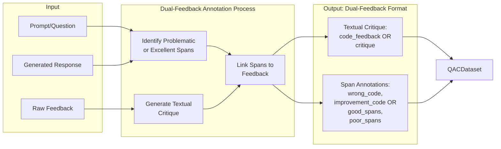
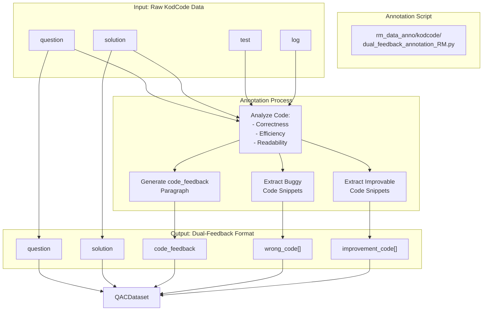
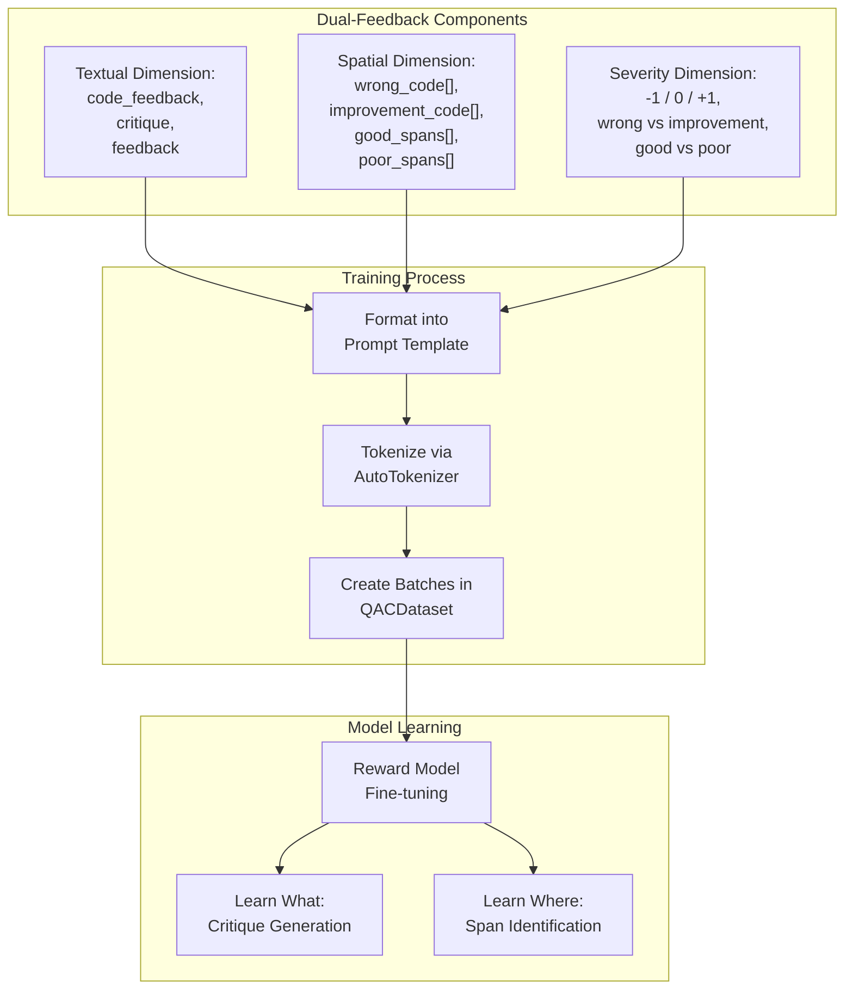
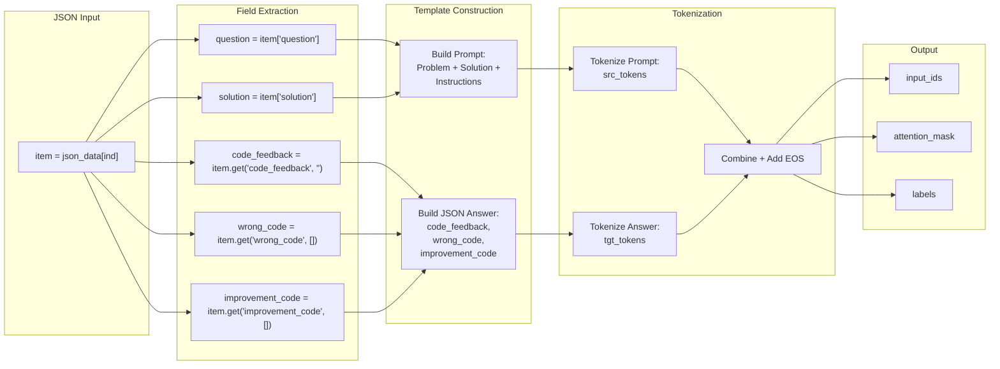

<!-- source: DeepWiki mcp.deepwiki.com · repo microsoft/Text2Grad · page 4.2 Dual-Feedback Annotation · fetched 2026-10-26 -->

# Dual-Feedback Annotation

<details>
<summary>Relevant source files</summary>

The following files were used as context for generating this wiki page:

- [README.md](README.md)
- [nl_reward_model/kodcode/train_rm.py](nl_reward_model/kodcode/train_rm.py)

</details>


## Purpose and Scope

This document explains the dual-feedback annotation format used throughout Text2Grad. Dual-feedback annotation is a structured data format that pairs natural language critiques with specific token spans or code snippets, enabling fine-grained reward modeling and policy optimization.

For information about the raw input data formats before annotation, see [Input Data Formats](#4.1). For details on how annotated data is used in reward model training, see [Training Reward Models](#5.1).

---

## Overview

Dual-feedback annotation transforms coarse feedback signals into structured data suitable for span-level learning. Unlike traditional RLHF approaches that assign scalar rewards to entire responses, dual-feedback provides two complementary types of information:

1. **Textual Feedback**: Natural language explanations describing quality, errors, or improvements
2. **Span Annotations**: Specific text segments, code snippets, or word positions linked to the feedback

This dual structure allows reward models to learn not just *whether* a response is good or bad, but precisely *which parts* are problematic or excellent, and *why*.

**Diagram: Dual-Feedback Annotation Concept**



**Sources:** [README.md:33-61](), [nl_reward_model/kodcode/train_rm.py:22-121]()

---

## Dual-Feedback Structure

The dual-feedback format varies by task but follows a common pattern:

| Component | Description | Purpose |
|-----------|-------------|---------|
| **Question/Prompt** | The input instruction or problem | Context for evaluation |
| **Response/Solution** | The model's generated output | The text being evaluated |
| **Textual Feedback** | Natural language critique | Explains overall quality and issues |
| **Positive Spans** | Good/correct segments | Identifies what should be reinforced |
| **Negative Spans** | Problematic segments | Identifies what should be improved |

The specific field names and structures differ across tasks to accommodate domain-specific requirements.

---

## Task-Specific Formats

### KodCode Dual-Feedback Format

For code generation tasks, dual-feedback distinguishes between code that is **incorrect** (bugs/errors) and code that **works but could be improved** (suboptimal patterns).

**Structure:**

```json
{
    "question": "Programming problem description",
    "solution": "def function():\n    # Generated code",
    "code_feedback": "Overall evaluation of correctness, efficiency, readability, and completeness",
    "wrong_code": [
        "code_snippet_with_bug",
        "another_buggy_snippet"
    ],
    "improvement_code": [
        "working_but_suboptimal_snippet",
        "another_improvable_snippet"
    ]
}
```

**Field Definitions:**

- **`code_feedback`**: Single paragraph critique covering correctness, efficiency, readability, and completeness
- **`wrong_code`**: Array of code snippets that cause test failures or contain bugs (empty array if none)
- **`improvement_code`**: Array of code snippets that work correctly but could be optimized or refactored (empty array if none)

**Diagram: KodCode Dual-Feedback Data Flow**



**Sources:** [README.md:198-216](), [nl_reward_model/kodcode/train_rm.py:47-91]()

---

### UltraFeedback Dual-Feedback Format

For question answering tasks, dual-feedback identifies continuous spans of text that are either high-quality or problematic.

**Structure:**

```json
{
    "prompt": "Question or instruction",
    "response": [
        {"content": "Question text", "role": "user"},
        {"content": "Assistant's response", "role": "assistant"}
    ],
    "critique": "Overall assessment of response quality",
    "good_spans": [
        "well-written segment",
        "another helpful part"
    ],
    "poor_spans": [
        "incorrect or unhelpful segment",
        "another problematic part"
    ],
    "score": 4.0
}
```

**Field Definitions:**

- **`critique`**: Natural language evaluation of the response
- **`good_spans`**: Array of text segments that are factually correct, helpful, or well-articulated
- **`poor_spans`**: Array of text segments that are incorrect, unhelpful, or poorly written
- **`score`**: Overall quality score (typically 1-5 scale)

The span-based annotation allows the reward model to learn spatial awareness, understanding not just what's wrong but where in the response the issues occur.

**Sources:** [README.md:173-196]()

---

### SLF5K Dual-Feedback Format

For summarization tasks, dual-feedback operates at the word level, assigning scores to individual words or tokens.

**Structure:**

```json
{
    "Post": "Original text to summarize",
    "generated_summary": "Model's generated summary",
    "word_scores": {
        "0": -1,
        "1": 0,
        "2": 1,
        "3": 0,
        ...
    },
    "feedback": "Overall critique of summary quality"
}
```

**Field Definitions:**

- **`word_scores`**: Dictionary mapping word indices to scores:
  - `-1`: Incorrect, misleading, or problematic word
  - `0`: Neutral or acceptable word
  - `+1`: Excellent, important, or well-chosen word
- **`feedback`**: Textual explanation of summary strengths and weaknesses

This granular word-level annotation enables precise gradient signals during policy optimization.

**Sources:** [README.md:163-171]()

---

## Key Characteristics

### Granularity Levels

Different tasks require different granularity:

| Task | Granularity | Annotation Units | Scoring Mechanism |
|------|-------------|------------------|-------------------|
| **KodCode** | Snippet-level | Code blocks/lines | Binary (present in wrong_code/improvement_code or not) |
| **UltraFeedback** | Span-level | Text segments | Binary (good_spans vs poor_spans) |
| **SLF5K** | Word-level | Individual words | Ternary (-1, 0, +1) |

### Multi-Dimensional Feedback

Dual-feedback provides multiple dimensions of information:

1. **What**: Textual feedback describes the nature of issues
2. **Where**: Span annotations locate specific problems
3. **Severity**: Categorization (wrong vs improvement) or scores indicate importance

**Diagram: Dual-Feedback Multi-Dimensional Structure**



**Sources:** [nl_reward_model/kodcode/train_rm.py:56-85]()

---

## Format Consistency

Despite task-specific variations, all dual-feedback formats share a common structure that the `QACDataset` class can process:

**Diagram: QACDataset Processing Pipeline**



**Sources:** [nl_reward_model/kodcode/train_rm.py:47-121]()

---

## Prompt Template Structure

The `QACDataset` formats dual-feedback data into a structured prompt that teaches the model to generate feedback in JSON format:

### Template Components

1. **Problem Statement**: Presents the original question/prompt
2. **Submitted Solution**: Shows the model's generated response
3. **Evaluation Instructions**: Specifies evaluation criteria (correctness, efficiency, readability, completeness)
4. **Output Format Specification**: Defines the expected JSON structure

**Example Template (KodCode):**

```
Please analyze the following programming problem and solution:

Problem:
{question}

Submitted Solution:
{solution}

---
**Instructions:**
1. Evaluate the code solution based on:
   - **Correctness**: Does it solve the problem without bugs?
   - **Efficiency**: Is the time and space complexity optimal?
   - **Readability**: Is the code clean and well-structured?
   - **Completeness**: Does it handle all edge cases?
2. Identify specific code snippets that:
   - Have errors or bugs (for wrong_code)
   - Work correctly but could be improved (for improvement_code)
3. Provide a concise paragraph summarizing the overall quality of the solution.

---
**Output Format:**
```json
{
    "code_feedback": "...",
    "wrong_code": ["..."],
    "improvement_code": ["..."]
}
```
```

This template structure is consistent across annotation scripts: `rm_data_anno/kodcode/dual_feedback_annotation_RM.py`, `rm_data_anno/ultrafeedback/dual_feedback_annotation_RM.py`, and `rm_data_anno/slf5k/dual_feedback_annotation_RM.py`.

**Sources:** [nl_reward_model/kodcode/train_rm.py:56-85]()

---

## Label Masking Strategy

The `QACDataset` implements a crucial masking strategy to ensure the model learns to generate feedback rather than memorize prompts:

```python
# Compute context length (prompt only)
context_length = len(src_tokens)

# Mask prompt tokens with -100 (ignored in loss calculation)
labels = [-100] * context_length + input_ids[context_length:]
```

This ensures:
- **Input tokens (prompt)**: Masked with `-100`, not included in loss calculation
- **Target tokens (answer)**: Included in loss, model learns to predict dual-feedback

The model is trained to predict the JSON-formatted dual-feedback given the prompt, learning both the textual feedback and span annotations jointly.

**Sources:** [nl_reward_model/kodcode/train_rm.py:107-110]()

---

## Benefits for Downstream Training

Dual-feedback annotation enables several key capabilities in the Text2Grad pipeline:

### 1. Fine-Grained Reward Signals

During policy optimization, dual-feedback is converted to token-level rewards:

- **Wrong code** → `-1` rewards for those tokens
- **Improvement code** → `0` or slight negative rewards
- **Good spans** → `+1` rewards for those tokens
- **Poor spans** → `-1` rewards for those tokens

See [Reward Processing Pipeline](#6.3) for details on conversion.

### 2. Interpretable Learning

The textual feedback provides human-readable explanations that can be:
- Logged for debugging
- Used in few-shot prompting
- Evaluated with text similarity metrics (ROUGE, BERTScore)

See [Evaluation Metrics](#5.5) for metric details.

### 3. Task-Agnostic Framework

Despite format variations, the dual structure (text + spans) allows a unified training pipeline across code generation, QA, and summarization tasks.

**Sources:** [README.md:33-61]()

---

## Annotation Script Locations

Each task has a dedicated annotation script in the `rm_data_anno/` directory:

| Task | Script Path | Input Format | Output Format |
|------|-------------|--------------|---------------|
| **Code Generation** | `rm_data_anno/kodcode/dual_feedback_annotation_RM.py` | Raw KodCode JSON | `code_feedback`, `wrong_code`, `improvement_code` |
| **Question Answering** | `rm_data_anno/ultrafeedback/dual_feedback_annotation_RM.py` | UltraFeedback JSON | `critique`, `good_spans`, `poor_spans` |
| **Summarization** | `rm_data_anno/slf5k/dual_feedback_annotation_RM.py` | SLF5K JSON | `feedback`, `word_scores` |

These scripts typically use LLMs (e.g., GPT-4) to generate high-quality dual-feedback annotations from raw or minimally-annotated data.

**Sources:** [README.md:127-158]()

---

## Summary

Dual-feedback annotation is the foundational data format for Text2Grad. By pairing natural language critiques with precise span annotations, it bridges the gap between coarse scalar rewards and fine-grained gradient signals. The format's flexibility accommodates diverse tasks while maintaining a consistent structure that enables unified model training and evaluation.

**Sources:** [README.md:33-61](), [nl_reward_model/kodcode/train_rm.py:22-121]()

---

