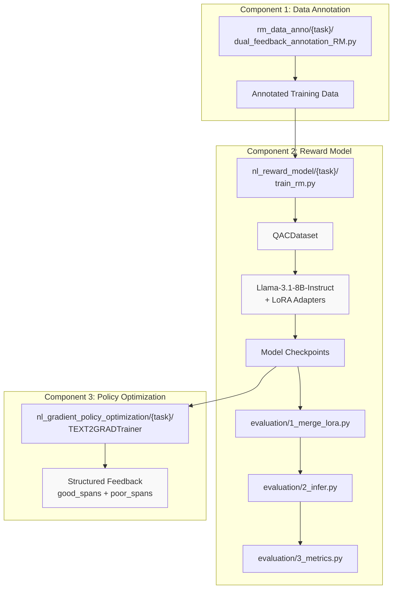
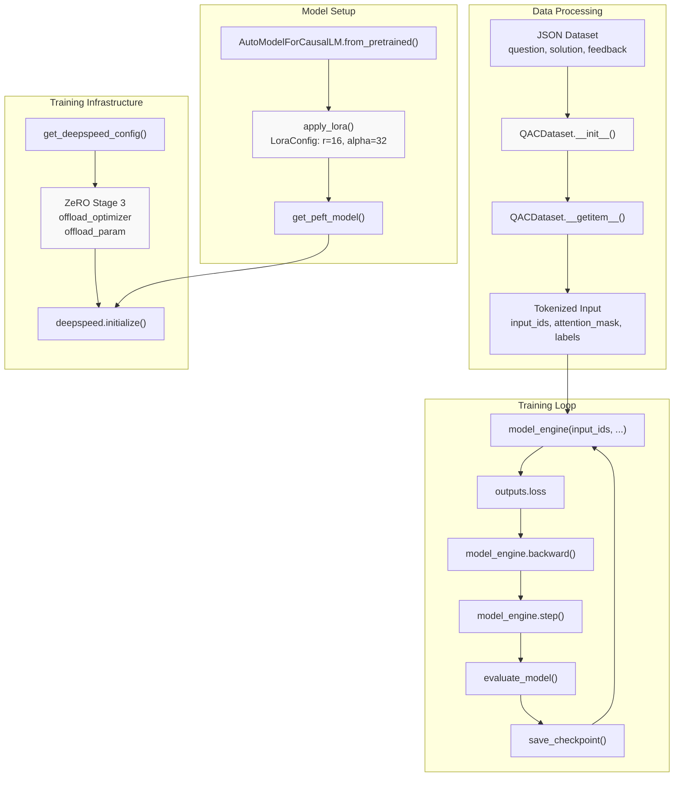
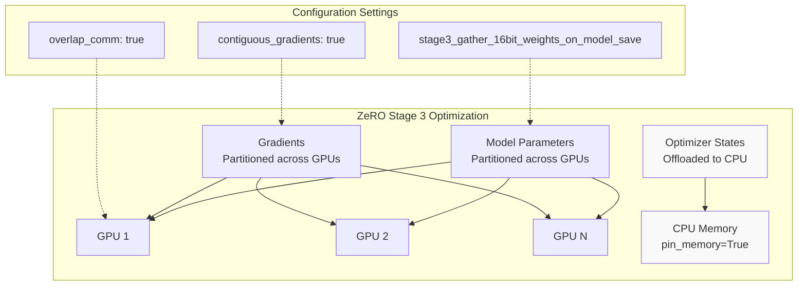
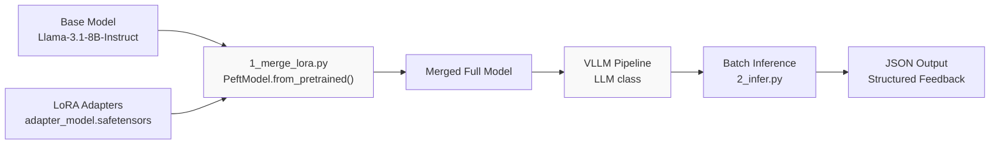
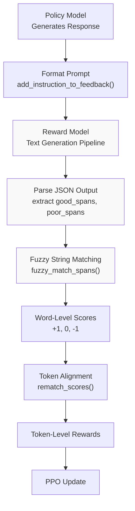

<!-- source: DeepWiki mcp.deepwiki.com · repo microsoft/Text2Grad · page 5 Reward Models · fetched 2026-10-26 -->

# Reward Models

<details>
<summary>Relevant source files</summary>

The following files were used as context for generating this wiki page:

- [README.md](README.md)
- [nl_reward_model/kodcode/train_rm.py](nl_reward_model/kodcode/train_rm.py)

</details>


## Purpose and Scope

This document provides an overview of the fine-grained reward models in Text2Grad, which form the second component of the three-component pipeline. Reward models predict span-level rewards and generate explanatory critiques, converting natural language feedback into structured annotations that guide policy optimization.

For detailed information about training procedures, see [Training Reward Models](#5.1). For inference and evaluation workflows, see [Reward Model Inference](#5.3) and [Evaluation Metrics](#5.5). For information about how reward models are used during policy training, see [Policy Optimization](#6).

---

## Overview

Reward models in Text2Grad serve as quality assessors that analyze generated text and identify specific spans (words, code snippets, or phrases) that are correct, incorrect, or require improvement. Unlike traditional RLHF reward models that output scalar scores, Text2Grad reward models generate **structured feedback** containing:

1. **Textual critiques**: Natural language explanations of quality
2. **Span-level annotations**: Specific portions of text marked as good or poor
3. **Token-level scores**: Fine-grained assessments aligned with model outputs

This fine-grained feedback enables the policy optimization component to apply targeted gradient updates rather than diffuse, document-level rewards.

**Sources:** [README.md:33-62](), [README.md:221-274]()

---

## System Integration



**Figure 1: Reward Model Position in Text2Grad Pipeline**

The reward model bridges the data annotation pipeline and policy optimization. It is trained on dual-feedback annotated data and then deployed during PPO training to provide real-time feedback on policy-generated responses.

**Sources:** [README.md:41-50](), [README.md:127-145]()

---

## Architecture and Components

### Core Training Pipeline



**Figure 2: Training Pipeline Code Structure**

The training pipeline defined in [nl_reward_model/{task}/train_rm.py]() follows this flow:

1. **Data Processing**: `QACDataset` [nl_reward_model/kodcode/train_rm.py:22-122]() formats question-answer-critique data into tokenized training examples
2. **Model Setup**: `setup_model_and_tokenizer()` [nl_reward_model/kodcode/train_rm.py:159-181]() loads the base model, then `apply_lora()` [nl_reward_model/kodcode/train_rm.py:183-206]() adds parameter-efficient adapters
3. **Training Infrastructure**: `get_deepspeed_config()` [nl_reward_model/kodcode/train_rm.py:209-261]() configures ZeRO-3 optimization for memory efficiency
4. **Training Loop**: The main `train()` function [nl_reward_model/kodcode/train_rm.py:325-403]() orchestrates forward passes, backpropagation, evaluation, and checkpointing

**Sources:** [nl_reward_model/kodcode/train_rm.py:1-427]()

---

## Data Format and Prompting

### QACDataset Structure

The `QACDataset` class implements the core data formatting logic for reward model training. Each task uses the same class structure but with task-specific prompt templates.

| Component | Description | Code Location |
|-----------|-------------|---------------|
| **Initialization** | Loads JSON data, sets tokenizer and length limits | [train_rm.py:25-42]() |
| **Prompt Construction** | Formats question, solution, and instructions into prompt | [train_rm.py:56-85]() |
| **Target Generation** | Constructs JSON-formatted answer with feedback fields | [train_rm.py:87-91]() |
| **Tokenization** | Converts to tokens with proper truncation and padding | [train_rm.py:93-121]() |
| **Label Masking** | Masks prompt tokens (sets to -100) to only train on answer | [train_rm.py:108]() |

**Sources:** [nl_reward_model/kodcode/train_rm.py:22-122]()

---

## Multi-Task Support

Text2Grad reward models are trained separately for each task domain, with task-specific output formats:

### KodCode (Code Generation)

**Output Format:**
```json
{
    "code_feedback": "Textual critique of code quality",
    "wrong_code": ["snippet1", "snippet2"],
    "improvement_code": ["snippet3", "snippet4"]
}
```

**Key Fields:**
- `code_feedback`: Overall assessment paragraph
- `wrong_code`: Code snippets with errors or bugs
- `improvement_code`: Correct code that could be optimized

**Training Path:** `nl_reward_model/kodcode/`

**Sources:** [nl_reward_model/kodcode/train_rm.py:78-84](), [README.md:100-106]()

---

### UltraFeedback (Question Answering)

**Output Format:**
```json
{
    "critique": "Textual feedback on answer quality",
    "good_spans": ["phrase1", "phrase2"],
    "poor_spans": ["phrase3", "phrase4"]
}
```

**Key Fields:**
- `critique`: Natural language evaluation
- `good_spans`: Text segments that are correct/helpful
- `poor_spans`: Text segments that are incorrect/unhelpful

**Training Path:** `nl_reward_model/ultrafeedback/`

**Sources:** [README.md:112-114](), [README.md:173-196]()

---

### SLF5K (Summarization)

**Output Format:**
```json
{
    "feedback": "Assessment of summary quality",
    "word_scores": [-1, 0, 1, 0, -1, ...]
}
```

**Key Fields:**
- `feedback`: Textual critique of summarization
- `word_scores`: Per-word scores (-1: poor, 0: neutral, 1: good)

**Training Path:** `nl_reward_model/slf5k/`

**Sources:** [README.md:120-122](), [README.md:163-171]()

---

## Training Configuration

### LoRA Parameters

Text2Grad uses parameter-efficient fine-tuning via LoRA to reduce memory requirements and training time:

```python
LoraConfig(
    r=16,                # Rank of low-rank decomposition
    lora_alpha=32,       # Scaling factor
    target_modules=["q_proj", "k_proj", "v_proj", "o_proj"],
    lora_dropout=0.1,
    bias="none",
    task_type="CAUSAL_LM"
)
```

Only these adapter layers are trained, while the base Llama-3.1-8B-Instruct model remains frozen. This approach:
- Reduces trainable parameters by ~99%
- Enables training on limited GPU resources
- Maintains base model knowledge
- Allows efficient checkpointing (only adapters saved)

**Sources:** [nl_reward_model/kodcode/train_rm.py:196-204]()

---

### DeepSpeed ZeRO-3 Configuration

Memory optimization is achieved through DeepSpeed ZeRO Stage 3:



**Figure 3: DeepSpeed ZeRO-3 Memory Management**

Key configuration parameters from `get_deepspeed_config()` [nl_reward_model/kodcode/train_rm.py:237-253]():

| Parameter | Value | Purpose |
|-----------|-------|---------|
| `stage` | 3 | Partition parameters, gradients, and optimizer states |
| `offload_optimizer.device` | "cpu" | Move optimizer states to CPU |
| `offload_param.device` | "cpu" | Move inactive parameters to CPU |
| `overlap_comm` | true | Overlap communication with computation |
| `stage3_gather_16bit_weights_on_model_save` | true | Collect weights for checkpoint saving |

**Sources:** [nl_reward_model/kodcode/train_rm.py:209-261]()

---

## Inference Pipeline

### Model Merging and Deployment



**Figure 4: Inference Deployment Pipeline**

The inference workflow consists of three stages:

1. **Merging** (`evaluation/1_merge_lora.py`): Combines LoRA adapters with base model weights
2. **Inference** (`evaluation/2_infer.py`): Uses VLLM for efficient batch processing
3. **Evaluation** (`evaluation/3_metrics.py`): Computes metrics on generated feedback

**Sources:** [README.md:237-274]()

---

## Integration with Policy Optimization

During PPO training, the reward model serves as a frozen critic that provides feedback on policy-generated responses:



**Figure 5: Reward Model in PPO Training Loop**

The reward model checkpoint is loaded separately from the policy model and remains frozen during training. It generates feedback that is converted to token-level rewards through a multi-step matching and alignment process.

For detailed information about this integration, see [Reward Processing Pipeline](#6.3) and [Token-Reward Alignment](#6.4).

**Sources:** [README.md:277-294]()

---

## Key Files and Entry Points

### Training Scripts

| Task | Entry Point | Configuration |
|------|-------------|---------------|
| **KodCode** | `nl_reward_model/kodcode/train_rm.py` | `nl_reward_model/kodcode/deepspeed_train_kodcode.sh` |
| **UltraFeedback** | `nl_reward_model/ultrafeedback/train_rm.py` | `nl_reward_model/ultrafeedback/deepspeed_train_ultrafeedback.sh` |
| **SLF5K** | `nl_reward_model/slf5k/train_rm.py` | `nl_reward_model/slf5k/deepspeed_train_slf5k.sh` |

### Evaluation Scripts

Each task directory contains an `evaluation/` subdirectory with:
- `1_merge_lora.py`: Merge LoRA adapters with base model
- `2_infer.py`: Run batch inference on test data
- `3_metrics.py`: Compute evaluation metrics

**Sources:** [README.md:221-234](), [README.md:237-274]()

---

## Design Principles

1. **Task-Specific Specialization**: Each domain (code, QA, summarization) has dedicated models trained on domain-specific feedback formats
2. **Parameter Efficiency**: LoRA enables training 8B models on limited resources
3. **Memory Optimization**: DeepSpeed ZeRO-3 with CPU offloading supports larger batch sizes
4. **Structured Outputs**: JSON format ensures parseable, actionable feedback
5. **Frozen Deployment**: During policy training, reward models provide feedback without updates, ensuring stable learning signals

**Sources:** [README.md:54-75](), [nl_reward_model/kodcode/train_rm.py:183-261]()

---

## Next Steps

- For detailed training procedures and hyperparameters, see [Training Reward Models](#5.1)
- For information about LoRA and DeepSpeed configuration options, see [LoRA and DeepSpeed Configuration](#5.2)
- For inference details including model loading and VLLM usage, see [Reward Model Inference](#5.3)
- For robust parsing strategies that handle malformed outputs, see [Response Parsing Strategies](#5.4)
- For comprehensive evaluation metrics and benchmarks, see [Evaluation Metrics](#5.5)

---

