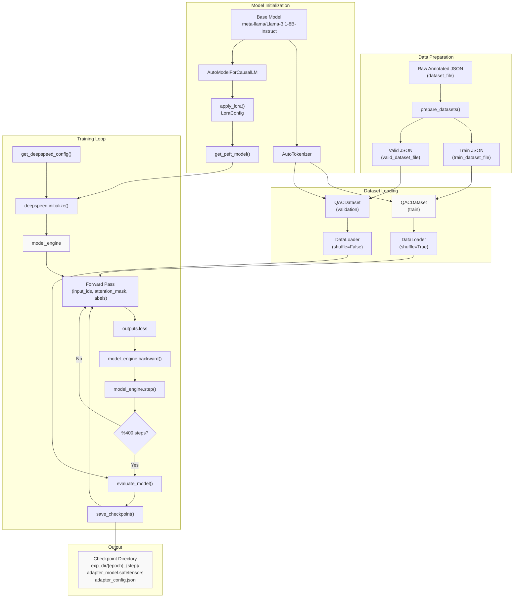
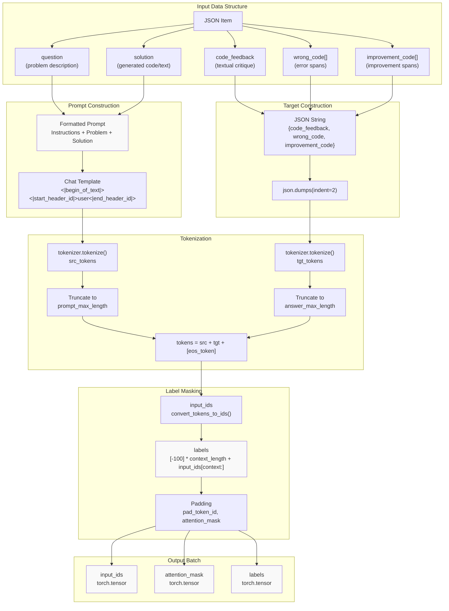
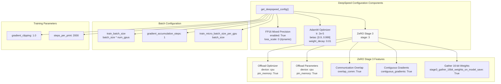
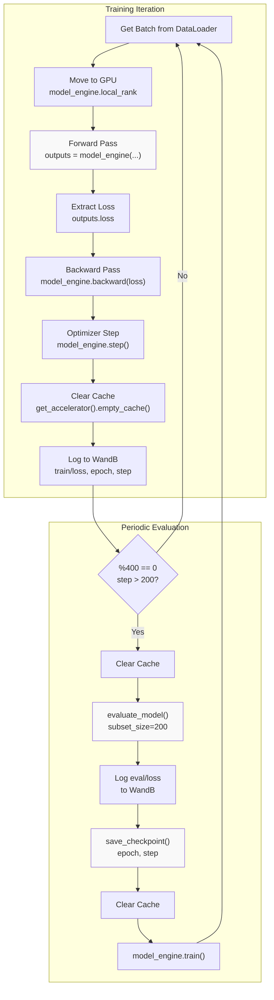
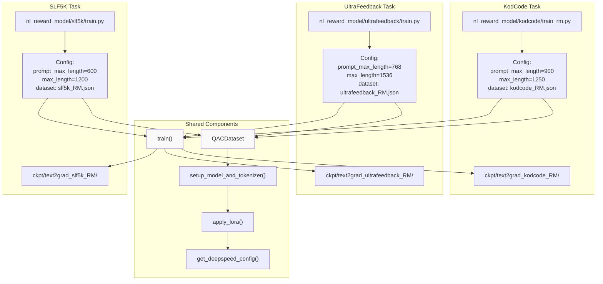

<!-- source: DeepWiki mcp.deepwiki.com · repo microsoft/Text2Grad · page 5.1 Training Reward Models · fetched 2026-10-26 -->

# Training Reward Models

<details>
<summary>Relevant source files</summary>

The following files were used as context for generating this wiki page:

- [nl_reward_model/kodcode/train_rm.py](nl_reward_model/kodcode/train_rm.py)

</details>


## Purpose and Scope

This page documents the process of training fine-grained reward models that predict span-level rewards and generate textual critiques. Reward models are trained via supervised fine-tuning on dual-feedback annotated data (see [Dual-Feedback Annotation](#4.2)) using parameter-efficient LoRA adapters and DeepSpeed optimization.

This page covers the training workflow, dataset formatting, model configuration, and the training loop. For detailed LoRA and DeepSpeed configuration options, see [LoRA and DeepSpeed Configuration](#5.2). For inference and evaluation of trained models, see [Reward Model Inference](#5.3) and [Evaluation Metrics](#5.5).

**Sources:** [nl_reward_model/kodcode/train_rm.py:1-427]()

---

## Training Pipeline Overview

The reward model training process follows a supervised fine-tuning approach where the model learns to generate structured feedback by training on annotated examples. The pipeline operates in several stages:



**Training Flow:**

1. **Data Preparation**: `prepare_datasets()` splits the annotated data into train/validation sets with a configurable ratio (default 90/10)
2. **Model Initialization**: Load base Llama model via `AutoModelForCausalLM` and apply LoRA adapters with `apply_lora()`
3. **Dataset Loading**: `QACDataset` formats examples into model inputs with proper tokenization and masking
4. **Training Loop**: DeepSpeed `model_engine` performs forward/backward passes with periodic evaluation and checkpointing
5. **Output**: LoRA adapter weights saved as `adapter_model.safetensors` with configuration

**Sources:** [nl_reward_model/kodcode/train_rm.py:124-427]()

---

## QACDataset: Data Formatting and Tokenization

The `QACDataset` class transforms dual-feedback annotations into training examples suitable for causal language modeling:



### Key Implementation Details

**Constructor Parameters** [nl_reward_model/kodcode/train_rm.py:25-42]():
- `json_path`: Path to annotated data file
- `tokenizer`: HuggingFace tokenizer instance
- `prompt_max_length`: Maximum tokens for input prompt (default 900)
- `max_length`: Total sequence length including prompt and response (default 1250)

**Prompt Template** [nl_reward_model/kodcode/train_rm.py:56-85]():
The prompt instructs the model to analyze code solutions across four dimensions: Correctness, Efficiency, Readability, and Completeness. It specifies the exact JSON output format expected.

**Label Masking Strategy** [nl_reward_model/kodcode/train_rm.py:108-114]():
```
labels = [-100] * context_length + input_ids[context_length:]
```
Only the model's generated response is used for loss calculation; the prompt portion is masked with `-100` to exclude it from gradients. This ensures the model learns to generate feedback rather than memorize prompts.

**Sequence Length Management:**
- `answer_max_length = max_length - prompt_max_length - 1` [nl_reward_model/kodcode/train_rm.py:39]()
- Both prompt and answer are truncated if they exceed limits [nl_reward_model/kodcode/train_rm.py:96-101]()
- Padding is applied to reach `max_length` for efficient batching [nl_reward_model/kodcode/train_rm.py:112-115]()

**Sources:** [nl_reward_model/kodcode/train_rm.py:22-122]()

---

## Model Setup and LoRA Application

### Model Initialization

The `setup_model_and_tokenizer()` function loads the base model and configures the tokenizer:

**Tokenizer Configuration** [nl_reward_model/kodcode/train_rm.py:169-174]():
```
tokenizer = AutoTokenizer.from_pretrained(model_name)
if not tokenizer.pad_token:
    tokenizer.pad_token = tokenizer.eos_token
    tokenizer.pad_token_id = tokenizer.eos_token_id
tokenizer.padding_side = "right"
```
Right-side padding is used for causal language modeling to ensure attention masks align correctly with input sequences.

**Model Loading** [nl_reward_model/kodcode/train_rm.py:176-179]():
```
model = AutoModelForCausalLM.from_pretrained(model_name)
model.pad_token_id = tokenizer.eos_token_id
```

### LoRA Configuration

The `apply_lora()` function wraps the base model with LoRA adapters for parameter-efficient fine-tuning:

| Parameter | Value | Purpose |
|-----------|-------|---------|
| `r` | 16 | LoRA rank (dimension of low-rank matrices) |
| `lora_alpha` | 32 | Scaling factor for LoRA updates |
| `target_modules` | `["q_proj", "k_proj", "v_proj", "o_proj"]` | Attention projection layers to adapt |
| `lora_dropout` | 0.1 | Dropout for regularization |
| `bias` | `"none"` | No bias parameters trained |
| `task_type` | `"CAUSAL_LM"` | Causal language modeling task |

**Implementation** [nl_reward_model/kodcode/train_rm.py:183-206]():
```python
lora_config = LoraConfig(...)
model = get_peft_model(model, lora_config)
```

Only the LoRA adapter weights are trainable; base model parameters remain frozen. This dramatically reduces memory requirements and training time while maintaining model quality. See [LoRA and DeepSpeed Configuration](#5.2) for detailed configuration options.

**Sources:** [nl_reward_model/kodcode/train_rm.py:159-206]()

---

## DeepSpeed Training Configuration

The `get_deepspeed_config()` function generates a DeepSpeed configuration dictionary with ZeRO Stage 3 optimization:



### ZeRO Stage 3 Optimization

**Memory Offloading** [nl_reward_model/kodcode/train_rm.py:238-246]():
- **Optimizer States**: Offloaded to CPU with pinned memory for fast transfer
- **Parameters**: Offloaded to CPU when not in use
- Enables training large models (8B parameters) on consumer GPUs

**Communication Optimization** [nl_reward_model/kodcode/train_rm.py:247-252]():
- `overlap_comm: True`: Overlap computation with inter-GPU communication
- `contiguous_gradients: True`: Store gradients contiguously for efficient all-reduce
- `sub_group_size: 1e9`: Large sub-group for reduced communication overhead
- `stage3_max_live_parameters: 1e9`: Maximum parameters kept in GPU memory
- `stage3_max_reuse_distance: 1e9`: Distance for parameter reuse optimization

**Model Saving** [nl_reward_model/kodcode/train_rm.py:252]():
- `stage3_gather_16bit_weights_on_model_save: True`: Gather full 16-bit weights for checkpoint saving (required for LoRA adapters)

### FP16 Mixed Precision

[nl_reward_model/kodcode/train_rm.py:221-227]()
- Dynamic loss scaling (`loss_scale: 0`) adjusts automatically to prevent gradient underflow/overflow
- `loss_scale_window: 1000`: Evaluation window for scaling adjustments
- `min_loss_scale: 1`: Minimum scale to prevent numerical instability

**Sources:** [nl_reward_model/kodcode/train_rm.py:209-260]()

---

## Training Loop Implementation

The `train()` function orchestrates the complete training process:

### Initialization Phase

**DeepSpeed Engine Setup** [nl_reward_model/kodcode/train_rm.py:343-350]():
```python
trainable_parameters = [p for p in model.parameters() if p.requires_grad]
model_engine, optimizer, _, _ = deepspeed.initialize(
    model=model,
    model_parameters=trainable_parameters,
    config=ds_config
)
```
Only trainable LoRA parameters are passed to DeepSpeed, reducing memory overhead.

**DataLoader Creation** [nl_reward_model/kodcode/train_rm.py:352-366]():
- Training data: `shuffle=True` for randomization
- Validation data: `shuffle=False` for consistent evaluation

### Training Step

[nl_reward_model/kodcode/train_rm.py:368-402]()



**Key Operations:**

1. **Device Placement** [nl_reward_model/kodcode/train_rm.py:371-373](): Tensors moved to `model_engine.local_rank` (GPU ID for current process)

2. **Forward Pass** [nl_reward_model/kodcode/train_rm.py:374-375](): Model computes outputs and loss automatically via `labels` parameter

3. **Backward Pass** [nl_reward_model/kodcode/train_rm.py:377](): `model_engine.backward(loss)` handles gradient computation with DeepSpeed optimizations

4. **Optimizer Step** [nl_reward_model/kodcode/train_rm.py:378](): `model_engine.step()` updates LoRA parameters

5. **Memory Management** [nl_reward_model/kodcode/train_rm.py:380, 389, 400](): `get_accelerator().empty_cache()` clears GPU cache to prevent OOM errors

6. **WandB Logging** [nl_reward_model/kodcode/train_rm.py:382-386](): Train loss, epoch, and step logged for experiment tracking

**Sources:** [nl_reward_model/kodcode/train_rm.py:325-403]()

---

## Evaluation and Checkpointing

### Validation Evaluation

The `evaluate_model()` function performs periodic validation on a random subset:

**Subset Sampling** [nl_reward_model/kodcode/train_rm.py:278-290]():
```python
random_indices = torch.randperm(total_eval_samples)[:subset_size]
eval_subset = torch.utils.data.Subset(eval_dataloader.dataset, random_indices)
eval_subset_loader = DataLoader(eval_subset, batch_size=..., shuffle=True)
```
Default `subset_size=200` balances evaluation quality with training speed. Random sampling ensures diverse coverage across epochs.

**Evaluation Loop** [nl_reward_model/kodcode/train_rm.py:292-304]():
```python
model_engine.eval()
with torch.no_grad():
    for eval_step, batch in tqdm(enumerate(eval_subset_loader), ...):
        outputs = model_engine(input_ids=..., attention_mask=..., labels=...)
        eval_loss = outputs.loss
        eval_losses.append(eval_loss.item())
avg_eval_loss = sum(eval_losses) / len(eval_losses)
```
Model set to `eval()` mode and gradients disabled for efficiency.

### Checkpoint Saving

The `save_checkpoint()` function saves LoRA adapter weights:

**Directory Structure** [nl_reward_model/kodcode/train_rm.py:318-322]():
```
{exp_dir}/{epoch}_{step}/
├── adapter_model.safetensors  (LoRA weights)
├── adapter_config.json        (LoRA configuration)
└── ...
```

**Rank-0 Saving** [nl_reward_model/kodcode/train_rm.py:318]():
```python
if model_engine.local_rank == 0:
    checkpoint_dir = os.path.join(exp_dir, f'{epoch}_{step}')
    model_engine.save_pretrained(checkpoint_dir)
```
Only rank 0 process saves checkpoints to avoid conflicts in distributed training.

**Checkpoint Frequency** [nl_reward_model/kodcode/train_rm.py:388, 402]():
Checkpoints saved every 400 steps (after step 200) following validation evaluation.

**Sources:** [nl_reward_model/kodcode/train_rm.py:263-323, 388-402]()

---

## Configuration Parameters

### Training Configuration Dictionary

The `main()` function defines a configuration dictionary with task-specific parameters:

| Parameter | Type | KodCode Default | Description |
|-----------|------|-----------------|-------------|
| `model_name` | str | `"meta-llama/Llama-3.1-8B-Instruct"` | Base model identifier |
| `dataset_file` | str | `"./data/KodCode/kodcode_RM.json"` | Full annotated dataset path |
| `train_dataset_file` | str | `"./data/KodCode/kodcode_RM_train.json"` | Training split output path |
| `valid_dataset_file` | str | `"./data/KodCode/kodcode_RM_test.json"` | Validation split output path |
| `batch_size` | int | `2` | Batch size per GPU |
| `epochs` | int | `3` | Number of training epochs |
| `prompt_max_length` | int | `900` | Maximum prompt tokens |
| `max_length` | int | `1250` | Total sequence length |
| `exp_dir` | str | `"ckpt/text2grad_kodcode_RM"` | Checkpoint directory |
| `project_name` | str | `"kodcode-RM"` | WandB project name |

**Task-Specific Variations:**

For different tasks, adjust paths and sequence lengths:

| Task | Dataset Path | Prompt Length | Max Length | Notes |
|------|-------------|---------------|------------|-------|
| KodCode | `./data/KodCode/kodcode_RM.json` | 900 | 1250 | Code + tests require longer sequences |
| UltraFeedback | `./data/ultrafeedback/...` | 512-768 | 1024-1536 | QA responses vary in length |
| SLF5K | `./data/SLF5K/...` | 400-600 | 800-1200 | Summaries typically shorter |

**Memory Considerations:**

Larger sequence lengths increase memory usage quadratically (due to attention mechanism). With DeepSpeed ZeRO Stage 3 and batch_size=2, the configuration supports:
- 8B parameter models on 40GB GPUs
- 13B parameter models on 80GB GPUs (with sequence length reductions)

**Sources:** [nl_reward_model/kodcode/train_rm.py:405-423]()

---

## Task-Specific Training Scripts

The same training architecture is replicated across all three tasks with task-specific configurations:



**Shared Architecture:**
All task training scripts use identical class definitions and function signatures, enabling code reuse and consistent behavior across tasks.

**Task Differentiation:**
- **Dataset paths**: Point to task-specific annotated data
- **Sequence lengths**: Tuned based on task characteristics (code vs. text)
- **Checkpoint directories**: Separate storage per task
- **WandB projects**: Independent tracking per task

For task-specific training guides, see:
- [KodCode Reward Model Training](#7.1.2)
- [UltraFeedback Reward Model](#7.2.2)
- [SLF5K Reward Model](#7.3.2)

**Sources:** [nl_reward_model/kodcode/train_rm.py:1-427]()

---

