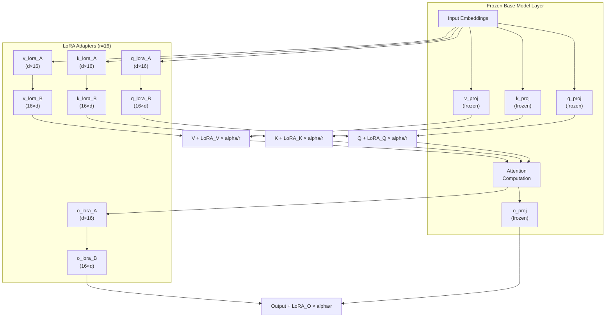
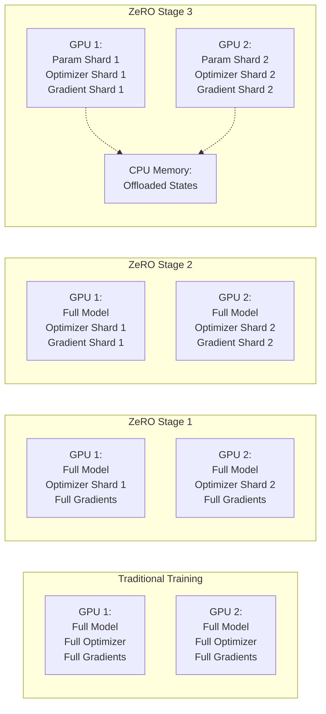
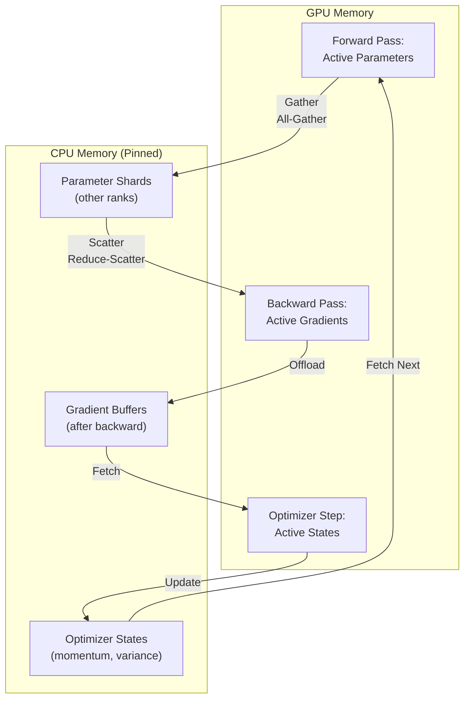
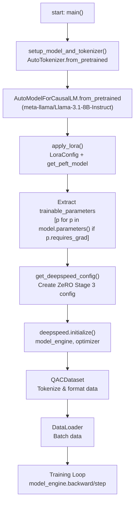
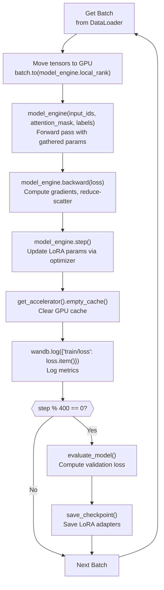
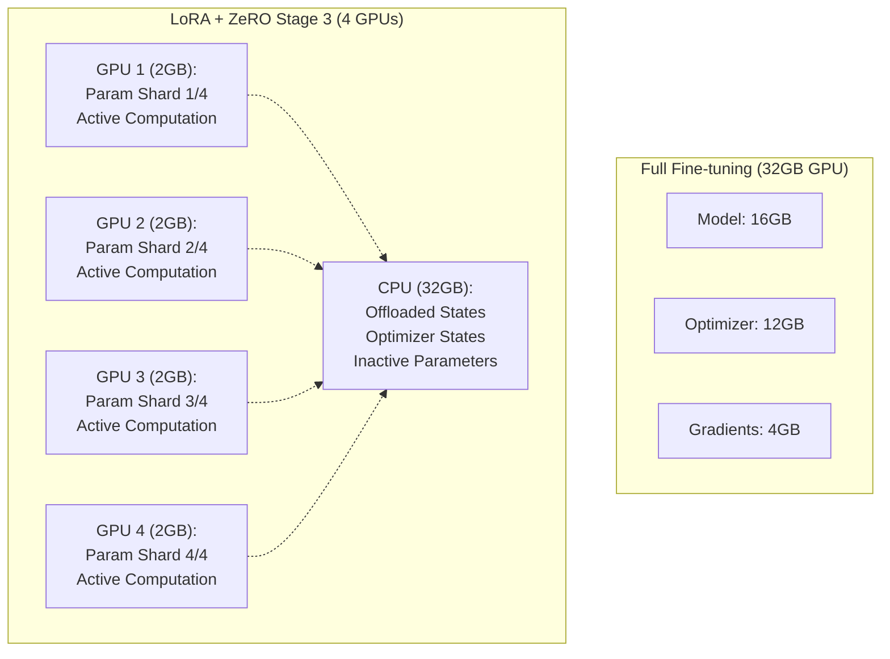

<!-- source: DeepWiki mcp.deepwiki.com · repo microsoft/Text2Grad · page 5.2 LoRA and DeepSpeed Configuration · fetched 2026-10-26 -->

# LoRA and DeepSpeed Configuration

<details>
<summary>Relevant source files</summary>

The following files were used as context for generating this wiki page:

- [nl_reward_model/kodcode/train_rm.py](nl_reward_model/kodcode/train_rm.py)

</details>


## Purpose and Scope

This page documents the parameter-efficient fine-tuning configuration using LoRA (Low-Rank Adaptation) and the memory optimization strategy using DeepSpeed ZeRO Stage 3 for reward model training. These techniques enable training large language models (8B parameters) on consumer-grade GPUs by reducing trainable parameters and partitioning model states across devices.

For the complete reward model training workflow, see [Training Reward Models](#5.1). For inference configuration, see [Reward Model Inference](#5.3).

---

## LoRA Configuration

### Overview

LoRA reduces the number of trainable parameters by injecting trainable rank decomposition matrices into specific layers while keeping the pre-trained weights frozen. Instead of fine-tuning all 8B parameters of Llama-3.1-8B-Instruct, only low-rank adapter weights (~1% of total parameters) are trained.

**Sources:** [nl_reward_model/kodcode/train_rm.py:183-206]()

### Configuration Parameters

The `apply_lora` function configures LoRA with the following parameters:

| Parameter | Default Value | Purpose |
|-----------|---------------|---------|
| `r` | 16 | Rank of the low-rank decomposition matrices (controls capacity) |
| `lora_alpha` | 32 | Scaling factor for LoRA updates (typically 2×r) |
| `target_modules` | `["q_proj", "k_proj", "v_proj", "o_proj"]` | Attention projection layers to apply LoRA |
| `lora_dropout` | 0.1 | Dropout rate for LoRA layers |
| `bias` | `"none"` | Whether to train bias terms |
| `task_type` | `"CAUSAL_LM"` | Model task type for PEFT library |

**Sources:** [nl_reward_model/kodcode/train_rm.py:196-202]()

### LoRA Architecture in Attention Layers



This diagram shows how LoRA adapters are injected into the four attention projection layers. Each adapter consists of two low-rank matrices (A and B) whose product is added to the frozen projection output, scaled by `lora_alpha / r`.

**Sources:** [nl_reward_model/kodcode/train_rm.py:196-206]()

### Implementation Details

The `apply_lora` function uses the PEFT library to wrap the base model:

```python
lora_config = LoraConfig(
    r=r,
    lora_alpha=lora_alpha,
    target_modules=["q_proj", "k_proj", "v_proj", "o_proj"],
    lora_dropout=dropout,
    bias="none",
    task_type="CAUSAL_LM"
)
model = get_peft_model(model, lora_config)
```

This configuration:
- Freezes all base model parameters
- Adds trainable LoRA adapters to specified modules
- Reduces trainable parameters from ~8B to ~67M (~0.84%)
- Enables training on GPUs with limited memory

**Sources:** [nl_reward_model/kodcode/train_rm.py:196-206]()

---

## DeepSpeed ZeRO Stage 3 Configuration

### Overview

DeepSpeed ZeRO (Zero Redundancy Optimizer) Stage 3 partitions model states (optimizer states, gradients, and parameters) across all available GPUs and offloads them to CPU memory when not in active use. This enables training models that would not fit in GPU memory on a single device.

**Sources:** [nl_reward_model/kodcode/train_rm.py:209-260]()

### ZeRO Optimization Stages



Text2Grad uses **Stage 3** to partition all model states and offload to CPU, maximizing memory efficiency.

**Sources:** [nl_reward_model/kodcode/train_rm.py:237-252]()

### Configuration Parameters

The `get_deepspeed_config` function returns a comprehensive DeepSpeed configuration dictionary:

#### Mixed Precision (FP16)

| Parameter | Value | Purpose |
|-----------|-------|---------|
| `enabled` | `True` | Use 16-bit floating point for forward/backward passes |
| `loss_scale` | 0 | Dynamic loss scaling (0 = automatic) |
| `loss_scale_window` | 1000 | Steps to wait before adjusting loss scale |
| `hysteresis` | 2 | Delay factor for loss scale changes |
| `min_loss_scale` | 1 | Minimum loss scale value |

**Sources:** [nl_reward_model/kodcode/train_rm.py:221-226]()

#### Optimizer Configuration

| Parameter | Value | Purpose |
|-----------|-------|---------|
| `type` | `"AdamW"` | Optimizer algorithm |
| `lr` | `2e-5` | Learning rate |
| `betas` | `[0.9, 0.999]` | Adam beta parameters |
| `eps` | `1e-8` | Numerical stability epsilon |
| `weight_decay` | 0.01 | L2 regularization coefficient |

**Sources:** [nl_reward_model/kodcode/train_rm.py:228-235]()

#### ZeRO Stage 3 Configuration

| Parameter | Value | Purpose |
|-----------|-------|---------|
| `stage` | 3 | Partition all model states |
| `offload_optimizer.device` | `"cpu"` | Offload optimizer states to CPU |
| `offload_optimizer.pin_memory` | `True` | Use pinned memory for faster transfers |
| `offload_param.device` | `"cpu"` | Offload parameters to CPU |
| `offload_param.pin_memory` | `True` | Use pinned memory for faster transfers |
| `overlap_comm` | `True` | Overlap communication with computation |
| `contiguous_gradients` | `True` | Allocate contiguous gradient buffers |
| `sub_group_size` | `1e9` | Sub-group size for parameter gathering |
| `stage3_max_live_parameters` | `1e9` | Maximum live parameters on GPU |
| `stage3_max_reuse_distance` | `1e9` | Parameter reuse distance threshold |
| `stage3_gather_16bit_weights_on_model_save` | `True` | Gather FP16 weights for saving |

**Sources:** [nl_reward_model/kodcode/train_rm.py:237-252]()

#### Batch Configuration

| Parameter | Value | Purpose |
|-----------|-------|---------|
| `train_batch_size` | `1 × batch_size × num_gpus` | Total batch size across all GPUs |
| `gradient_accumulation_steps` | 1 | Steps to accumulate gradients |
| `train_micro_batch_size_per_gpu` | `batch_size` | Batch size per GPU |
| `gradient_clipping` | 1.0 | Maximum gradient norm |

**Sources:** [nl_reward_model/kodcode/train_rm.py:254-257]()

### Memory Offloading Strategy



This diagram shows the data movement pattern during training:
1. **Forward Pass**: Parameters are gathered from CPU to GPU for active layers
2. **Backward Pass**: Gradients are computed and reduced across ranks
3. **Optimizer Step**: Optimizer states are fetched from CPU, parameters updated, then offloaded back

**Sources:** [nl_reward_model/kodcode/train_rm.py:237-252]()

---

## Integration in Training Pipeline

### Initialization Sequence



This shows the initialization order in the `train` function. LoRA is applied before DeepSpeed initialization, and only trainable parameters (LoRA adapters) are passed to DeepSpeed.

**Sources:** [nl_reward_model/kodcode/train_rm.py:325-403]()

### Code Implementation

The training function integrates both configurations:

```python
# Step 1: Load base model
tokenizer, model = setup_model_and_tokenizer(config["model_name"])

# Step 2: Apply LoRA (reduces trainable params)
model = apply_lora(model)

# Step 3: Extract only trainable parameters
trainable_parameters = [p for p in model.parameters() if p.requires_grad]

# Step 4: Initialize DeepSpeed with LoRA model
ds_config = get_deepspeed_config(config["batch_size"])
model_engine, optimizer, _, _ = deepspeed.initialize(
    model=model,
    model_parameters=trainable_parameters,
    config=ds_config
)
```

**Key Integration Points:**
1. LoRA is applied **before** DeepSpeed initialization
2. Only LoRA adapter parameters (those with `requires_grad=True`) are passed to DeepSpeed
3. DeepSpeed manages the reduced parameter set with ZeRO Stage 3
4. Combined memory savings: LoRA reduces trainable params by ~99%, ZeRO Stage 3 partitions remaining params across GPUs and CPU

**Sources:** [nl_reward_model/kodcode/train_rm.py:340-350]()

### Training Loop Details



The training loop uses `model_engine` (DeepSpeed-wrapped model) for all operations:
- `model_engine.backward(loss)`: Handles gradient computation and reduction
- `model_engine.step()`: Applies optimizer updates to LoRA parameters
- `get_accelerator().empty_cache()`: Frees GPU memory after operations

**Sources:** [nl_reward_model/kodcode/train_rm.py:368-402]()

### Checkpoint Saving

Only LoRA adapter weights are saved, not the full model:

```python
def save_checkpoint(model_engine, exp_dir, epoch, step):
    if model_engine.local_rank == 0:
        checkpoint_dir = os.path.join(exp_dir, f'{epoch}_{step}')
        os.makedirs(checkpoint_dir, exist_ok=True)
        model_engine.save_pretrained(checkpoint_dir)
```

This saves:
- `adapter_model.safetensors`: LoRA adapter weights (~130MB)
- `adapter_config.json`: LoRA configuration
- `adapter_model.bin`: Alternative format

The base Llama-3.1-8B-Instruct model is not saved, as it remains frozen.

**Sources:** [nl_reward_model/kodcode/train_rm.py:308-322]()

---

## Memory Benefits

### Parameter Count Comparison

| Configuration | Total Parameters | Trainable Parameters | Memory (Approx) |
|---------------|------------------|----------------------|-----------------|
| Full Fine-tuning | 8.03B | 8.03B | ~32GB (FP16) |
| LoRA Only (r=16) | 8.03B | 67M | ~16GB + optimizer |
| LoRA + ZeRO Stage 3 (1 GPU) | 8.03B | 67M | ~8GB + CPU offload |
| LoRA + ZeRO Stage 3 (4 GPUs) | 8.03B | 67M | ~2GB per GPU + CPU |

### Memory Distribution



The combination of LoRA and ZeRO Stage 3 enables training on consumer hardware that would otherwise require expensive multi-GPU clusters.

**Sources:** [nl_reward_model/kodcode/train_rm.py:183-260]()

---

## Configuration Variants

### Task-Specific Configurations

While the core LoRA and DeepSpeed configurations are consistent across tasks, some parameters vary:

| Task | Batch Size | Prompt Max Length | Max Length | Epochs |
|------|------------|-------------------|------------|--------|
| KodCode | 2 | 900 | 1250 | 3 |
| UltraFeedback | 2 | 1024 | 1536 | 3 |
| SLF5K | 2 | 800 | 1200 | 3 |

These values balance memory usage with training throughput for each domain's typical input lengths.

**Sources:** [nl_reward_model/kodcode/train_rm.py:407-418]()

---

## Troubleshooting

### Common Issues

**Out of Memory (OOM) Errors:**
- Reduce `batch_size` in configuration
- Decrease `prompt_max_length` or `max_length`
- Ensure CPU has sufficient RAM for offloading (recommend 32GB+)
- Verify `pin_memory=True` for faster CPU-GPU transfers

**Slow Training:**
- Check `overlap_comm=True` in ZeRO config for communication overlap
- Verify `contiguous_gradients=True` for efficient gradient buffers
- Ensure pinned memory is enabled for offloading
- Monitor CPU-GPU transfer bandwidth

**Checkpoint Loading Issues:**
- Ensure LoRA config matches between training and inference
- Verify base model matches (Llama-3.1-8B-Instruct)
- Check that adapter files exist: `adapter_model.safetensors`, `adapter_config.json`

**Sources:** [nl_reward_model/kodcode/train_rm.py:209-322]()

---

