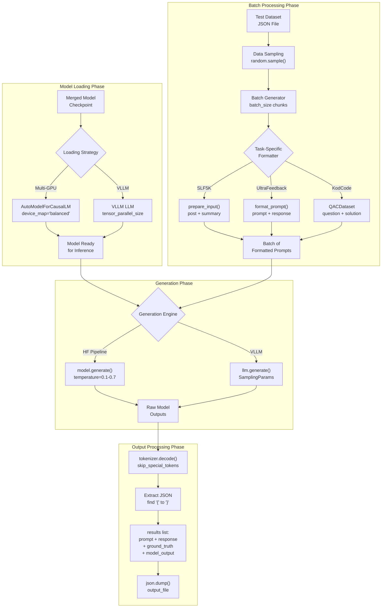
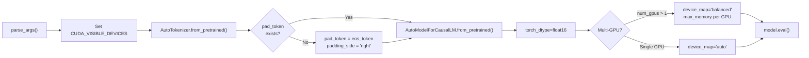
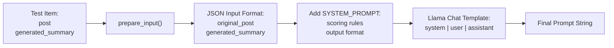
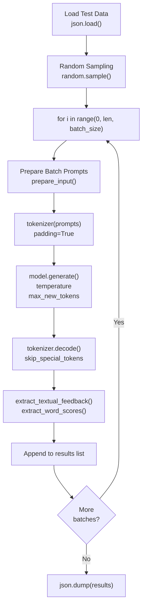
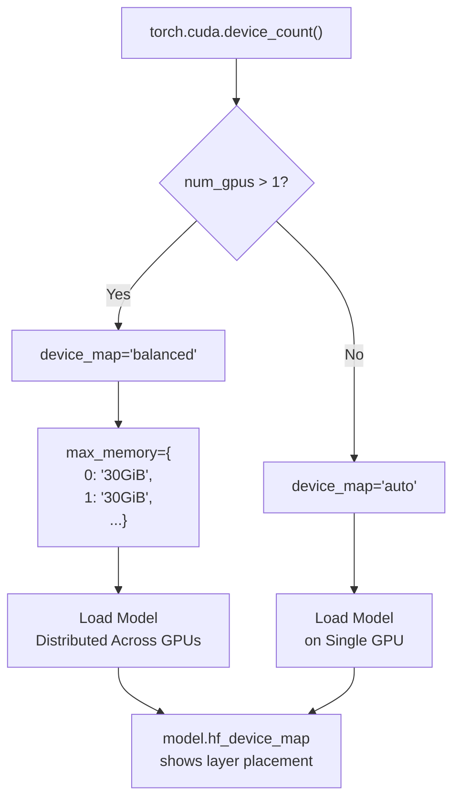
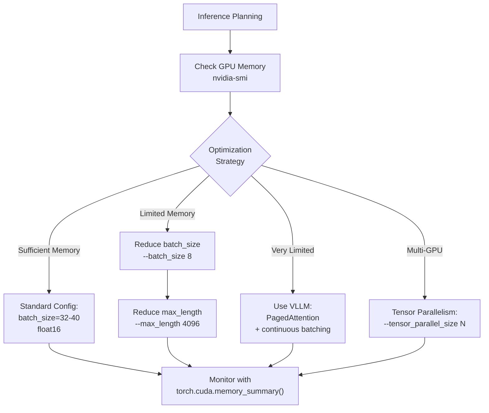

<!-- source: DeepWiki mcp.deepwiki.com · repo microsoft/Text2Grad · page 5.3 Reward Model Inference · fetched 2026-10-26 -->

# Reward Model Inference

<details>
<summary>Relevant source files</summary>

The following files were used as context for generating this wiki page:

- [nl_reward_model/kodcode/evaluation/2_infer.py](nl_reward_model/kodcode/evaluation/2_infer.py)
- [nl_reward_model/slf5k/evaluation/2_infer.py](nl_reward_model/slf5k/evaluation/2_infer.py)
- [nl_reward_model/ultrafeedback/evaluation/2_infer.py](nl_reward_model/ultrafeedback/evaluation/2_infer.py)

</details>


## Purpose and Scope

This page documents the inference process for trained reward models in the Text2Grad system. After a reward model has been trained with LoRA adapters (see [Training Reward Models](#5.1)) and optionally merged (see [LoRA and DeepSpeed Configuration](#5.2)), it must be deployed to generate structured feedback on test data.

The inference pipeline loads the trained model, processes input data in batches, generates JSON-formatted feedback (textual critiques and span annotations), and saves results for evaluation. For information about parsing and handling malformed outputs, see [Response Parsing Strategies](#5.4). For metrics computed on inference results, see [Evaluation Metrics](#5.5).

**Sources:** [nl_reward_model/slf5k/evaluation/2_infer.py:1-288](), [nl_reward_model/ultrafeedback/evaluation/2_infer.py:1-178](), [nl_reward_model/kodcode/evaluation/2_infer.py:1-222]()

## High-Level Inference Architecture



**Diagram: Reward Model Inference Pipeline**

This diagram shows the complete flow from loading a trained model checkpoint to saving inference results. The process is divided into four phases:

1. **Model Loading** - Chooses between standard HuggingFace loading with balanced device mapping or VLLM for optimized inference
2. **Batch Processing** - Samples test data, groups into batches, and applies task-specific prompt formatting
3. **Generation** - Executes batch inference with configured sampling parameters
4. **Output Processing** - Decodes tokens, extracts JSON, and saves structured results

**Sources:** [nl_reward_model/slf5k/evaluation/2_infer.py:61-118](), [nl_reward_model/ultrafeedback/evaluation/2_infer.py:103-176](), [nl_reward_model/kodcode/evaluation/2_infer.py:108-222]()

## Command-Line Interface

All inference scripts share a common argument structure with task-specific defaults:

| Argument | Type | Purpose | SLF5K Default | UltraFeedback Default | KodCode Default |
|----------|------|---------|---------------|----------------------|-----------------|
| `--model_path` | str | Path to merged model | `../ckpt/llama31-8B/0_4800_merge` | `../ckpt/llama31-8B-span2span-v2-nofeedback/0_10000_merge` | `../ckpt/llama31-8B-span2span-v2/0_4000_merge` |
| `--data_path` / `--valid_dataset_file` | str | Test dataset JSON | `../SLF5K_label/validation_critique_processed.json` | `../data/ultrafeedback/RM/test_annotated_v4_concurrent_2step.json` | `../data/KodCode/kodcode_test.json` |
| `--output_path` / `--output_file` | str | Output JSON path | `../QA_FS_EVAL/0_4800_res_span` | `validation_results.json` | `inference_results_0_4000.json` |
| `--batch_size` | int | Inference batch size | 24 | 32 | 40 |
| `--max_new_tokens` | int | Generation token limit | 512 | 300 | 350 |
| `--temperature` | float | Sampling temperature | 0.1 | 0.7 | N/A (greedy) |
| `--gpu_ids` | str | GPU device IDs | `"0,1,2,3"` | `"0,1,2,3,4,5,6,7"` | `"0,1,2,3,4,5"` |
| `--max_samples` | int | Number of test samples | 500 | 1000 | All |
| `--tensor_parallel_size` | int | GPUs for VLLM | N/A | 1 | N/A |

**Sources:** [nl_reward_model/slf5k/evaluation/2_infer.py:42-58](), [nl_reward_model/ultrafeedback/evaluation/2_infer.py:10-23](), [nl_reward_model/kodcode/evaluation/2_infer.py:80-105]()

## Model Loading Strategies

### HuggingFace Standard Loading (SLF5K, KodCode)



**Diagram: HuggingFace Model Loading Flow**

The `load_and_prepare_model()` function in SLF5K inference and similar logic in KodCode handle model initialization:

**Key Implementation Details:**
- **Tokenizer Setup**: Ensures `pad_token` is set, defaulting to `eos_token` if missing [nl_reward_model/slf5k/evaluation/2_infer.py:61-66]()
- **Padding Side**: Sets `padding_side="right"` for proper batch padding during generation [nl_reward_model/slf5k/evaluation/2_infer.py:66]()
- **Device Mapping**: Uses `device_map="balanced"` to distribute model layers across available GPUs [nl_reward_model/slf5k/evaluation/2_infer.py:70]()
- **Memory Limits**: KodCode optionally specifies `max_memory={i: "30GiB" for i in range(num_gpus)}` to prevent OOM [nl_reward_model/kodcode/evaluation/2_infer.py:128]()
- **Float16 Precision**: All models use `torch_dtype=torch.float16` for memory efficiency [nl_reward_model/slf5k/evaluation/2_infer.py:69]()

**Sources:** [nl_reward_model/slf5k/evaluation/2_infer.py:61-75](), [nl_reward_model/kodcode/evaluation/2_infer.py:115-138]()

### VLLM Optimized Loading (UltraFeedback)

The UltraFeedback inference script uses VLLM for significantly faster batch inference:

```python
model = LLM(
    model=args.model_path,
    tensor_parallel_size=args.tensor_parallel_size,
    dtype="float16",
    trust_remote_code=True,
    max_model_len=8192,    
)

sampling_params = SamplingParams(
    temperature=0.7,
    top_p=0.9,
    max_tokens=args.max_new_tokens,
)
```

**VLLM Configuration:**
- **Tensor Parallelism**: Distributes model across GPUs with `tensor_parallel_size` for larger batch throughput [nl_reward_model/ultrafeedback/evaluation/2_infer.py:111]()
- **Maximum Context Length**: Sets `max_model_len=8192` to handle longer prompts [nl_reward_model/ultrafeedback/evaluation/2_infer.py:114]()
- **Sampling Parameters**: Separates generation config from model initialization [nl_reward_model/ultrafeedback/evaluation/2_infer.py:117-121]()
- **Batched Generation**: VLLM automatically optimizes for high-throughput batch processing

**Sources:** [nl_reward_model/ultrafeedback/evaluation/2_infer.py:103-121]()

## Task-Specific Prompt Formatting

Each task domain requires different input formatting to match the reward model's training distribution.

### SLF5K: Post-Summary Evaluation



**Diagram: SLF5K Prompt Construction**

The `prepare_input()` function formats Reddit post and summary pairs:

```python
def prepare_input(post, summary):
    question = f"""# Input
{{
  "original_post": "{post}",
  "generated_summary": "{summary}"
}}

# Output
Please score each word in generated_summary based on original_post and the feedback of generated_summary, and output the responses as a JSON Dictionary without any extra information:
"""

    prompt = f"<|begin_of_text|><|start_header_id|>system<|end_header_id|>\n{SYSTEM_PROMPT}<|eot_id|><|start_header_id|>user<|end_header_id|>\n{question} \n<|eot_id|><|start_header_id|>assistant<|end_header_id|>\n"
    
    return prompt
```

**Expected Output Format:**
```json
{
  "textual_feedback": "feedback indicating missing, incorrect, or unnecessary content",
  "word_score_list": [
    ("word1", -1),
    ("word2", 0),
    ("word3", 1)
  ]
}
```

**Sources:** [nl_reward_model/slf5k/evaluation/2_infer.py:12-91]()

### UltraFeedback: Span-Level Critique

The `format_prompt()` function creates prompts for identifying good and poor spans:

```python
def format_prompt(user_prompt, assistant_response):
    prompt = f'''Please critique the following response to a user input and provide word-level list of good and poor spans:

---
**User Input**:
{user_prompt}
---

---
**Generated Response**:
{assistant_response}
---

---
**Definitions:**
- **good_spans**: phrases from the response that greatly improve its quality by accurately addressing the user input, providing key information, or capturing the core intent effectively, as explained in 'textual_feedback'. Empty if none apply.
- **poor_spans**: phrases from the response that noticeably harm its quality due to inaccuracy, irrelevance, redundancy, poor wording, or missing critical aspects of the input, as explained in 'textual_feedback'. Empty if none apply.

---
**Instructions:**
1. Evaluate the response based on:
    - **Accuracy**: Does it correctly address the input?
    - **Relevance**: Does it stay on topic?
    - **Clarity**: Is it easy to understand?
    - **Completeness**: Does it cover the input's core needs?
2. Select the most significant phrases for 'good_spans' and 'poor_spans', keeping them impactful, and essence-focused, with brief justifications. Include none if no phrases stand out.

---
**Output Format:**
{{
"good_spans": ["phrase1", "phrase2",...],
"poor_spans": ["phrase1", "phrase2",...]
}}'''

    return f"<|begin_of_text|><|start_header_id|>user<|end_header_id|>\n{prompt}<|eot_id|><|start_header_id|>assistant<|end_header_id|>\n"
```

**Expected Output Format:**
```json
{
  "good_spans": ["accurate phrase", "helpful explanation"],
  "poor_spans": ["incorrect claim", "irrelevant detail"]
}
```

**Sources:** [nl_reward_model/ultrafeedback/evaluation/2_infer.py:25-60]()

### KodCode: Code Quality Analysis

The `QACDataset.__getitem__()` method formats programming problems and solutions:

```python
prompt = f'''Please analyze the following programming problem and solution:

Problem:
{question}

Submitted Solution:
{solution}

---
**Instructions:**
1. Evaluate the code solution based on:
   - **Correctness**: Does it solve the problem without bugs?
   - **Efficiency**: Is the time and space complexity optimal?
   - **Readability**: Is the code clean and well-structured?
   - **Completeness**: Does it handle all edge cases?
2. Identify specific code snippets that:
   - Have errors or bugs (for wrong_code)
   - Work correctly but could be improved (for improvement_code)
3. Provide a concise paragraph summarizing the overall quality of the solution.

---
**Output Format:**
```json
{{
    "code_feedback": "Evaluate the strengths and weaknesses (if any) of the code solution, concisely written in one paragraph.",
    "wrong_code": ["Include only code snippets with errors or bugs causing test failures. Leave as an empty array if no such errors are found."],
    "improvement_code": ["Include only original code snippets in the Submitted Code that work correctly but could be improved. Leave as an empty array if no improvements are needed."]
}}
```
'''
```

**Expected Output Format:**
```json
{
  "code_feedback": "Overall assessment paragraph",
  "wrong_code": ["buggy_snippet_1", "buggy_snippet_2"],
  "improvement_code": ["suboptimal_snippet_1"]
}
```

**Sources:** [nl_reward_model/kodcode/evaluation/2_infer.py:26-62]()

## Batch Inference Execution

### HuggingFace Generation Loop (SLF5K)



**Diagram: HuggingFace Batch Processing Flow**

The `process_batch()` function handles tokenization and generation:

```python
def process_batch(model, tokenizer, batch_data, max_new_tokens, temperature):
    prompts = [prepare_input(data["post"], data["generated_summary"]) for data in batch_data]
    inputs = tokenizer(prompts, return_tensors="pt", padding=True, truncation=True).to(model.device)

    with torch.no_grad():
        outputs = model.generate(
            **inputs,
            max_new_tokens=max_new_tokens,
            temperature=temperature,
            do_sample=True,
            pad_token_id=tokenizer.pad_token_id
        )

    responses = []
    for i, output in enumerate(outputs):
        input_length = inputs['input_ids'].shape[1]
        response_tokens = output[input_length:]
        response = tokenizer.decode(response_tokens, skip_special_tokens=True).strip()
        responses.append(response)

    return responses
```

**Key Operations:**
- **Batch Preparation**: Converts list of data items to formatted prompts [nl_reward_model/slf5k/evaluation/2_infer.py:95]()
- **Tokenization**: Pads prompts to same length with `padding=True` [nl_reward_model/slf5k/evaluation/2_infer.py:96]()
- **GPU Transfer**: Moves tensors to model device with `.to(model.device)` [nl_reward_model/slf5k/evaluation/2_infer.py:96]()
- **Generation**: Uses `do_sample=True` for stochastic generation [nl_reward_model/slf5k/evaluation/2_infer.py:103]()
- **Decoding**: Extracts only newly generated tokens by slicing from `input_length` [nl_reward_model/slf5k/evaluation/2_infer.py:111-112]()

**Sources:** [nl_reward_model/slf5k/evaluation/2_infer.py:94-118](), [nl_reward_model/slf5k/evaluation/2_infer.py:241-270]()

### VLLM Generation Loop (UltraFeedback)

VLLM provides higher throughput through optimized batching:

```python
for i in tqdm(range(0, len(valid_data), args.batch_size), desc="Processing batches"):
    batch_items = valid_data[i:i+args.batch_size]
    batch_prompts = []
    prompt_ids = []

    for idx, item in enumerate(batch_items):
        user_prompt = item["prompt"]
        assistant_response = item["response"]
        
        input_text = format_prompt(user_prompt, assistant_response)
        batch_prompts.append(input_text)
        prompt_ids.append(i + idx)

    outputs = model.generate(batch_prompts, sampling_params)

    for output, prompt_id in zip(outputs, prompt_ids):
        item = valid_data[prompt_id]
        generated_text = output.outputs[0].text

        assistant_part = generated_text.strip()
        parsed_response = parse_response(assistant_part)

        result = {
            "prompt": item["prompt"],
            "response": item["response"],
            "ground_truth": {
                "good_spans": item.get("good_spans", []),
                "poor_spans": item.get("poor_spans", [])
            },
            "model_output": parsed_response,
            "raw_model_output": assistant_part
        }

        results.append(result)
```

**VLLM Advantages:**
- **Optimized Batching**: Automatically packs sequences for maximum GPU utilization [nl_reward_model/ultrafeedback/evaluation/2_infer.py:145]()
- **Continuous Batching**: Starts processing new requests as soon as earlier ones complete
- **PagedAttention**: Efficient KV cache management reduces memory overhead
- **No Manual Device Management**: VLLM handles tensor placement automatically

**Sources:** [nl_reward_model/ultrafeedback/evaluation/2_infer.py:132-176]()

## Output Structure and Storage

### Result Dictionary Schema

All inference scripts save results as JSON arrays with consistent structure:

**SLF5K Result Format:**
```json
{
  "index": 42,
  "original_post": "Full Reddit post text...",
  "generated_summary": "Model-generated summary...",
  "model_response": "{\n  \"textual_feedback\": \"...\",\n  \"word_score_list\": [...]}"
}
```

**UltraFeedback Result Format:**
```json
{
  "prompt": "User question or instruction...",
  "response": "Model-generated response...",
  "ground_truth": {
    "good_spans": ["accurate phrase", "helpful detail"],
    "poor_spans": ["error", "irrelevant content"]
  },
  "model_output": {
    "good_spans": ["predicted good phrase"],
    "poor_spans": ["predicted poor phrase"]
  },
  "raw_model_output": "Raw JSON string from model..."
}
```

**KodCode Result Format:**
```json
{
  "generated_response": "Full model output with JSON...",
  "improvement_code": ["ground_truth_snippet_1"],
  "wrong_code": ["ground_truth_snippet_2"],
  "feedback": "Ground truth feedback text",
  "generated_improvement_code": ["predicted_snippet_1"],
  "generated_wrong_code": ["predicted_snippet_2"],
  "generated_feedback": "Model-generated feedback text"
}
```

**Sources:** [nl_reward_model/slf5k/evaluation/2_infer.py:265-270](), [nl_reward_model/ultrafeedback/evaluation/2_infer.py:155-166](), [nl_reward_model/kodcode/evaluation/2_infer.py:178-186]()

### File Saving with Error Handling

The SLF5K script demonstrates robust file saving:

```python
try:
    with open(args.output_path, "w") as f:
        json.dump(results, f, indent=2)
    print(f"\n✅ Results saved to: {args.output_path}")
except Exception as e:
    print(f"Error saving results: {str(e)}")
    backup_path = "./evaluation_results_backup.json"
    try:
        with open(backup_path, "w") as f:
            json.dump(results, f, indent=2)
        print(f"Results saved to backup location: {backup_path}")
    except:
        print("Failed to save results to backup location as well.")
```

**Error Handling Features:**
- **Primary Save Attempt**: Tries to write to specified output path [nl_reward_model/slf5k/evaluation/2_infer.py:273-275]()
- **Backup Fallback**: If primary fails, attempts to save to local backup file [nl_reward_model/slf5k/evaluation/2_infer.py:278-282]()
- **Silent Failure**: If both fail, prints error but doesn't crash [nl_reward_model/slf5k/evaluation/2_infer.py:283-284]()

**Sources:** [nl_reward_model/slf5k/evaluation/2_infer.py:272-284]()

## Multi-GPU Inference Configuration

### Device Visibility Management

All scripts use `CUDA_VISIBLE_DEVICES` environment variable to control GPU allocation:

```python
os.environ["CUDA_VISIBLE_DEVICES"] = args.gpu_ids
```

**Configuration Examples:**
- **4 GPUs**: `--gpu_ids "0,1,2,3"` makes only first 4 GPUs visible [nl_reward_model/slf5k/evaluation/2_infer.py:207]()
- **8 GPUs**: `--gpu_ids "0,1,2,3,4,5,6,7"` for large batches [nl_reward_model/ultrafeedback/evaluation/2_infer.py:106]()
- **Non-contiguous**: `--gpu_ids "0,2,4,6"` to skip specific GPUs

**Sources:** [nl_reward_model/slf5k/evaluation/2_infer.py:207](), [nl_reward_model/ultrafeedback/evaluation/2_infer.py:106](), [nl_reward_model/kodcode/evaluation/2_infer.py:111]()

### Device Map Strategies



**Diagram: Multi-GPU Device Mapping Strategy**

The KodCode script explicitly configures memory limits:

```python
num_gpus = torch.cuda.device_count()
print(f"Number of available GPUs: {num_gpus}")

if num_gpus > 1:
    model = AutoModelForCausalLM.from_pretrained(
        args.model_path,
        device_map="balanced",
        max_memory={i: args.gpu_memory for i in range(num_gpus)},
        torch_dtype=torch.float16
    )
else:
    model = AutoModelForCausalLM.from_pretrained(
        args.model_path,
        device_map="auto",
        torch_dtype=torch.float16
    )

print(f"Model device map: {model.hf_device_map}")
```

**Device Map Options:**
- **`balanced`**: Distributes layers evenly across GPUs by memory size [nl_reward_model/kodcode/evaluation/2_infer.py:127]()
- **`auto`**: HuggingFace automatically determines optimal placement [nl_reward_model/kodcode/evaluation/2_infer.py:134]()
- **`max_memory`**: Specifies memory limit per device to prevent OOM [nl_reward_model/kodcode/evaluation/2_infer.py:128]()

**Sources:** [nl_reward_model/kodcode/evaluation/2_infer.py:121-138]()

## Initial Output Extraction

Before structured parsing (see [Response Parsing Strategies](#5.4)), the raw model output must be extracted from generation results:

### JSON Boundary Detection

All three tasks use similar logic to isolate JSON from surrounding text:

```python
# SLF5K approach
response_dict = json.loads(response)  # Direct parse attempt

# UltraFeedback approach  
json_start = assistant_part.find("{")
json_end = assistant_part.rfind("}") + 1

if json_start >= 0 and json_end > json_start:
    json_str = assistant_part[json_start:json_end]
    try:
        return json.loads(json_str)
    except json.JSONDecodeError:
        return extract_spans_with_regex(assistant_part)

# KodCode approach
json_start = assistant_response.find('{')
json_end = assistant_response.rfind('}') + 1
if json_start != -1 and json_end != -1:
    json_str = assistant_response[json_start:json_end]
    response_dict = json.loads(json_str)
```

**Extraction Strategy:**
1. **Direct Parse**: Attempt `json.loads()` on entire response [nl_reward_model/slf5k/evaluation/2_infer.py:123]()
2. **Boundary Search**: Find first `{` and last `}` to extract JSON substring [nl_reward_model/ultrafeedback/evaluation/2_infer.py:65-66]()
3. **Substring Parse**: Parse extracted JSON string [nl_reward_model/ultrafeedback/evaluation/2_infer.py:71]()
4. **Fallback**: If all fail, use regex-based extraction (documented in [Response Parsing Strategies](#5.4))

**Sources:** [nl_reward_model/slf5k/evaluation/2_infer.py:121-130](), [nl_reward_model/ultrafeedback/evaluation/2_infer.py:62-78](), [nl_reward_model/kodcode/evaluation/2_infer.py:168-172]()

## Debugging and Progress Monitoring

### Real-Time Output Display

All scripts print sample outputs during inference for monitoring:

```python
# SLF5K prints first prediction per batch
print("\n" + "=" * 50)
print(f"BATCH {i // args.batch_size + 1} - FIRST PREDICTION:")
print("-" * 50)
print(f"Original Post: {batch_data[0]['post'][:100]}...")
print(f"Generated Summary: {batch_data[0]['generated_summary']}")
print(f"Model Response: {responses[0][:200]}...")

try:
    word_scores = extract_word_scores(responses[0])
    print("\nWord Scores:")
    for word, score in word_scores[:10]:
        print(f"  • '{word}': {score}")
    if len(word_scores) > 10:
        print(f"  ... and {len(word_scores) - 10} more words")
except Exception as e:
    print(f"Error extracting word scores: {e}")
print("=" * 50)
```

**Monitoring Features:**
- **Batch Identification**: Shows which batch is being processed [nl_reward_model/slf5k/evaluation/2_infer.py:246]()
- **Input Preview**: Truncated original post and summary [nl_reward_model/slf5k/evaluation/2_infer.py:248-249]()
- **Output Preview**: First 200 characters of model response [nl_reward_model/slf5k/evaluation/2_infer.py:250]()
- **Parsed Results**: First 10 word scores to verify extraction [nl_reward_model/slf5k/evaluation/2_infer.py:255-259]()
- **Error Catching**: Continues execution even if parsing fails [nl_reward_model/slf5k/evaluation/2_infer.py:260-261]()

**Sources:** [nl_reward_model/slf5k/evaluation/2_infer.py:245-262](), [nl_reward_model/ultrafeedback/evaluation/2_infer.py:168-171]()

### Progress Bars

Both HuggingFace and VLLM scripts use `tqdm` for batch progress:

```python
# SLF5K
for i in tqdm(range(0, len(sampled_data), args.batch_size)):
    batch_data = sampled_data[i:i + args.batch_size]
    responses = process_batch(model, tokenizer, batch_data, args.max_new_tokens, args.temperature)

# KodCode  
with torch.no_grad():
    for batch_idx, batch in tqdm(enumerate(valid_dataloader), desc="Inferencing"):

# UltraFeedback
for i in tqdm(range(0, len(valid_data), args.batch_size), desc="Processing batches"):
```

**Progress Bar Benefits:**
- **Completion Estimate**: Shows time remaining based on current speed [nl_reward_model/slf5k/evaluation/2_infer.py:241]()
- **Batch Counting**: Displays current/total batches [nl_reward_model/ultrafeedback/evaluation/2_infer.py:132]()
- **Custom Description**: Labels like "Inferencing" or "Processing batches" [nl_reward_model/kodcode/evaluation/2_infer.py:151]()

**Sources:** [nl_reward_model/slf5k/evaluation/2_infer.py:241](), [nl_reward_model/ultrafeedback/evaluation/2_infer.py:132](), [nl_reward_model/kodcode/evaluation/2_infer.py:151]()

## Performance Considerations

### Batch Size Selection

Different tasks use different default batch sizes based on typical sequence lengths:

| Task | Default Batch Size | Rationale |
|------|-------------------|-----------|
| SLF5K | 24 | Short summaries + post excerpts |
| UltraFeedback | 32 | Medium-length Q&A pairs |
| KodCode | 40 | Code solutions vary widely |

**Tuning Recommendations:**
- **Increase batch size** if GPUs have free memory (check with `nvidia-smi`)
- **Decrease batch size** if encountering OOM errors
- **VLLM** can typically handle larger batches than HuggingFace due to optimized memory management

**Sources:** [nl_reward_model/slf5k/evaluation/2_infer.py:53](), [nl_reward_model/ultrafeedback/evaluation/2_infer.py:18](), [nl_reward_model/kodcode/evaluation/2_infer.py:91]()

### Temperature and Sampling

| Task | Temperature | Do Sample | Rationale |
|------|-------------|-----------|-----------|
| SLF5K | 0.1 | True | Low temperature for consistent scoring |
| UltraFeedback | 0.7 | True | Higher diversity for span identification |
| KodCode | N/A | False (greedy) | Deterministic for code analysis |

**Temperature Effects:**
- **Low (0.1)**: Nearly deterministic outputs, minimal variation [nl_reward_model/slf5k/evaluation/2_infer.py:103]()
- **Medium (0.7)**: Balanced diversity and coherence [nl_reward_model/ultrafeedback/evaluation/2_infer.py:118]()
- **High (>1.0)**: More creative but potentially inconsistent outputs

**Sources:** [nl_reward_model/slf5k/evaluation/2_infer.py:102-103](), [nl_reward_model/ultrafeedback/evaluation/2_infer.py:117-120]()

### Memory Optimization



**Diagram: Memory Optimization Decision Tree**

**Optimization Techniques:**
1. **Float16 Precision**: All scripts use `torch_dtype=torch.float16` to halve memory usage [nl_reward_model/slf5k/evaluation/2_infer.py:69]()
2. **Gradient Disabling**: `torch.no_grad()` context prevents gradient computation [nl_reward_model/slf5k/evaluation/2_infer.py:98]()
3. **Device Mapping**: Distributes model layers across multiple GPUs [nl_reward_model/kodcode/evaluation/2_infer.py:127]()
4. **VLLM PagedAttention**: Efficiently manages KV cache memory [nl_reward_model/ultrafeedback/evaluation/2_infer.py:109-115]()

**Sources:** [nl_reward_model/slf5k/evaluation/2_infer.py:69,98](), [nl_reward_model/kodcode/evaluation/2_infer.py:127-128](), [nl_reward_model/ultrafeedback/evaluation/2_infer.py:109-115]()

---

