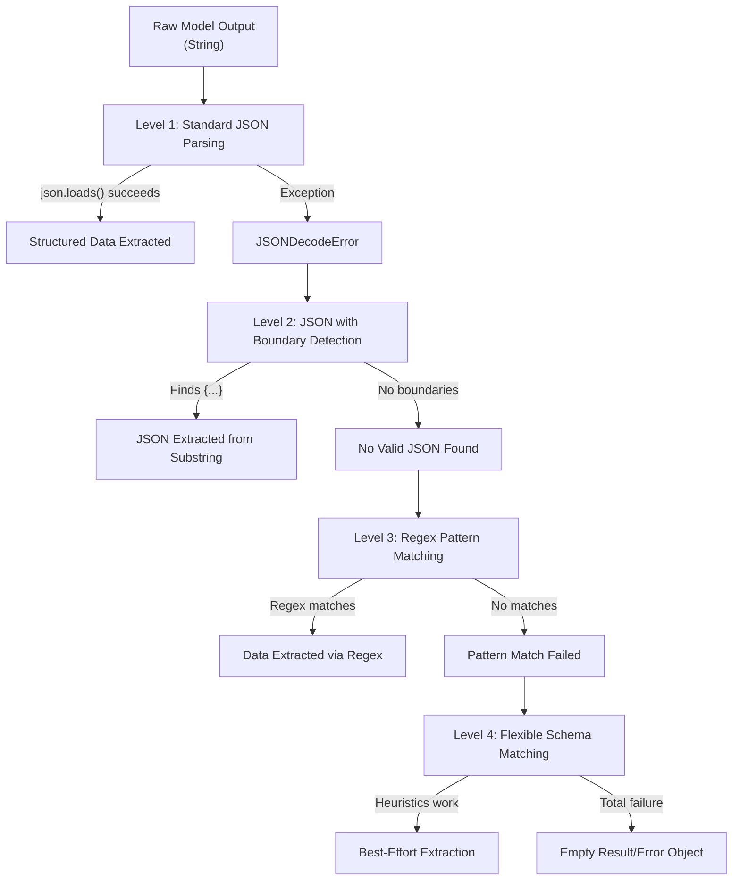
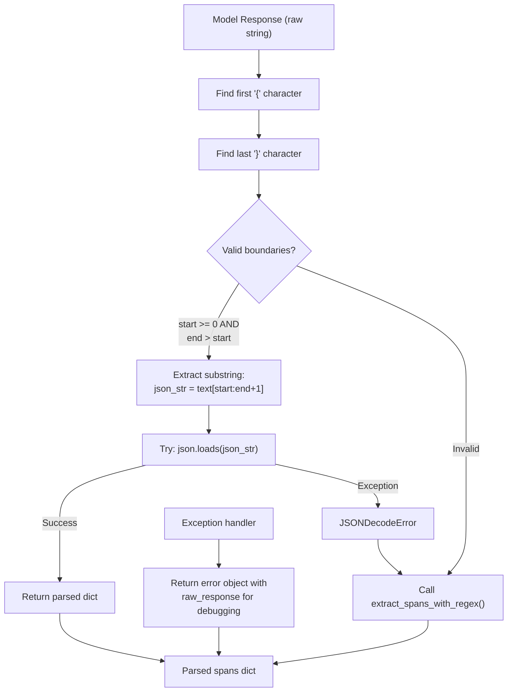
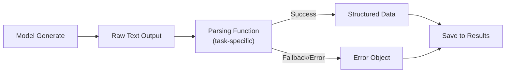

<!-- source: DeepWiki mcp.deepwiki.com · repo microsoft/Text2Grad · page 5.4 Response Parsing Strategies · fetched 2026-10-26 -->

# Response Parsing Strategies

<details>
<summary>Relevant source files</summary>

The following files were used as context for generating this wiki page:

- [nl_reward_model/slf5k/evaluation/2_infer.py](nl_reward_model/slf5k/evaluation/2_infer.py)
- [nl_reward_model/ultrafeedback/evaluation/2_infer.py](nl_reward_model/ultrafeedback/evaluation/2_infer.py)

</details>


## Purpose and Scope

This document describes the multi-level fallback parsing strategies used to extract structured data from reward model outputs during inference. Since reward models are generative language models, their outputs may be malformed, incomplete, or formatted inconsistently. This page covers the defensive parsing techniques that ensure robust extraction of span annotations, word scores, and textual feedback across different output formats and error conditions.

For information about the inference process that generates these outputs, see [Reward Model Inference](#5.3). For details on how parsed outputs are evaluated, see [Evaluation Metrics](#5.5).

---

## Overview of Parsing Challenges

Reward models are trained to output structured JSON containing span-level annotations and textual feedback. However, generative models frequently produce outputs that deviate from the expected format:

- **Syntax errors**: Mismatched brackets, missing quotes, trailing commas
- **Format variations**: Different key names (`"Score"` vs `"score"`), different data structures (lists vs dictionaries)
- **Incomplete outputs**: Truncated JSON due to token limits
- **Extra text**: Explanatory text before or after the JSON object

The parsing pipeline implements a **defensive multi-level strategy** that attempts multiple extraction methods in order of decreasing precision, ensuring maximum data recovery even from malformed outputs.

**Sources:** [nl_reward_model/slf5k/evaluation/2_infer.py:121-202](), [nl_reward_model/ultrafeedback/evaluation/2_infer.py:62-101]()

---

## Parsing Pipeline Architecture

The parsing system follows a cascading fallback pattern where each level attempts a different extraction strategy:



**Diagram: Cascading Fallback Parsing Strategy**

**Sources:** [nl_reward_model/slf5k/evaluation/2_infer.py:132-202](), [nl_reward_model/ultrafeedback/evaluation/2_infer.py:62-78]()

---

## Task-Specific Parsing Functions

Different tasks require different output schemas and therefore different parsing strategies:

| Task | Primary Function | Output Schema | Key Fields |
|------|------------------|---------------|------------|
| **SLF5K** | `extract_word_scores` | Word-level scoring | `textual_feedback`, `word_score_list` |
| **SLF5K** | `extract_textual_feedback` | Critique text | `textual_feedback` |
| **UltraFeedback** | `parse_response` | Span identification | `good_spans`, `poor_spans` |
| **UltraFeedback** | `extract_spans_with_regex` | Regex fallback | `good_spans`, `poor_spans` |

**Sources:** [nl_reward_model/slf5k/evaluation/2_infer.py:121-202](), [nl_reward_model/ultrafeedback/evaluation/2_infer.py:62-101]()

---

## SLF5K Parsing Strategy

### Textual Feedback Extraction

The `extract_textual_feedback` function in [nl_reward_model/slf5k/evaluation/2_infer.py:121-129]() implements a two-level strategy:

```mermaid
graph TB
    INPUT["Model Response String"]
    
    PRIMARY["Primary: json.loads()"]
    PRIMARY_SUCCESS["Extract textual_feedback field"]
    PRIMARY_FAIL["JSONDecodeError"]
    
    FALLBACK["Fallback: Regex Search"]
    FALLBACK_PATTERN["Pattern: '\"textual_feedback\"\\s*:\\s*\"([^\"]*)'"]
    FALLBACK_SUCCESS["Extract matched group"]
    FALLBACK_FAIL["Return empty string"]
    
    RESULT["Textual Feedback String"]
    
    INPUT --> PRIMARY
    PRIMARY -->|"Valid JSON"| PRIMARY_SUCCESS
    PRIMARY -->|"Exception"| PRIMARY_FAIL
    
    PRIMARY_FAIL --> FALLBACK
    FALLBACK --> FALLBACK_PATTERN
    FALLBACK_PATTERN -->|"Match found"| FALLBACK_SUCCESS
    FALLBACK_PATTERN -->|"No match"| FALLBACK_FAIL
    
    PRIMARY_SUCCESS --> RESULT
    FALLBACK_SUCCESS --> RESULT
    FALLBACK_FAIL --> RESULT
```

**Diagram: Textual Feedback Extraction Pipeline**

The function gracefully degrades: if full JSON parsing fails, it searches for the `textual_feedback` field specifically using a regex pattern that handles whitespace variations.

**Sources:** [nl_reward_model/slf5k/evaluation/2_infer.py:121-129]()

---

### Word Score List Extraction

The `extract_word_scores` function in [nl_reward_model/slf5k/evaluation/2_infer.py:132-202]() implements the most comprehensive parsing strategy with multiple format handlers:

```mermaid
graph TB
    INPUT["Model Response"]
    
    JSON_PARSE["Try: json.loads()"]
    JSON_SUCCESS["JSON parsed successfully"]
    JSON_FAIL["JSONDecodeError caught"]
    
    GET_LIST["Extract 'word_score_list' field"]
    
    CHECK_TYPE{"Check data type"}
    
    TYPE_STR["Type: String"]
    STR_REGEX["Parse tuples with regex:<br/>\\([\\\"\']?([^\\\"\',]+)[\\\"\']?,\\s*(-?\\d+)\\)"]
    
    TYPE_LIST["Type: List"]
    CHECK_ELEM{"Check element type"}
    
    ELEM_DICT_WS["Dict with 'word'/'score'"]
    ELEM_DICT_WC["Dict with 'word'/'Score' (capital)"]
    ELEM_TUPLE["List/Tuple with 2 elements"]
    
    FALLBACK["Fallback: Deep format detection"]
    FALLBACK_DICT["Flexible key matching:<br/>word/token, score/value"]
    FALLBACK_TUPLE["Extract pairs with type coercion"]
    
    REGEX_PARSE["Regex patterns on raw text"]
    PATTERN1["Pattern 1: Tuple format"]
    PATTERN2["Pattern 2: List format"]
    PATTERN3["Pattern 3: Dict format"]
    JSON_EXTRACT["Search for JSON substring"]
    
    RESULT["List of (word, score) tuples"]
    EMPTY["Empty list"]
    
    INPUT --> JSON_PARSE
    JSON_PARSE -->|"Success"| JSON_SUCCESS
    JSON_PARSE -->|"Exception"| JSON_FAIL
    
    JSON_SUCCESS --> GET_LIST
    GET_LIST --> CHECK_TYPE
    
    CHECK_TYPE -->|"str"| TYPE_STR
    CHECK_TYPE -->|"list"| TYPE_LIST
    
    TYPE_STR --> STR_REGEX --> RESULT
    
    TYPE_LIST --> CHECK_ELEM
    CHECK_ELEM -->|"dict w/ word+score"| ELEM_DICT_WS --> RESULT
    CHECK_ELEM -->|"dict w/ word+Score"| ELEM_DICT_WC --> RESULT
    CHECK_ELEM -->|"list/tuple"| ELEM_TUPLE --> RESULT
    CHECK_ELEM -->|"other"| FALLBACK
    
    FALLBACK --> FALLBACK_DICT --> RESULT
    FALLBACK --> FALLBACK_TUPLE --> RESULT
    
    JSON_FAIL --> REGEX_PARSE
    REGEX_PARSE --> PATTERN1 --> RESULT
    REGEX_PARSE --> PATTERN2 --> RESULT
    REGEX_PARSE --> PATTERN3 --> RESULT
    REGEX_PARSE --> JSON_EXTRACT
    JSON_EXTRACT -->|"Found"| JSON_SUCCESS
    JSON_EXTRACT -->|"Not found"| EMPTY --> RESULT
```

**Diagram: Multi-Stage Word Score Extraction**

**Sources:** [nl_reward_model/slf5k/evaluation/2_infer.py:132-202]()

---

### Format Variation Handling

The function handles multiple data format variations within the `word_score_list` field:

| Format Type | Example | Handling Code Lines |
|-------------|---------|---------------------|
| **String (serialized tuples)** | `"[('word', 1), ('other', -1)]"` | [137-139]() |
| **List of dictionaries (word/score)** | `[{"word": "test", "score": 1}]` | [142-143]() |
| **List of dictionaries (word/Score)** | `[{"word": "test", "Score": 1}]` | [144-145]() |
| **List of tuples** | `[["word", 1], ["other", -1]]` | [146-147]() |
| **Flexible dictionary keys** | `[{"token": "test", "value": 1}]` | [164-175]() |

The fallback section (lines 150-176) implements **heuristic key matching** that searches for keys containing common variations like "word"/"token" and "score"/"value", making the parser resilient to minor schema deviations.

**Sources:** [nl_reward_model/slf5k/evaluation/2_infer.py:137-176]()

---

### Regex Fallback Patterns

When JSON parsing completely fails, the function tries multiple regex patterns in sequence:

```python
patterns = [
    r'\([\"\']?([^\"\',]+)[\"\']?,\s*(-?\d+)\)',           # Tuple format: ("word", 1)
    r'\[[\"\']?([^\"\',]+)[\"\']?,\s*(-?\d+)\]',           # List format: ["word", 1]
    r'{\s*[\"\']?word[\"\']?\s*:\s*[\"\']?([^\"\',]+)[\"\']?\s*,\s*[\"\']?score[\"\']?\s*:\s*(-?\d+)\s*}'  # Dict format
]
```

Each pattern is tested against the raw response text, with the first matching pattern used for extraction. If all patterns fail, the function attempts to locate a JSON substring within the response and recursively parse it (lines 191-199).

**Sources:** [nl_reward_model/slf5k/evaluation/2_infer.py:180-199]()

---

## UltraFeedback Parsing Strategy

### Span Extraction with Boundary Detection

The `parse_response` function in [nl_reward_model/ultrafeedback/evaluation/2_infer.py:62-78]() uses JSON boundary detection as a preprocessing step:



**Diagram: UltraFeedback Span Parsing with Boundary Detection**

This approach is more tolerant of extra text around the JSON object, which commonly occurs when models provide explanations before outputting the structured data.

**Sources:** [nl_reward_model/ultrafeedback/evaluation/2_infer.py:62-78]()

---

### Regex Span Extraction

The `extract_spans_with_regex` function in [nl_reward_model/ultrafeedback/evaluation/2_infer.py:80-101]() handles the fallback case by searching for span lists directly in the text:

```mermaid
graph TB
    INPUT["Raw text (no valid JSON)"]
    
    GOOD_PATTERN["Search for good_spans pattern:<br/>'\"good_spans\"\\s*:\\s*\\[(.*?)\\]'"]
    GOOD_EXTRACT["Extract content inside brackets"]
    GOOD_SPANS["Parse individual spans:<br/>(?:\"([^\"]*?)\"|'([^']*?)')"]
    
    POOR_PATTERN["Search for poor_spans pattern:<br/>'\"poor_spans\"\\s*:\\s*\\[(.*?)\\]'"]
    POOR_EXTRACT["Extract content inside brackets"]
    POOR_SPANS["Parse individual spans:<br/>(?:\"([^\"]*?)\"|'([^']*?)')"]
    
    BUILD_DICT["Construct result:<br/>{<br/>  good_spans: [...],<br/>  poor_spans: [...]<br/>}"]
    
    RESULT["Spans dictionary"]
    
    INPUT --> GOOD_PATTERN
    GOOD_PATTERN --> GOOD_EXTRACT
    GOOD_EXTRACT --> GOOD_SPANS
    
    INPUT --> POOR_PATTERN
    POOR_PATTERN --> POOR_EXTRACT
    POOR_EXTRACT --> POOR_SPANS
    
    GOOD_SPANS --> BUILD_DICT
    POOR_SPANS --> BUILD_DICT
    
    BUILD_DICT --> RESULT
```

**Diagram: Regex-Based Span Extraction for UltraFeedback**

The regex patterns use `re.DOTALL` flag (line 83, 91) to match across newlines, and the span extraction pattern handles both double-quoted and single-quoted strings, selecting whichever matched (lines 87-88, 95-96).

**Sources:** [nl_reward_model/ultrafeedback/evaluation/2_infer.py:80-101]()

---

## Integration with Inference Pipeline

The parsing functions are called immediately after model generation to convert raw text outputs into structured data:



**Diagram: Parsing Integration in Inference Loop**

In the SLF5K pipeline [nl_reward_model/slf5k/evaluation/2_infer.py:264-270](), each response is processed and stored with:
- Original inputs (post, generated_summary)
- Raw model response
- Index for tracking

In the UltraFeedback pipeline [nl_reward_model/ultrafeedback/evaluation/2_infer.py:155-166](), results include:
- Prompt and response
- Ground truth spans
- Parsed model output
- Raw model output for debugging

Both pipelines preserve raw outputs alongside parsed data, enabling post-hoc debugging and manual inspection of parse failures.

**Sources:** [nl_reward_model/slf5k/evaluation/2_infer.py:264-270](), [nl_reward_model/ultrafeedback/evaluation/2_infer.py:155-166]()

---

## Error Handling and Robustness

### Score Type Coercion

The SLF5K parser includes defensive type handling when extracting scores from various formats:

```python
# From nl_reward_model/slf5k/evaluation/2_infer.py:156-161
score = item[1]
if isinstance(score, str):
    try:
        score = int(score)
    except ValueError:
        score_match = re.search(r'(-?\d+)', score)
        score = int(score_match.group(1)) if score_match else 0
```

This handles cases where scores are:
- Already integers (direct use)
- Numeric strings (`"1"` → `1`)
- Strings with embedded numbers (`"Score: 1"` → `1` via regex)
- Unparseable (default to `0`)

Similar logic exists in lines 169-174 for dictionary-based formats.

**Sources:** [nl_reward_model/slf5k/evaluation/2_infer.py:156-174]()

---

### Debug Logging

Both pipelines include debug output to help diagnose parsing issues:

```python
# SLF5K: Print first prediction per batch
print(f"Model Response: {responses[0][:200]}...")
try:
    word_scores = extract_word_scores(responses[0])
    print("\nWord Scores:")
    for word, score in word_scores[:10]:
        print(f"  • '{word}': {score}")
except Exception as e:
    print(f"Error extracting word scores: {e}")
```

This provides immediate feedback during inference about:
- Whether parsing succeeded
- Sample extracted data
- Exception messages for failures

**Sources:** [nl_reward_model/slf5k/evaluation/2_infer.py:246-262](), [nl_reward_model/ultrafeedback/evaluation/2_infer.py:168-171]()

---

### Empty Result Handling

Both parsers default to empty structures rather than raising exceptions:

| Task | Default on Total Failure |
|------|--------------------------|
| SLF5K `extract_word_scores` | `[]` (empty list) |
| SLF5K `extract_textual_feedback` | `""` (empty string) |
| UltraFeedback `extract_spans_with_regex` | `{"good_spans": [], "poor_spans": []}` |
| UltraFeedback `parse_response` | `{"error": "...", "raw_response": "..."}` |

This allows the inference pipeline to continue processing even when individual samples fail to parse, with empty annotations indicating parse failures in downstream metrics calculation.

**Sources:** [nl_reward_model/slf5k/evaluation/2_infer.py:129, 178, 201](), [nl_reward_model/ultrafeedback/evaluation/2_infer.py:78, 98-101]()

---

## Code Entity Reference

### Key Functions

| Function | File | Lines | Purpose |
|----------|------|-------|---------|
| `extract_word_scores` | `nl_reward_model/slf5k/evaluation/2_infer.py` | 132-202 | Multi-level word score extraction for SLF5K |
| `extract_textual_feedback` | `nl_reward_model/slf5k/evaluation/2_infer.py` | 121-129 | Extract critique text for SLF5K |
| `parse_response` | `nl_reward_model/ultrafeedback/evaluation/2_infer.py` | 62-78 | Main parsing entry point for UltraFeedback |
| `extract_spans_with_regex` | `nl_reward_model/ultrafeedback/evaluation/2_infer.py` | 80-101 | Regex fallback for UltraFeedback spans |

### Integration Points

| Location | Function | Purpose |
|----------|----------|---------|
| [nl_reward_model/slf5k/evaluation/2_infer.py:253]() | `extract_word_scores(responses[0])` | Debug logging of first batch result |
| [nl_reward_model/slf5k/evaluation/2_infer.py:269]() | Store `model_response` | Save raw output to results |
| [nl_reward_model/ultrafeedback/evaluation/2_infer.py:153]() | `parse_response(assistant_part)` | Parse each generated output |
| [nl_reward_model/ultrafeedback/evaluation/2_infer.py:162]() | Store `model_output` and `raw_model_output` | Preserve parsed + raw data |

**Sources:** [nl_reward_model/slf5k/evaluation/2_infer.py:1-288](), [nl_reward_model/ultrafeedback/evaluation/2_infer.py:1-178]()

---

## Best Practices and Recommendations

### When to Use Which Strategy

1. **JSON parsing with boundary detection** (UltraFeedback approach) is best when:
   - Models frequently add explanatory text around JSON
   - JSON is generally well-formed when present
   - Output schema is simple (lists of strings)

2. **Direct JSON parsing with type checking** (SLF5K approach) is best when:
   - Schema is complex with nested structures
   - Multiple format variations exist in training data
   - Need to handle both string and structured list formats

3. **Regex fallback** should always be implemented as it:
   - Recovers data from severely malformed outputs
   - Handles partial JSON objects
   - Maintains inference pipeline continuity

### Debugging Parse Failures

To diagnose parsing issues:

1. Check `raw_model_output` or `model_response` fields in saved results
2. Run the parsing function directly on problematic outputs
3. Add print statements in fallback sections to see which path executes
4. Test regex patterns in isolation using Python's `re` module

**Sources:** All inference files

---

