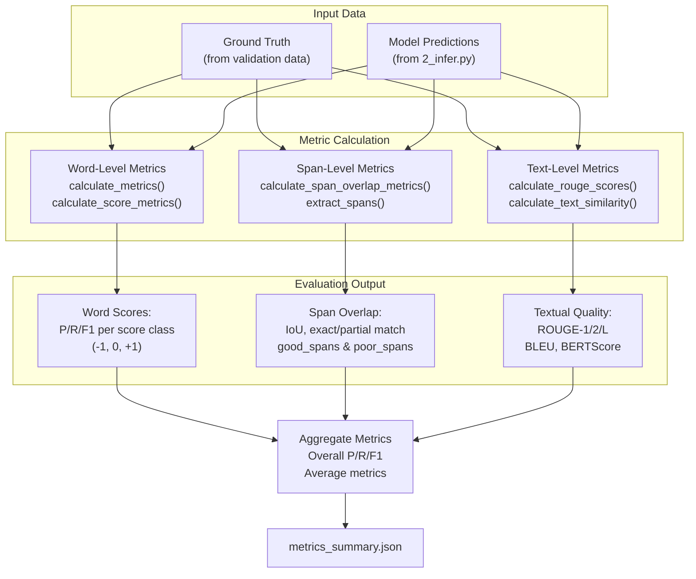
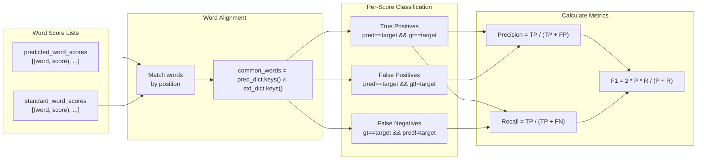
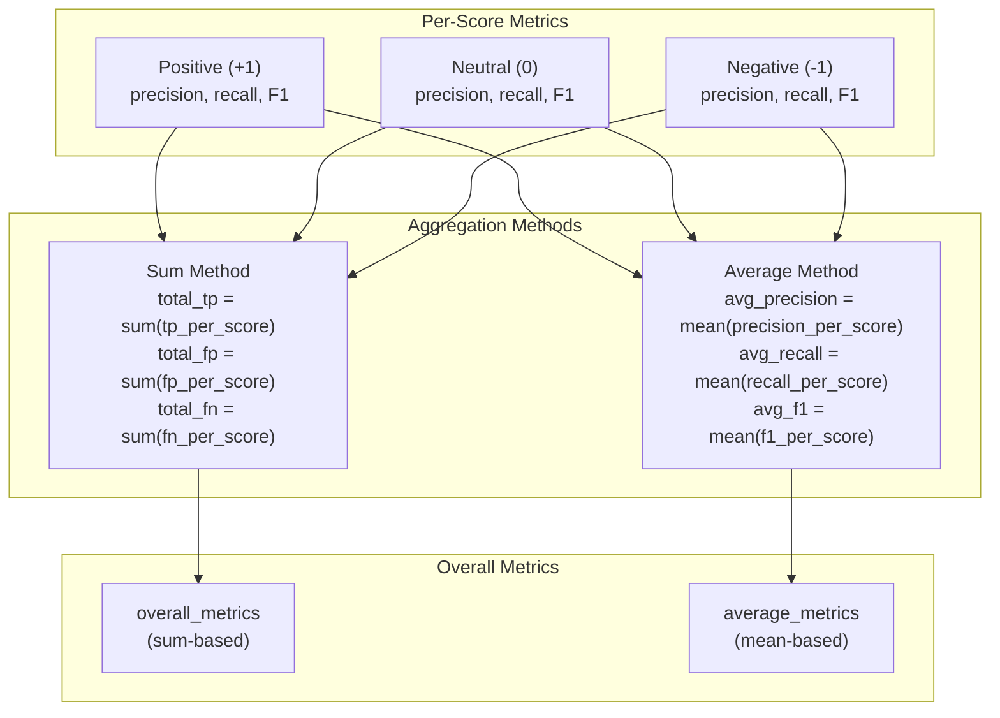
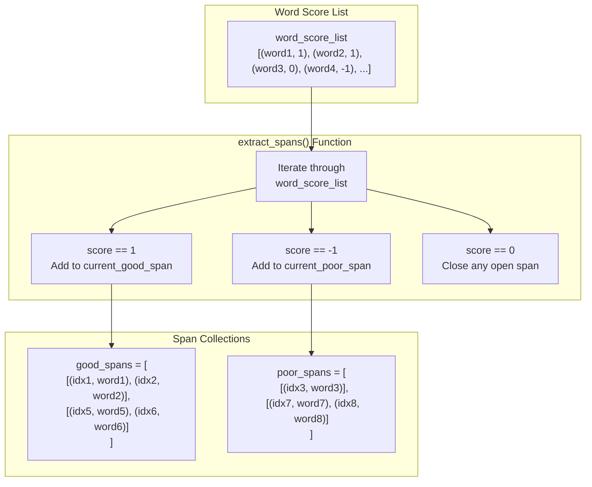
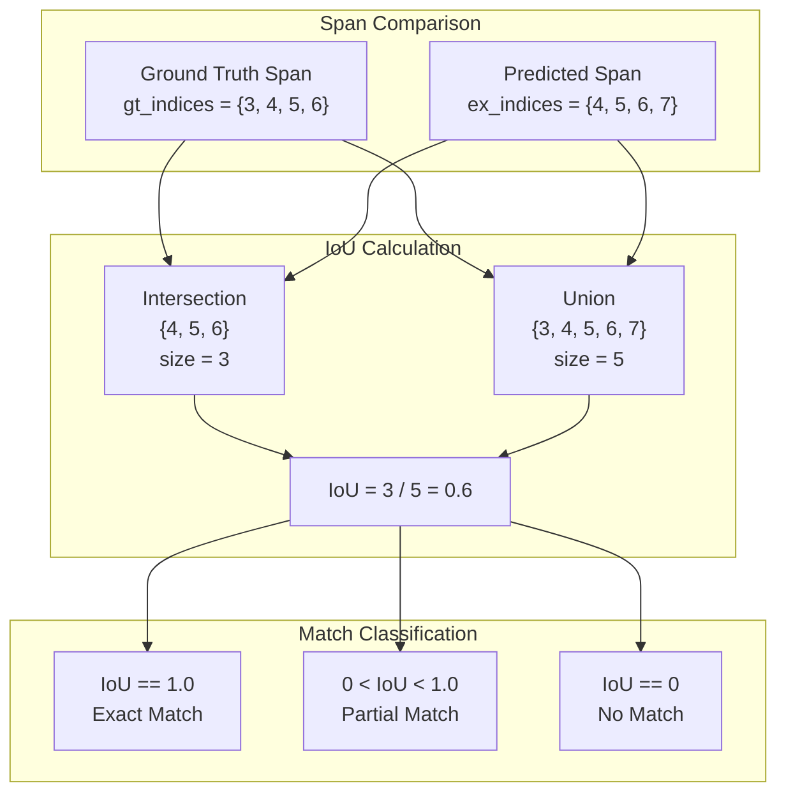
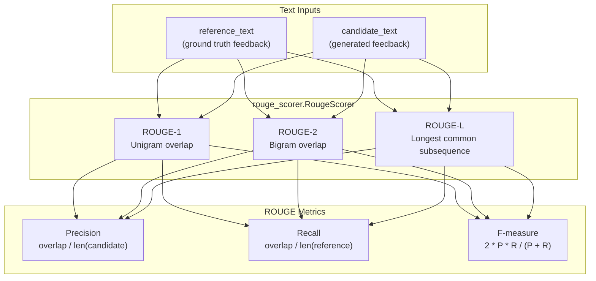
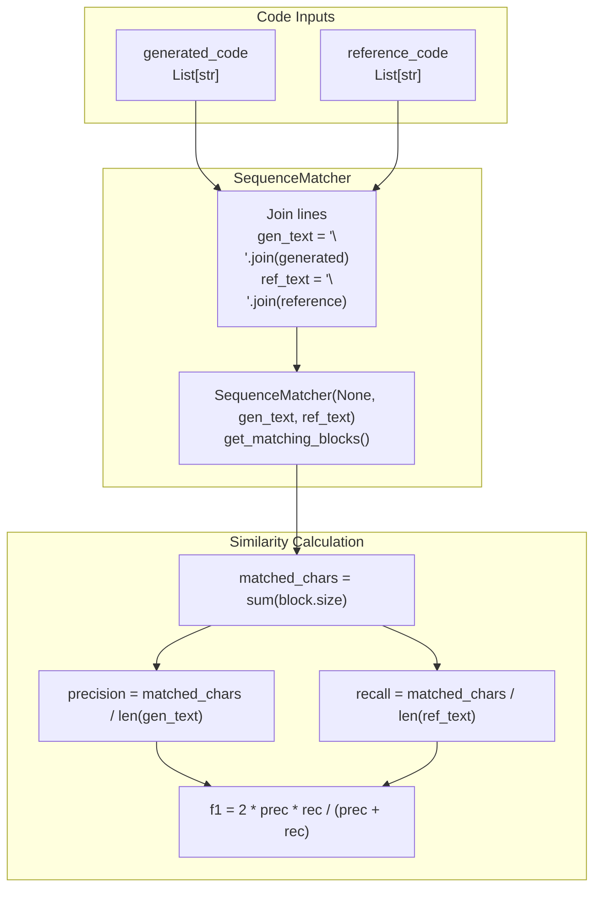
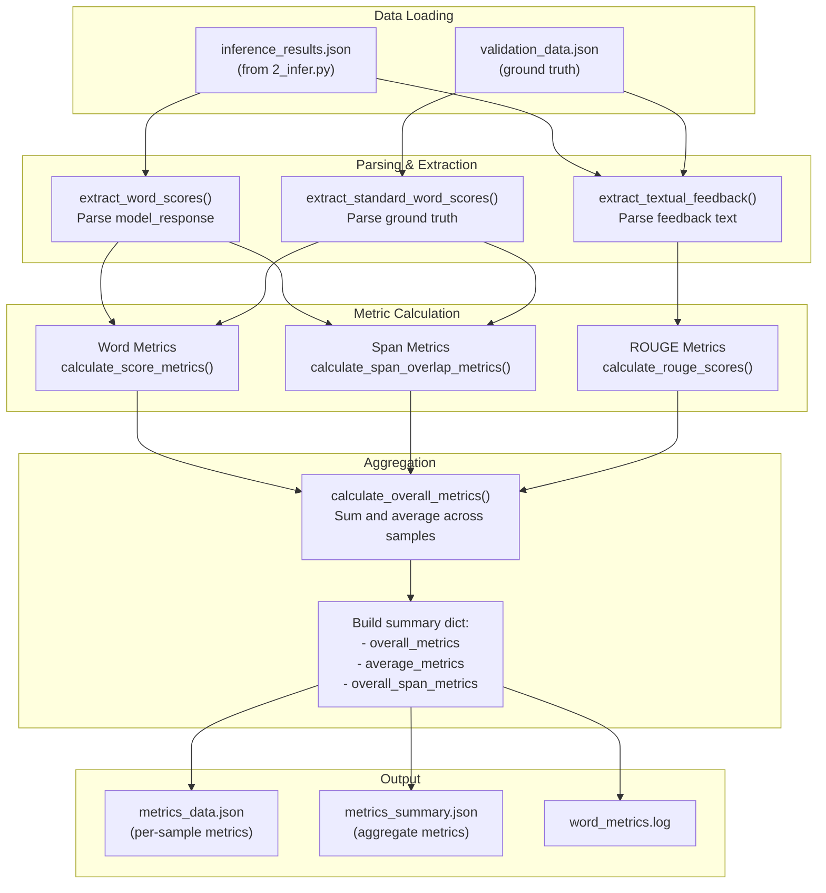
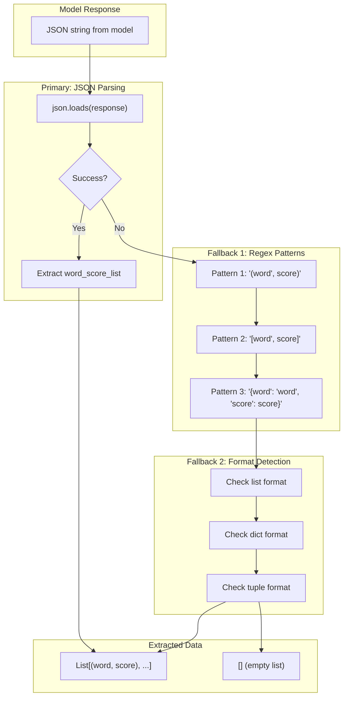

<!-- source: DeepWiki mcp.deepwiki.com · repo microsoft/Text2Grad · page 5.5 Evaluation Metrics · fetched 2026-10-26 -->

# Evaluation Metrics

<details>
<summary>Relevant source files</summary>

The following files were used as context for generating this wiki page:

- [nl_reward_model/kodcode/evaluation/3_metrics.py](nl_reward_model/kodcode/evaluation/3_metrics.py)
- [nl_reward_model/slf5k/evaluation/3_metrics.py](nl_reward_model/slf5k/evaluation/3_metrics.py)
- [nl_reward_model/ultrafeedback/evaluation/3_metrics.py](nl_reward_model/ultrafeedback/evaluation/3_metrics.py)

</details>


## Purpose and Scope

This page documents the evaluation metrics used to assess reward model performance across all three tasks (KodCode, UltraFeedback, SLF5K). These metrics measure how accurately the reward models predict span-level annotations and generate textual feedback compared to ground truth annotations.

For information about inference and output generation, see [Reward Model Inference](#5.3). For output parsing strategies, see [Response Parsing Strategies](#5.4). For task-specific evaluation benchmarks that assess final policy model performance, see the task-specific guides ([KodCode Evaluation](#7.1.4), [UltraFeedback Evaluation](#7.2.4), [SLF5K Evaluation](#7.3.4)).

The metrics are computed by the `3_metrics.py` scripts located in `nl_reward_model/{task}/evaluation/` directories, which process the inference results from `2_infer.py` (see [Reward Model Inference](#5.3)) and calculate precision, recall, F1, and other metrics at multiple granularities.

---

## Metrics Hierarchy

The Text2Grad evaluation system operates at three distinct levels of granularity, each measuring different aspects of reward model quality:



**Sources:**
- [nl_reward_model/slf5k/evaluation/3_metrics.py:229-253]()
- [nl_reward_model/ultrafeedback/evaluation/3_metrics.py:28-110]()
- [nl_reward_model/ultrafeedback/evaluation/3_metrics.py:143-269]()
- [nl_reward_model/kodcode/evaluation/3_metrics.py:12-73]()

---

## Word-Level Metrics

Word-level metrics treat each word position as a classification task, measuring how accurately the model assigns scores (-1, 0, or +1) to individual words compared to ground truth annotations.

### Score Classification

The evaluation distinguishes three score classes:

| Score | Meaning | Usage |
|-------|---------|-------|
| `+1` | Good/Correct | Words in good spans (accurate, helpful phrases) |
| `0` | Neutral | Words not part of identified spans |
| `-1` | Poor/Incorrect | Words in poor spans (inaccurate, problematic phrases) |

### Precision, Recall, and F1 Calculation

For each score class, metrics are calculated independently:



**Implementation Details:**

The `calculate_score_metrics` function implements this logic:

```python
def calculate_score_metrics(predicted_scores, standard_scores, target_score):
    pred_dict = {word: score for word, score in predicted_scores}
    std_dict = {word: score for word, score in standard_scores}
    common_words = set(pred_dict.keys()) & set(std_dict.keys())
    
    true_positives = sum(1 for word in common_words
                        if pred_dict[word] == target_score and std_dict[word] == target_score)
    predicted_positives = sum(1 for score in pred_dict.values() if score == target_score)
    actual_positives = sum(1 for score in std_dict.values() if score == target_score)
```

**Sources:**
- [nl_reward_model/slf5k/evaluation/3_metrics.py:256-276]()
- [nl_reward_model/ultrafeedback/evaluation/3_metrics.py:28-110]()

### Overall Word Metrics

The system calculates both per-score metrics and overall metrics that aggregate across all score classes:



**Sources:**
- [nl_reward_model/slf5k/evaluation/3_metrics.py:278-334]()
- [nl_reward_model/ultrafeedback/evaluation/3_metrics.py:375-393]()

---

## Span-Level Metrics

Span-level metrics are primarily used for **UltraFeedback** evaluation, where the reward model identifies contiguous regions (spans) of good or poor text. These metrics measure spatial overlap between predicted and ground truth spans.

### Span Extraction

Spans are extracted by identifying contiguous sequences of words with the same score:



**Sources:**
- [nl_reward_model/ultrafeedback/evaluation/3_metrics.py:154-188]()

### IoU-Based Overlap Metrics

The Intersection over Union (IoU) measures the spatial overlap between predicted and ground truth spans:



### Span-Level Precision and Recall

For each span type (good_span, poor_span), the system calculates:

| Metric | Definition | Formula |
|--------|------------|---------|
| **Precision** | What fraction of predicted spans overlap with ground truth? | `partial_match / ex_count` |
| **Recall** | What fraction of ground truth spans are detected? | `partial_match / gt_count` |
| **F1** | Harmonic mean of precision and recall | `2 * P * R / (P + R)` |
| **Exact Precision** | Fraction with perfect boundary alignment | `exact_match / ex_count` |
| **Exact Recall** | Fraction of GT spans perfectly matched | `exact_match / gt_count` |
| **Average IoU** | Mean IoU across all matched spans | `mean(ious)` |

**Sources:**
- [nl_reward_model/ultrafeedback/evaluation/3_metrics.py:210-268]()

---

## Text-Level Metrics

Text-level metrics evaluate the quality of textual feedback (critiques) generated by reward models by comparing them to reference feedback using similarity measures.

### ROUGE Scores

ROUGE (Recall-Oriented Understudy for Gisting Evaluation) measures n-gram overlap between generated and reference text:



**Implementation:**

```python
# From calculate_rouge_scores function
scorer = rouge_scorer.RougeScorer(['rouge1', 'rouge2', 'rougeL'], use_stemmer=True)
scores = scorer.score(reference_text, candidate_text)

result = {}
for metric, score in scores.items():
    result[metric] = {
        "precision": score.precision,
        "recall": score.recall,
        "fmeasure": score.fmeasure
    }
```

**Sources:**
- [nl_reward_model/slf5k/evaluation/3_metrics.py:229-253]()
- [nl_reward_model/ultrafeedback/evaluation/3_metrics.py:112-141]()

### Code Similarity Metrics (KodCode)

For KodCode, text-level metrics are replaced by code similarity metrics using `SequenceMatcher`:



**KodCode evaluates three components:**
- `wrong_code`: Incorrectly generated code snippets
- `improvement_code`: Suggested improvements
- `feedback`: Textual explanations

**Sources:**
- [nl_reward_model/kodcode/evaluation/3_metrics.py:12-73]()
- [nl_reward_model/kodcode/evaluation/3_metrics.py:74-141]()

---

## Metrics Calculation Workflow

The complete metrics calculation pipeline processes inference results and produces comprehensive evaluation reports:



**Command-line usage:**

```bash
# SLF5K
python 3_metrics.py \
  --results_path "../Evaluation/0_4800_res_span" \
  --output_path "../Evaluation/0_4800_metrics_span" \
  --data_path "../SLF5K_label/validation_critique_processed.json"

# UltraFeedback
python 3_metrics.py \
  --input "inference_results.json" \
  --output "word_metrics_summary.json"

# KodCode
python 3_metrics.py \
  --input_file "../ckpt/text2grad_kodcode_RM/EVAL/inference_results_0_4400.json" \
  --output_file "word_level_evaluation_results.json"
```

**Sources:**
- [nl_reward_model/slf5k/evaluation/3_metrics.py:336-347]()
- [nl_reward_model/slf5k/evaluation/3_metrics.py:361-488]()
- [nl_reward_model/ultrafeedback/evaluation/3_metrics.py:271-585]()
- [nl_reward_model/kodcode/evaluation/3_metrics.py:143-191]()

---

## Task-Specific Implementation Details

### SLF5K (Summarization) Metrics

**Key characteristics:**
- Word-level scoring only (no span-level metrics)
- ROUGE scores for textual feedback quality
- Emphasis on accurate word classification

**Metric structure:**

```
{
  "rouge_scores": {
    "rouge1": {"precision": ..., "recall": ..., "fmeasure": ...},
    "rouge2": {...},
    "rougeL": {...}
  },
  "word_score_metrics": {
    "score_specific": {
      "-1": {"precision": ..., "recall": ..., "f1": ..., "tp": ..., "fp": ..., "fn": ...},
      "0": {...},
      "1": {...}
    },
    "word_matching": {
      "total_std_words": ...,
      "total_pred_words": ...,
      "missing_words": ...,
      "matching_words": ...
    }
  }
}
```

**Sources:**
- [nl_reward_model/slf5k/evaluation/3_metrics.py:278-334]()
- [nl_reward_model/slf5k/evaluation/3_metrics.py:444-460]()

### UltraFeedback (Question Answering) Metrics

**Key characteristics:**
- Word-level + span-level metrics
- IoU-based span overlap evaluation
- Separate metrics for good_spans and poor_spans
- ROUGE scores for textual feedback

**Metric structure:**

```
{
  "overall_metrics": {
    "positive": {"precision": ..., "recall": ..., "f1": ..., "tp": ..., "fp": ..., "fn": ...},
    "negative": {...},
    "neutral": {...},
    "overall": {...}
  },
  "overall_span_metrics": {
    "good_span": {
      "gt_count": ..., "ex_count": ...,
      "exact_match": ..., "partial_match": ...,
      "precision": ..., "recall": ..., "f1": ...,
      "avg_iou": ...
    },
    "poor_span": {...}
  },
  "average_rouge": {
    "rouge1": {"precision": ..., "recall": ..., "fmeasure": ...},
    "rouge2": {...},
    "rougeL": {...}
  }
}
```

**Sources:**
- [nl_reward_model/ultrafeedback/evaluation/3_metrics.py:375-412]()
- [nl_reward_model/ultrafeedback/evaluation/3_metrics.py:476-485]()

### KodCode (Code Generation) Metrics

**Key characteristics:**
- Code similarity using SequenceMatcher
- Three-component evaluation: wrong_code, improvement_code, feedback
- Character-level matching for code sequences
- Overall metrics averaging all three components

**Metric structure:**

```
{
  "wrong_code": {
    "precision": ...,
    "recall": ...,
    "f1": ...
  },
  "improvement_code": {
    "precision": ...,
    "recall": ...,
    "f1": ...
  },
  "feedback": {
    "precision": ...,
    "recall": ...,
    "f1": ...
  },
  "overall": {
    "precision": ...,
    "recall": ...,
    "f1": ...
  },
  "samples": ...
}
```

**Sources:**
- [nl_reward_model/kodcode/evaluation/3_metrics.py:74-141]()

---

## Defensive Parsing for Metrics

The metrics calculation includes robust extraction strategies to handle malformed model outputs. This is critical because LLM-generated JSON may have syntax errors.

### Multi-Level Extraction Strategy



**Implementation example from SLF5K:**

```python
def extract_word_scores(response):
    try:
        response_dict = json.loads(response)
        word_score_list = response_dict.get("word_score_list", [])
        
        # Handle string format
        if isinstance(word_score_list, str):
            tuples = re.findall(r'\([\"\']?([^\"\',]+)[\"\']?,\s*(-?\d+)\)', word_score_list)
            return [(word, int(score)) for word, score in tuples]
        # Handle list of dicts
        elif isinstance(word_score_list, list):
            if word_score_list and isinstance(word_score_list[0], dict):
                if "word" in word_score_list[0] and "score" in word_score_list[0]:
                    return [(item["word"], int(item["score"])) for item in word_score_list]
        # ... additional fallback strategies
    except json.JSONDecodeError:
        # Regex fallback patterns
        patterns = [
            r'\([\"\']?([^\"\',]+)[\"\']?,\s*(-?\d+)\)',
            r'\[[\"\']?([^\"\',]+)[\"\']?,\s*(-?\d+)\]',
            r'{\s*[\"\']?word[\"\']?\s*:\s*[\"\']?([^\"\',]+)[\"\']?\s*,\s*[\"\']?score[\"\']?\s*:\s*(-?\d+)\s*}'
        ]
        for pattern in patterns:
            tuples = re.findall(pattern, response)
            if tuples:
                return [(word, int(score)) for word, score in tuples]
    return []
```

**Sources:**
- [nl_reward_model/slf5k/evaluation/3_metrics.py:122-168]()
- [nl_reward_model/slf5k/evaluation/3_metrics.py:170-227]()
- [nl_reward_model/ultrafeedback/evaluation/3_metrics.py:143-269]() (similar patterns for UltraFeedback)

---

## Output Format and Logging

### Console Output

All metrics scripts provide formatted console output for quick inspection:

```
==========================================
📊 EVALUATION METRICS SUMMARY 📊
==========================================

🔍 TEXTUAL FEEDBACK - ROUGE SCORES:
--------------------------------------------------
  ROUGE1:
    • F1: 0.7234
  ROUGE2:
    • F1: 0.5891
  ROUGEL:
    • F1: 0.6723

🔍 WORD SCORE LIST - METRICS:
--------------------------------------------------

  Negative (-1):
    • Precision: 0.8234
    • Recall:    0.7891
    • F1 Score:  0.8058

  Neutral (0):
    • Precision: 0.9123
    • Recall:    0.8967
    • F1 Score:  0.9044

  Positive (1):
    • Precision: 0.8567
    • Recall:    0.8234
    • F1 Score:  0.8397

==========================================
✅ Results saved to: metrics_summary.json
==========================================
```

### JSON Output Structure

The metrics scripts save two JSON files:

1. **`metrics_summary.json`**: Aggregate statistics
2. **`metrics_data.json`**: Per-sample detailed metrics

**Summary structure:**

```json
{
  "total_records": 1000,
  "valid_records": 995,
  "valid_rouge_records": 990,
  "overall_metrics": {
    "positive": {"precision": 0.856, "recall": 0.823, "f1": 0.839, "tp": 2345, "fp": 389, "fn": 507},
    "negative": {"precision": 0.823, "recall": 0.789, "f1": 0.805, "tp": 1823, "fp": 394, "fn": 489},
    "neutral": {"precision": 0.912, "recall": 0.896, "f1": 0.904, "tp": 8234, "fp": 790, "fn": 956},
    "overall": {"precision": 0.897, "recall": 0.869, "f1": 0.883}
  },
  "average_metrics": {...},
  "average_rouge": {...},
  "overall_span_metrics": {...},  // UltraFeedback only
  "average_span_metrics": {...}   // UltraFeedback only
}
```

**Sources:**
- [nl_reward_model/slf5k/evaluation/3_metrics.py:458-487]()
- [nl_reward_model/ultrafeedback/evaluation/3_metrics.py:487-492]()

---

