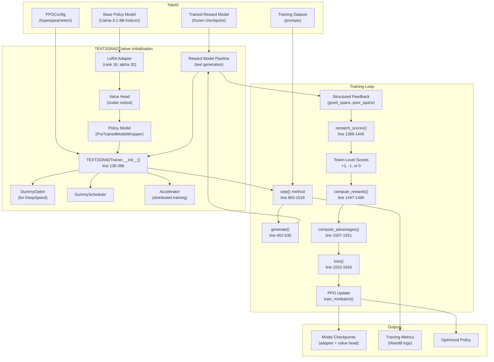
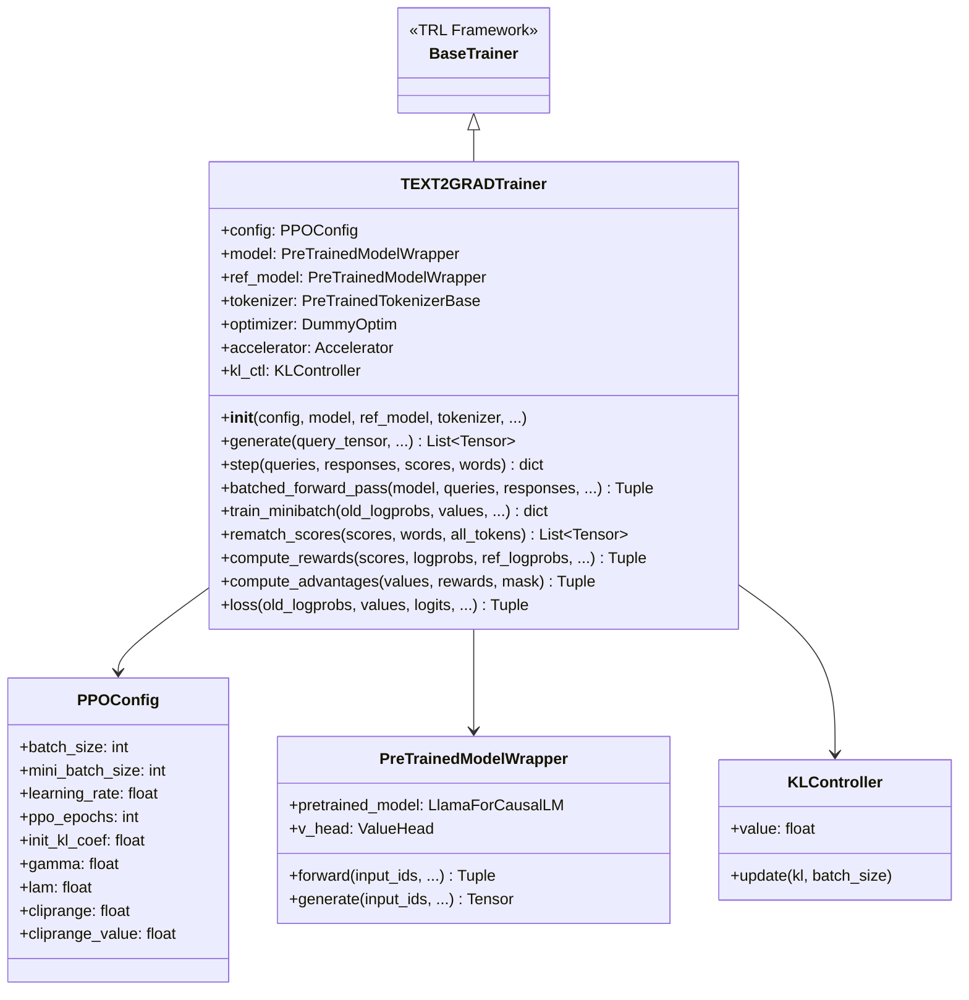
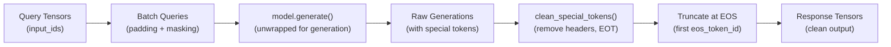
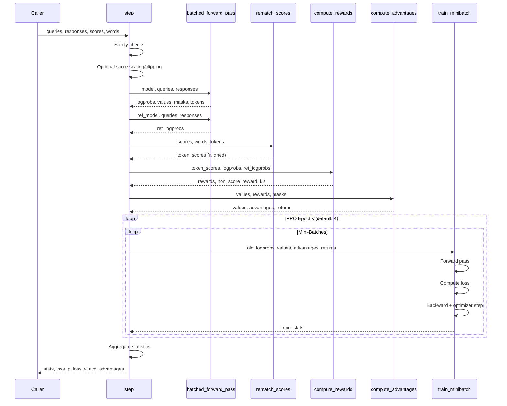
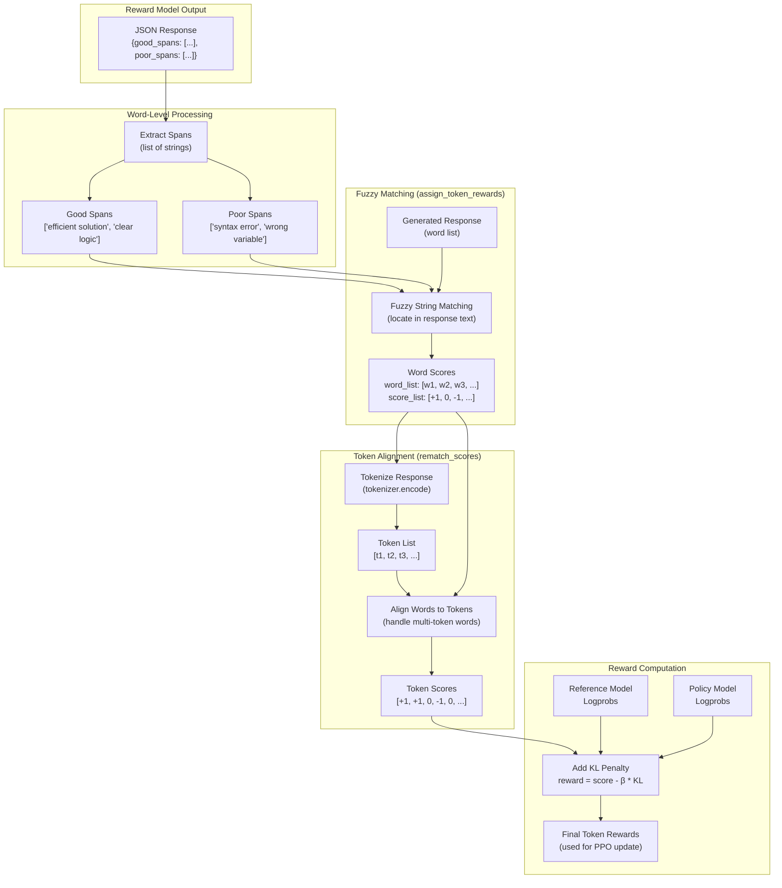
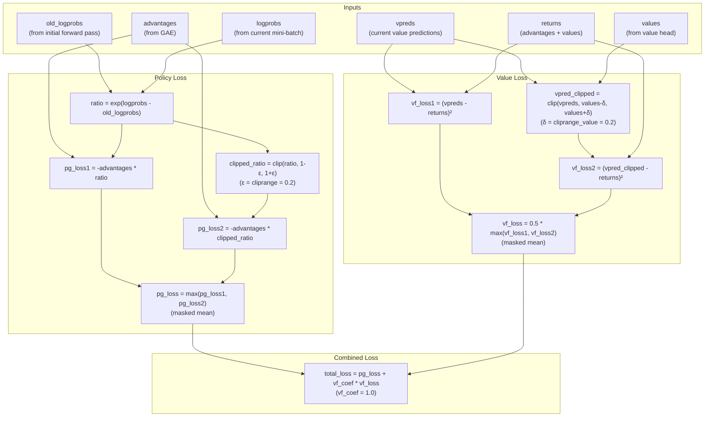

<!-- source: DeepWiki mcp.deepwiki.com · repo microsoft/Text2Grad · page 6 Policy Optimization · fetched 2026-10-26 -->

# Policy Optimization

<details>
<summary>Relevant source files</summary>

The following files were used as context for generating this wiki page:

- [README.md](README.md)
- [nl_gradiant_policy_optimization/ultrafeedback/text2grad_trainer.py](nl_gradiant_policy_optimization/ultrafeedback/text2grad_trainer.py)

</details>


This page provides an overview of the Natural Language Gradient Policy Optimization component, which uses the `TEXT2GRADTrainer` class to train language models with fine-grained, token-level feedback derived from natural language critiques. This is the third component in the Text2Grad pipeline, following data annotation (see [Data Annotation Pipeline](#4)) and reward model training (see [Reward Models](#5)).

For detailed implementation of specific aspects, see:
- [TEXT2GRADTrainer Architecture](#6.1) - Class structure and initialization
- [PPO Training Loop](#6.2) - Complete training step implementation
- [Token-Reward Alignment](#6.4) - Fuzzy matching algorithm

## Purpose and Scope

Policy optimization in Text2Grad converts natural language feedback from a trained reward model into token-level gradient signals for Proximal Policy Optimization (PPO). Unlike traditional RLHF which uses scalar rewards for entire sequences, this system assigns individual rewards to each token based on whether it appears in "good spans" or "poor spans" identified by the reward model. The `TEXT2GRADTrainer` class orchestrates this process across multiple PPO epochs, handling reward computation, advantage estimation, and policy updates.

This document covers the high-level architecture, training workflow, and key concepts. Implementation details for specific algorithms are documented in child pages.

## System Architecture

### Component Integration



**Sources:** [nl_gradiant_policy_optimization/ultrafeedback/text2grad_trainer.py:104-388](), [README.md:277-294]()

### TEXT2GRADTrainer Class Structure

The `TEXT2GRADTrainer` class extends TRL's `BaseTrainer` and implements the core PPO algorithm with natural language gradients:



**Sources:** [nl_gradiant_policy_optimization/ultrafeedback/text2grad_trainer.py:104-135](), [nl_gradiant_policy_optimization/ultrafeedback/text2grad_trainer.py:138-388]()

## Training Workflow

### High-Level Training Loop

The training process follows a standard reinforcement learning loop with a critical modification: rewards are computed at the token level rather than as scalar values for entire sequences.

```mermaid
graph TB
    START["Start Training Epoch"]
    
    START --> LOAD["Load Batch from Dataset<br/>(queries: prompts)"]
    
    LOAD --> GENERATE["ppo_trainer.generate()<br/>Generate responses from policy"]
    
    GENERATE --> FORMAT["Format for Reward Model<br/>(question + answer pairs)"]
    
    FORMAT --> RM_INFER["Reward Model Inference<br/>(returns JSON feedback)"]
    
    RM_INFER --> PARSE["Parse Feedback<br/>(extract good_spans, poor_spans)"]
    
    PARSE --> FUZZY["Fuzzy String Matching<br/>(locate spans in response)"]
    
    FUZZY --> WORD_SCORES["Assign Word Scores<br/>(+1: good, -1: poor, 0: neutral)"]
    
    WORD_SCORES --> ALIGN["rematch_scores()<br/>(align words to tokens)"]
    
    ALIGN --> TOKEN_REWARDS["Token-Level Rewards<br/>(one score per token)"]
    
    TOKEN_REWARDS --> FORWARD["batched_forward_pass()<br/>(compute logprobs, values)"]
    
    FORWARD --> KL["Add KL Penalty<br/>(divergence from ref_model)"]
    
    KL --> REWARDS["Final Rewards<br/>(token_score - kl_penalty)"]
    
    REWARDS --> GAE["compute_advantages()<br/>(Generalized Advantage Estimation)"]
    
    GAE --> PPO_EPOCHS{"PPO Epochs<br/>(default: 4)"}
    
    PPO_EPOCHS --> MINI_BATCH["Sample Mini-Batch<br/>(shuffle batch indices)"]
    
    MINI_BATCH --> FORWARD2["Forward Pass<br/>(new logprobs, values)"]
    
    FORWARD2 --> LOSS["loss()<br/>(policy + value loss)"]
    
    LOSS --> BACKWARD["Backward Pass<br/>(compute gradients)"]
    
    BACKWARD --> OPTIMIZER["optimizer.step()<br/>(update parameters)"]
    
    OPTIMIZER --> PPO_CHECK{More<br/>Mini-Batches?}
    
    PPO_CHECK -->|Yes| MINI_BATCH
    PPO_CHECK -->|No| EPOCH_CHECK{More<br/>PPO Epochs?}
    
    EPOCH_CHECK -->|Yes| PPO_EPOCHS
    EPOCH_CHECK -->|No| LOG["Log Metrics<br/>(WandB)"]
    
    LOG --> SAVE{Save<br/>Checkpoint?}
    
    SAVE -->|Yes| CHECKPOINT["Save Adapter + Value Head<br/>+ Optimizer State"]
    SAVE -->|No| NEXT_BATCH{More<br/>Batches?}
    
    CHECKPOINT --> NEXT_BATCH
    NEXT_BATCH -->|Yes| LOAD
    NEXT_BATCH -->|No| END["Training Complete"]
```



**Sources:** [nl_gradiant_policy_optimization/ultrafeedback/text2grad_trainer.py:663-1018]()

### Key Innovation: Token-Level Rewards

Traditional RLHF assigns a single scalar reward to an entire generated sequence. Text2Grad's key innovation is computing rewards at the token level:

| Traditional RLHF | Text2Grad NL-Gradients |
|------------------|------------------------|
| `reward = scalar` (e.g., 0.85) | `rewards = [+1, +1, 0, -1, 0, +1, ...]` |
| Applied uniformly to all tokens | Each token gets individual reward |
| No localization of errors | Pinpoints exact problematic tokens |
| Opaque feedback | Interpretable via natural language |

The process for computing token-level rewards:

1. **Reward Model Output**: JSON with `good_spans` and `poor_spans` lists
   ```json
   {
     "good_spans": ["correctly handles edge case", "efficient algorithm"],
     "poor_spans": ["incorrect variable name", "missing error check"]
   }
   ```

2. **Fuzzy Matching**: Locate these spans in the generated response using string similarity

3. **Word-Level Scoring**: Assign scores to each word
   - Words in `good_spans`: **+1**
   - Words in `poor_spans`: **-1**
   - Other words: **0**

4. **Token Alignment**: Map word scores to tokens via `rematch_scores()` (see [Token-Reward Alignment](#6.4))

5. **KL Penalty**: Subtract KL divergence from reference model to prevent drift

**Sources:** [nl_gradiant_policy_optimization/ultrafeedback/text2grad_trainer.py:780-810](), [nl_gradiant_policy_optimization/ultrafeedback/text2grad_trainer.py:1447-1490]()

## Core Methods

### Initialization

The `__init__` method (lines 138-388) sets up all components needed for training:

| Component | Configuration | Purpose |
|-----------|--------------|---------|
| **Policy Model** | Base LLM + LoRA (r=16) + Value Head | Model being optimized |
| **Reference Model** | Frozen copy or PEFT base | KL penalty computation |
| **Optimizer** | `DummyOptim` wrapper | DeepSpeed compatibility |
| **Accelerator** | Multi-GPU coordination | Distributed training |
| **KL Controller** | Adaptive or Fixed | Controls KL penalty strength |
| **Data Collator** | `DataCollatorForLanguageModeling` | Batch preparation |

**Critical Detail**: When using PEFT/LoRA, `self.ref_model` is set to `None` and the reference logprobs are computed by temporarily disabling the adapter via `self.optional_peft_ctx()`.

**Sources:** [nl_gradiant_policy_optimization/ultrafeedback/text2grad_trainer.py:138-388]()

### Generation

The `generate()` method (lines 452-530) produces responses from the policy model:



The cleaning process is critical for subsequent fuzzy matching:
- Removes Llama-3 special tokens: `<|start_header_id|>`, `<|end_header_id|>`, `<|eot_id|>`
- Strips role markers: `assistant`, `human`
- Normalizes whitespace

**Sources:** [nl_gradiant_policy_optimization/ultrafeedback/text2grad_trainer.py:452-612]()

### PPO Step

The `step()` method (lines 663-1018) implements one complete PPO optimization step:



**Key Steps**:
1. **Safety Checking**: Validate batch dimensions and tensor devices
2. **Forward Passes**: Compute logprobs for policy and reference model
3. **Reward Alignment**: Convert word-level scores to token-level rewards
4. **Reward Computation**: Add token scores and KL penalty
5. **Advantage Estimation**: Compute advantages using GAE (γ=0.99, λ=0.95)
6. **Mini-Batch Training**: Multiple PPO epochs over shuffled mini-batches
7. **Statistics**: Aggregate and log training metrics

**Sources:** [nl_gradiant_policy_optimization/ultrafeedback/text2grad_trainer.py:663-1018]()

## Reward Processing Pipeline

The transformation from natural language feedback to token-level rewards is the distinguishing feature of Text2Grad:



**Key Functions**:
- `rematch_scores()`: Main coordinator (line 1389-1445)
- `assign_token_rewards()`: Fuzzy matching logic (line 1299-1387)
- `compute_rewards()`: Add KL penalty (line 1447-1490)

**Sources:** [nl_gradiant_policy_optimization/ultrafeedback/text2grad_trainer.py:1299-1490]()

## Loss Computation

The `loss()` method (lines 1553-1643) implements the PPO clipped objective:



**PPO Clipping**: The clipping prevents excessively large policy updates by limiting the ratio of new to old probabilities:
- `ratio ∈ [0.8, 1.2]` (with `cliprange=0.2`)
- If advantage is positive (good action), limit how much we can increase probability
- If advantage is negative (bad action), limit how much we can decrease probability

**Value Clipping**: Similarly prevents large value function updates, improving stability.

**Sources:** [nl_gradiant_policy_optimization/ultrafeedback/text2grad_trainer.py:1553-1643]()

## Distributed Training

The `TEXT2GRADTrainer` uses Hugging Face Accelerate for distributed training:

| Component | Implementation | Purpose |
|-----------|---------------|---------|
| **Accelerator** | `accelerate.Accelerator` | Coordinates multi-GPU training |
| **DummyOptim** | Wraps real optimizer | DeepSpeed compatibility |
| **Padding** | `pad_across_processes()` | Ensures consistent tensor shapes |
| **Gathering** | `gather_object()`, `all_reduce()` | Collects statistics from all GPUs |
| **Barriers** | `dist.barrier()` | Synchronizes processes |

**Key Method**: `gather_stats()` (lines 1053-1067) aggregates metrics across GPUs:
```python
for k, v in stats.items():
    if isinstance(v, torch.Tensor):
        dist.all_reduce(v.to(self.accelerator.device), dist.ReduceOp.SUM)
        v /= self.accelerator.num_processes
```

**Sources:** [nl_gradiant_policy_optimization/ultrafeedback/text2grad_trainer.py:187-192](), [nl_gradiant_policy_optimization/ultrafeedback/text2grad_trainer.py:721-748](), [nl_gradiant_policy_optimization/ultrafeedback/text2grad_trainer.py:1053-1067]()

## Task-Specific Training

The `TEXT2GRADTrainer` class is reused across all three tasks with task-specific training scripts:

| Task | Training Script | Dataset | Reward Model |
|------|----------------|---------|--------------|
| **Code Generation** | `nl_gradient_policy_optimization/kodcode/train_kodcode.py` | KodCode-Light-RL-10K | Identifies code errors and correct patterns |
| **Question Answering** | `nl_gradient_policy_optimization/ultrafeedback/train_ultrafeedback.py` | UltraFeedback-Binarized | Evaluates answer quality and relevance |
| **Summarization** | `nl_gradient_policy_optimization/slf5k/train.py` | SLF5K | Assesses summary accuracy and conciseness |

Each training script:
1. Loads task-specific configuration (`ScriptArguments`)
2. Initializes the reward model pipeline
3. Creates dataset with appropriate formatting
4. Instantiates `TEXT2GRADTrainer`
5. Runs training loop with evaluation

**Sources:** [README.md:277-294]()

## Memory Management

The trainer includes extensive memory optimization to handle large models:

```python
# Explicit cache clearing after each operation
if torch.cuda.is_available():
    torch.cuda.empty_cache()

# Delete intermediate tensors
del logprobs, logits, vpreds, model_inputs

# Clear cache periodically during batching
if torch.cuda.is_available() and i % 2 == 1:
    torch.cuda.empty_cache()
```

This is critical because:
- Token-level rewards create large tensors
- Multiple forward passes per step (policy + reference)
- Multiple PPO epochs over same data
- Gradient accumulation for large batches

**Sources:** [nl_gradiant_policy_optimization/ultrafeedback/text2grad_trainer.py:676-677](), [nl_gradiant_policy_optimization/ultrafeedback/text2grad_trainer.py:1104](), [nl_gradiant_policy_optimization/ultrafeedback/text2grad_trainer.py:1209-1210]()

## Configuration

Key `PPOConfig` parameters for policy optimization:

| Parameter | Default | Description |
|-----------|---------|-------------|
| `learning_rate` | 1e-5 | Optimizer learning rate |
| `batch_size` | 4-8 | Number of samples per batch |
| `mini_batch_size` | 1-2 | Mini-batch size for gradient accumulation |
| `ppo_epochs` | 4 | Number of PPO optimization epochs |
| `init_kl_coef` | 0.05-0.2 | Initial KL penalty coefficient |
| `gamma` | 0.99 | Discount factor for rewards |
| `lam` | 0.95 | GAE lambda parameter |
| `cliprange` | 0.2 | PPO clipping parameter |
| `cliprange_value` | 0.2 | Value function clipping parameter |
| `vf_coef` | 1.0 | Value loss coefficient |

**Sources:** [nl_gradiant_policy_optimization/ultrafeedback/text2grad_trainer.py:138-388]()

## Next Steps

For detailed implementation of specific components:
- [TEXT2GRADTrainer Architecture](#6.1) - Detailed class structure and initialization
- [PPO Training Loop](#6.2) - Step-by-step breakdown of training iterations
- [Reward Processing Pipeline](#6.3) - Natural language to reward conversion
- [Token-Reward Alignment](#6.4) - Fuzzy matching algorithm details
- [Forward Pass and Masking](#6.5) - Batched computation and attention masking
- [Loss Calculation and Updates](#6.6) - PPO objective and optimization
- [Checkpoint Management](#6.7) - Saving and loading trained models
- [Distributed Training](#6.8) - Multi-GPU training strategies

For task-specific guides:
- [Code Generation (KodCode)](#7.1.3) - Code generation policy optimization
- [Question Answering (UltraFeedback)](#7.2.3) - QA policy optimization
- [Summarization (SLF5K)](#7.3.3) - Summarization policy optimization

---

