<!-- source: DeepWiki mcp.deepwiki.com · repo microsoft/Text2Grad · page 6.1 TEXT2GRADTrainer Architecture · fetched 2026-10-26 -->

# TEXT2GRADTrainer Architecture

<details>
<summary>Relevant source files</summary>

The following files were used as context for generating this wiki page:

- [nl_gradiant_policy_optimization/kodcode/text2grad_trainer.py](nl_gradiant_policy_optimization/kodcode/text2grad_trainer.py)
- [nl_gradiant_policy_optimization/ultrafeedback/text2grad_trainer.py](nl_gradiant_policy_optimization/ultrafeedback/text2grad_trainer.py)

</details>


This page provides a detailed examination of the `TEXT2GRADTrainer` class architecture, including its initialization process, core attributes, and method organization. For information about the complete training loop that uses this trainer, see [PPO Training Loop](#6.2). For details on specific algorithmic components like reward processing and loss calculation, see [Reward Processing Pipeline](#6.3) and [Loss Calculation and Updates](#6.6).

## Class Overview

The `TEXT2GRADTrainer` is a specialized PPO trainer that extends `trl.trainer.BaseTrainer` to implement natural language gradient-based policy optimization. It serves as the central orchestrator for training language models with fine-grained, token-level feedback derived from natural language critiques.

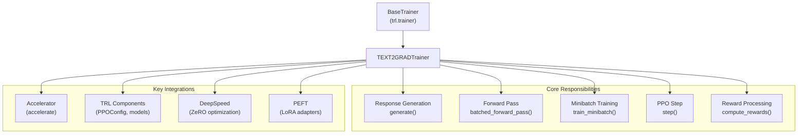

**Sources:** [nl_gradiant_policy_optimization/ultrafeedback/text2grad_trainer.py:104-136](), [nl_gradiant_policy_optimization/kodcode/text2grad_trainer.py:106-138]()

## Initialization Architecture

The `TEXT2GRADTrainer` constructor follows a multi-stage initialization process that sets up the policy model, reference model, optimizer, and distributed training infrastructure.

### Constructor Signature

The trainer accepts the following core components:

| Parameter | Type | Purpose |
|-----------|------|---------|
| `config` | `PPOConfig` | Training hyperparameters and configuration |
| `model` | `PreTrainedModelWrapper` | Policy model with value head |
| `ref_model` | `PreTrainedModelWrapper` (optional) | Reference model for KL penalty |
| `tokenizer` | `PreTrainedTokenizerBase` | Tokenizer for encoding/decoding |
| `dataset` | `Dataset` (optional) | Training dataset |
| `optimizer` | `torch.optim.Optimizer` (optional) | Parameter optimizer |
| `data_collator` | `Callable` (optional) | Batch collation function |
| `num_shared_layers` | `int` (optional) | Layers shared between policy and ref model |
| `lr_scheduler` | `lr_scheduler` (optional) | Learning rate scheduler |

### Initialization Flow

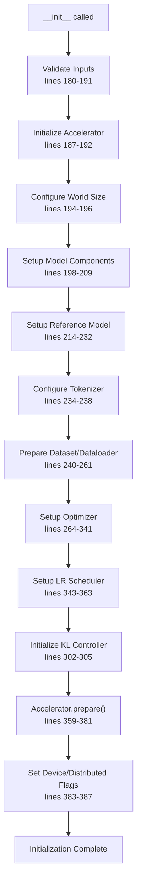

**Sources:** [nl_gradiant_policy_optimization/ultrafeedback/text2grad_trainer.py:138-387](), [nl_gradiant_policy_optimization/kodcode/text2grad_trainer.py:140-393]()

### Validation Phase

The initialization begins with strict type checking:

```python
# Validate config type
if not isinstance(config, PPOConfig):
    raise ValueError(f"config must be a PPOConfig, got {type(config)}")
    
# Validate tokenizer type
if not isinstance(tokenizer, (PreTrainedTokenizerBase)):
    raise ValueError(f"tokenizer must be a PreTrainedTokenizerBase, got {type(tokenizer)}")
    
# Validate model architecture
if not isinstance(model, (SUPPORTED_ARCHITECTURES)):
    raise ValueError(f"model must be a PreTrainedModelWrapper, got {type(model)}")
```

These checks ensure type safety before proceeding with initialization.

**Sources:** [nl_gradiant_policy_optimization/ultrafeedback/text2grad_trainer.py:180-185](), [nl_gradiant_policy_optimization/kodcode/text2grad_trainer.py:182-191]()

## Core Attributes

The trainer maintains several categories of attributes that manage different aspects of the training process.

### Model Components

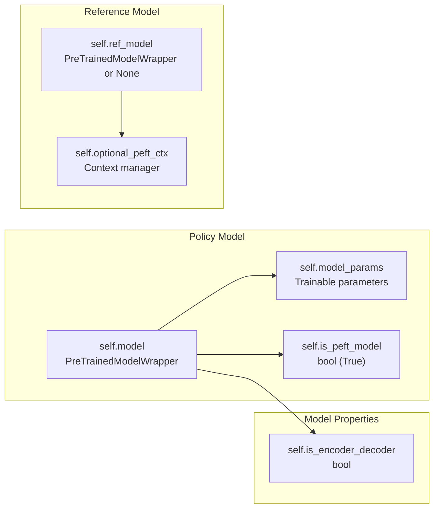

- **`self.model`**: The policy model being optimized, includes a value head for V(s) estimation
- **`self.ref_model`**: Reference model for computing KL divergence; set to `None` for PEFT models
- **`self.model_params`**: Filtered iterator of trainable parameters
- **`self.is_peft_model`**: Hardcoded to `True` indicating LoRA adapter usage
- **`self.optional_peft_ctx`**: Context manager for disabling adapters during reference model inference
- **`self.is_encoder_decoder`**: Flag indicating if model is encoder-decoder architecture

**Sources:** [nl_gradiant_policy_optimization/ultrafeedback/text2grad_trainer.py:198-232](), [nl_gradiant_policy_optimization/kodcode/text2grad_trainer.py:203-240]()

### Training Infrastructure

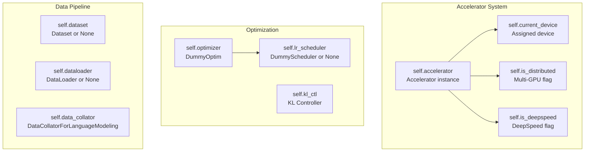

**Sources:** [nl_gradiant_policy_optimization/ultrafeedback/text2grad_trainer.py:187-387](), [nl_gradiant_policy_optimization/kodcode/text2grad_trainer.py:192-393]()

### Optimizer and Scheduler Setup

The trainer uses `DummyOptim` and `DummyScheduler` from `accelerate.utils` for DeepSpeed compatibility:

```python
# Create DummyOptim for DeepSpeed
self.optimizer = DummyOptim(
    params=filter(lambda p: p.requires_grad, model.parameters()),
    lr=config.learning_rate,
    weight_decay=0.0
)

# Create DummyScheduler if lr_scheduler provided
if lr_scheduler is not None:
    self.lr_scheduler = DummyScheduler(
        self.optimizer,
        total_num_steps=config.total_ppo_epochs * config.batch_size,
        warmup_num_steps=0
    )
```

These "dummy" objects are placeholders that allow `accelerate.prepare()` to properly initialize the actual DeepSpeed optimizers and schedulers based on the DeepSpeed configuration.

**Sources:** [nl_gradiant_policy_optimization/ultrafeedback/text2grad_trainer.py:311-355](), [nl_gradiant_policy_optimization/kodcode/text2grad_trainer.py:319-363]()

### KL Divergence Controller

```python
if self.config.adap_kl_ctrl:
    self.kl_ctl = AdaptiveKLController(
        self.config.init_kl_coef, 
        self.config.target, 
        self.config.horizon
    )
else:
    self.kl_ctl = FixedKLController(self.config.init_kl_coef)
```

The KL controller manages the coefficient for the KL penalty term in the reward function. The adaptive controller adjusts the coefficient based on observed KL divergence, while the fixed controller maintains a constant value.

**Sources:** [nl_gradiant_policy_optimization/ultrafeedback/text2grad_trainer.py:302-305](), [nl_gradiant_policy_optimization/kodcode/text2grad_trainer.py:310-313]()

## Accelerator Integration

The `Accelerator` from HuggingFace's `accelerate` library handles distributed training, mixed precision, and gradient accumulation.

### Accelerator Configuration

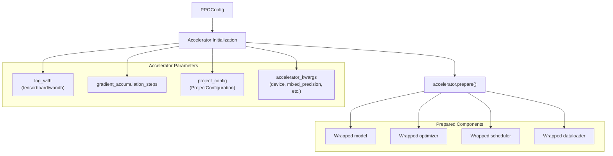

The `prepare()` call wraps components for distributed training:

```python
if self.lr_scheduler is not None:
    (
        self.model,
        self.optimizer,
        self.lr_scheduler,
        self.dataloader,
    ) = self.accelerator.prepare(
        self.model,
        self.optimizer,
        self.lr_scheduler,
        self.dataloader,
    )
else:
    (
        self.model,
        self.optimizer,
        self.dataloader,
    ) = self.accelerator.prepare(
        self.model,
        self.optimizer,
        self.dataloader,
    )
```

**Sources:** [nl_gradiant_policy_optimization/ultrafeedback/text2grad_trainer.py:359-381](), [nl_gradiant_policy_optimization/kodcode/text2grad_trainer.py:367-389]()

### Distributed Training Configuration

After `prepare()`, the trainer sets distributed training flags:

```python
self.current_device = self.accelerator.device
self.is_distributed = self.accelerator.num_processes > 1
self.is_deepspeed = is_deepspeed_used
```

These flags control behavior throughout the training loop:
- **`current_device`**: Target device for tensor operations
- **`is_distributed`**: Enables cross-GPU padding and statistics gathering
- **`is_deepspeed`**: Enables DeepSpeed-specific optimization paths

**Sources:** [nl_gradiant_policy_optimization/ultrafeedback/text2grad_trainer.py:383-387](), [nl_gradiant_policy_optimization/kodcode/text2grad_trainer.py:391-393]()

## Method Organization

The `TEXT2GRADTrainer` provides methods organized into functional categories.

### Generation Methods

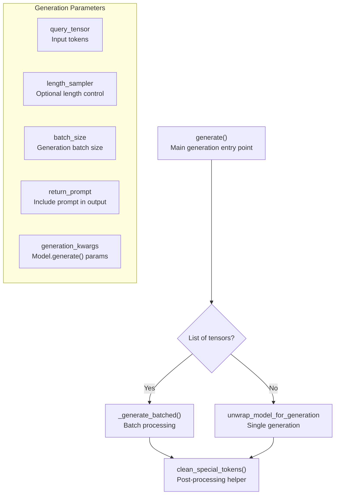

- **`generate()`**: Primary interface for generating responses from queries
- **`_generate_batched()`**: Handles batch generation with padding and special token cleanup
- **`clean_special_tokens()`**: Removes chat template tokens from generated sequences

**Sources:** [nl_gradiant_policy_optimization/ultrafeedback/text2grad_trainer.py:452-612](), [nl_gradiant_policy_optimization/kodcode/text2grad_trainer.py:458-617]()

### Forward Pass Methods

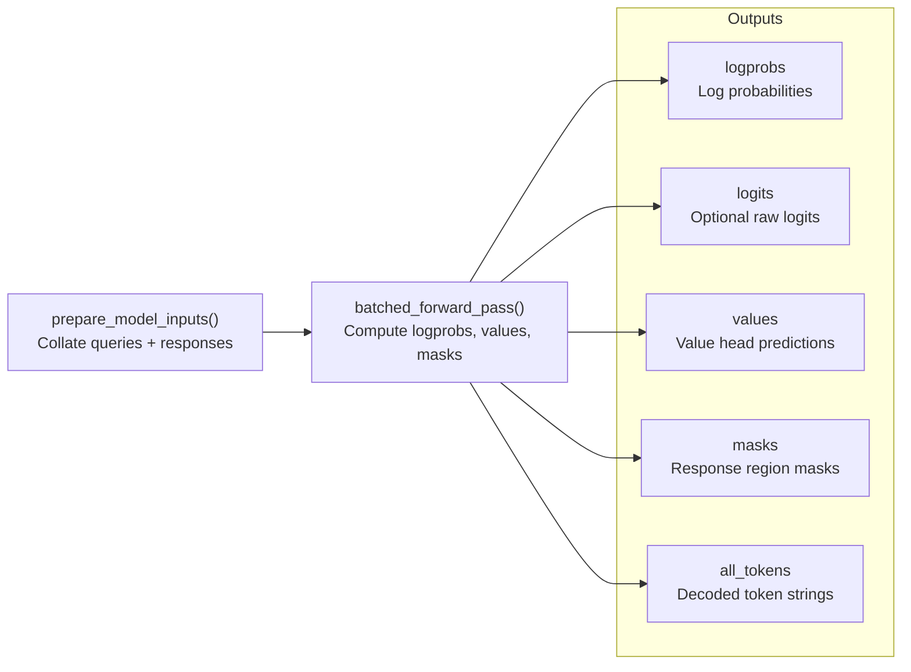

- **`prepare_model_inputs()`**: Concatenates queries and responses, creates attention masks
- **`batched_forward_pass()`**: Processes inputs in mini-batches, extracts logprobs and values
- Handles encoder-decoder vs. decoder-only architectures
- Applies sophisticated masking to isolate response tokens (details in [Forward Pass and Masking](#6.5))

**Sources:** [nl_gradiant_policy_optimization/ultrafeedback/text2grad_trainer.py:1069-1224](), [nl_gradiant_policy_optimization/kodcode/text2grad_trainer.py:1073-1230]()

### Training Methods

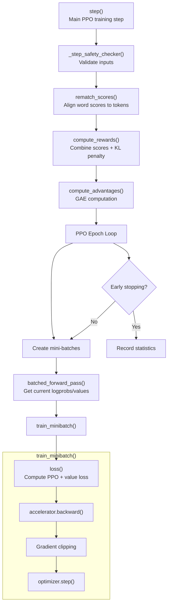

**Key Training Methods:**

| Method | Purpose | Key Operations |
|--------|---------|----------------|
| `step()` | Orchestrates full PPO update | Forward passes, reward computation, mini-batch training |
| `train_minibatch()` | Single gradient update | Loss computation, backprop, optimizer step |
| `loss()` | PPO objective calculation | Policy loss (clipped), value loss (clipped), entropy |
| `compute_rewards()` | Token-level reward assembly | Combines word scores with KL penalty |
| `compute_advantages()` | GAE algorithm | Computes advantages and returns for PPO |

**Sources:** [nl_gradiant_policy_optimization/ultrafeedback/text2grad_trainer.py:662-1018](), [nl_gradiant_policy_optimization/ultrafeedback/text2grad_trainer.py:1227-1268](), [nl_gradiant_policy_optimization/ultrafeedback/text2grad_trainer.py:1447-1643]()

### Reward Processing Methods

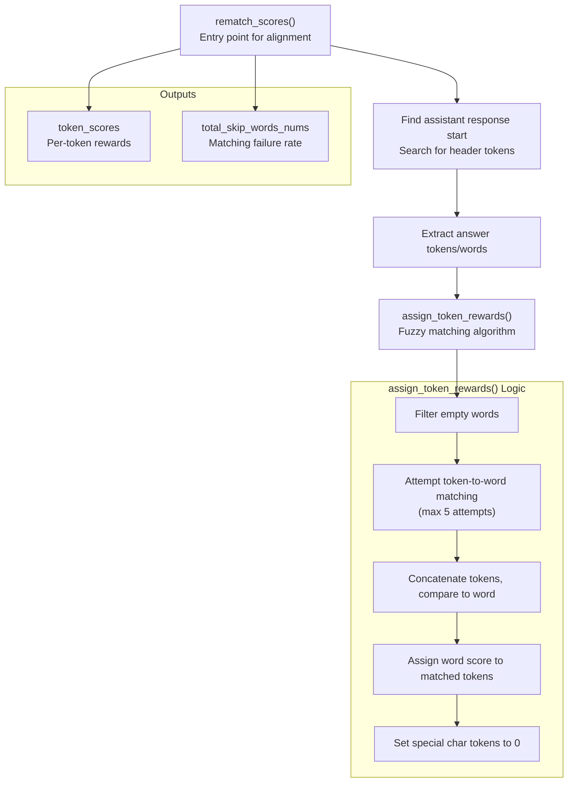

The reward processing pipeline converts word-level scores from the reward model into token-level rewards:

1. **`rematch_scores()`**: Main entry point, processes batch of responses
2. **`assign_token_rewards()`**: Fuzzy string matching to align words to tokens
3. Handles tokenization mismatches (e.g., "don't" → ["don", "'", "t"])
4. Tracks matching failures for monitoring

For detailed algorithm explanation, see [Token-Reward Alignment](#6.4).

**Sources:** [nl_gradiant_policy_optimization/ultrafeedback/text2grad_trainer.py:1389-1445](), [nl_gradiant_policy_optimization/ultrafeedback/text2grad_trainer.py:1299-1387]()

### Utility Methods

| Method | Purpose | Location |
|--------|---------|----------|
| `_filter_kwargs()` | Filter kwargs for target function signature | [text2grad_trainer.py:389-399]() |
| `prepare_dataloader()` | Create DataLoader from dataset | [text2grad_trainer.py:401-424]() |
| `_remove_unused_columns()` | Remove columns not needed by model | [text2grad_trainer.py:432-450]() |
| `_early_stop()` | Check KL divergence for early stopping | [text2grad_trainer.py:1020-1051]() |
| `gather_stats()` | Aggregate statistics across GPUs | [text2grad_trainer.py:1053-1067]() |
| `record_step_stats()` | Compute and log training metrics | [text2grad_trainer.py:1645-1694]() |
| `log_stats()` | Log to WandB/TensorBoard | [text2grad_trainer.py:1696-1763]() |
| `_save_pretrained()` | Save model checkpoint | [text2grad_trainer.py:1785-1788]() |

**Sources:** [nl_gradiant_policy_optimization/ultrafeedback/text2grad_trainer.py:389-1788]()

## PEFT and Reference Model Handling

The trainer implements specialized logic for PEFT (Parameter-Efficient Fine-Tuning) models using LoRA adapters.

### PEFT Context Manager

```python
self.optional_peft_ctx = (
    self.accelerator.unwrap_model(self.model).pretrained_model.disable_adapter
    if self.is_peft_model
    else nullcontext
)
```

This context manager is used during reference model forward passes:

```python
with self.optional_peft_ctx():
    ref_logprobs, ref_logits_or_none, _, _, _ = self.batched_forward_pass(
        self.model if self.is_peft_model else self.ref_model,
        queries,
        responses,
        model_inputs,
        return_logits=full_kl_penalty,
    )
```

When `self.is_peft_model` is `True`:
- `self.ref_model` is set to `None`
- Reference model inference uses the same model with adapters disabled
- This provides the base model behavior without loading a separate reference model

**Sources:** [nl_gradiant_policy_optimization/ultrafeedback/text2grad_trainer.py:228-232](), [nl_gradiant_policy_optimization/ultrafeedback/text2grad_trainer.py:766-773]()

## Configuration Dependencies

The trainer's behavior is heavily influenced by the `PPOConfig` object:

```mermaid
graph TB
    CONFIG["PPOConfig"]
    
    subgraph "Training Parameters"
        LR["learning_rate"]
        BS["batch_size<br/>backward_batch_size<br/>mini_batch_size"]
        EPOCHS["ppo_epochs"]
        GRAD["gradient_accumulation_steps"]
    end
    
    subgraph "PPO Hyperparameters"
        GAMMA["gamma<br/>(discount factor)"]
        LAM["lam<br/>(GAE lambda)"]
        CLIP["cliprange<br/>cliprange_value"]
        VF["vf_coef<br/>(value loss coefficient)"]
    end
    
    subgraph "KL Control"
        KL_PENALTY["kl_penalty<br/>(kl/abs/mse/full)"]
        INIT_KL["init_kl_coef"]
        ADAP["adap_kl_ctrl<br/>(adaptive)"]
        TARGET["target<br/>(target KL)"]
    end
    
    subgraph "Optimization"
        MAX_GRAD["max_grad_norm"]
        RATIO["ratio_threshold"]
        EARLY["early_stopping"]
    end
    
    CONFIG --> LR
    CONFIG --> BS
    CONFIG --> EPOCHS
    CONFIG --> GRAD
    CONFIG --> GAMMA
    CONFIG --> LAM
    CONFIG --> CLIP
    CONFIG --> VF
    CONFIG --> KL_PENALTY
    CONFIG --> INIT_KL
    CONFIG --> ADAP
    CONFIG --> TARGET
    CONFIG --> MAX_GRAD
    CONFIG --> RATIO
    CONFIG --> EARLY
```

**Sources:** [nl_gradiant_policy_optimization/ultrafeedback/text2grad_trainer.py:138-176]()

## Task-Specific Variants

The codebase contains two implementations with minor variations:

### UltraFeedback Version
- Located at: `nl_gradiant_policy_optimization/ultrafeedback/text2grad_trainer.py`
- Class name: `TEXT2GRADTrainer` (all caps)
- More verbose debug output in `assign_token_rewards()`
- Column logging: `("query", "response")`

### KodCode Version
- Located at: `nl_gradiant_policy_optimization/kodcode/text2grad_trainer.py`
- Class name: `Text2GradTrainer` (mixed case)
- Cleaner debug output
- Column logging: `("question", "response")`
- Additional whitespace normalization in token cleaning

Both versions implement the same core algorithm with cosmetic differences.

**Sources:** [nl_gradiant_policy_optimization/ultrafeedback/text2grad_trainer.py:104](), [nl_gradiant_policy_optimization/kodcode/text2grad_trainer.py:106](), [nl_gradiant_policy_optimization/ultrafeedback/text2grad_trainer.py:1299-1387](), [nl_gradiant_policy_optimization/kodcode/text2grad_trainer.py:1306-1395]()

## Integration Summary

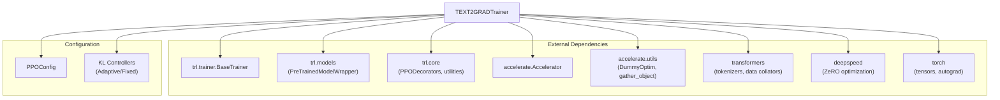

The `TEXT2GRADTrainer` integrates components from multiple libraries:
- **TRL**: Base trainer class, model wrappers, PPO utilities
- **Accelerate**: Distributed training, device management, gradient accumulation
- **Transformers**: Tokenizers, data collators, model loading
- **DeepSpeed**: Memory-efficient training via ZeRO optimization
- **PyTorch**: Core tensor operations and autograd

This modular architecture allows the trainer to leverage best-in-class implementations for each component while focusing on the novel natural language gradient algorithm.

**Sources:** [nl_gradiant_policy_optimization/ultrafeedback/text2grad_trainer.py:1-55](), [nl_gradiant_policy_optimization/kodcode/text2grad_trainer.py:1-56]()

---

