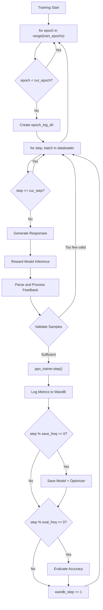
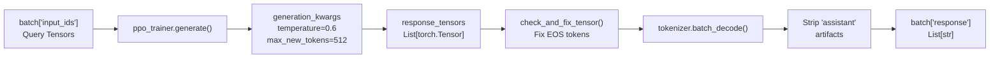
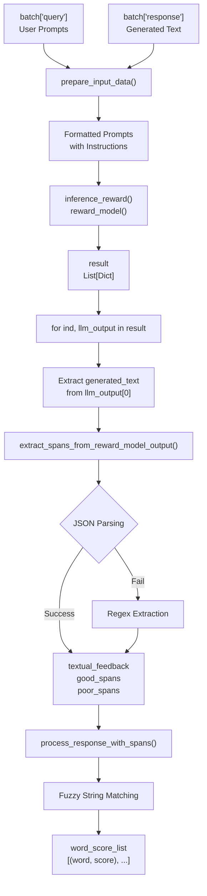
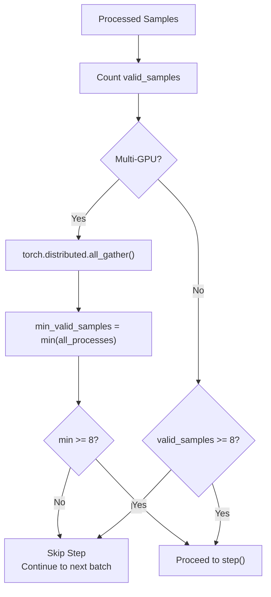
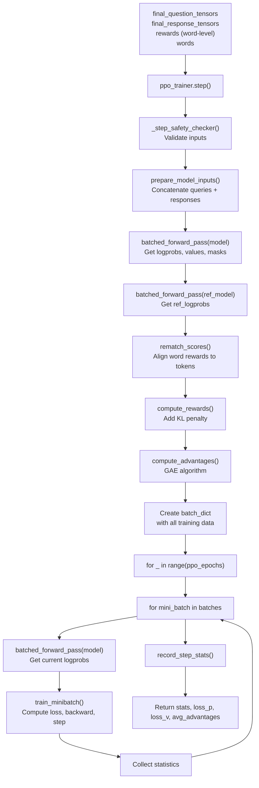
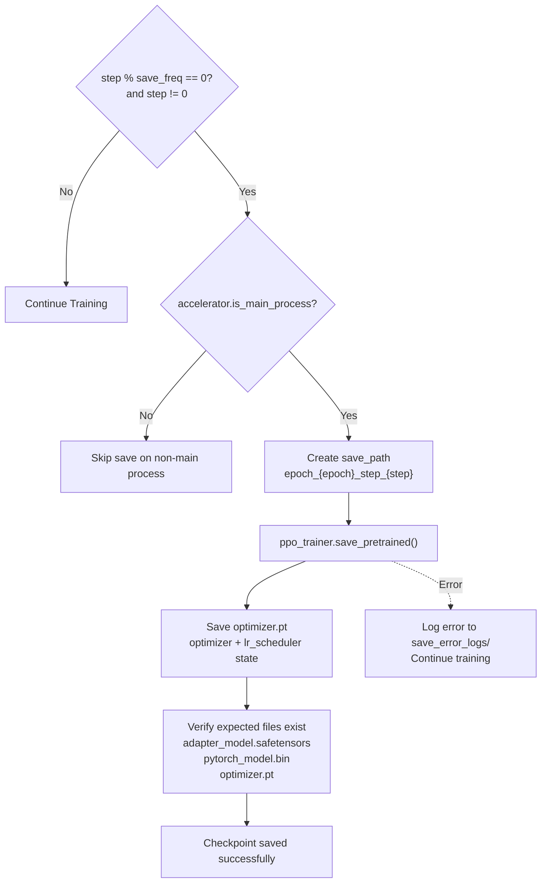
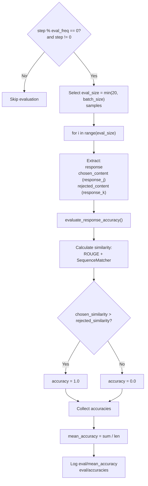
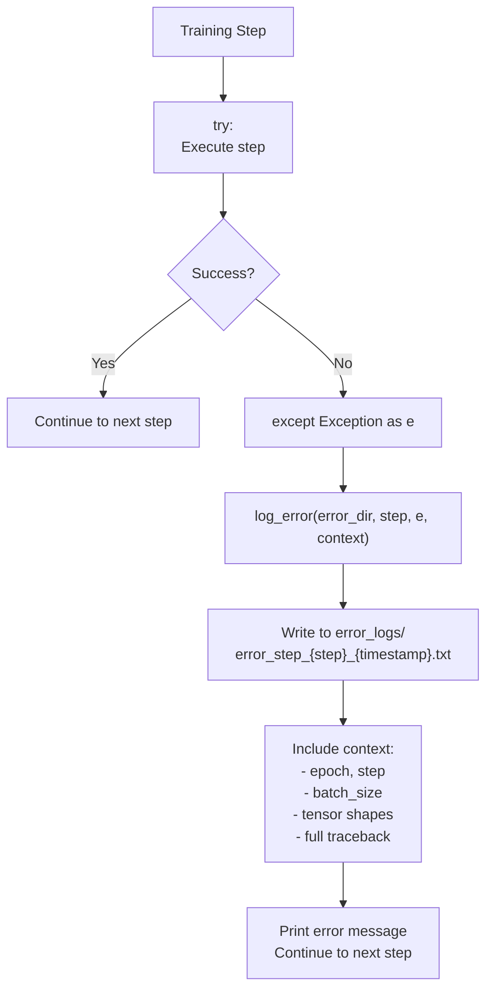
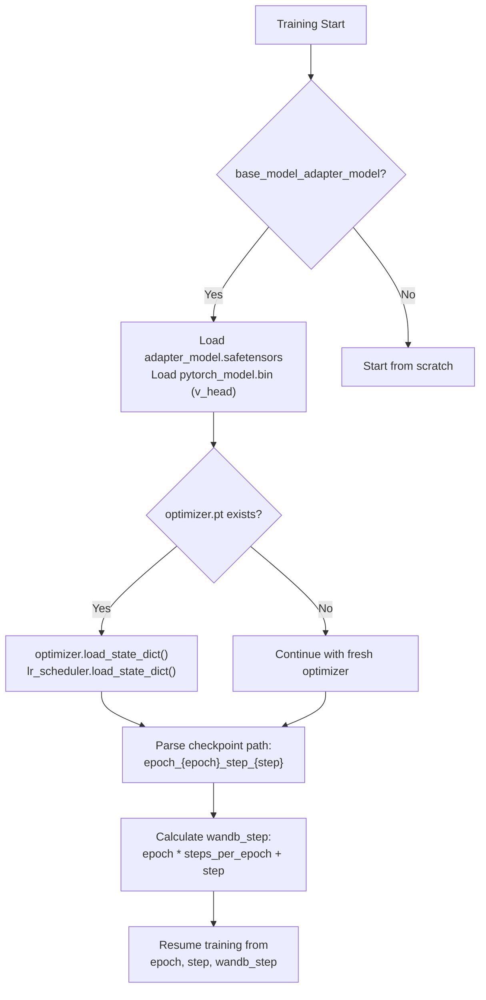

<!-- source: DeepWiki mcp.deepwiki.com · repo microsoft/Text2Grad · page 6.2 PPO Training Loop · fetched 2026-10-26 -->

# PPO Training Loop

<details>
<summary>Relevant source files</summary>

The following files were used as context for generating this wiki page:

- [nl_gradiant_policy_optimization/ultrafeedback/text2grad_trainer.py](nl_gradiant_policy_optimization/ultrafeedback/text2grad_trainer.py)
- [nl_gradiant_policy_optimization/ultrafeedback/train_ultrafeedback.py](nl_gradiant_policy_optimization/ultrafeedback/train_ultrafeedback.py)

</details>


This page documents the complete PPO training loop that orchestrates response generation, reward model inference, and policy updates. For details about the `TEXT2GRADTrainer` class structure and initialization, see [TEXT2GRADTrainer Architecture](#6.1). For deep dives into specific components like reward alignment or loss calculation, see [Reward Processing Pipeline](#6.3), [Token-Reward Alignment](#6.4), [Forward Pass and Masking](#6.5), and [Loss Calculation and Updates](#6.6).

## Overview

The PPO training loop implements the core training algorithm that iteratively:
1. Generates responses from the policy model
2. Obtains fine-grained feedback from the reward model
3. Converts feedback to token-level rewards
4. Updates the policy using PPO objectives

The main loop is implemented in task-specific training scripts (e.g., `train_ultrafeedback.py`, `train_kodcode.py`), which orchestrate calls to the `TEXT2GRADTrainer.step()` method. Each iteration processes a batch of queries through generation, reward inference, and optimization.

**Sources:** [nl_gradiant_policy_optimization/ultrafeedback/train_ultrafeedback.py:957-1260]()

## Training Loop Structure

The outer training loop consists of nested epochs and steps. The loop maintains global state including current epoch, step counters, and wandb logging steps for training resumption.



**Key Variables:**
- `cur_epoch`, `cur_step`: Track current training position for resumption [nl_gradiant_policy_optimization/ultrafeedback/train_ultrafeedback.py:35-36]()
- `wandb_step`: Global logging counter across epochs [nl_gradiant_policy_optimization/ultrafeedback/train_ultrafeedback.py:37]()
- `script_args.save_freq`: Checkpoint save interval [nl_gradiant_policy_optimization/ultrafeedback/train_ultrafeedback.py:115]()

**Sources:** [nl_gradiant_policy_optimization/ultrafeedback/train_ultrafeedback.py:957-1260]()

## Response Generation Phase

The generation phase produces model responses for input queries using the policy model's generation capabilities.



The generation process uses the `TEXT2GRADTrainer.generate()` method, which internally calls `_generate_batched()` for efficient batch processing:

| Parameter | Value | Purpose |
|-----------|-------|---------|
| `temperature` | 0.6 | Controls sampling randomness |
| `do_sample` | True | Enables stochastic sampling |
| `top_p` | 1.0 | Nucleus sampling threshold |
| `max_new_tokens` | 512 | Maximum response length |
| `return_prompt` | False | Only return generated tokens |

**Post-processing Steps:**
1. **EOS Token Fixing**: `check_and_fix_tensor()` ensures exactly one EOS token at the end [nl_gradiant_policy_optimization/ultrafeedback/train_ultrafeedback.py:381-388]()
2. **Decoding**: Convert token IDs to text strings [nl_gradiant_policy_optimization/ultrafeedback/train_ultrafeedback.py:985]()
3. **Cleaning**: Strip special tokens like "assistant" [nl_gradiant_policy_optimization/ultrafeedback/train_ultrafeedback.py:986]()

**Sources:** [nl_gradiant_policy_optimization/ultrafeedback/train_ultrafeedback.py:976-987](), [nl_gradiant_policy_optimization/ultrafeedback/text2grad_trainer.py:452-530](), [nl_gradiant_policy_optimization/ultrafeedback/text2grad_trainer.py:532-612]()

## Reward Model Inference and Feedback Extraction

After generation, responses are evaluated by the reward model to obtain fine-grained feedback identifying good and poor spans.



### Prompt Formatting

The `prepare_input_data()` function creates structured prompts that instruct the reward model to provide critiques and identify spans:

```
Please critique the following response...

**User Input**: {user_prompt}
**Generated Response**: {assistant_response}

**Definitions:**
- good_spans: phrases that greatly improve quality...
- poor_spans: phrases that noticeably harm quality...

**Output Format:**
{
  "textual_feedback": "...",
  "good_spans": ["phrase1", "phrase2", ...],
  "poor_spans": ["phrase1", "phrase2", ...]
}
```

**Sources:** [nl_gradiant_policy_optimization/ultrafeedback/train_ultrafeedback.py:390-439]()

### Inference Parameters

The reward model uses different generation parameters optimized for producing structured feedback:

| Parameter | Value | Purpose |
|-----------|-------|---------|
| `batch_size` | 32 | Matches training batch size |
| `temperature` | 0.1 | Low temperature for consistent output |
| `min_new_tokens` | 50 | Ensure sufficient feedback |
| `max_new_tokens` | 768 | Allow detailed critiques |

**Sources:** [nl_gradiant_policy_optimization/ultrafeedback/train_ultrafeedback.py:371-379](), [nl_gradiant_policy_optimization/ultrafeedback/train_ultrafeedback.py:759-799]()

### Response Parsing with Fallback

The `extract_spans_from_reward_model_output()` function implements robust parsing with multiple fallback strategies:

1. **Primary**: `load_json_from_string()` with regex JSON extraction [nl_gradiant_policy_optimization/ultrafeedback/train_ultrafeedback.py:710]()
2. **Secondary**: Regex pattern matching for individual fields [nl_gradiant_policy_optimization/ultrafeedback/train_ultrafeedback.py:728-746]()
3. **Fallback**: Return empty spans if parsing completely fails [nl_gradiant_policy_optimization/ultrafeedback/train_ultrafeedback.py:757]()

This defensive parsing is critical because LLM-generated JSON may contain syntax errors or formatting inconsistencies.

**Sources:** [nl_gradiant_policy_optimization/ultrafeedback/train_ultrafeedback.py:699-757]()

## Sample Validation and Synchronization

Before calling `ppo_trainer.step()`, the training loop validates that sufficient samples successfully parsed and ensures multi-GPU synchronization.



**Validation Logic:**
- **Minimum Samples**: At least 8 valid samples required per process [nl_gradiant_policy_optimization/ultrafeedback/train_ultrafeedback.py:1118-1124]()
- **Multi-GPU Sync**: All processes must have sufficient samples [nl_gradiant_policy_optimization/ultrafeedback/train_ultrafeedback.py:1110-1120]()
- **Graceful Degradation**: Skip step rather than crash if samples insufficient

**Sources:** [nl_gradiant_policy_optimization/ultrafeedback/train_ultrafeedback.py:1108-1128]()

## PPO Step Execution

The core optimization happens in `TEXT2GRADTrainer.step()`, which orchestrates the PPO algorithm.



**Method Signature:**
```python
def step(
    self,
    queries: List[torch.LongTensor],
    responses: List[torch.LongTensor],
    scores: List[torch.FloatTensor],  # word-level rewards
    words: List[List[str]] = None,
    response_masks: Optional[List[torch.LongTensor]] = None,
    mask_loss: str = "",
)
```

**Key Operations:**

1. **Input Validation**: Ensure tensors are valid and on correct device [nl_gradiant_policy_optimization/ultrafeedback/text2grad_trainer.py:681-683]()
2. **Forward Passes**: Compute logprobs from model and reference model [nl_gradiant_policy_optimization/ultrafeedback/text2grad_trainer.py:754-773]()
3. **Reward Alignment**: Convert word-level rewards to token-level [nl_gradiant_policy_optimization/ultrafeedback/text2grad_trainer.py:780-781]() (detailed in [Token-Reward Alignment](#6.4))
4. **Reward Computation**: Add KL penalty to rewards [nl_gradiant_policy_optimization/ultrafeedback/text2grad_trainer.py:792-801]()
5. **Advantage Estimation**: Compute GAE advantages [nl_gradiant_policy_optimization/ultrafeedback/text2grad_trainer.py:805]() (detailed in [Loss Calculation and Updates](#6.6))
6. **Mini-batch Training**: Multiple epochs over shuffled mini-batches [nl_gradiant_policy_optimization/ultrafeedback/text2grad_trainer.py:855-945]()

**Sources:** [nl_gradiant_policy_optimization/ultrafeedback/text2grad_trainer.py:663-1018]()

## Logging and Metrics

The training loop logs comprehensive metrics to WandB at each step, including loss values, reward statistics, and example token-level rewards.

```mermaid
graph LR
    STEP_RETURN["stats, loss_ps, loss_vs, average_rewards"] --> LOG_LOSS["Log train/loss_advantage<br/>train/loss_value_kl"]
    LOG_LOSS --> REWARD_STATS["Compute reward statistics<br/>mean, max, min, ratios"]
    
    REWARD_STATS --> LOG_REWARDS["Log rewards/*<br/>metrics to WandB"]
    LOG_REWARDS --> HISTOGRAM["Log rewards/distribution<br/>as histogram"]
    
    HISTOGRAM --> EXAMPLES["Select min(3, len(rewards))<br/>examples"]
    EXAMPLES --> TOKEN_TABLES["Create wandb.Table<br/>with token-reward pairs"]
    
    TOKEN_TABLES --> LOG_EXAMPLES["Log examples/example_*<br/>to WandB"]
    LOG_EXAMPLES --> PPO_STATS["ppo_trainer.log_stats()"]
```



### Logged Metrics

**Loss Metrics:**
- `train/loss_advantage`: Policy gradient loss [nl_gradiant_policy_optimization/ultrafeedback/train_ultrafeedback.py:1138]()
- `train/loss_value_kl`: Value function loss [nl_gradiant_policy_optimization/ultrafeedback/train_ultrafeedback.py:1139]()
- `train/average_advantages`: Mean advantage across batch [nl_gradiant_policy_optimization/ultrafeedback/train_ultrafeedback.py:1140]()

**Reward Statistics:**
- `rewards/mean`, `rewards/max`, `rewards/min`: Basic statistics [nl_gradiant_policy_optimization/ultrafeedback/train_ultrafeedback.py:1147-1149]()
- `rewards/positive_ratio`, `rewards/negative_ratio`, `rewards/zero_ratio`: Distribution of reward signs [nl_gradiant_policy_optimization/ultrafeedback/train_ultrafeedback.py:1150-1152]()
- `rewards/distribution`: Histogram visualization [nl_gradiant_policy_optimization/ultrafeedback/train_ultrafeedback.py:1156]()

**Example Logs:**
For the first 3 samples, the loop creates WandB tables showing token-level reward assignments:

```python
token_table = wandb.Table(columns=["token", "reward"])
for token, reward in zip(words[i], rewards[i].tolist()):
    token_table.add_data(token, reward)
```

This provides visibility into how rewards are distributed across generated text.

**Sources:** [nl_gradiant_policy_optimization/ultrafeedback/train_ultrafeedback.py:1138-1171]()

## Checkpoint Saving

Checkpoints are saved at regular intervals defined by `script_args.save_freq`. The saving process is coordinated across distributed processes.



**Saved Components:**

| File | Content | Method |
|------|---------|--------|
| `adapter_model.safetensors` | LoRA adapter weights | `save_pretrained()` |
| `pytorch_model.bin` | Value head weights | `save_pretrained()` |
| `optimizer.pt` | Optimizer and scheduler state | `torch.save()` |

**Implementation Details:**
- **Process Coordination**: Only main process saves to avoid conflicts [nl_gradiant_policy_optimization/ultrafeedback/train_ultrafeedback.py:1175]()
- **Error Handling**: Save errors are logged but don't halt training [nl_gradiant_policy_optimization/ultrafeedback/train_ultrafeedback.py:1197-1206]()
- **Verification**: Checks for expected files after save [nl_gradiant_policy_optimization/ultrafeedback/train_ultrafeedback.py:1188-1194]()

**Sources:** [nl_gradiant_policy_optimization/ultrafeedback/train_ultrafeedback.py:1173-1206]()

## Evaluation and Validation

The training loop includes periodic evaluation to assess model quality by comparing generated responses to preferred/rejected examples.



### Similarity Calculation

The `evaluate_response_accuracy()` function uses a hybrid similarity metric:

```python
def calculate_similarity(text1, text2):
    # ROUGE scores (F1 for rouge1, rouge2, rougeL)
    rouge_score = (rouge1.f + rouge2.f + rougeL.f) / 3
    
    # Sequence matcher ratio
    seq_score = difflib.SequenceMatcher(None, text1, text2).ratio()
    
    # Average
    final_score = (rouge_score + seq_score) / 2
    return final_score
```

**Evaluation Logic:**
1. Calculate similarity between generated response and chosen example
2. Calculate similarity between generated response and rejected example
3. If `chosen_similarity > rejected_similarity`, accuracy = 1.0, else 0.0
4. Average accuracy across evaluation samples

This binary accuracy metric measures whether the model is moving toward preferred responses.

**Sources:** [nl_gradiant_policy_optimization/ultrafeedback/train_ultrafeedback.py:1208-1233](), [nl_gradiant_policy_optimization/ultrafeedback/train_ultrafeedback.py:884-905](), [nl_gradiant_policy_optimization/ultrafeedback/train_ultrafeedback.py:907-956]()

## Error Handling and Recovery

The training loop implements comprehensive error handling to ensure robustness during long training runs.



**Error Categories:**

1. **Sample Processing Errors**: Individual sample parsing failures [nl_gradiant_policy_optimization/ultrafeedback/train_ultrafeedback.py:1090-1104]()
   - Logged to `sample_log` with status="failed"
   - Increment `fail` counter
   - Continue processing remaining samples

2. **Step Execution Errors**: Failures in `ppo_trainer.step()` [nl_gradiant_policy_optimization/ultrafeedback/train_ultrafeedback.py:1237-1254]()
   - Log to `error_logs/` directory
   - Include full context (tensor shapes, batch info)
   - Continue to next step (don't halt training)

3. **Save Errors**: Checkpoint saving failures [nl_gradiant_policy_optimization/ultrafeedback/train_ultrafeedback.py:1197-1206]()
   - Log to `save_error_logs/` directory
   - Continue training (don't lose progress)

**Distributed Error Handling:**
In multi-GPU settings, errors trigger a barrier to synchronize all processes:
```python
if self.is_distributed:
    import torch.distributed as dist
    dist.barrier()
```

This prevents deadlocks when one process encounters an error.

**Sources:** [nl_gradiant_policy_optimization/ultrafeedback/train_ultrafeedback.py:802-819](), [nl_gradiant_policy_optimization/ultrafeedback/train_ultrafeedback.py:1237-1259](), [nl_gradiant_policy_optimization/ultrafeedback/text2grad_trainer.py:1013-1018]()

## Training Resumption

The training loop supports resumption from checkpoints by restoring epoch, step, and optimizer state.



**Checkpoint Path Format:**
```
{output_dir}/epoch_{epoch}_step_{step}/
```

**State Restoration:**
1. **Model State**: LoRA adapters and value head [nl_gradiant_policy_optimization/ultrafeedback/train_ultrafeedback.py:227-242]()
2. **Optimizer State**: Optimizer and learning rate scheduler [nl_gradiant_policy_optimization/ultrafeedback/train_ultrafeedback.py:244-258]()
3. **Training Position**: Extract epoch and step from path [nl_gradiant_policy_optimization/ultrafeedback/train_ultrafeedback.py:261-287]()
4. **Logging Counter**: Recalculate `wandb_step` for continuous logging [nl_gradiant_policy_optimization/ultrafeedback/train_ultrafeedback.py:273]()

**Skip Logic:**
```python
if epoch < cur_epoch:
    continue  # Skip completed epochs
if epoch == cur_epoch and step <= cur_step:
    continue  # Skip completed steps in current epoch
```

This allows seamless resumption after interruptions or crashes.

**Sources:** [nl_gradiant_policy_optimization/ultrafeedback/train_ultrafeedback.py:224-292](), [nl_gradiant_policy_optimization/ultrafeedback/train_ultrafeedback.py:958-970]()

---

