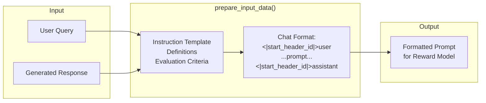
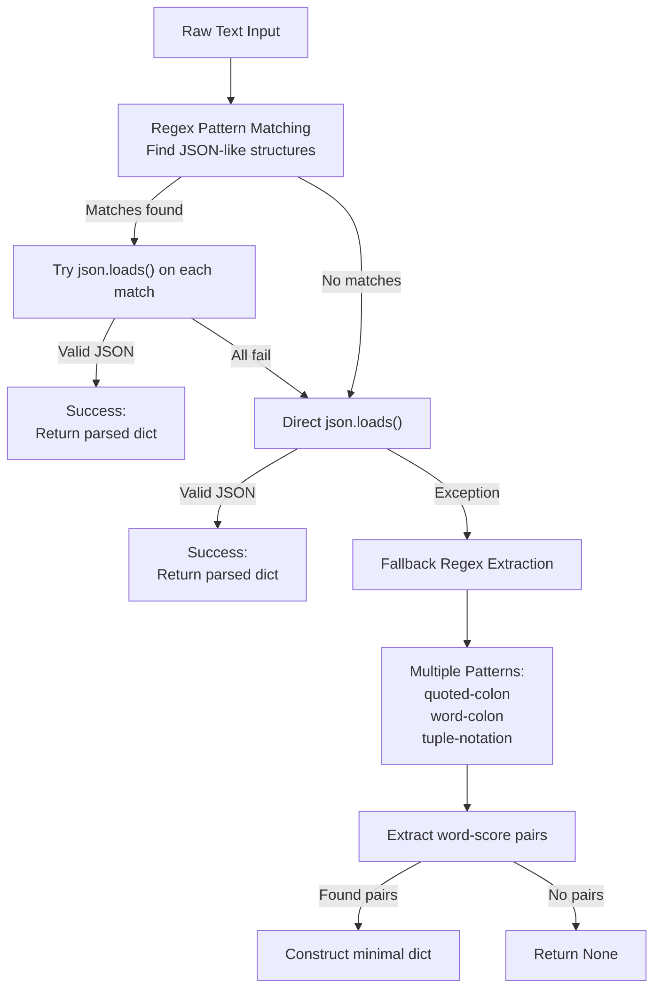
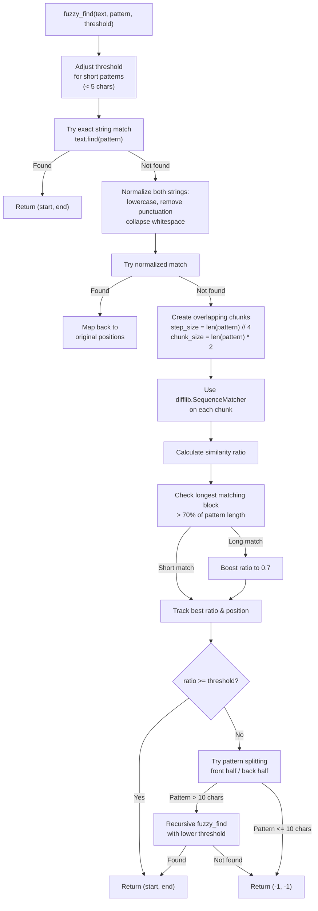
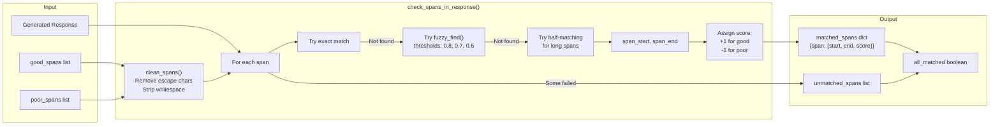
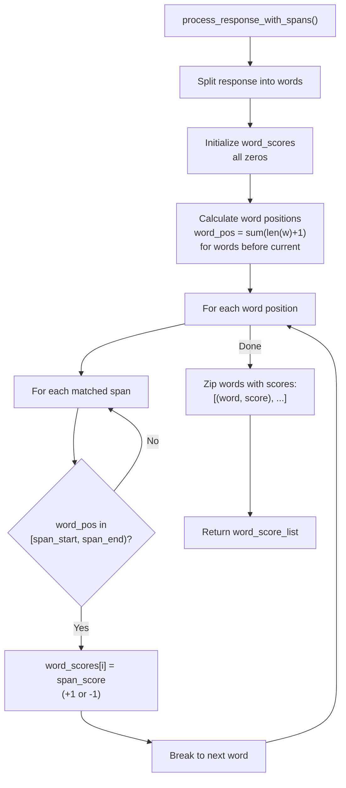
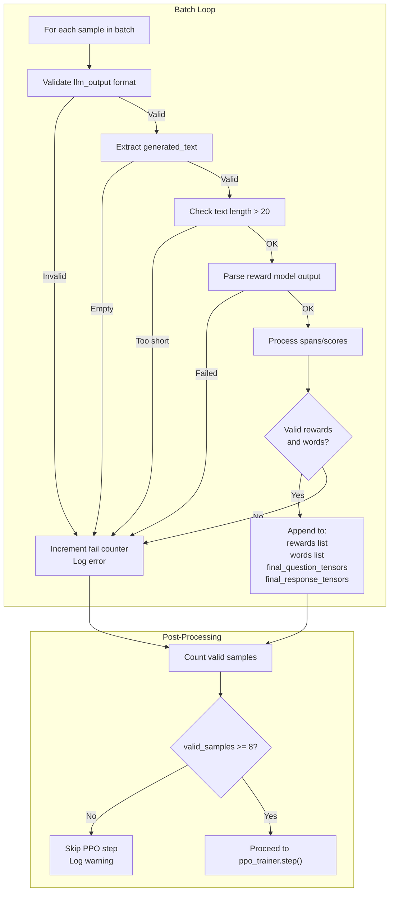
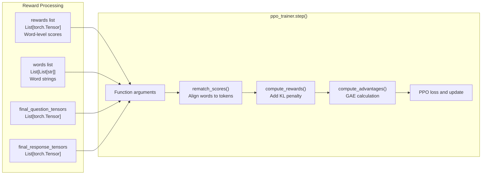

<!-- source: DeepWiki mcp.deepwiki.com · repo microsoft/Text2Grad · page 6.3 Reward Processing Pipeline · fetched 2026-10-26 -->

# Reward Processing Pipeline

<details>
<summary>Relevant source files</summary>

The following files were used as context for generating this wiki page:

- [nl_gradiant_policy_optimization/slf5k/text2grad_trainer.py](nl_gradiant_policy_optimization/slf5k/text2grad_trainer.py)
- [nl_gradiant_policy_optimization/slf5k/train.py](nl_gradiant_policy_optimization/slf5k/train.py)
- [nl_gradiant_policy_optimization/ultrafeedback/train_ultrafeedback.py](nl_gradiant_policy_optimization/ultrafeedback/train_ultrafeedback.py)

</details>


## Purpose and Scope

This document describes the reward processing pipeline that converts natural language feedback from reward models into word-level numerical rewards for PPO training. The pipeline handles structured JSON output parsing, fuzzy string matching to locate spans in generated text, and assignment of word-level scores (+1 for good spans, -1 for poor spans, 0 for neutral).

For token-level reward alignment after word-level assignment, see [Token-Reward Alignment](#6.4). For the broader PPO training context, see [PPO Training Loop](#6.2).

---

## Pipeline Overview

The reward processing pipeline bridges the gap between human-readable natural language critiques and numerical token-level rewards used in policy gradient optimization. This pipeline is executed after the policy model generates responses but before PPO update steps.

```mermaid
flowchart TB
    subgraph Generation["Policy Generation Phase"]
        GEN["ppo_trainer.generate()"]
        RESP["response_tensors"]
        DECODE["tokenizer.batch_decode()"]
        TEXT["batch['response']"]
    end
    
    subgraph Formatting["Input Preparation"]
        PREP["prepare_input_data()"]
        PROMPT["Formatted Prompts<br/>with user/assistant tags"]
    end
    
    subgraph Inference["Reward Model Inference"]
        RM["inference_reward()<br/>reward_model pipeline"]
        OUTPUT["Raw LLM Output<br/>generated_text"]
    end
    
    subgraph Parsing["Output Parsing"]
        EXTRACT["extract_spans_from_reward_model_output()"]
        JSON["load_json_from_string()"]
        STRUCT["Structured Data:<br/>textual_feedback<br/>good_spans<br/>poor_spans"]
    end
    
    subgraph Matching["Span Matching"]
        CLEAN["clean_spans()"]
        CHECK["check_spans_in_response()"]
        FUZZY["fuzzy_find()"]
        MATCHED["matched_spans dict<br/>(span, (start, end, score))"]
    end
    
    subgraph Assignment["Score Assignment"]
        PROCESS["process_response_with_spans()"]
        WORDSCORES["word_score_list<br/>[(word, score), ...]"]
        TENSOR["torch.tensor(word_rewards)"]
    end
    
    subgraph PPO["PPO Update"]
        STEP["ppo_trainer.step()"]
        REMATCH["rematch_scores()"]
        TOKENS["Token-level rewards"]
    end
    
    GEN --> RESP
    RESP --> DECODE
    DECODE --> TEXT
    TEXT --> PREP
    PREP --> PROMPT
    PROMPT --> RM
    RM --> OUTPUT
    OUTPUT --> EXTRACT
    EXTRACT --> JSON
    JSON --> STRUCT
    STRUCT --> CLEAN
    CLEAN --> CHECK
    CHECK --> FUZZY
    FUZZY --> MATCHED
    MATCHED --> PROCESS
    PROCESS --> WORDSCORES
    WORDSCORES --> TENSOR
    TENSOR --> STEP
    STEP --> REMATCH
    REMATCH --> TOKENS
```



**Sources:**
- [nl_gradiant_policy_optimization/ultrafeedback/train_ultrafeedback.py:976-1136]()
- [nl_gradiant_policy_optimization/slf5k/train.py:756-998]()

---

## Reward Model Output Format

The reward model is expected to generate structured JSON containing textual feedback and span annotations. The format differs slightly between tasks but follows a consistent pattern.

### UltraFeedback Format

For question answering, the reward model outputs:

```json
{
  "textual_feedback": "Summary of key strengths and weaknesses",
  "good_spans": ["phrase1", "phrase2"],
  "poor_spans": ["phrase3", "phrase4"]
}
```

The prompt template instructs the model to identify:
- **good_spans**: Phrases that greatly improve response quality
- **poor_spans**: Phrases that noticeably harm response quality

### SLF5K Format

For summarization, the reward model outputs word-level scores:

```json
{
  "word_score_list": [
    ["word1", 0.5],
    ["word2", -0.3],
    ["word3", 0.8]
  ]
}
```

Each word receives a continuous score, later discretized to -1, 0, or +1.

### Prompt Construction

The `prepare_input_data()` function formats inputs for the reward model using chat templates:



**Sources:**
- [nl_gradiant_policy_optimization/ultrafeedback/train_ultrafeedback.py:390-439]() - UltraFeedback prompt
- [nl_gradiant_policy_optimization/slf5k/train.py:492-517]() - SLF5K prompt

---

## JSON Parsing Strategies

The parsing layer implements multiple fallback strategies to handle malformed or incomplete LLM output. This robustness is critical since reward models may generate imperfect JSON.

### Multi-Level Parsing Cascade



### Implementation Details

The `load_json_from_string()` function implements this cascade:

| Strategy | Pattern | Example Match |
|----------|---------|---------------|
| Regex JSON | `\{(?:[^{}]\|(?:\{...\}))*\}` | `{"key": "value"}` |
| Direct Parse | N/A | Well-formed JSON string |
| Quote-Colon | `"([^"]+)"\s*:\s*([-+]?\d*\.?\d+)` | `"word": 0.5` |
| Word-Colon | `([a-zA-Z0-9$￥&']+)\s*:\s*([-+]?\d*\.?\d+)` | `word: 0.5` |
| Tuple | `\(([^,]+),\s*([-+]?\d*\.?\d+)\)` | `(word, 0.5)` |

For UltraFeedback, `extract_spans_from_reward_model_output()` first attempts `load_json_from_string()`, then falls back to direct regex extraction for `textual_feedback`, `good_spans`, and `poor_spans` fields.

**Sources:**
- [nl_gradiant_policy_optimization/ultrafeedback/train_ultrafeedback.py:821-882]() - JSON loading with fallback
- [nl_gradiant_policy_optimization/ultrafeedback/train_ultrafeedback.py:699-757]() - Span extraction
- [nl_gradiant_policy_optimization/slf5k/train.py:681-745]() - SLF5K parsing
- [nl_gradiant_policy_optimization/slf5k/train.py:625-678]() - Direct word-score extraction

---

## Fuzzy String Matching

The fuzzy matching algorithm locates identified spans within the generated response text, handling variations in spacing, capitalization, and punctuation.

### Fuzzy Matching Algorithm

The `fuzzy_find()` function implements a multi-strategy approach:



### Key Features

1. **Adaptive Thresholding**: Short patterns (< 5 characters) use lower thresholds (0.5-0.6) to account for higher relative variation.

2. **Text Normalization**: The `normalize_text()` function removes punctuation, converts to lowercase, and collapses whitespace for robust matching.

3. **Chunked Comparison**: The algorithm divides text into overlapping chunks to reduce computational complexity from O(n²) to approximately O(n·m) where m is pattern length.

4. **Longest Block Detection**: If the longest matching block exceeds 70% of the pattern length, the overall ratio is boosted, improving recall for partially correct matches.

5. **Recursive Splitting**: For long patterns (> 10 chars), the algorithm tries matching front and back halves independently with reduced thresholds.

### Span Matching Workflow

The `check_spans_in_response()` function orchestrates the matching process:



**Sources:**
- [nl_gradiant_policy_optimization/ultrafeedback/train_ultrafeedback.py:452-532]() - `fuzzy_find()` implementation
- [nl_gradiant_policy_optimization/ultrafeedback/train_ultrafeedback.py:442-450]() - `normalize_text()`
- [nl_gradiant_policy_optimization/ultrafeedback/train_ultrafeedback.py:550-653]() - `check_spans_in_response()`
- [nl_gradiant_policy_optimization/ultrafeedback/train_ultrafeedback.py:534-548]() - `clean_spans()`

---

## Word-Level Score Assignment

After locating spans, the pipeline assigns scores to individual words based on their positions within matched spans.

### Score Assignment Process

The `process_response_with_spans()` function performs word-level scoring:



### Handling Unmatched Spans

When some spans cannot be matched (logged as warnings), the function continues with partially matched results:

1. If no spans matched at all, all words receive a default score of `0.1`
2. If some spans matched, unmatched spans are logged but processing continues
3. Words not within any matched span retain score `0`

### Task-Specific Variations

**UltraFeedback**: Uses binary scores (+1, -1, 0) from good_spans and poor_spans.

**SLF5K**: The `assign_word_rewards()` function processes continuous scores from `word_score_list`:

1. Filters out non-string words and non-numeric scores
2. Cleans word text (removes special characters, normalizes quotes)
3. Returns parallel lists of `word_rewards` and `words`

**Sources:**
- [nl_gradiant_policy_optimization/ultrafeedback/train_ultrafeedback.py:655-697]() - `process_response_with_spans()`
- [nl_gradiant_policy_optimization/slf5k/train.py:381-449]() - `assign_word_rewards()`

---

## Batch Processing and Error Handling

The reward processing pipeline handles batches of responses with comprehensive error handling to ensure training stability.

### Batch Processing Flow



### Error Recovery Strategies

The implementation includes multiple layers of error handling:

| Error Type | Detection | Recovery |
|------------|-----------|----------|
| Invalid output format | `isinstance(llm_output, (list, tuple))` check | Skip sample, log warning |
| Empty generated text | Length check on `generated_text` | Skip sample, log warning |
| Parsing failure | Try-catch around JSON parsing | Use fallback regex extraction |
| Span matching failure | `all_matched` flag | Continue with partial matches or default scores |
| Insufficient valid samples | Count check before PPO step | Skip training step entirely |

### Logging and Debugging

Comprehensive logging is implemented at multiple levels:

1. **Sample-level logs**: Individual file per sample with query, response, reward model input/output, and parsing results
2. **Batch summary**: JSON file with counts of successful/failed samples and error details
3. **Step-level metrics**: WandB logging of reward distributions, success rates, and token counts

**Sources:**
- [nl_gradiant_policy_optimization/ultrafeedback/train_ultrafeedback.py:1010-1104]() - Batch processing loop
- [nl_gradiant_policy_optimization/ultrafeedback/train_ultrafeedback.py:1108-1124]() - Valid sample checking
- [nl_gradiant_policy_optimization/slf5k/train.py:800-971]() - SLF5K batch processing with detailed logging
- [nl_gradiant_policy_optimization/slf5k/train.py:598-622]() - `log_error()` helper function

---

## Integration with PPO Training

The reward processing pipeline outputs are consumed by the `TEXT2GRADTrainer.step()` method for PPO updates.

### Data Flow to PPO



### Pre-Processing Steps

Before calling `ppo_trainer.step()`, the training loop performs:

1. **Tensor Conversion**: Word rewards are converted to PyTorch tensors
2. **Batch Updating**: Only successfully processed samples are included in the final batch
3. **Validation**: Minimum sample count enforced (typically 8 for multi-GPU, batch_size/2 for single GPU)

### WandB Metrics Logged

The training loop logs detailed metrics about the reward processing:

```python
wandb.log({
    "rewards/mean": ...,
    "rewards/max": ...,
    "rewards/min": ...,
    "rewards/positive_ratio": ...,  # Fraction of rewards > 0
    "rewards/negative_ratio": ...,  # Fraction of rewards < 0
    "rewards/zero_ratio": ...,      # Fraction of rewards == 0
    "rewards/sample_count": ...,
    "rewards/distribution": wandb.Histogram(...)
})
```

Additionally, per-example token-reward tables are logged for the first few samples to enable qualitative inspection.

**Sources:**
- [nl_gradiant_policy_optimization/ultrafeedback/train_ultrafeedback.py:1130-1136]() - Calling `ppo_trainer.step()`
- [nl_gradiant_policy_optimization/ultrafeedback/train_ultrafeedback.py:1142-1169]() - WandB reward logging
- [nl_gradiant_policy_optimization/slf5k/train.py:989-997]() - SLF5K PPO step call

---

## Code Entity Reference

### Key Functions by File

**train_ultrafeedback.py**:
- `prepare_input_data()` [390-439]() - Format reward model prompts
- `normalize_text()` [442-450]() - Text normalization for matching
- `fuzzy_find()` [452-532]() - Fuzzy string matching algorithm
- `clean_spans()` [534-548]() - Clean span text
- `check_spans_in_response()` [550-653]() - Match all spans in response
- `process_response_with_spans()` [655-697]() - Generate word score list
- `extract_spans_from_reward_model_output()` [699-757]() - Parse reward model JSON
- `inference_reward()` [759-799]() - Run reward model inference
- `load_json_from_string()` [821-882]() - Multi-strategy JSON parsing

**train.py (slf5k)**:
- `assign_word_rewards()` [381-449]() - Process word-level rewards
- `prepare_input_data()` [492-517]() - Format reward model prompts
- `inference_reward()` [520-560]() - Run reward model inference
- `extract_word_scores_directly()` [625-678]() - Direct regex extraction
- `load_json_from_string()` [681-745]() - JSON parsing with fallbacks
- `log_error()` [598-622]() - Error logging helper

### Main Training Loop Integration

Both training scripts follow a similar pattern in their main loops:

1. Generate responses: `ppo_trainer.generate()`
2. Prepare reward model input: `prepare_input_data()`
3. Run inference: `inference_reward()`
4. Parse and process: `extract_*()` → `process_*()` or `assign_word_rewards()`
5. Filter valid samples
6. Update policy: `ppo_trainer.step()`

**Sources:**
- [nl_gradiant_policy_optimization/ultrafeedback/train_ultrafeedback.py:964-1136]()
- [nl_gradiant_policy_optimization/slf5k/train.py:756-998]()

---

