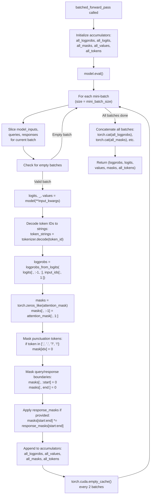
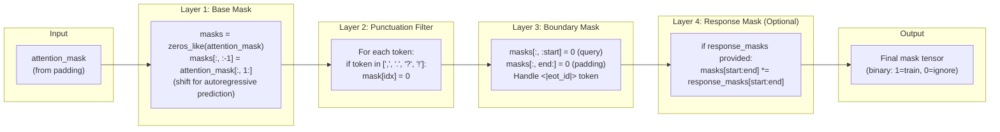

<!-- source: DeepWiki mcp.deepwiki.com · repo microsoft/Text2Grad · page 6.5 Forward Pass and Masking · fetched 2026-10-26 -->

# Forward Pass and Masking

<details>
<summary>Relevant source files</summary>

The following files were used as context for generating this wiki page:

- [nl_gradiant_policy_optimization/kodcode/text2grad_trainer.py](nl_gradiant_policy_optimization/kodcode/text2grad_trainer.py)
- [nl_gradiant_policy_optimization/ultrafeedback/text2grad_trainer.py](nl_gradiant_policy_optimization/ultrafeedback/text2grad_trainer.py)

</details>


## Purpose and Scope

This page documents the `batched_forward_pass` method in TEXT2GRADTrainer, which performs inference on query-response pairs to compute logprobs, values, and masks for PPO training. The forward pass is critical for both the initial reward calculation phase and the policy update phase of each training step.

For the overall PPO training loop that calls this method, see [PPO Training Loop](#6.2). For how masks are used in loss calculation, see [Loss Calculation and Updates](#6.6).

## Overview

The forward pass in TEXT2GRADTrainer serves two purposes:

1. **Initial Forward Pass**: Compute logprobs and values for generated responses with the current policy and reference policy (with gradients disabled)
2. **Training Forward Pass**: Re-compute logprobs and values during mini-batch updates (with gradients enabled)

The method operates in batches to manage memory constraints, processes tokens to extract string representations, and constructs sophisticated masks that control which tokens contribute to the loss function.

**Sources:** [nl_gradiant_policy_optimization/ultrafeedback/text2grad_trainer.py:1091-1224](), [nl_gradiant_policy_optimization/kodcode/text2grad_trainer.py:1095-1230]()

## Method Signature and Parameters

```python
@PPODecorators.empty_device_cache()
def batched_forward_pass(
    self,
    model: PreTrainedModelWrapper,
    queries: torch.Tensor,
    responses: torch.Tensor,
    model_inputs: dict,
    return_logits: bool = False,
    response_masks: Optional[torch.Tensor] = None,
)
```

### Parameters

| Parameter | Type | Purpose |
|-----------|------|---------|
| `model` | `PreTrainedModelWrapper` | Policy model or reference model to perform forward pass |
| `queries` | `List[torch.Tensor]` | List of query token tensors |
| `responses` | `List[torch.Tensor]` | List of response token tensors |
| `model_inputs` | `dict` | Prepared inputs with `input_ids`, `attention_mask`, etc. |
| `return_logits` | `bool` | Whether to return full logits (needed for "full" KL penalty) |
| `response_masks` | `Optional[torch.Tensor]` | Additional mask to apply to responses |

### Returns

The method returns a tuple of five elements:

1. **logprobs** (`torch.Tensor`): Log probabilities for each token, shape `(batch_size, seq_len-1)`
2. **logits** (`torch.Tensor` or `None`): Full logits if `return_logits=True`, otherwise `None`
3. **values** (`torch.Tensor`): Value head predictions, shape `(batch_size, seq_len-1)`
4. **masks** (`torch.Tensor`): Binary masks indicating trainable tokens, shape `(batch_size, seq_len-1)`
5. **all_tokens** (`List[List[str]]`): Decoded token strings for each sample

**Sources:** [nl_gradiant_policy_optimization/ultrafeedback/text2grad_trainer.py:1091-1103]()

## Batched Forward Pass Pipeline



**Sources:** [nl_gradiant_policy_optimization/ultrafeedback/text2grad_trainer.py:1091-1224]()

## Mask Construction Strategy

The mask construction process applies multiple layers of filtering to determine which tokens should contribute to the loss function. Each layer serves a specific purpose in controlling the training dynamics.

### Mask Construction Layers



**Sources:** [nl_gradiant_policy_optimization/ultrafeedback/text2grad_trainer.py:1157-1196]()

### Layer 1: Base Mask from Attention

The initial mask is derived from the attention mask, shifted by one position to align with autoregressive prediction:

```python
# Line 1157-1158 in ultrafeedback/text2grad_trainer.py
masks = torch.zeros_like(attention_mask)
masks[:, :-1] = attention_mask[:, 1:]
```

This shift accounts for the fact that logprobs are computed for predicting token `t+1` given tokens `0:t`.

**Sources:** [nl_gradiant_policy_optimization/ultrafeedback/text2grad_trainer.py:1157-1158]()

### Layer 2: Punctuation Masking

Punctuation tokens are explicitly masked to avoid training on these tokens:

```python
# Lines 1164-1171 in ultrafeedback/text2grad_trainer.py
for k in range(len(masks)):
    mask = masks[k]
    tokens = all_tokens[k]
    comma_indices = [i for i, char in enumerate(tokens) 
                     if (char in [',', '.', '?', '!']) and mask[i] == 1]
    for idx in comma_indices:
        mask[idx] = torch.tensor(0., device=mask.device)
    masks[k] = mask
```

This prevents the model from being explicitly rewarded or penalized for punctuation placement, focusing training on semantic content.

**Sources:** [nl_gradiant_policy_optimization/ultrafeedback/text2grad_trainer.py:1164-1171]()

### Layer 3: Query/Response Boundary Masking

The most critical masking operation determines the trainable region within each sequence:

```python
# Lines 1173-1196 in ultrafeedback/text2grad_trainer.py
for j in range(len(query_batch)):
    if self.is_encoder_decoder:
        start = 1  # Decoder sentence starts at index 1
        end = attention_mask[j, :].sum() - 1
    else:
        start = len(query_batch[j]) - 1
        if attention_mask[j, 0] == 0:  # Offset left padding
            start += attention_mask[j, :].nonzero()[0]
        end = start + len(response_batch[j])
        
        # Find <|eot_id|> token if present
        for i in range(start, end):
            if tokens[i] == '<|eot_id|>':
                end = i + 1 if i < len(tokens) - 1 else i
                break
    
    masks[j, :start] = 0  # Mask query
    masks[j, end:] = 0     # Mask padding
```

**Key behaviors:**

- **Query masking**: All tokens before `start` are masked (the original prompt)
- **Response masking**: Only tokens between `start` and `end` are trainable
- **End-of-text handling**: Training stops at `<|eot_id|>` token
- **Encoder-decoder mode**: Different start/end calculation for seq2seq models

**Sources:** [nl_gradiant_policy_optimization/ultrafeedback/text2grad_trainer.py:1173-1196]()

### Layer 4: Optional Response Masks

If `response_masks` parameter is provided, it applies an additional multiplicative mask:

```python
# Lines 1194-1195 in ultrafeedback/text2grad_trainer.py
if response_masks is not None:
    masks[j, start:end] = masks[j, start:end] * response_masks_batch[j][start:end]
```

This allows external logic to specify which specific response tokens should be trainable, enabling fine-grained control over the training process.

**Sources:** [nl_gradiant_policy_optimization/ultrafeedback/text2grad_trainer.py:1182-1196]()

## Token Decoding Process

Token strings are extracted for two purposes:
1. Enable punctuation masking
2. Support reward alignment in `rematch_scores` (see [Token-Reward Alignment](#6.4))

```python
# Lines 1141-1147 in ultrafeedback/text2grad_trainer.py
token_ids = input_kwargs["input_ids"]
token_ids_list = token_ids.tolist()
for sample_token_ids in token_ids_list:
    import re
    tokens = [re.sub(r"[''‛']", "'", self.tokenizer.decode(token_id).strip()) 
              for token_id in sample_token_ids]
    all_tokens.append(tokens)
```

**Character normalization**: Various quote characters are normalized to standard apostrophe (`'`) to improve matching accuracy in downstream processing.

**Sources:** [nl_gradiant_policy_optimization/ultrafeedback/text2grad_trainer.py:1141-1147]()

## Architecture-Specific Handling

The forward pass adapts to both decoder-only (e.g., Llama) and encoder-decoder architectures:

### Decoder-Only Models

```python
# Lines 1153-1158 in ultrafeedback/text2grad_trainer.py
if self.is_encoder_decoder:
    # ... encoder-decoder logic
else:
    input_ids = input_kwargs["input_ids"]
    attention_mask = input_kwargs["attention_mask"]
```

For decoder-only models:
- Query and response are concatenated in `input_ids`
- Single attention mask covers both
- Start position calculated from query length

### Encoder-Decoder Models

```python
# Lines 1149-1152 in ultrafeedback/text2grad_trainer.py
if self.is_encoder_decoder:
    input_ids = input_kwargs["decoder_input_ids"]
    attention_mask = input_kwargs["decoder_attention_mask"]
```

For encoder-decoder models:
- Query goes to encoder, response to decoder
- Separate input IDs and attention masks
- Start position is always 1 (after BOS token)

**Sources:** [nl_gradiant_policy_optimization/ultrafeedback/text2grad_trainer.py:1149-1158]()

## Log Probability Calculation

Log probabilities are computed using the `logprobs_from_logits` utility from TRL:

```python
# Line 1156 in ultrafeedback/text2grad_trainer.py
logprobs = logprobs_from_logits(logits[:, :-1, :], input_ids[:, 1:])
```

This computes the log probability of each token given the previous context:
- `logits[:, :-1, :]`: Logits for positions 0 to T-1
- `input_ids[:, 1:]`: Target tokens at positions 1 to T
- Returns log probabilities for each position

**Sources:** [nl_gradiant_policy_optimization/ultrafeedback/text2grad_trainer.py:1156]()

## Batching Strategy

The method processes inputs in mini-batches to manage GPU memory:

```python
# Lines 1106-1119 in ultrafeedback/text2grad_trainer.py
bs = len(queries)
fbs = self.config.mini_batch_size
all_logprobs = []
# ... other accumulators

model.eval()

if bs == 0:
    raise ValueError("Empty batch received in batched_forward_pass")

for i in range(math.ceil(bs / fbs)):
    input_kwargs = {key: value[i * fbs: (i + 1) * fbs] 
                    for key, value in model_inputs.items()}
    query_batch = queries[i * fbs: (i + 1) * fbs]
    response_batch = responses[i * fbs: (i + 1) * fbs]
```

**Key aspects:**

- **Mini-batch size**: Controlled by `config.mini_batch_size`
- **Model in eval mode**: `model.eval()` disables dropout and batch normalization
- **Empty batch handling**: Skips empty batches with warning
- **Accumulation**: Results stored in lists, concatenated at the end

**Sources:** [nl_gradiant_policy_optimization/ultrafeedback/text2grad_trainer.py:1106-1119]()

## Memory Management

The forward pass includes explicit memory management to prevent OOM errors:

```python
# Lines 1103-1104, 1209-1210 in ultrafeedback/text2grad_trainer.py
if torch.cuda.is_available():
    torch.cuda.empty_cache()

# ... processing ...

if torch.cuda.is_available() and i % 2 == 1:  # Every 2 batches
    torch.cuda.empty_cache()
```

**Memory management strategy:**

1. **Pre-emptive clearing**: Cache cleared at method entry
2. **Periodic clearing**: Cache cleared every 2 mini-batches during iteration
3. **Tensor deletion**: Intermediate tensors explicitly deleted
4. **Final clearing**: Cache cleared before returning

**Sources:** [nl_gradiant_policy_optimization/ultrafeedback/text2grad_trainer.py:1103-1104](), [nl_gradiant_policy_optimization/ultrafeedback/text2grad_trainer.py:1209-1210]()

## Integration with Training Loop

The `batched_forward_pass` method is called at two points in the training loop:

### 1. Initial Forward Pass (No Gradients)

```python
# Line 754-761 in ultrafeedback/text2grad_trainer.py (step method)
with torch.no_grad():
    all_logprobs, logits_or_none, values, masks, all_tokens = self.batched_forward_pass(
        self.model,
        queries,
        responses,
        model_inputs,
        response_masks=response_masks,
        return_logits=full_kl_penalty,
    )
```

This initial pass computes logprobs and values for the current policy to calculate rewards and advantages.

### 2. Reference Model Forward Pass (No Gradients)

```python
# Lines 766-773 in ultrafeedback/text2grad_trainer.py
with self.optional_peft_ctx():
    ref_logprobs, ref_logits_or_none, _, _, _ = self.batched_forward_pass(
        self.model if self.is_peft_model else self.ref_model,
        queries,
        responses,
        model_inputs,
        return_logits=full_kl_penalty,
    )
```

For PEFT models, the base model acts as the reference policy when adapters are disabled.

### 3. Training Forward Pass (With Gradients)

```python
# Lines 884-890 in ultrafeedback/text2grad_trainer.py (inside mini-batch loop)
logprobs, logits, vpreds, _, _ = self.batched_forward_pass(
    self.model,
    mini_batch_dict["queries"],
    mini_batch_dict["responses"],
    model_inputs,
    return_logits=True,
)
```

This pass re-computes logprobs during training to compute gradients for policy updates.

**Sources:** [nl_gradiant_policy_optimization/ultrafeedback/text2grad_trainer.py:754-773](), [nl_gradiant_policy_optimization/ultrafeedback/text2grad_trainer.py:884-890]()

## Mask Usage in Loss Calculation

The masks produced by `batched_forward_pass` control which tokens contribute to the PPO loss:

```python
# Example from loss calculation (see Loss Calculation and Updates page)
pg_loss = masked_mean(torch.max(pg_losses, pg_losses2), mask)
vf_loss = 0.5 * masked_mean(torch.max(vf_losses1, vf_losses2), mask)
```

The `masked_mean` function from TRL applies the mask before averaging, ensuring only response tokens within the valid range affect the loss.

**Sources:** [nl_gradiant_policy_optimization/ultrafeedback/text2grad_trainer.py:1598-1602]()

## Error Handling and Validation

The method includes several validation checks:

```python
# Lines 1116-1126 in ultrafeedback/text2grad_trainer.py
if bs == 0:
    raise ValueError("Empty batch received in batched_forward_pass")

# Lines 1124-1126
if len(query_batch) == 0 or len(response_batch) == 0:
    print(f"Warning: Empty batch at index {i}, skipping")
    continue

# Lines 1132-1137
for k, v in input_kwargs.items():
    if isinstance(v, torch.Tensor) and v.numel() == 0:
        print(f"Warning: Empty tensor for {k} at batch {i}")

# Lines 1138-1143
if logits.numel() == 0:
    print(f"Warning: Empty logits at batch {i}, skipping")
    continue
```

**Validation strategy:**
- Raise exception for completely empty batches
- Skip individual mini-batches that are empty
- Warn about empty tensors but continue processing
- Ensure all_logprobs list is non-empty before concatenation

**Sources:** [nl_gradiant_policy_optimization/ultrafeedback/text2grad_trainer.py:1116-1143]()

## Summary Table: Mask Layers

| Layer | Purpose | Location | Effect |
|-------|---------|----------|--------|
| Base Mask | Align with autoregressive prediction | Lines 1157-1158 | Shift attention mask by 1 position |
| Punctuation Mask | Ignore punctuation tokens | Lines 1164-1171 | Set mask=0 for `,`, `.`, `?`, `!` |
| Boundary Mask | Train only on response | Lines 1173-1196 | Mask query and padding regions |
| Response Mask | Optional fine-grained control | Lines 1194-1195 | Apply external mask to responses |

**Sources:** [nl_gradiant_policy_optimization/ultrafeedback/text2grad_trainer.py:1157-1196]()

---

