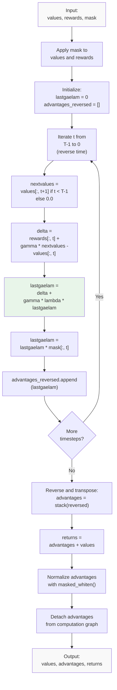
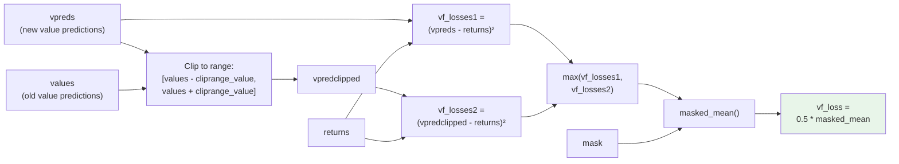
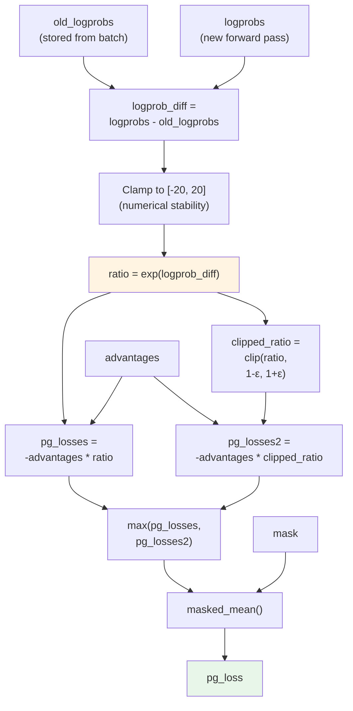
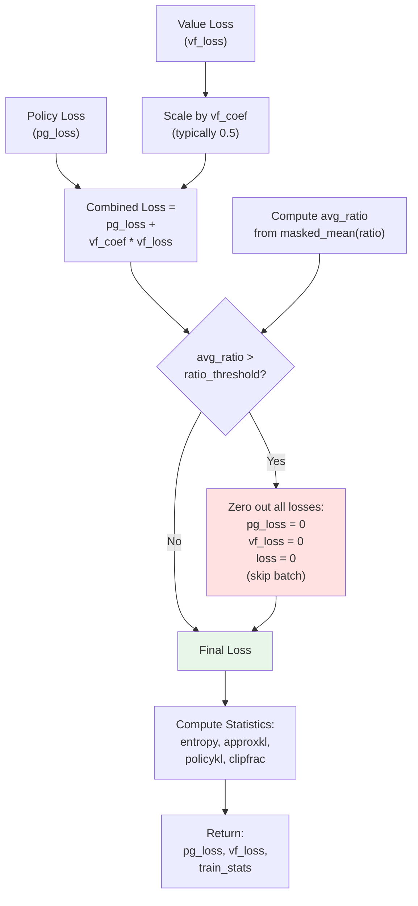
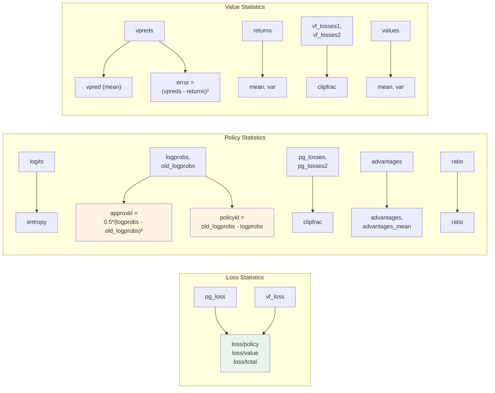
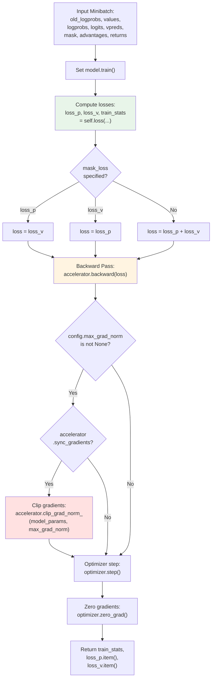

<!-- source: DeepWiki mcp.deepwiki.com · repo microsoft/Text2Grad · page 6.6 Loss Calculation and Updates · fetched 2026-10-26 -->

# Loss Calculation and Updates

<details>
<summary>Relevant source files</summary>

The following files were used as context for generating this wiki page:

- [nl_gradiant_policy_optimization/kodcode/text2grad_trainer.py](nl_gradiant_policy_optimization/kodcode/text2grad_trainer.py)
- [nl_gradiant_policy_optimization/ultrafeedback/text2grad_trainer.py](nl_gradiant_policy_optimization/ultrafeedback/text2grad_trainer.py)

</details>


## Purpose and Scope

This page documents the loss calculation and gradient update mechanisms in TEXT2GRADTrainer's PPO training loop. It covers Generalized Advantage Estimation (GAE), the PPO clipped objective for policy loss, clipped value function loss, and the gradient update procedure with safety mechanisms.

For information about how rewards are computed from natural language feedback, see [Reward Processing Pipeline](#6.3). For details on the complete training loop that uses these losses, see [PPO Training Loop](#6.2). For how forward passes compute logprobs and values, see [Forward Pass and Masking](#6.5).

---

## Advantage Computation with GAE

The `compute_advantages()` method implements Generalized Advantage Estimation (GAE), which computes advantage estimates and returns for policy gradient updates. GAE balances bias-variance tradeoff in advantage estimation through the λ (lambda) parameter.

### Algorithm Overview



**Diagram: GAE Computation Flow**

### Implementation Details

The GAE computation uses two key hyperparameters:
- **gamma (γ)**: Discount factor for future rewards, typically 0.99-1.0
- **lambda (λ)**: GAE parameter controlling bias-variance tradeoff, typically 0.95

The temporal difference (TD) error at timestep t is:
```
delta_t = reward_t + gamma * V(s_{t+1}) - V(s_t)
```

The GAE advantage estimate is computed recursively backwards:
```
A_t = delta_t + gamma * lambda * A_{t+1}
```

After computing advantages, they are normalized using `masked_whiten()` which subtracts mean and divides by standard deviation (considering only non-masked positions). This normalization stabilizes training.

**Sources:** [nl_gradiant_policy_optimization/ultrafeedback/text2grad_trainer.py:1507-1551](), [nl_gradiant_policy_optimization/kodcode/text2grad_trainer.py:1516-1557]()

---

## Value Function Loss

The value function loss measures how well the value head predicts returns. TEXT2GRADTrainer uses a **clipped value loss** to prevent excessively large updates.

### Clipped Value Function Objective



**Diagram: Value Function Loss Calculation**

The clipped value loss is computed as:

```
vpredclipped = clip(vpreds, values - ε_v, values + ε_v)
vf_loss = 0.5 * masked_mean(max((vpreds - returns)², (vpredclipped - returns)²))
```

Where:
- `vpreds`: New value predictions from current forward pass
- `values`: Old value predictions from the stored batch
- `returns`: Target values computed as advantages + values
- `ε_v`: Clipping range (`config.cliprange_value`)

The clipping prevents value estimates from changing too drastically in a single update, improving training stability. The `max()` operation means the loss only uses the clipped version when it would result in a larger loss.

**Sources:** [nl_gradiant_policy_optimization/ultrafeedback/text2grad_trainer.py:1582-1592](), [nl_gradiant_policy_optimization/kodcode/text2grad_trainer.py:1583-1592]()

---

## Policy Gradient Loss (PPO Clipped Objective)

The policy loss implements the core PPO clipped objective, which constrains policy updates to prevent destructively large changes.

### PPO Objective Computation



**Diagram: Policy Gradient Loss with PPO Clipping**

### Mathematical Formulation

The probability ratio measures how much the policy has changed:
```
r_t(θ) = π_θ(a_t|s_t) / π_θ_old(a_t|s_t) = exp(logprob - old_logprob)
```

The clipped objective is:
```
L^CLIP(θ) = -E[min(r_t(θ) * A_t, clip(r_t(θ), 1-ε, 1+ε) * A_t)]
```

Where:
- `r_t(θ)`: Probability ratio between new and old policy
- `A_t`: Advantage estimate
- `ε`: Clipping parameter (`config.cliprange`), typically 0.2

The clipping ensures:
- When advantage is positive (good action), ratio is clipped to [1-ε, 1+ε]
- When advantage is negative (bad action), ratio is clipped symmetrically
- This prevents excessively optimistic updates

The negative sign converts the maximization objective to a minimization loss.

**Sources:** [nl_gradiant_policy_optimization/ultrafeedback/text2grad_trainer.py:1594-1602](), [nl_gradiant_policy_optimization/kodcode/text2grad_trainer.py:1594-1602]()

---

## Combined Loss and Safety Mechanisms

The `loss()` method combines policy and value losses and applies safety checks to prevent training instabilities.

### Loss Combination and Safety



**Diagram: Loss Combination and Safety Checks**

### Code Entity Mapping

| Component | Code Reference | Purpose |
|-----------|----------------|---------|
| `vf_coef` | `config.vf_coef` | Weight for value loss, typically 0.5 |
| `ratio_threshold` | `config.ratio_threshold` | Maximum allowed avg ratio, typically 10 |
| `cliprange` | `config.cliprange` | Policy clipping ε, typically 0.2 |
| `cliprange_value` | `config.cliprange_value` | Value clipping ε, typically 0.2 |

### Safety Mechanism

The ratio threshold check prevents training collapse:
```python
avg_ratio = masked_mean(ratio, mask).item()
if avg_ratio > self.config.ratio_threshold:
    # Zero out losses to skip this problematic batch
    pg_loss = pg_loss * 0.0
    vf_loss = vf_loss * 0.0
    loss = loss * 0.0
```

This detects when the policy has changed too drastically (ratio >> 1), which can indicate numerical instability or a problematic batch.

**Sources:** [nl_gradiant_policy_optimization/ultrafeedback/text2grad_trainer.py:1604-1613](), [nl_gradiant_policy_optimization/kodcode/text2grad_trainer.py:1604-1613]()

---

## Statistics Computation

The `loss()` method computes extensive statistics for monitoring training health.

### Tracked Statistics



**Diagram: Statistics Tracked During Loss Calculation**

### Key Metrics

| Metric | Calculation | Interpretation |
|--------|-------------|----------------|
| **entropy** | `masked_mean(entropy_from_logits(logits))` | Policy randomness; decreases during training |
| **approxkl** | `0.5 * masked_mean((logprobs - old_logprobs)²)` | Approximate KL divergence; should stay small |
| **policykl** | `masked_mean(old_logprobs - logprobs)` | Alternative KL estimate |
| **pg_clipfrac** | Fraction of policy losses that used clipping | Indicates constraint saturation |
| **vf_clipfrac** | Fraction of value losses that used clipping | Indicates value constraint saturation |
| **ratio** | Full tensor of probability ratios | Distribution of policy changes |

These statistics are collected in a nested dictionary:
```python
stats = dict(
    loss=dict(policy=pg_loss, value=vf_loss, total=loss),
    policy=dict(entropy=..., approxkl=..., policykl=..., clipfrac=..., 
                advantages=..., advantages_mean=..., ratio=...),
    returns=dict(mean=return_mean, var=return_var),
    val=dict(vpred=..., error=..., clipfrac=..., mean=..., var=...)
)
```

**Sources:** [nl_gradiant_policy_optimization/ultrafeedback/text2grad_trainer.py:1615-1643](), [nl_gradiant_policy_optimization/kodcode/text2grad_trainer.py:1615-1642]()

---

## Gradient Update Procedure

The `train_minibatch()` method orchestrates the complete loss computation and gradient update for a single minibatch.

### Update Flow



**Diagram: Complete Gradient Update Flow in train_minibatch()**

### Gradient Clipping

Gradient clipping prevents exploding gradients by scaling gradient norms that exceed a threshold:

```python
if self.config.max_grad_norm is not None:
    if self.accelerator.sync_gradients:
        self.accelerator.clip_grad_norm_(self.model_params, self.config.max_grad_norm)
```

The `sync_gradients` check ensures clipping only occurs when gradients are synchronized across devices in distributed training. The `max_grad_norm` is typically set to 0.5-1.0.

### Optional Loss Masking

The `mask_loss` parameter allows training only one loss component:
- `mask_loss="loss_p"`: Train only value loss (mask out policy loss)
- `mask_loss="loss_v"`: Train only policy loss (mask out value loss)
- `mask_loss=""`: Train both losses (normal operation)

This feature is rarely used but can help debug which loss component is causing issues.

**Sources:** [nl_gradiant_policy_optimization/ultrafeedback/text2grad_trainer.py:1227-1268](), [nl_gradiant_policy_optimization/kodcode/text2grad_trainer.py:1233-1274]()

---

## Integration with Training Loop

The loss calculation and updates integrate into the broader PPO training loop as shown below:

```mermaid
graph TB
    subgraph "PPO Epoch Loop"
        Start["For each PPO epoch"] --> Permute["Permute batch indices"]
        Permute --> BackwardBatch["For each backward batch"]
        BackwardBatch --> MiniBatch["For each minibatch"]
        
        MiniBatch --> Forward["batched_forward_pass():<br/>Compute logprobs, logits, vpreds"]
        Forward --> TrainMB["train_minibatch()"]
        
        subgraph "train_minibatch()"
            TMB_Start["Input: old_logprobs, values,<br/>advantages, returns"] --> Loss["loss():<br/>Compute pg_loss, vf_loss"]
            Loss --> Backward["backward(loss)"]
            Backward --> Clip["Clip gradients"]
            Clip --> Step["optimizer.step()"]
            Step --> Zero["optimizer.zero_grad()"]
        end
        
        TrainMB --> TMB_Start
        Zero --> Collect["Collect train_stats"]
        Collect --> CheckEarly{Early stopping<br/>based on KL?}
        CheckEarly -->|Yes| Done["Exit epoch loop"]
        CheckEarly -->|No| NextMB{More<br/>minibatches?}
        NextMB -->|Yes| MiniBatch
        NextMB -->|No| NextBB{More backward<br/>batches?}
        NextBB -->|Yes| BackwardBatch
        NextBB -->|No| NextEpoch{More<br/>epochs?}
        NextEpoch -->|Yes| Start
        NextEpoch -->|No| Done
    end
    
    style Loss fill:#e8f5e9
    style Backward fill:#fff4e1
    style Clip fill:#ffe1e1
```



**Diagram: Loss Calculation Within PPO Training Loop Context**

The loss calculation happens multiple times per training step:
1. **Outer loop**: `ppo_epochs` iterations (typically 4)
2. **Middle loop**: Batch divided into `backward_batch_size` chunks
3. **Inner loop**: Backward batch divided into `mini_batch_size` pieces

For each minibatch:
1. Forward pass computes new logprobs, logits, values
2. `train_minibatch()` called with old and new values
3. `loss()` computes clipped policy and value losses
4. Backward pass computes gradients
5. Gradients clipped if configured
6. Optimizer step updates model parameters
7. Statistics collected for logging

**Sources:** [nl_gradiant_policy_optimization/ultrafeedback/text2grad_trainer.py:855-945](), [nl_gradiant_policy_optimization/kodcode/text2grad_trainer.py:858-947]()

---

## Configuration Parameters

Key hyperparameters controlling loss calculation and updates:

| Parameter | Typical Value | Purpose |
|-----------|---------------|---------|
| `ppo_epochs` | 4 | Number of optimization epochs per batch |
| `mini_batch_size` | 1-4 | Minibatch size for gradient updates |
| `learning_rate` | 1e-6 to 1e-5 | Optimizer learning rate |
| `vf_coef` | 0.5 | Weight for value function loss |
| `cliprange` | 0.2 | PPO policy clipping epsilon |
| `cliprange_value` | 0.2 | Value function clipping epsilon |
| `max_grad_norm` | 0.5-1.0 | Maximum gradient norm for clipping |
| `ratio_threshold` | 10.0 | Safety threshold for probability ratios |
| `gamma` | 0.99-1.0 | Discount factor for GAE |
| `lam` | 0.95 | Lambda parameter for GAE |

These are configured via `PPOConfig` and passed to the TEXT2GRADTrainer constructor. See [TEXT2GRADTrainer Architecture](#6.1) for initialization details.

**Sources:** [nl_gradiant_policy_optimization/ultrafeedback/text2grad_trainer.py:138-175](), [nl_gradiant_policy_optimization/kodcode/text2grad_trainer.py:140-177]()

---

