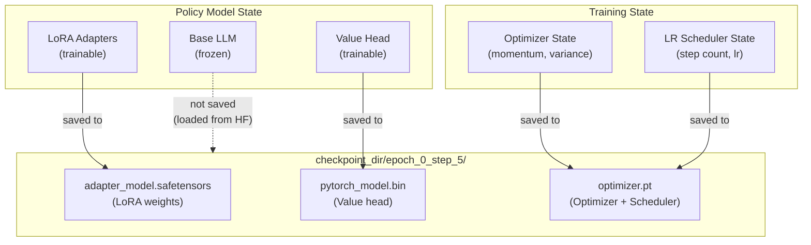
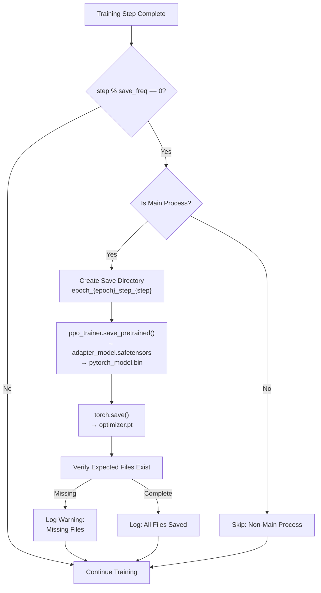
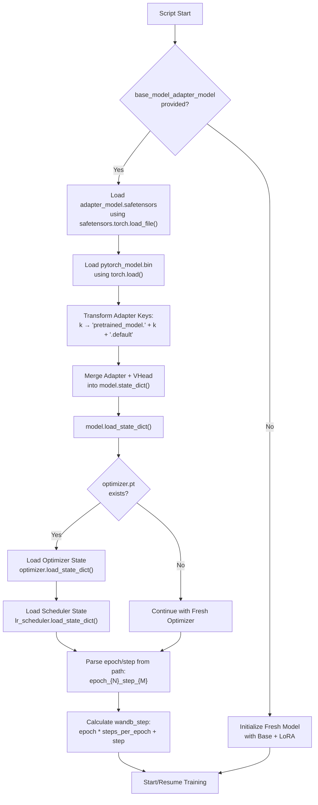
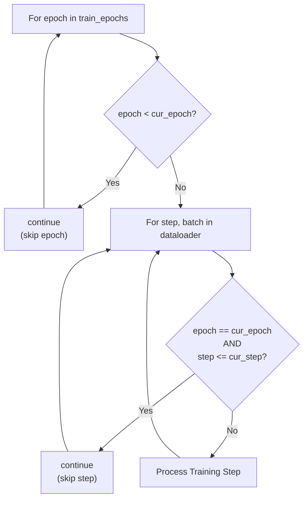
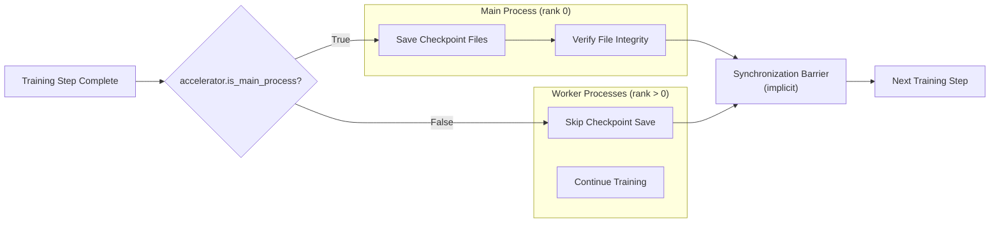

<!-- source: DeepWiki mcp.deepwiki.com · repo microsoft/Text2Grad · page 6.7 Checkpoint Management · fetched 2026-10-26 -->

# Checkpoint Management

<details>
<summary>Relevant source files</summary>

The following files were used as context for generating this wiki page:

- [nl_gradiant_policy_optimization/kodcode/train_kodcode.py](nl_gradiant_policy_optimization/kodcode/train_kodcode.py)
- [nl_gradiant_policy_optimization/ultrafeedback/train_ultrafeedback.py](nl_gradiant_policy_optimization/ultrafeedback/train_ultrafeedback.py)

</details>


This page documents the checkpoint management system used during policy optimization training in Text2Grad. Checkpoint management enables training resumption after interruptions, preserves model and optimizer states, and tracks training progress across epochs and steps.

For information about the overall policy optimization training loop, see [PPO Training Loop](#6.2). For details on the TEXT2GRADTrainer class that orchestrates training, see [TEXT2GRADTrainer Architecture](#6.1).

## Overview

The checkpoint management system handles three critical responsibilities:

1. **Saving checkpoints**: Periodically persisting model weights, optimizer state, and training metadata
2. **Loading checkpoints**: Restoring saved states to resume training from interruption points
3. **State tracking**: Maintaining accurate epoch, step, and WandB logging counters across training sessions

The system is designed for distributed training environments where multiple GPUs may be involved, with special handling to ensure only the main process writes checkpoints while all processes maintain synchronized state.

---

## Checkpoint Components

Each checkpoint directory contains three essential files that collectively represent the complete training state:

| File | Content | Format | Purpose |
|------|---------|--------|---------|
| `adapter_model.safetensors` | LoRA adapter weights | SafeTensors | Parameter-efficient fine-tuning weights for the policy model |
| `pytorch_model.bin` | Value head weights | PyTorch Binary | Value function weights for PPO advantage estimation |
| `optimizer.pt` | Optimizer and scheduler state | PyTorch Binary | Optimizer momentum/variance and learning rate schedule |

The checkpoint directory follows a naming convention: `epoch_{epoch}_step_{step}` which encodes the training position directly in the path.

**Checkpoint File Structure**



**Sources:**
- [nl_gradiant_policy_optimization/ultrafeedback/train_ultrafeedback.py:1173-1206]()
- [nl_gradiant_policy_optimization/kodcode/train_kodcode.py:997-1030]()

---

## Checkpoint Saving

Checkpoints are saved periodically during training based on the `save_freq` argument in `ScriptArguments`. The saving process occurs only on the main process in distributed training to avoid race conditions and redundant writes.

### Save Frequency and Conditions

The checkpoint saving logic evaluates at each training step:

```python
if step != 0 and step % script_args.save_freq == 0:
    # Save checkpoint
```

Typical `save_freq` values range from 5 to 20 steps, depending on dataset size and training duration.

### Save Process Flow



**Sources:**
- [nl_gradiant_policy_optimization/ultrafeedback/train_ultrafeedback.py:1173-1206]()
- [nl_gradiant_policy_optimization/kodcode/train_kodcode.py:997-1030]()

### Implementation Details

The save operation uses `ppo_trainer.save_pretrained()` which internally calls PEFT library methods to save LoRA adapters. The optimizer state is saved separately using `torch.save()`:

```python
# Save model adapters and value head
ppo_trainer.save_pretrained(save_path)

# Save optimizer and scheduler state
optimizer_path = os.path.join(save_path, "optimizer.pt")
torch.save({
    'optimizer': optimizer.state_dict(),
    'lr_scheduler': lr_scheduler.state_dict() if lr_scheduler else None,
}, optimizer_path)
```

After saving, the code verifies that all expected files exist:

```python
expected_files = ["adapter_model.safetensors", "pytorch_model.bin", "optimizer.pt"]
missing_files = [f for f in expected_files if not os.path.exists(os.path.join(save_path, f))]
```

**Sources:**
- [nl_gradiant_policy_optimization/ultrafeedback/train_ultrafeedback.py:1179-1194]()
- [nl_gradiant_policy_optimization/kodcode/train_kodcode.py:1003-1018]()

### Error Handling During Save

If an exception occurs during saving, the error is logged to a dedicated error directory without halting training:

```python
except Exception as save_error:
    print(f"Error during model saving: {str(save_error)}")
    error_dir = os.path.join(script_args.output_dir, "save_error_logs")
    os.makedirs(error_dir, exist_ok=True)
    save_error_file = os.path.join(error_dir, f"save_error_epoch_{epoch}_step_{step}.txt")
    # Write detailed error information
```

**Sources:**
- [nl_gradiant_policy_optimization/ultrafeedback/train_ultrafeedback.py:1197-1206]()
- [nl_gradiant_policy_optimization/kodcode/train_kodcode.py:1021-1030]()

---

## Checkpoint Loading and Resumption

When `base_model_adapter_model` is provided in `ScriptArguments`, the training script loads a checkpoint to resume from a previous state. The loading process reconstructs both the model weights and optimizer state.

### Loading Process Architecture



**Sources:**
- [nl_gradiant_policy_optimization/ultrafeedback/train_ultrafeedback.py:224-292]()
- [nl_gradiant_policy_optimization/kodcode/train_kodcode.py:208-276]()

### Adapter Weight Transformation

The adapter weights require key transformation before loading because PEFT's internal naming differs from the saved format:

```python
adapter_model_state = safetensors.torch.load_file(
    os.path.join(script_args.base_model_adapter_model, "adapter_model.safetensors"))

# Transform keys to match PEFT's internal structure
new_adapter_model_state = {
    "pretrained_model." + k[:-7] + ".default" + k[-7:]: v
    for k, v in adapter_model_state.items()
}
```

This transformation adds the `pretrained_model.` prefix and inserts `.default` before the weight suffix (e.g., `.weight`, `.bias`).

**Sources:**
- [nl_gradiant_policy_optimization/ultrafeedback/train_ultrafeedback.py:227-235]()
- [nl_gradiant_policy_optimization/kodcode/train_kodcode.py:211-219]()

### Optimizer State Loading

The optimizer state is loaded conditionally with robust error handling:

```python
optimizer_path = os.path.join(script_args.base_model_adapter_model, "optimizer.pt")
if os.path.exists(optimizer_path):
    try:
        optimizer_state = torch.load(optimizer_path, map_location="cuda:1", weights_only=True)
        if not optimizer_state:
            raise ValueError("Empty optimizer state")
        optimizer.load_state_dict(optimizer_state['optimizer'])
        if optimizer_state.get('lr_scheduler') and lr_scheduler:
            lr_scheduler.load_state_dict(optimizer_state['lr_scheduler'])
        print("Successfully loaded optimizer state")
    except Exception as e:
        print(f"Error loading optimizer state: {str(e)}")
        print("Continuing with fresh optimizer")
else:
    print("No optimizer state found, starting with fresh optimizer")
```

If optimizer loading fails, training continues with a freshly initialized optimizer. This design choice prioritizes training continuation over perfect state restoration.

**Sources:**
- [nl_gradiant_policy_optimization/ultrafeedback/train_ultrafeedback.py:244-258]()
- [nl_gradiant_policy_optimization/kodcode/train_kodcode.py:228-243]()

---

## State Tracking and Resumption

The checkpoint management system maintains three global state variables to track training progress:

| Variable | Type | Purpose | Scope |
|----------|------|---------|-------|
| `cur_epoch` | int | Current epoch number | Global module-level |
| `cur_step` | int | Current step within epoch | Global module-level |
| `wandb_step` | int | Global step counter for WandB logging | Global module-level |

These variables are initialized to 0 at script start and updated when loading from a checkpoint.

### Parsing Training Position from Checkpoint Path

The checkpoint path encodes the training position in its name. The system parses this information to restore state:

```python
checkpoint_path = script_args.base_model_adapter_model
path_parts = checkpoint_path.split('/')[-1].split('_')

cur_epoch = int(path_parts[path_parts.index('epoch') + 1])
cur_step = int(path_parts[path_parts.index('step') + 1])
```

For example, path `output/epoch_2_step_15` would set `cur_epoch=2` and `cur_step=15`.

**Sources:**
- [nl_gradiant_policy_optimization/ultrafeedback/train_ultrafeedback.py:261-265]()
- [nl_gradiant_policy_optimization/kodcode/train_kodcode.py:246-250]()

### Calculating WandB Step for Continuous Logging

The `wandb_step` must be calculated to maintain continuous metric logging across training sessions:

```python
batch_size = script_args.batch_size
num_processes = torch.cuda.device_count() 
steps_per_epoch = len(ds) // (batch_size * num_processes)
if len(ds) % (batch_size * num_processes) != 0:
    steps_per_epoch += 1

wandb_step = cur_epoch * steps_per_epoch + cur_step
```

This ensures that WandB metrics continue from the correct global step rather than resetting to 0.

**Sources:**
- [nl_gradiant_policy_optimization/ultrafeedback/train_ultrafeedback.py:267-273]()
- [nl_gradiant_policy_optimization/kodcode/train_kodcode.py:251-257]()

### Training Loop Skip Logic

The training loop uses the restored state to skip already-processed data:



**Implementation:**

```python
for epoch in range(script_args.train_epochs):
    if epoch < cur_epoch:
        continue  # Skip completed epochs
    
    for step, batch in enumerate(ppo_trainer.dataloader):
        if epoch == cur_epoch and step <= cur_step:
            continue  # Skip completed steps in current epoch
        
        # Process training step
```

**Sources:**
- [nl_gradiant_policy_optimization/ultrafeedback/train_ultrafeedback.py:957-970]()
- [nl_gradiant_policy_optimization/kodcode/train_kodcode.py:803-816]()

---

## Distributed Training Considerations

In multi-GPU distributed training, checkpoint management requires special handling to prevent conflicts and ensure consistency.

### Main Process vs. Worker Processes



**Code Implementation:**

```python
if ppo_trainer.accelerator.is_main_process:
    save_path = os.path.join(script_args.output_dir, f"epoch_{epoch}_step_{step}")
    os.makedirs(save_path, exist_ok=True)
    
    print(f"Saving model to {save_path}...")
    ppo_trainer.save_pretrained(save_path)
    # ... save optimizer state ...
else:
    print("Skipping model save on non-main process")
```

**Sources:**
- [nl_gradiant_policy_optimization/ultrafeedback/train_ultrafeedback.py:1175-1196]()
- [nl_gradiant_policy_optimization/kodcode/train_kodcode.py:999-1020]()

### State Synchronization

While only the main process saves files, all processes must maintain synchronized state variables (`cur_epoch`, `cur_step`, `wandb_step`). These are updated identically on all processes during loading:

1. **Loading phase**: All processes load the same checkpoint and parse the same path
2. **Training phase**: All processes skip the same epochs/steps
3. **Saving phase**: Only main process writes, but all processes update their internal counters

This ensures that when training resumes, all processes start from the same logical position.

---

## Error Handling and Recovery

The checkpoint system implements defensive error handling to maintain training stability.

### Checkpoint Loading Errors

If checkpoint loading fails, the system raises a `RuntimeError` to prevent training with incorrect state:

```python
try:
    adapter_model_state = safetensors.torch.load_file(...)
    # ... loading logic ...
except Exception as e:
    print(f"Error loading adapter model: {str(e)}")
    traceback.print_exc()
    raise RuntimeError("Failed to load adapter model")
```

**Sources:**
- [nl_gradiant_policy_optimization/ultrafeedback/train_ultrafeedback.py:289-292]()
- [nl_gradiant_policy_optimization/kodcode/train_kodcode.py:273-276]()

### Checkpoint Saving Errors

Saving errors are logged but do not halt training:

```python
try:
    # Save checkpoint
    ppo_trainer.save_pretrained(save_path)
    torch.save({...}, optimizer_path)
except Exception as save_error:
    print(f"Error during model saving: {str(save_error)}")
    error_dir = os.path.join(script_args.output_dir, "save_error_logs")
    os.makedirs(error_dir, exist_ok=True)
    save_error_file = os.path.join(error_dir, f"save_error_epoch_{epoch}_step_{step}.txt")
    with open(save_error_file, "w") as f:
        f.write(f"Error saving model at epoch {epoch}, step {step}:\n")
        f.write(str(save_error) + "\n\n")
        f.write(traceback.format_exc())
```

This design prioritizes training continuity, allowing the system to attempt another save at the next interval.

**Sources:**
- [nl_gradiant_policy_optimization/ultrafeedback/train_ultrafeedback.py:1197-1206]()
- [nl_gradiant_policy_optimization/kodcode/train_kodcode.py:1021-1030]()

### State Parsing Errors

If epoch/step cannot be parsed from the checkpoint path, the system defaults to starting from scratch:

```python
try:
    checkpoint_path = script_args.base_model_adapter_model
    path_parts = checkpoint_path.split('/')[-1].split('_')
    cur_epoch = int(path_parts[path_parts.index('epoch') + 1])
    cur_step = int(path_parts[path_parts.index('step') + 1])
    # ... calculate wandb_step ...
except Exception as e:
    print(f"Error extracting epoch/step from checkpoint path: {str(e)}")
    print("Starting from epoch 0, step 0")
    cur_epoch = 0
    cur_step = 0
    wandb_step = 0
```

**Sources:**
- [nl_gradiant_policy_optimization/ultrafeedback/train_ultrafeedback.py:282-287]()
- [nl_gradiant_policy_optimization/kodcode/train_kodcode.py:266-271]()

---

## Integration with Training Scripts

### Configuration via ScriptArguments

Checkpoint behavior is configured through `ScriptArguments`:

| Argument | Type | Purpose | Default |
|----------|------|---------|---------|
| `base_model_adapter_model` | str | Path to checkpoint for resumption | "" (empty = no resume) |
| `save_freq` | int | Steps between checkpoint saves | 5 |
| `output_dir` | str | Directory for saving checkpoints | "ckpt/superw_token_ppo" |

**Sources:**
- [nl_gradiant_policy_optimization/ultrafeedback/train_ultrafeedback.py:95-131]()
- [nl_gradiant_policy_optimization/kodcode/train_kodcode.py:78-123]()

### Checkpoint Path Convention

The system follows a strict naming convention for checkpoint directories:

```
{output_dir}/epoch_{epoch}_step_{step}/
├── adapter_model.safetensors
├── pytorch_model.bin
└── optimizer.pt
```

Example paths:
- `ckpt/ultrafeedback/epoch_0_step_5/`
- `ckpt/kodcode/epoch_1_step_20/`

This convention enables automatic state parsing during resumption.

---

## Usage Examples

### Starting Fresh Training

```bash
python train_ultrafeedback.py \
    --base_model_name "meta-llama/Meta-Llama-3.1-8B-Instruct" \
    --reward_model_name "path/to/reward_model" \
    --output_dir "ckpt/experiment_1" \
    --save_freq 10 \
    --train_epochs 3
```

No checkpoint is loaded. Training starts from epoch 0, step 0.

### Resuming from Checkpoint

```bash
python train_ultrafeedback.py \
    --base_model_name "meta-llama/Meta-Llama-3.1-8B-Instruct" \
    --base_model_adapter_model "ckpt/experiment_1/epoch_1_step_15" \
    --reward_model_name "path/to/reward_model" \
    --output_dir "ckpt/experiment_1" \
    --save_freq 10 \
    --train_epochs 3
```

Training resumes from epoch 1, step 15. Previously completed steps are skipped.

**Sources:**
- [nl_gradiant_policy_optimization/ultrafeedback/train_ultrafeedback.py:100-101]()
- [nl_gradiant_policy_optimization/kodcode/train_kodcode.py:83-85]()

---

