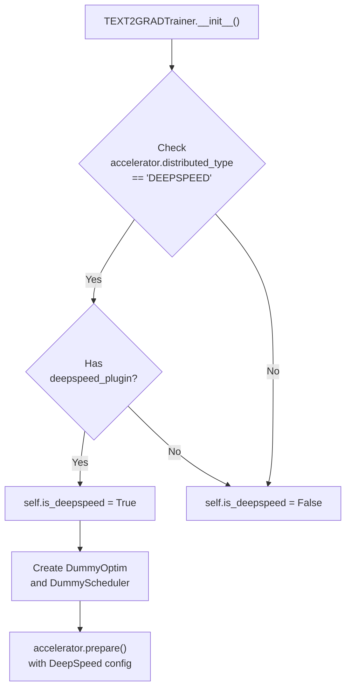
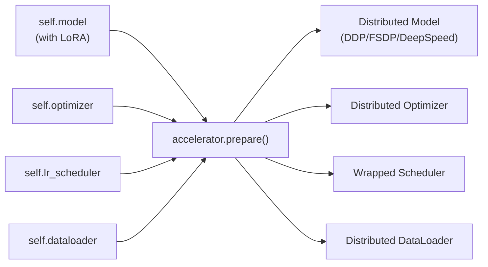
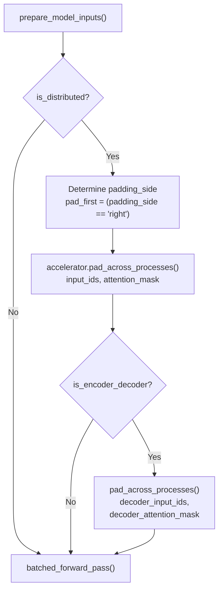
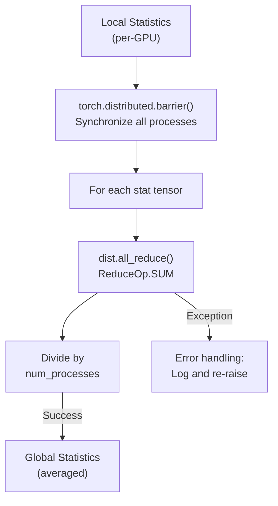
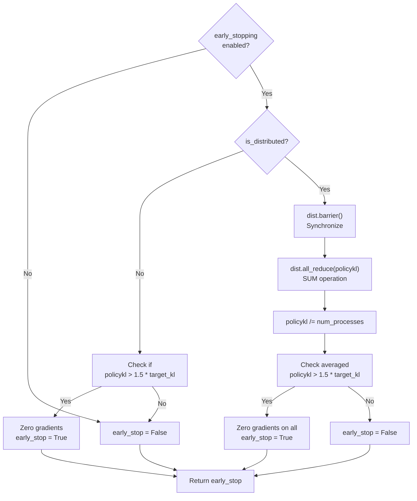
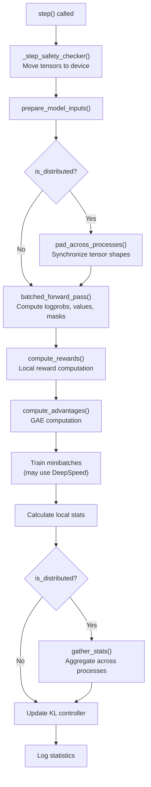

<!-- source: DeepWiki mcp.deepwiki.com · repo microsoft/Text2Grad · page 6.8 Distributed Training · fetched 2026-10-26 -->

# Distributed Training

<details>
<summary>Relevant source files</summary>

The following files were used as context for generating this wiki page:

- [nl_gradiant_policy_optimization/slf5k/text2grad_trainer.py](nl_gradiant_policy_optimization/slf5k/text2grad_trainer.py)
- [nl_gradiant_policy_optimization/slf5k/train.py](nl_gradiant_policy_optimization/slf5k/train.py)
- [nl_gradiant_policy_optimization/ultrafeedback/text2grad_trainer.py](nl_gradiant_policy_optimization/ultrafeedback/text2grad_trainer.py)

</details>


## Purpose and Scope

This page documents the distributed training implementation in Text2Grad's `TEXT2GRADTrainer`, focusing on multi-GPU and multi-node coordination mechanisms. The system uses HuggingFace Accelerate as the primary abstraction layer with optional DeepSpeed integration for memory optimization.

For training configuration parameters, see [PPO Training Loop](#6.2). For checkpoint management across distributed processes, see [Checkpoint Management](#6.7).

---

## Overview

Text2Grad's distributed training architecture coordinates multiple GPUs/nodes to train policy models efficiently. The implementation handles:

- Process synchronization and communication
- Tensor padding and data distribution
- Statistics aggregation across devices
- DeepSpeed ZeRO optimization compatibility
- Error recovery and early stopping coordination

The core implementation resides in `TEXT2GRADTrainer.__init__()` and related methods across task-specific trainers.

**Sources:** [nl_gradiant_policy_optimization/ultrafeedback/text2grad_trainer.py:104-388](), [nl_gradiant_policy_optimization/slf5k/text2grad_trainer.py:103-286]()

---

## Initialization and Configuration

### Accelerator Setup

The `TEXT2GRADTrainer` initializes distributed training through the Accelerate `Accelerator` object:

```python
self.accelerator = Accelerator(
    log_with=config.log_with,
    gradient_accumulation_steps=config.gradient_accumulation_steps,
    project_config=ProjectConfiguration(**config.project_kwargs),
    **config.accelerator_kwargs,
)
```

**Key Configuration Parameters:**

| Parameter | Purpose | Source |
|-----------|---------|--------|
| `config.world_size` | Total number of processes | Set from `accelerator.num_processes` |
| `config.global_backward_batch_size` | Backward batch size × world_size | Calculated for gradient accumulation |
| `config.global_batch_size` | Batch size × world_size | Total samples processed per step |
| `self.is_distributed` | Flag for multi-GPU mode | True if `num_processes > 1` |

The trainer automatically detects the distributed configuration and sets global batch sizes:

[nl_gradiant_policy_optimization/ultrafeedback/text2grad_trainer.py:187-196]()

**Sources:** [nl_gradiant_policy_optimization/ultrafeedback/text2grad_trainer.py:187-196](), [nl_gradiant_policy_optimization/slf5k/text2grad_trainer.py:130-139]()

---

### DeepSpeed Detection and Integration

**DeepSpeed Detection Flow:**



The trainer detects DeepSpeed at lines [nl_gradiant_policy_optimization/ultrafeedback/text2grad_trainer.py:307-309]():

```python
is_deepspeed_used = self.accelerator.distributed_type == "DEEPSPEED" and hasattr(
    self.accelerator.state, "deepspeed_plugin"
)
```

When DeepSpeed is detected, the trainer creates `DummyOptim` and `DummyScheduler` wrappers that DeepSpeed requires for its internal optimizer management:

[nl_gradiant_policy_optimization/ultrafeedback/text2grad_trainer.py:311-356]()

**DeepSpeed-Specific Considerations:**

- Uses ZeRO optimization (typically Stage 3) for memory efficiency
- Requires special dummy optimizer/scheduler wrappers
- Handles optimizer state partitioning automatically
- Reference model may need separate DeepSpeed initialization (slf5k implementation)

**Sources:** [nl_gradiant_policy_optimization/ultrafeedback/text2grad_trainer.py:307-388](), [nl_gradiant_policy_optimization/slf5k/text2grad_trainer.py:236-261]()

---

## Model and Optimizer Preparation

### Accelerator.prepare() Workflow

**Preparation Sequence:**



The trainer wraps all training components with `accelerator.prepare()`:

[nl_gradiant_policy_optimization/ultrafeedback/text2grad_trainer.py:359-381]()

This method:
1. Wraps the model in the appropriate distributed wrapper (DDP, FSDP, or DeepSpeed)
2. Distributes optimizer states across devices
3. Ensures the learning rate scheduler is synchronized
4. Creates a distributed-aware dataloader with proper sampling

**Device Assignment:**

After preparation, the trainer determines the current device:

```python
self.current_device = self.accelerator.device
self.is_distributed = self.accelerator.num_processes > 1
```

[nl_gradiant_policy_optimization/ultrafeedback/text2grad_trainer.py:383-385]()

**Sources:** [nl_gradiant_policy_optimization/ultrafeedback/text2grad_trainer.py:359-385](), [nl_gradiant_policy_optimization/slf5k/text2grad_trainer.py:240-262]()

---

## Data Synchronization in Training

### Tensor Padding Across Processes

During the PPO training step, input tensors must have consistent shapes across all GPUs. The trainer handles this with `pad_across_processes()`:

**Padding Flow in step():**



Implementation at [nl_gradiant_policy_optimization/ultrafeedback/text2grad_trainer.py:721-748]():

```python
if self.is_distributed:
    pad_first = self.tokenizer.padding_side == "right"
    
    model_inputs["input_ids"] = self.accelerator.pad_across_processes(
        model_inputs["input_ids"],
        dim=1,
        pad_index=self.tokenizer.pad_token_id,
        pad_first=pad_first,
    )
    model_inputs["attention_mask"] = self.accelerator.pad_across_processes(
        model_inputs["attention_mask"], dim=1, pad_index=0, pad_first=pad_first
    )
```

**Why Padding is Necessary:**

- Different GPUs may receive batches with varying sequence lengths
- DDP/FSDP require uniform tensor shapes for collective operations
- Padding ensures all processes can proceed with forward/backward passes synchronously

**Sources:** [nl_gradiant_policy_optimization/ultrafeedback/text2grad_trainer.py:721-748](), [nl_gradiant_policy_optimization/slf5k/text2grad_trainer.py:675-699]()

---

## Statistics Gathering and Aggregation

### gather_stats() Method

After each training step, statistics are collected from all processes and aggregated:

**Statistics Aggregation Process:**



Implementation:

[nl_gradiant_policy_optimization/ultrafeedback/text2grad_trainer.py:1053-1067]()

```python
def gather_stats(self, stats):
    import torch.distributed as dist
    
    dist.barrier()  # Synchronize all processes
    
    for k, v in stats.items():
        if isinstance(v, torch.Tensor):
            try:
                dist.all_reduce(v.to(self.accelerator.device), dist.ReduceOp.SUM)
                v /= self.accelerator.num_processes
            except Exception as e:
                print(f"Error in gather_stats for key {k}: {e}")
                raise
            stats[k] = v
    return stats
```

**Key Operations:**

| Operation | Purpose |
|-----------|---------|
| `dist.barrier()` | Ensures all processes reach this point before proceeding |
| `dist.all_reduce()` | Sums tensors across all processes |
| Division by `num_processes` | Computes mean across processes |

**Usage in Training Step:**

[nl_gradiant_policy_optimization/ultrafeedback/text2grad_trainer.py:984-987]()

```python
if self.is_distributed:
    stats = self.gather_stats(stats)
stats = stats_to_np(stats)
```

**Sources:** [nl_gradiant_policy_optimization/ultrafeedback/text2grad_trainer.py:1053-1067](), [nl_gradiant_policy_optimization/slf5k/text2grad_trainer.py:913-933]()

---

## Early Stopping Coordination

### Multi-GPU Early Stop Logic

The `_early_stop()` method ensures all processes agree on whether to stop training early based on KL divergence:

**Early Stopping Decision Flow:**



Implementation:

[nl_gradiant_policy_optimization/ultrafeedback/text2grad_trainer.py:1020-1051]()

```python
def _early_stop(self, policykl):
    early_stop = False
    if not self.config.early_stopping:
        return early_stop
    
    if not self.is_distributed and policykl > 1.5 * self.config.target_kl:
        self.optimizer.zero_grad()
        early_stop = True
    elif self.is_distributed:
        import torch.distributed as dist
        
        dist.barrier()
        
        dist.all_reduce(policykl, dist.ReduceOp.SUM)
        policykl /= self.accelerator.num_processes
        
        if policykl > 1.5 * self.config.target_kl:
            self.optimizer.zero_grad()
            early_stop = True
    return early_stop
```

**Critical Aspects:**

1. **Consensus Decision**: All processes must agree on early stopping
2. **Averaged KL**: Uses mean KL divergence across all processes
3. **Synchronized Gradients**: Zeros gradients on all processes when stopping
4. **Barrier Synchronization**: Ensures no process proceeds until all are ready

**Sources:** [nl_gradiant_policy_optimization/ultrafeedback/text2grad_trainer.py:1020-1051](), [nl_gradiant_policy_optimization/slf5k/text2grad_trainer.py:880-911]()

---

## Training Step with Distributed Coordination

### Complete Distributed Step Flow

**End-to-End Training Step Coordination:**



### DeepSpeed-Specific Training Path

When DeepSpeed is enabled, the minibatch training differs:

[nl_gradiant_policy_optimization/ultrafeedback/text2grad_trainer.py:881-927]()

```python
if hasattr(self, 'is_deepspeed') and self.is_deepspeed:
    model_inputs = {k: mini_batch_dict[k] for k in model_inputs_names}
    
    logprobs, logits, vpreds, _, _ = self.batched_forward_pass(
        self.model,
        mini_batch_dict["queries"],
        mini_batch_dict["responses"],
        model_inputs,
        return_logits=True,
    )
    train_stats, loss_p, loss_v = self.train_minibatch(
        mini_batch_dict["logprobs"],
        mini_batch_dict["values"],
        logprobs,
        logits,
        vpreds,
        mini_batch_dict["masks"],
        mini_batch_dict["advantages"],
        mini_batch_dict["returns"],
        mask_loss
    )
else:
    with self.accelerator.accumulate(self.model):
        # Standard gradient accumulation path
        ...
```

**Key Differences:**

- **DeepSpeed Path**: No explicit `accelerator.accumulate()` context
- **Standard Path**: Uses `accelerator.accumulate()` for gradient accumulation
- Both paths call the same `train_minibatch()` for loss computation and backprop

**Sources:** [nl_gradiant_policy_optimization/ultrafeedback/text2grad_trainer.py:663-1018](), [nl_gradiant_policy_optimization/slf5k/text2grad_trainer.py:615-878]()

---

## Error Handling in Distributed Context

### Distributed Error Recovery

The trainer includes defensive error handling for distributed failures:

[nl_gradiant_policy_optimization/ultrafeedback/text2grad_trainer.py:1013-1018]()

```python
except Exception as e:
    if self.is_distributed:
        import torch.distributed as dist
        dist.barrier()
    print(f"Error in step: {e}")
    raise
```

**Purpose:**

- Prevents deadlocks when one process encounters an error
- `dist.barrier()` ensures all processes are aware of the failure
- Allows for graceful shutdown or error logging across all ranks

### Statistics Gathering Error Handling

In `gather_stats()`, errors during aggregation are caught and reported:

[nl_gradiant_policy_optimization/ultrafeedback/text2grad_trainer.py:1060-1065]()

```python
try:
    dist.all_reduce(v.to(self.accelerator.device), dist.ReduceOp.SUM)
    v /= self.accelerator.num_processes
except Exception as e:
    print(f"Error in gather_stats for key {k}: {e}")
    raise
```

**Sources:** [nl_gradiant_policy_optimization/ultrafeedback/text2grad_trainer.py:1013-1018, 1060-1065]()

---

## Code Entity Reference

**Key Classes and Methods:**

| Entity | Location | Purpose |
|--------|----------|---------|
| `TEXT2GRADTrainer` | text2grad_trainer.py:104 (UF), :96 (slf5k) | Main trainer class with distributed support |
| `Accelerator` | Line 187 (UF), 130 (slf5k) | HuggingFace distributed training abstraction |
| `accelerator.prepare()` | Line 366-371 (UF), 246-252 (slf5k) | Wraps models/optimizers for distributed training |
| `accelerator.pad_across_processes()` | Line 724-732 (UF), 678-686 (slf5k) | Synchronizes tensor shapes across GPUs |
| `gather_stats()` | Line 1053 (UF), 913 (slf5k) | Aggregates statistics using all_reduce |
| `_early_stop()` | Line 1020 (UF), 880 (slf5k) | Coordinates early stopping decisions |
| `DummyOptim` | Line 272, 320, 330 (UF) | DeepSpeed-compatible optimizer wrapper |
| `DummyScheduler` | Line 346 (UF) | DeepSpeed-compatible scheduler wrapper |

**Distributed Training Configuration:**

| Attribute | Type | Set At | Purpose |
|-----------|------|--------|---------|
| `self.is_distributed` | bool | Line 385 (UF), 262 (slf5k) | Flag for multi-GPU mode |
| `self.is_deepspeed` | bool | Line 387 (UF) | Flag for DeepSpeed usage |
| `config.world_size` | int | Line 194 (UF), 137 (slf5k) | Number of processes |
| `config.global_batch_size` | int | Line 196 (UF), 139 (slf5k) | Total batch size across GPUs |
| `self.current_device` | torch.device | Line 383 (UF), 274-281 (slf5k) | Device for current process |

**Sources:** [nl_gradiant_policy_optimization/ultrafeedback/text2grad_trainer.py:104-1068](), [nl_gradiant_policy_optimization/slf5k/text2grad_trainer.py:96-1638]()

---

## Performance Considerations

### Memory Optimization

**Distributed Training Memory Benefits:**

1. **Model Parallelism** (DeepSpeed ZeRO-3):
   - Parameters distributed across GPUs
   - Only active parameters loaded per GPU
   - Reduces per-GPU memory footprint

2. **Data Parallelism** (DDP/FSDP):
   - Each GPU processes different batch samples
   - Effective batch size increases linearly with GPUs
   - Gradient synchronization occurs once per backward pass

3. **Gradient Accumulation**:
   - `config.gradient_accumulation_steps` allows larger effective batch sizes
   - Gradients accumulated locally before synchronization
   - Reduces communication overhead

### Communication Overhead

**Key Synchronization Points:**

| Operation | Frequency | Communication Type |
|-----------|-----------|-------------------|
| Gradient all-reduce | Every backward pass | All-to-all |
| `pad_across_processes()` | Once per step | All-gather |
| `gather_stats()` | Once per step | All-reduce |
| `dist.barrier()` | On early stop, errors | Barrier |

**Optimization Strategies:**

- Use larger `backward_batch_size` to reduce sync frequency
- Enable gradient accumulation to batch communication
- Avoid unnecessary `barrier()` calls in hot paths
- Use efficient tensor padding (right-padding is faster)

**Sources:** [nl_gradiant_policy_optimization/ultrafeedback/text2grad_trainer.py:187-196, 721-748, 1053-1067]()

---

## Debugging Distributed Training

### Common Issues and Solutions

**Problem: Deadlocks during training**

- **Cause**: One process waits at `barrier()` while another is stuck
- **Solution**: Check logs from all ranks, ensure all processes reach sync points
- **Code reference**: [text2grad_trainer.py:1014-1018]() shows barrier in error handling

**Problem: Shape mismatch errors**

- **Cause**: Tensors not padded consistently across processes
- **Solution**: Verify `pad_across_processes()` is called before forward pass
- **Code reference**: [text2grad_trainer.py:721-748]()

**Problem: Statistics are incorrect**

- **Cause**: Forgetting to call `gather_stats()` or improper averaging
- **Solution**: Ensure division by `num_processes` after all_reduce
- **Code reference**: [text2grad_trainer.py:1062]()

### Logging and Monitoring

The trainer logs distributed-specific information:

[nl_gradiant_policy_optimization/ultrafeedback/text2grad_trainer.py:311]()

```python
print(f"Creating DummyOptim for DeepSpeed compatibility (distributed: {self.accelerator.num_processes > 1})")
```

Monitor these key metrics:
- `config.world_size`: Should match expected number of GPUs
- `config.global_batch_size`: Verify correct scaling
- Statistics after `gather_stats()`: Should be averaged across ranks

**Sources:** [nl_gradiant_policy_optimization/ultrafeedback/text2grad_trainer.py:311-356, 984-1018]()

---

