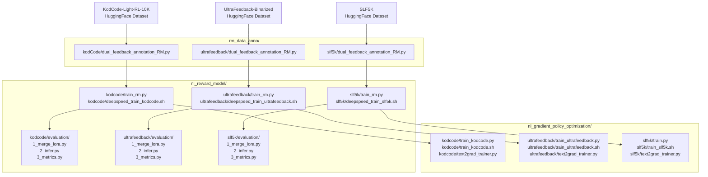
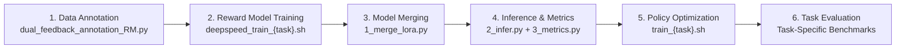
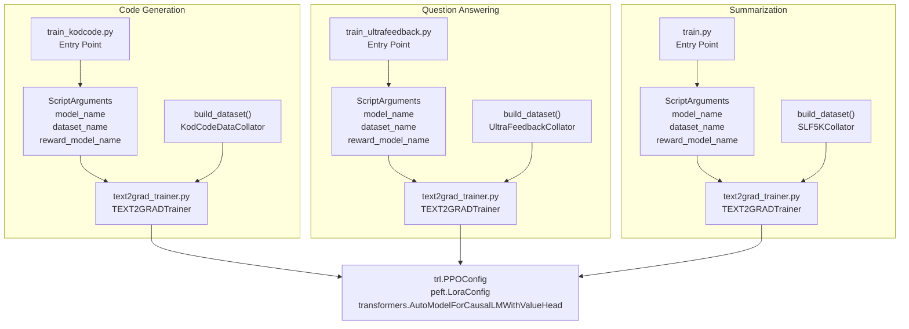

<!-- source: DeepWiki mcp.deepwiki.com · repo microsoft/Text2Grad · page 7 Task-Specific Guides · fetched 2026-10-26 -->

# Task-Specific Guides

<details>
<summary>Relevant source files</summary>

The following files were used as context for generating this wiki page:

- [README.md](README.md)

</details>


## Purpose and Scope

This section provides an overview of the three task-specific implementations in Text2Grad: Code Generation (KodCode), Question Answering (UltraFeedback), and Summarization (SLF5K). Each task follows the same three-component architecture (Data Annotation → Reward Model → Policy Optimization) but with task-specific configurations, datasets, and evaluation metrics.

This page introduces the common patterns and key differences across tasks. For detailed step-by-step guides on each task, see:
- [Code Generation (KodCode)](#7.1)
- [Question Answering (UltraFeedback)](#7.2)
- [Summarization (SLF5K)](#7.3)

For general architecture information, see [System Architecture](#3) and [Three-Component Pipeline](#3.1).

---

## Task Overview

Text2Grad supports three distinct NLP tasks, each representing a different domain of language model optimization:

| Task | Domain | Dataset | Primary Metric | Challenge |
|------|--------|---------|----------------|-----------|
| **Code Generation** | Programming | KodCode-Light-RL-10K | HumanEval+/MBPP+ Pass@1 | Functional correctness, syntax errors |
| **Question Answering** | Instruction Following | UltraFeedback-Binarized | MT-Bench, ARC-C | Response quality, reasoning |
| **Summarization** | Text Generation | SLF5K | ROUGE, BERTScore, GPT-4 | Factual accuracy, conciseness |

Each task is self-contained with its own directory structure, training scripts, and evaluation pipelines, but all share the same underlying TEXT2GRADTrainer architecture (see [TEXT2GRADTrainer Architecture](#6.1)).

**Sources:** [README.md:94-124](), [README.md:297-353]()

---

## Directory Structure and File Mapping

The following diagram shows how the three tasks map to specific directories and files in the codebase:



Each task follows the same three-phase structure but with independent implementations. The `dual_feedback_annotation_RM.py` scripts process task-specific input formats, the `train_rm.py` scripts train domain-specific reward models, and the training scripts in `nl_gradient_policy_optimization/` use the TEXT2GRADTrainer with task-specific configurations.

**Sources:** [README.md:127-145](), [README.md:149-294]()

---

## Common Pipeline Pattern

All three tasks follow an identical execution pattern:



### Phase 1: Data Annotation
- **Script:** `rm_data_anno/{task}/dual_feedback_annotation_RM.py`
- **Input:** Task-specific JSON format (see below)
- **Output:** Dual-feedback annotations with spans and critiques
- **Command:** `python dual_feedback_annotation_RM.py --data_path path/to/data`

### Phase 2: Reward Model Training
- **Script:** `nl_reward_model/{task}/train_rm.py`
- **Launch:** `bash deepspeed_train_{task}.sh`
- **Configuration:** LoRA (r=16, alpha=32), DeepSpeed ZeRO Stage 3
- **Output:** Adapter weights in `ckpt/` directory

### Phase 3: Reward Model Evaluation
- **Scripts:** 
  - `1_merge_lora.py` - Combines LoRA adapters with base model
  - `2_infer.py` - Runs batch inference on test data
  - `3_metrics.py` - Calculates word-level and span-level metrics

### Phase 4: Policy Optimization
- **Script:** `nl_gradient_policy_optimization/{task}/train_{task}.py`
- **Launch:** `bash train_{task}.sh`
- **Trainer:** `text2grad_trainer.py` (task-specific implementation)
- **Output:** Optimized policy model with NL-gradient updates

### Phase 5: Final Evaluation
- **KodCode:** EvalPlus framework (HumanEval+, MBPP+)
- **UltraFeedback:** MT-Bench, ARC-C, AlpacaEval 2.0
- **SLF5K:** ROUGE, BLEU, BERTScore, GPT-4-as-judge

**Sources:** [README.md:147-294]()

---

## Task-Specific Data Formats

Each task requires a specific JSON input format for the annotation pipeline:

### KodCode Input Format
```json
{
    "version": "v1.0",
    "style": "instruct",
    "subset": "Leetcode",
    "question_id": "Leetcode_36406_I",
    "question": "You are given a 0-indexed...",
    "solution": "def max_height_diff_after_removal(heights):\n  ...",
    "test": "def test_max_height_diff_after_removal_all_equal():\n    ...",
    "gpt_pass_trial_num": 2,
    "gpt_difficulty": "hard",
    "gpt_pass_percentage": 0.2,
    "log": "..."
}
```

**Key Fields:**
- `question`: Problem description
- `solution`: Generated code
- `test`: Test cases for validation
- `log`: Execution feedback

### UltraFeedback Input Format
```json
{
    "prompt": "In this task, you are given...",
    "prompt_id": "333685aaf217d34921dac65dbea023fe1180b5c1973dbb6554bc022d74b54e0c",
    "score_chosen": 4.0,
    "score_rejected": 4.0,
    "response": [
        {"content": "...", "role": "user"},
        {"content": "...", "role": "assistant"}
    ],
    "is_chosen": true,
    "score": 4.0,
    "critique": ""
}
```

**Key Fields:**
- `prompt`: User instruction
- `response`: Conversation turns
- `is_chosen`: Binary preference label
- `score_chosen`/`score_rejected`: Quality ratings

### SLF5K Input Format
```json
{
    "t3_132suw": {
        "generated_summary": "My girlfriend is premed and ...",
        "Post": "My girlfriend is studying something she won't ever use ..."
    }
}
```

**Key Fields:**
- `Post`: Original document
- `generated_summary`: Model-generated summary

**Sources:** [README.md:160-217]()

---

## Task-Specific Training Script Mapping

The following diagram maps each task to its specific training entry points and key classes:



### Script Arguments (`ScriptArguments` class)

Each training script instantiates a `ScriptArguments` dataclass with task-specific values:

| Parameter | KodCode | UltraFeedback | SLF5K |
|-----------|---------|---------------|-------|
| `model_name` | deepseek-ai/deepseek-coder-1.3b-base | meta-llama/Llama-3.1-8B-Instruct | meta-llama/Llama-3.1-8B-Instruct |
| `dataset_name` | KodCode/KodCode-Light-RL-10K | HuggingFaceH4/ultrafeedback_binarized | JeremyAlain/SLF5K |
| `reward_model_name` | path/to/kodcode/reward/model | path/to/ultrafeedback/reward/model | path/to/slf5k/reward/model |
| `output_dir` | ./checkpoints/kodcode | ./checkpoints/ultrafeedback | ./checkpoints/slf5k |

### Common Trainer Interface

All three tasks use the same `TEXT2GRADTrainer` base class with these key methods:
- `step()` - Execute one PPO training step
- `generate()` - Generate responses using the policy model
- `_get_reward()` - Query the reward model for span-level feedback
- `compute_rewards()` - Convert feedback to token-level rewards
- `save_pretrained()` - Save checkpoints

The task-specific implementations differ in:
1. **Prompt formatting** for reward model queries
2. **Data collators** for batch preparation
3. **Generation parameters** (max_new_tokens, temperature)
4. **Evaluation metrics** and benchmarks

**Sources:** [README.md:276-294]()

---

## Key Differences Across Tasks

### Generation Parameters

| Parameter | KodCode | UltraFeedback | SLF5K |
|-----------|---------|---------------|-------|
| `max_new_tokens` | 256-512 | 512-1024 | 128-256 |
| `temperature` | 0.7 | 0.8 | 0.9 |
| `top_p` | 0.9 | 0.9 | 0.95 |
| Reasoning | Code requires precision | Longer explanatory responses | Concise summaries |

### Reward Model Output Format

**KodCode:**
```json
{
    "critique": "The function has a syntax error...",
    "error_spans": ["def max_height_diff", "return result"],
    "correct_spans": ["heights[i]"]
}
```

**UltraFeedback:**
```json
{
    "critique": "Response lacks detail...",
    "good_spans": ["correct explanation", "helpful example"],
    "poor_spans": ["unclear phrasing", "incorrect fact"]
}
```

**SLF5K:**
```json
{
    "critique": "Summary is too verbose...",
    "feedback": "Remove redundant information",
    "word_scores": [-1, 0, 1, 0, -1, ...]
}
```

### Evaluation Metrics

**Code Generation (KodCode):**
- **Primary:** Pass@1, Pass@10 on HumanEval+/MBPP+
- **Secondary:** Syntax error rate, compilation success
- **Tools:** EvalPlus framework with sandboxed execution

**Question Answering (UltraFeedback):**
- **Primary:** MT-Bench score (multi-turn conversation)
- **Secondary:** ARC-C accuracy (reasoning), AlpacaEval 2.0 win rate
- **Metrics:** Span-level precision/recall/F1

**Summarization (SLF5K):**
- **Primary:** ROUGE-1/2/L, BERTScore
- **Secondary:** BLEU, perplexity, GPT-4-as-judge
- **Metrics:** Word-level accuracy, text similarity

**Sources:** [README.md:297-353]()

---

## Workflow Execution Commands

The following table provides the complete command sequence for each task:

| Phase | KodCode | UltraFeedback | SLF5K |
|-------|---------|---------------|-------|
| **Annotation** | `cd rm_data_anno/kodCode && python dual_feedback_annotation_RM.py` | `cd rm_data_anno/ultrafeedback && python dual_feedback_annotation_RM.py` | `cd rm_data_anno/slf5k && python dual_feedback_annotation_RM.py` |
| **RM Training** | `cd nl_reward_model/kodcode && bash deepspeed_train_kodcode.sh` | `cd nl_reward_model/ultrafeedback && bash deepspeed_train_ultrafeedback.sh` | `cd nl_reward_model/slf5k && bash deepspeed_train_slf5k.sh` |
| **RM Merge** | `cd nl_reward_model/kodcode/evaluation && python 1_merge_lora.py` | `cd nl_reward_model/ultrafeedback/evaluation && python 1_merge_lora.py` | `cd nl_reward_model/slf5k/evaluation && python 1_merge_lora.py` |
| **RM Inference** | `python 2_infer.py --model_path ... --dataset_path ...` | `python 2_infer.py --model_path ... --dataset_path ...` | `python 2_infer.py --model_path ... --dataset_path ...` |
| **RM Metrics** | `python 3_metrics.py --input_file ... --output_file ...` | `python 3_metrics.py --input_file ... --output_file ...` | `python 3_metrics.py --input_file ... --output_file ...` |
| **Policy Training** | `cd nl_gradient_policy_optimization/kodcode && bash train_kodcode.sh` | `cd nl_gradient_policy_optimization/ultrafeedback && bash train_ultrafeedback.sh` | `cd nl_gradient_policy_optimization/slf5k && bash train_slf5k.sh` |

### Required Parameters

Each script requires specific parameters. Common parameters across tasks:

```bash
# Reward Model Training (all tasks)
--model_name_or_path "meta-llama/Llama-3.1-8B-Instruct"
--data_path "path/to/annotated/data.json"
--output_dir "./ckpt/{task}-reward-model"
--num_train_epochs 3
--per_device_train_batch_size 4
--learning_rate 5e-5

# Policy Optimization (all tasks)
--model_name "base-model-name"
--dataset_name "dataset-hub-name"
--reward_model_name "path/to/trained/reward/model"
--output_dir "./checkpoints/{task}-policy"
--learning_rate 1e-5
--kl_penalty "kl"
--init_kl_coef 0.2
```

**Sources:** [README.md:222-273]()

---

## Implementation Details by Component

### Data Annotation Scripts

Each `dual_feedback_annotation_RM.py` script:
1. Loads task-specific input JSON
2. Calls OpenAI API to generate critiques
3. Identifies good/poor spans in the text
4. Outputs dual-feedback format for RM training

**Location:** [rm_data_anno/{task}/dual_feedback_annotation_RM.py]()

### Reward Model Training Scripts

Each `train_rm.py` script:
1. Loads annotated data into `QACDataset`
2. Initializes base model with LoRA adapters
3. Configures DeepSpeed with ZeRO Stage 3
4. Trains to predict spans and generate critiques
5. Saves adapter weights to checkpoints

**Location:** [nl_reward_model/{task}/train_rm.py]()

### Policy Optimization Scripts

Each training script (`train_kodcode.py`, `train_ultrafeedback.py`, `train.py`):
1. Initializes `TEXT2GRADTrainer` with policy and reward models
2. Builds dataset with task-specific collator
3. Runs PPO loop with NL-gradient updates
4. Logs to WandB and saves checkpoints
5. Evaluates on validation set periodically

**Location:** [nl_gradient_policy_optimization/{task}/train_{task}.py]()

**Sources:** [README.md:127-294]()

---

## Next Steps

For detailed implementation guides on each task:
- [Code Generation (KodCode)](#7.1) - Complete walkthrough of code generation pipeline
- [Question Answering (UltraFeedback)](#7.2) - Span-based feedback for instruction following
- [Summarization (SLF5K)](#7.3) - Word-level optimization for summarization quality

For understanding the shared components:
- [TEXT2GRADTrainer Architecture](#6.1) - Core trainer implementation
- [Reward Processing Pipeline](#6.3) - How feedback becomes gradients
- [Checkpoint Management](#6.7) - Saving and loading trained models

---

