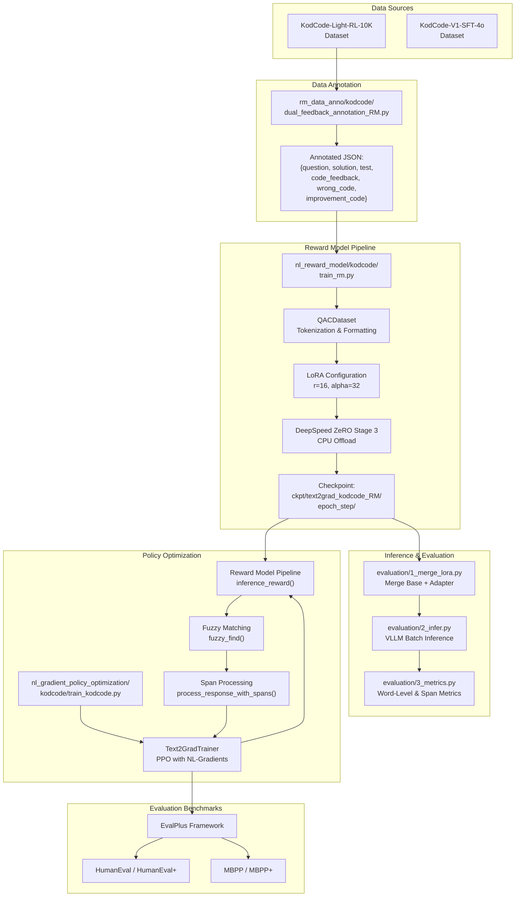
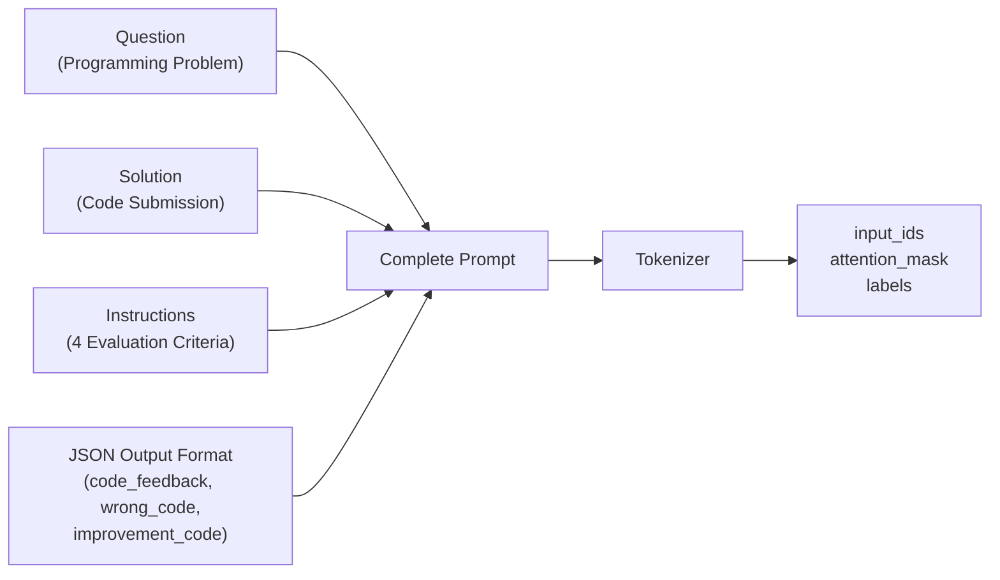
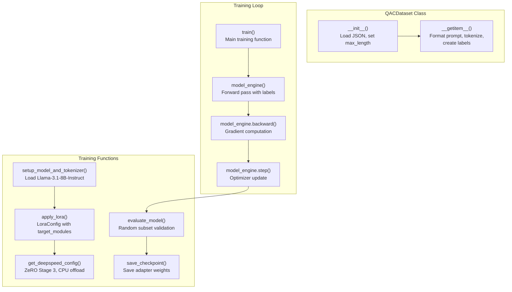
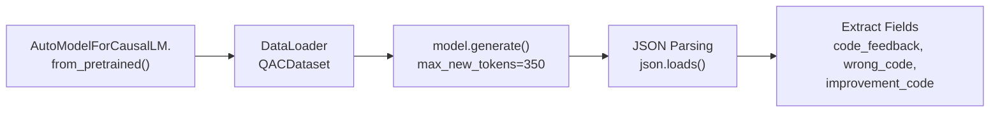
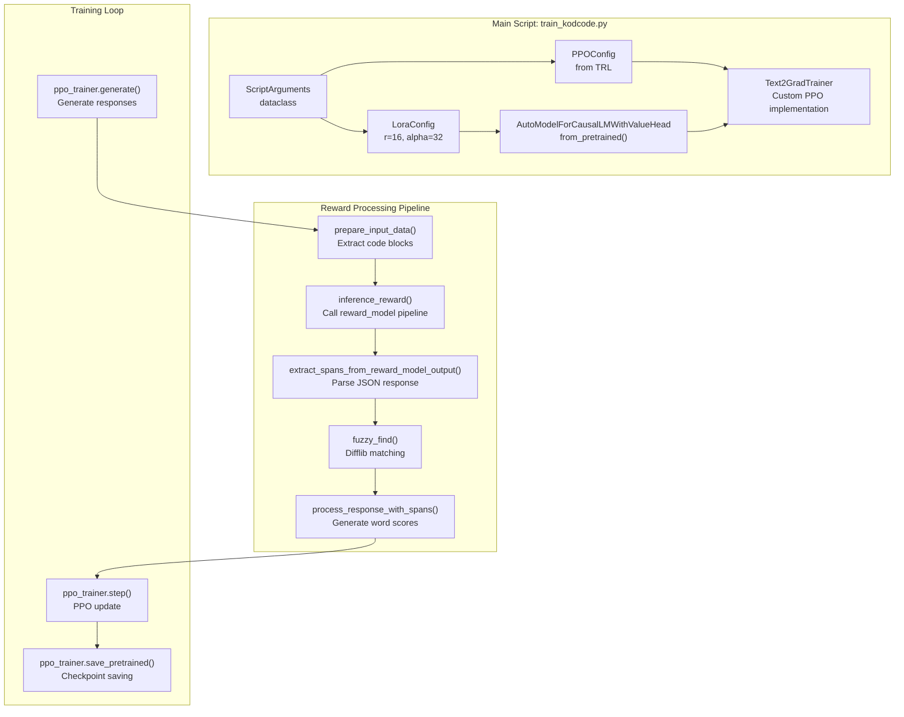
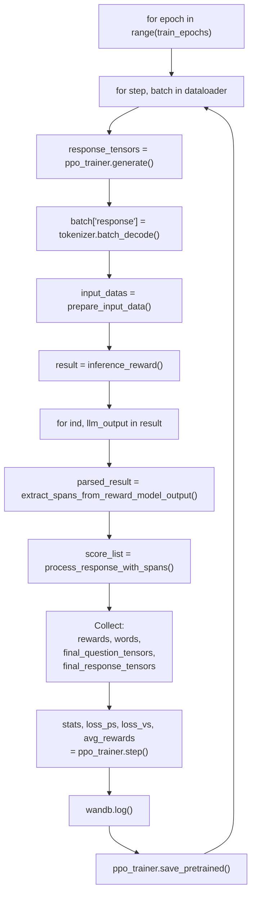
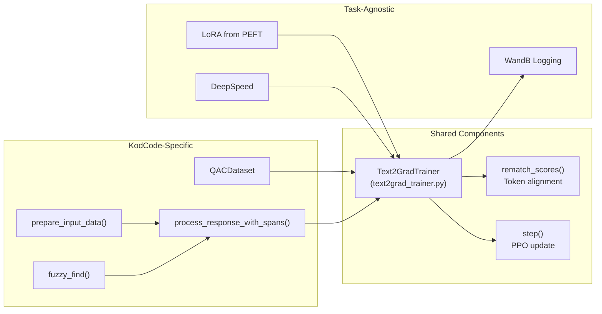

<!-- source: DeepWiki mcp.deepwiki.com · repo microsoft/Text2Grad · page 7.1 Code Generation (KodCode) · fetched 2026-10-26 -->

# Code Generation (KodCode)

<details>
<summary>Relevant source files</summary>

The following files were used as context for generating this wiki page:

- [README.md](README.md)
- [nl_gradiant_policy_optimization/kodcode/train_kodcode.py](nl_gradiant_policy_optimization/kodcode/train_kodcode.py)
- [nl_reward_model/kodcode/evaluation/2_infer.py](nl_reward_model/kodcode/evaluation/2_infer.py)
- [nl_reward_model/kodcode/train_rm.py](nl_reward_model/kodcode/train_rm.py)

</details>


## Purpose and Scope

This page provides a complete guide to using Text2Grad for code generation tasks with the KodCode dataset. It covers the end-to-end workflow from data annotation through reward model training, policy optimization, and evaluation using the EvalPlus benchmark suite.

For detailed information on specific aspects:
- Dataset format specifications: see [KodCode Dataset Format](#7.1.1)
- Reward model training details: see [KodCode Reward Model Training](#7.1.2)
- Policy optimization specifics: see [KodCode Policy Optimization](#7.1.3)
- Evaluation methodologies: see [KodCode Evaluation](#7.1.4)

For general system architecture: see [System Architecture](#3)

---

## Overview

The KodCode pipeline implements Text2Grad's three-component architecture specifically for Python code generation tasks. Unlike traditional RLHF approaches that provide scalar rewards, KodCode delivers **span-level feedback** identifying specific code snippets that contain errors (`wrong_code`) or could be improved (`improvement_code`), along with explanatory critiques (`code_feedback`).

The system evaluates generated code on four dimensions:
- **Correctness**: Absence of bugs and test passage
- **Efficiency**: Time and space complexity optimization
- **Readability**: Code structure and clarity
- **Completeness**: Edge case handling

**Sources:** [README.md:100-106](), [nl_reward_model/kodcode/train_rm.py:64-74]()

---

## KodCode Pipeline Architecture



**Diagram: Complete KodCode Pipeline from Data to Evaluation**

**Sources:** [README.md:127-145](), [README.md:220-273](), [README.md:335-343]()

---

## Directory Structure and Key Files

```
nl_reward_model/kodcode/
├── train_rm.py                    # Main training script with QACDataset
├── deepspeed_train_kodcode.sh     # DeepSpeed launch script
├── data/
│   └── KodCode/
│       ├── kodcode_RM.json        # Full annotated dataset
│       ├── kodcode_RM_train.json  # Training split
│       └── kodcode_RM_test.json   # Validation split
├── ckpt/
│   └── text2grad_kodcode_RM/      # Model checkpoints
└── evaluation/
    ├── 1_merge_lora.py            # LoRA weight merging
    ├── 2_infer.py                 # Batch inference script
    └── 3_metrics.py               # Metric calculation

nl_gradient_policy_optimization/kodcode/
├── train_kodcode.py               # PPO training with Text2GradTrainer
├── train_kodcode.sh               # Launch script
├── text2grad_trainer.py           # Core trainer implementation
└── utils.py                       # Helper functions
```

| Component | Purpose | Key Classes/Functions |
|-----------|---------|----------------------|
| `train_rm.py` | Reward model training | `QACDataset`, `train()`, `evaluate_model()` |
| `2_infer.py` | Model inference | `QACDataset`, `main()` |
| `train_kodcode.py` | Policy optimization | `QACDataset`, `prepare_input_data()`, `fuzzy_find()`, `process_response_with_spans()` |
| `text2grad_trainer.py` | PPO training loop | `Text2GradTrainer`, `step()`, `rematch_scores()` |

**Sources:** [README.md:127-145](), [nl_reward_model/kodcode/train_rm.py:1-427](), [nl_gradient_policy_optimization/kodcode/train_kodcode.py:1-1055]()

---

## Data Format and Processing

### Input Data Structure

The KodCode dataset uses a JSON format with the following fields:

```json
{
  "version": "v1.0",
  "style": "instruct",
  "subset": "Leetcode",
  "question_id": "Leetcode_36406_I",
  "question": "You are given a 0-indexed...",
  "solution": "def max_height_diff_after_removal(heights):\n  ...",
  "test": "def test_max_height_diff_after_removal_all_equal():\n    ...",
  "gpt_pass_trial_num": 2,
  "gpt_difficulty": "hard",
  "gpt_pass_percentage": 0.2
}
```

After dual-feedback annotation, additional fields are added:

```json
{
  "code_feedback": "The solution correctly implements...",
  "wrong_code": ["if len(heights) < 2:", "return heights[0] - heights[-1]"],
  "improvement_code": ["heights.sort()", "result = calculate_diff(heights)"]
}
```

**Sources:** [README.md:198-216](), [nl_reward_model/kodcode/train_rm.py:50-54]()

### Prompt Template

The `QACDataset` class formats data into a structured prompt:



**Diagram: Prompt Construction in QACDataset**

The template is defined in [nl_reward_model/kodcode/train_rm.py:56-85]() and [nl_reward_model/kodcode/evaluation/2_infer.py:32-61]() with identical structure for consistency between training and inference.

**Sources:** [nl_reward_model/kodcode/train_rm.py:47-122](), [nl_reward_model/kodcode/evaluation/2_infer.py:26-77]()

---

## Quick Start Guide

### Step 1: Data Annotation

```bash
cd rm_data_anno/kodcode
python dual_feedback_annotation_RM.py \
    --data_path path/to/kodcode_raw.json \
    --output_path path/to/kodcode_RM.json
```

### Step 2: Train Reward Model

```bash
cd nl_reward_model/kodcode
bash deepspeed_train_kodcode.sh
```

The training script initializes:
- Base model: `meta-llama/Llama-3.1-8B-Instruct`
- LoRA configuration: `r=16`, `lora_alpha=32`
- DeepSpeed ZeRO Stage 3 with CPU offloading
- Batch size: 2 per GPU
- Training for 3 epochs

Configuration is defined in [nl_reward_model/kodcode/train_rm.py:407-418]().

**Sources:** [README.md:223-233](), [nl_reward_model/kodcode/train_rm.py:405-423]()

### Step 3: Evaluate Reward Model

```bash
cd nl_reward_model/kodcode/evaluation

# Merge LoRA weights
python 1_merge_lora.py \
    --base_model "meta-llama/Llama-3.1-8B-Instruct" \
    --lora_model "../ckpt/text2grad_kodcode_RM/0_4400" \
    --save_dir "../ckpt/text2grad_kodcode_RM/0_4400_merge" \
    --merge_and_save True

# Run inference
python 2_infer.py \
    --model_path "../ckpt/text2grad_kodcode_RM/0_4400_merge" \
    --dataset_path "../data/KodCode/kodcode_test.json" \
    --output_file "inference_results_0_4400.json" \
    --batch_size 40 \
    --gpu_ids "0,1"

# Calculate metrics
python 3_metrics.py \
    --input_file "inference_results_0_4400.json" \
    --output_file "word_level_evaluation_results.json"
```

**Sources:** [README.md:237-267](), [nl_reward_model/kodcode/evaluation/2_infer.py:80-105]()

### Step 4: Train Policy with NL-Gradients

```bash
cd nl_gradient_policy_optimization/kodcode
bash train_kodcode.sh
```

Configuration in `ScriptArguments`:
- Base model: Pre-trained or SFT checkpoint
- Reward model: Merged checkpoint from Step 3
- Learning rate: `1e-5` (default)
- Batch size: 32
- PPO epochs: 4
- KL penalty coefficient: 0.2

**Sources:** [README.md:287-293](), [nl_gradient_policy_optimization/kodcode/train_kodcode.py:78-123]()

---

## Core Components and Code Entities

### Reward Model Training Components



**Diagram: Reward Model Training Code Flow**

| Function | Location | Purpose |
|----------|----------|---------|
| `QACDataset.__init__()` | [train_rm.py:25-42]() | Initialize dataset with JSON data and tokenizer |
| `QACDataset.__getitem__()` | [train_rm.py:47-122]() | Format data into training examples with labels |
| `prepare_datasets()` | [train_rm.py:124-157]() | Split dataset into train/validation sets |
| `setup_model_and_tokenizer()` | [train_rm.py:159-181]() | Load base Llama model and tokenizer |
| `apply_lora()` | [train_rm.py:183-207]() | Apply LoRA to `q_proj`, `k_proj`, `v_proj`, `o_proj` |
| `get_deepspeed_config()` | [train_rm.py:209-261]() | Configure ZeRO Stage 3 with optimizer offloading |
| `evaluate_model()` | [train_rm.py:263-306]() | Evaluate on 200 random validation samples |
| `save_checkpoint()` | [train_rm.py:308-323]() | Save model checkpoint with `save_pretrained()` |
| `train()` | [train_rm.py:325-403]() | Main training loop with WandB logging |

**Sources:** [nl_reward_model/kodcode/train_rm.py:22-427]()

### Inference Components

The inference pipeline follows this sequence:



**Diagram: Inference Pipeline in 2_infer.py**

Key inference parameters from [nl_reward_model/kodcode/evaluation/2_infer.py:155-161]():
- `max_new_tokens`: 350
- `pad_token_id`: Set to `eos_token_id`
- Multi-GPU support with `device_map="balanced"`

The parsing logic handles malformed JSON with fallback strategies at [nl_reward_model/kodcode/evaluation/2_infer.py:167-216]().

**Sources:** [nl_reward_model/kodcode/evaluation/2_infer.py:108-222]()

---

## Policy Optimization with Text2Grad

### Code Entity Mapping



**Diagram: Policy Optimization Code Structure**

**Sources:** [nl_gradient_policy_optimization/kodcode/train_kodcode.py:1-1055]()

### Key Functions

#### 1. `prepare_input_data()`

Located at [nl_gradient_policy_optimization/kodcode/train_kodcode.py:378-433](), this function:
- Extracts code blocks from generated responses using regex
- Formats the extracted code into the reward model prompt template
- Returns a list of formatted prompts ready for reward model inference

```python
# Regex patterns used:
r'```(?:python|py)?\n(.*?)```'  # Python code blocks
r'```(?:\w+)?\n(.*?)```'        # Generic code blocks
```

#### 2. `fuzzy_find()`

Located at [nl_gradient_policy_optimization/kodcode/train_kodcode.py:444-512](), implements fuzzy string matching:
- Uses `difflib.SequenceMatcher` for similarity computation
- Normalizes whitespace with `normalize_code_whitespace()`
- Default threshold: 0.8 (configurable)
- Fallback threshold: 0.64 (80% of default)
- Returns start and end positions in the original text

The function handles:
- Exact substring matching (fastest path)
- Anchor-based approximation for short patterns
- Full difflib matching with configurable step size

**Sources:** [nl_gradient_policy_optimization/kodcode/train_kodcode.py:436-512]()

#### 3. `process_response_with_spans()`

Located at [nl_gradient_policy_optimization/kodcode/train_kodcode.py:515-631](), this function:
- Takes generated response, `wrong_code` spans, and `improvement_code` spans
- Uses `fuzzy_find()` to locate each span in the response
- Assigns scores: `-1` for wrong_code, `0.0` for improvement_code, `1.0` for others
- Handles overlapping spans by merging and taking minimum score
- Returns word-level score list: `[(word, score), ...]`

Block-based processing logic:
1. Match and merge overlapping spans
2. Create blocks with assigned scores
3. Map blocks to word positions
4. Assign scores based on word centers

**Sources:** [nl_gradient_policy_optimization/kodcode/train_kodcode.py:515-631]()

#### 4. `extract_spans_from_reward_model_output()`

Located at [nl_gradient_policy_optimization/kodcode/train_kodcode.py:633-682](), provides robust parsing:
- Primary: `load_json_from_string()` with regex-based JSON extraction
- Fallback: Direct `json.loads()`
- Last resort: Regex extraction of individual fields

Returns dictionary:
```python
{
    "code_feedback": str,
    "wrong_code": List[str],
    "improvement_code": List[str]
}
```

**Sources:** [nl_gradient_policy_optimization/kodcode/train_kodcode.py:633-682]()

### Training Loop Structure

The main training loop at [nl_gradient_policy_optimization/kodcode/train_kodcode.py:803-1055]() implements:



**Diagram: Training Loop Execution Flow**

**Error Handling:**
- Sample-level try-catch blocks at [train_kodcode.py:855-948]()
- Step-level error logging at [train_kodcode.py:1033-1050]()
- Minimum valid samples check (8 samples required) at [train_kodcode.py:952-967]()

**Checkpointing:**
- Saves every `save_freq` steps (default: 5)
- Saves adapter model, value head, optimizer state, and lr_scheduler
- Path format: `{output_dir}/epoch_{epoch}_step_{step}/`
- Implementation at [train_kodcode.py:997-1030]()

**Sources:** [nl_gradient_policy_optimization/kodcode/train_kodcode.py:803-1055]()

---

## Configuration Reference

### ScriptArguments

Defined at [nl_gradient_policy_optimization/kodcode/train_kodcode.py:78-123]():

| Parameter | Default | Purpose |
|-----------|---------|---------|
| `base_model_name` | "" | Path to base LLM |
| `base_model_adapter_model` | "" | Path to adapter checkpoint for resuming |
| `reward_model_name` | "" | Path to trained reward model |
| `learning_rate` | 1e-5 | Optimizer learning rate |
| `batch_size` | 32 | Number of samples per batch |
| `mini_batch_size` | 1 | PPO minibatch size |
| `ppo_epochs` | 4 | Number of PPO update epochs per batch |
| `init_kl_coef` | 0.2 | Initial KL penalty coefficient |
| `adap_kl_ctrl` | True | Use adaptive KL control |
| `save_freq` | 5 | Steps between checkpoints |
| `prompt_max_length` | 1000 | Maximum prompt tokens |
| `answer_max_length` | 500 | Maximum response tokens |

### Generation Parameters

Defined at [nl_gradient_policy_optimization/kodcode/train_kodcode.py:346-354]():

```python
generation_kwargs = {
    "temperature": 0.6,
    "do_sample": True,
    "top_p": 1,
    "top_k": 0,
    "max_new_tokens": 256,
    "pad_token_id": tokenizer.pad_token_id,
    "eos_token_id": tokenizer.eos_token_id,
}
```

### Reward Model Inference Parameters

Defined at [nl_gradient_policy_optimization/kodcode/train_kodcode.py:357-362]():

```python
sent_kwargs = {
    "batch_size": script_args.batch_size,
    "max_new_tokens": 768,
    "pad_token_id": reward_tokenizer.eos_token_id,
    "eos_token_id": reward_tokenizer.eos_token_id,
}
```

**Sources:** [nl_gradient_policy_optimization/kodcode/train_kodcode.py:78-362]()

---

## Evaluation with EvalPlus

The KodCode system is evaluated using the EvalPlus framework, which tests code generation on:

- **HumanEval**: 164 programming problems
- **HumanEval+**: Extended test suite with additional edge cases
- **MBPP**: 974 mostly basic programming problems
- **MBPP+**: Extended MBPP with comprehensive tests

The evaluation measures **functional correctness** by executing generated code against test cases.

For detailed evaluation procedures and metrics, see [KodCode Evaluation](#7.1.4).

**Sources:** [README.md:335-343]()

---

## Integration with Text2Grad Framework

KodCode integrates with the broader Text2Grad system:



**Diagram: KodCode Integration with Shared Framework Components**

The `Text2GradTrainer` class (see [TEXT2GRADTrainer Architecture](#6.1)) provides the core PPO implementation that is reused across all tasks. KodCode-specific logic is primarily in:
- Dataset formatting (`QACDataset`)
- Reward model prompt template
- Code extraction and span matching functions

**Sources:** [nl_gradient_policy_optimization/kodcode/train_kodcode.py:314-323]()

---

