<!-- source: DeepWiki mcp.deepwiki.com · repo microsoft/Text2Grad · page 7.2 Question Answering (UltraFeedback) · fetched 2026-10-26 -->

# Question Answering (UltraFeedback)

<details>
<summary>Relevant source files</summary>

The following files were used as context for generating this wiki page:

- [README.md](README.md)
- [nl_gradiant_policy_optimization/ultrafeedback/train_ultrafeedback.py](nl_gradiant_policy_optimization/ultrafeedback/train_ultrafeedback.py)
- [nl_reward_model/ultrafeedback/evaluation/2_infer.py](nl_reward_model/ultrafeedback/evaluation/2_infer.py)

</details>


## Purpose and Scope

This document provides a comprehensive guide to the Question Answering task implementation using the UltraFeedback dataset in the Text2Grad framework. It covers the complete pipeline from data annotation through reward model training to policy optimization, with a focus on span-level feedback mechanisms for conversational AI models.

For dataset-specific formats, see [UltraFeedback Dataset Format](#7.2.1). For detailed reward model training procedures, see [UltraFeedback Reward Model](#7.2.2). For policy optimization specifics, see [UltraFeedback Policy Optimization](#7.2.3). For evaluation benchmarks, see [UltraFeedback Evaluation](#7.2.4).

## Task Overview

The UltraFeedback task focuses on improving conversational AI models through fine-grained span-level feedback. Unlike traditional RLHF approaches that provide scalar rewards for entire responses, this implementation identifies specific phrases within generated responses as either beneficial (`good_spans`) or problematic (`poor_spans`), enabling targeted improvements.

**Key Characteristics:**

| Aspect | Details |
|--------|---------|
| **Dataset** | HuggingFaceH4/ultrafeedback_binarized |
| **Task Type** | Open-domain question answering and instruction following |
| **Feedback Granularity** | Span-level with phrase identification |
| **Base Models** | Llama-3.1-8B-Instruct |
| **Evaluation Benchmarks** | MT-Bench, ARC-C, AlpacaEval 2.0 |

**Sources:** [README.md:109-114](), [README.md:173-196]()

## Dataset Structure

The UltraFeedback dataset contains user prompts with paired chosen/rejected responses and binary preference scores. The dual-feedback annotation process augments this with span-level annotations.

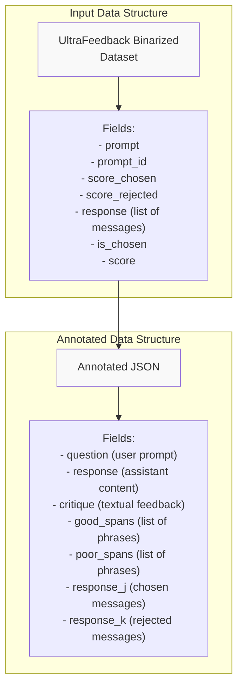

**Sources:** [README.md:173-196](), [nl_gradiant_policy_optimization/ultrafeedback/train_ultrafeedback.py:39-93]()

## Pipeline Architecture

The UltraFeedback implementation follows the standard three-component Text2Grad architecture with task-specific adaptations.

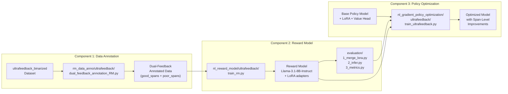

**Sources:** [README.md:131-146](), [README.md:227-233](), [README.md:286-293]()

## Key Code Components

### Training Script: `train_ultrafeedback.py`

The main training script orchestrates the entire PPO training loop with span-based rewards.

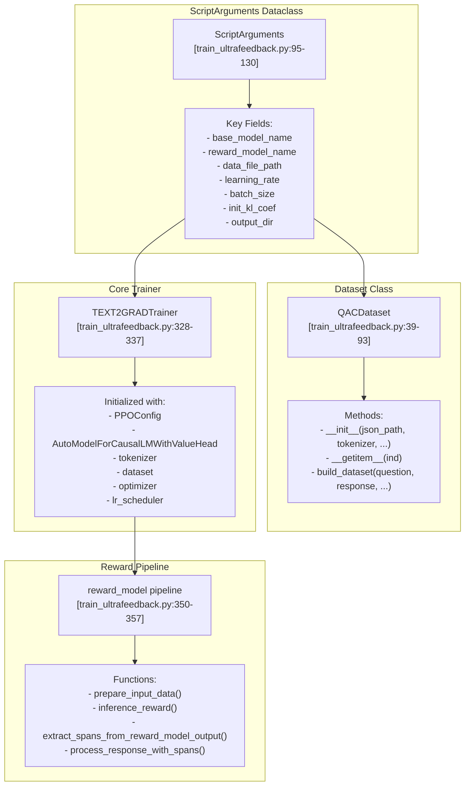

**Sources:** [nl_gradiant_policy_optimization/ultrafeedback/train_ultrafeedback.py:1-337]()

### Dataset Class: `QACDataset`

The `QACDataset` class handles data loading and preprocessing for question-answering-critique format.

**Key Methods:**

| Method | Purpose | Lines |
|--------|---------|-------|
| `__init__` | Loads JSON data and initializes tokenizer parameters | [39-47]() |
| `__getitem__` | Returns a single training example with question, response, and metadata | [52-68]() |
| `build_dataset` | Formats data with Llama-3 chat template and tokenizes | [70-92]() |

The `build_dataset` method applies the specific prompt template:
```
<|begin_of_text|><|start_header_id|>user<|end_header_id|>\n{question}\n<|eot_id|><|start_header_id|>assistant<|end_header_id|>\n
```

**Sources:** [nl_gradiant_policy_optimization/ultrafeedback/train_ultrafeedback.py:39-93]()

## Reward Processing Pipeline

The reward processing pipeline converts natural language feedback from the reward model into token-level rewards through a multi-stage process.

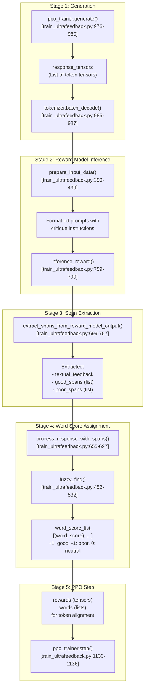

**Sources:** [nl_gradiant_policy_optimization/ultrafeedback/train_ultrafeedback.py:390-1136]()

### Prompt Formatting: `prepare_input_data()`

This function creates structured prompts for the reward model that request span-level feedback.

**Key Elements:**

| Element | Purpose |
|---------|---------|
| **User Input** | Original question/prompt from user |
| **Generated Response** | Model's generated answer |
| **Definitions** | Clear explanation of good_spans and poor_spans |
| **Instructions** | Evaluation criteria (accuracy, relevance, clarity, completeness) |
| **Output Format** | JSON schema with textual_feedback, good_spans, poor_spans |

**Template Structure:**
```
Please critique the following response to a user input and provide feedback and word-level score list:
---
**User Input**: {user_prompt}
---
**Generated Response**: {assistant_response}
---
**Definitions:**
- good_spans: phrases that greatly improve quality...
- poor_spans: phrases that noticeably harm quality...
---
**Output Format:**
{
  "textual_feedback": "...",
  "good_spans": ["phrase1", "phrase2",...],
  "poor_spans": ["phrase1", "phrase2",...]
}
```

**Sources:** [nl_gradiant_policy_optimization/ultrafeedback/train_ultrafeedback.py:390-439]()

### Span Matching: `fuzzy_find()` and `check_spans_in_response()`

These functions handle the critical task of locating identified spans within the generated response using fuzzy matching strategies.

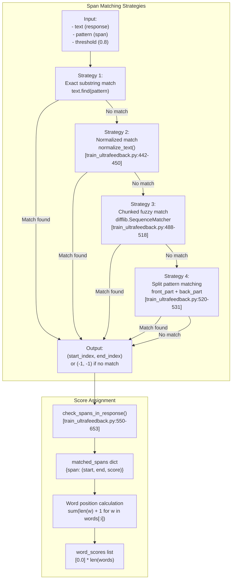

**Fuzzy Matching Features:**

- **Threshold Adjustment:** Lowers threshold for short patterns (< 5 chars) from 0.8 to 0.6
- **Text Normalization:** Removes punctuation, converts to lowercase, normalizes whitespace
- **Chunked Comparison:** Splits long texts into overlapping chunks for efficiency
- **Longest Block Matching:** Identifies longest matching subsequence and boosts similarity if > 70%
- **Progressive Fallback:** Tries multiple thresholds (0.8, 0.7, 0.6) before giving up

**Sources:** [nl_gradiant_policy_optimization/ultrafeedback/train_ultrafeedback.py:442-653]()

### Response Parsing: `extract_spans_from_reward_model_output()`

Extracts structured span information from the reward model's generated text using multiple fallback strategies.

**Parsing Strategies:**

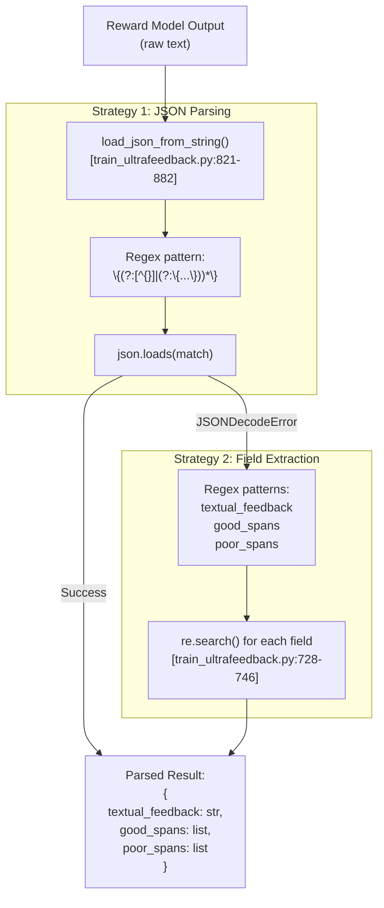

**Error Handling:**

- Returns `None` if all parsing strategies fail
- Logs warnings for debugging
- Initializes empty lists for missing `good_spans` or `poor_spans`
- Validates that `good_spans` and `poor_spans` are lists

**Sources:** [nl_gradiant_policy_optimization/ultrafeedback/train_ultrafeedback.py:699-757](), [nl_gradiant_policy_optimization/ultrafeedback/train_ultrafeedback.py:821-882]()

## Training Loop Workflow

The main training loop integrates generation, reward calculation, and policy updates with comprehensive error handling and logging.

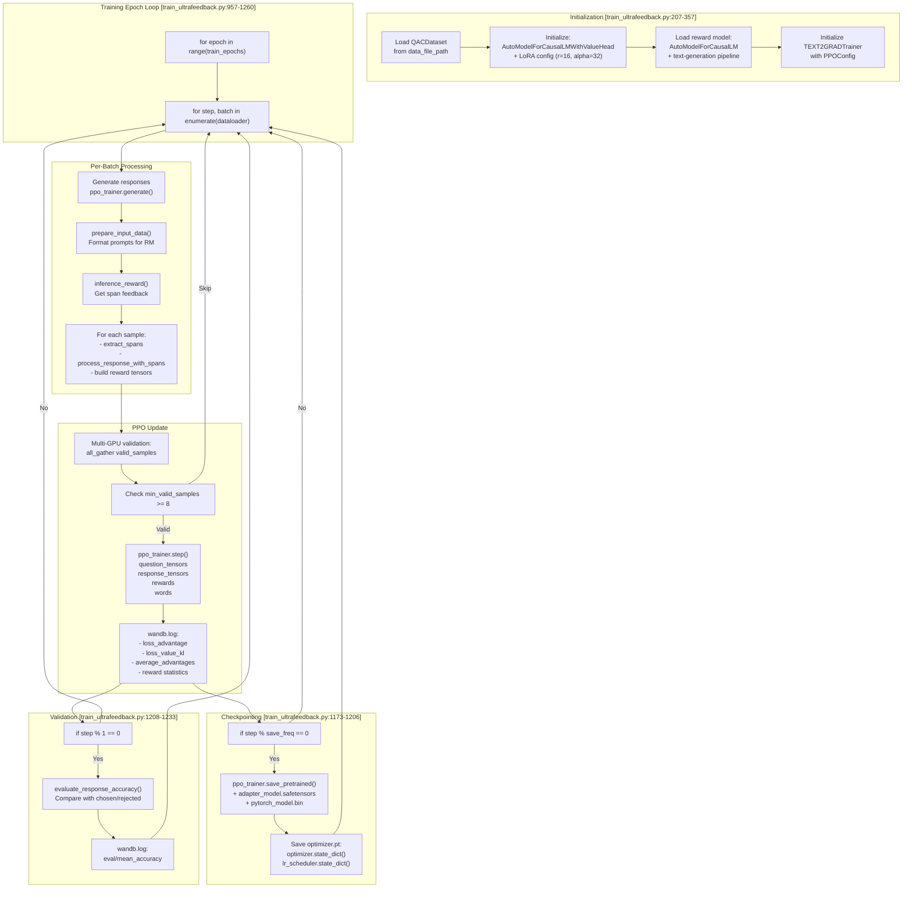

**Sources:** [nl_gradiant_policy_optimization/ultrafeedback/train_ultrafeedback.py:207-1260]()

### Checkpointing and Resume Logic

The training script supports resuming from checkpoints by restoring epoch, step, and optimizer state.

**Checkpoint Structure:**
```
output_dir/
├── epoch_{N}_step_{M}/
│   ├── adapter_model.safetensors    # LoRA adapter weights
│   ├── adapter_config.json          # LoRA configuration
│   ├── pytorch_model.bin            # Value head weights
│   └── optimizer.pt                 # Optimizer + scheduler state
```

**Resume Mechanism:**
- Parses checkpoint directory name to extract `epoch` and `step`
- Calculates `wandb_step` based on dataset size and batch configuration
- Loads optimizer state if available, otherwise continues with fresh optimizer
- Skips completed steps during training loop

**Sources:** [nl_gradiant_policy_optimization/ultrafeedback/train_ultrafeedback.py:224-287](), [nl_gradiant_policy_optimization/ultrafeedback/train_ultrafeedback.py:1173-1206]()

## Inference and Evaluation

### Inference Script: `2_infer.py`

The inference script uses VLLM for efficient batch inference on test data.

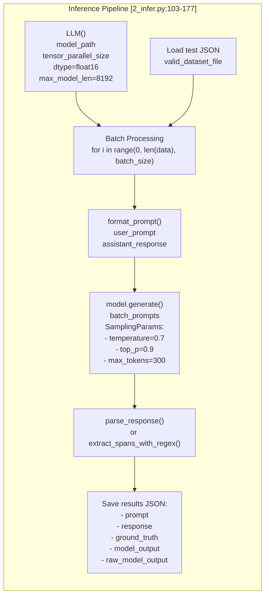

**Key Parameters:**

| Parameter | Default | Purpose |
|-----------|---------|---------|
| `model_path` | (required) | Path to merged model checkpoint |
| `valid_dataset_file` | (required) | Test dataset JSON path |
| `batch_size` | 32 | Number of samples per batch |
| `max_new_tokens` | 300 | Maximum tokens to generate |
| `num_samples` | 1000 | Number of samples to evaluate (-1 for all) |
| `tensor_parallel_size` | 1 | Number of GPUs for tensor parallelism |

**Sources:** [nl_reward_model/ultrafeedback/evaluation/2_infer.py:1-178]()

### Prompt Format for Inference

The inference script uses a specific prompt template that requests span-level feedback without textual_feedback.

```
Please critique the following response to a user input and provide word-level list of good and poor spans:
---
**User Input**: {user_prompt}
---
**Generated Response**: {assistant_response}
---
**Definitions:**
- good_spans: phrases from the response that greatly improve its quality...
- poor_spans: phrases from the response that noticeably harm its quality...
---
**Instructions:**
1. Evaluate the response based on accuracy, relevance, clarity, completeness
2. Select the most significant phrases for good_spans and poor_spans...
---
**Output Format:**
{
  "good_spans": ["phrase1", "phrase2",...],
  "poor_spans": ["phrase1", "phrase2",...]
}
```

**Key Difference from Training:** The inference prompt omits `textual_feedback` to focus evaluation on span identification accuracy.

**Sources:** [nl_reward_model/ultrafeedback/evaluation/2_infer.py:25-60]()

### Response Parsing Strategies

The inference script employs robust parsing with automatic fallback.

```mermaid
graph TB
    RAW["Raw Model Output"]
    
    subgraph "Primary Strategy"
        FIND_JSON["Find JSON boundaries:<br/>json_start = text.find('{')<br/>json_end = text.rfind('}') + 1"]
        TRY_PARSE["Try json.loads(json_str)"]
    end
    
    subgraph "Fallback Strategy"
        REGEX["extract_spans_with_regex()<br/>[2_infer.py:80-101]"]
        GOOD_PATTERN["good_spans pattern:<br/>\"good_spans\"\s*:\s*\[(.*?)\]"]
        POOR_PATTERN["poor_spans pattern:<br/>\"poor_spans\"\s*:\s*\[(.*?)\]"]
        SPAN_EXTRACT["Extract individual spans:<br/>(?:\"([^\"]*?)\"|'([^']*?)')"]
    end
    
    SUCCESS["Return dict:<br/>{good_spans, poor_spans}"]
    ERROR["Return error dict:<br/>{error, raw_response}"]
    
    RAW --> FIND_JSON
    FIND_JSON --> TRY_PARSE
    TRY_PARSE -->|"JSONDecodeError"| REGEX
    TRY_PARSE -->|"Success"| SUCCESS
    REGEX --> GOOD_PATTERN
    GOOD_PATTERN --> POOR_PATTERN
    POOR_PATTERN --> SPAN_EXTRACT
    SPAN_EXTRACT --> SUCCESS
    SPAN_EXTRACT -->|"Exception"| ERROR
```

**Sources:** [nl_reward_model/ultrafeedback/evaluation/2_infer.py:62-101]()

## Configuration and Hyperparameters

### PPOConfig Settings

The PPO configuration for UltraFeedback uses task-specific settings optimized for conversational models.

| Parameter | Value | Purpose |
|-----------|-------|---------|
| `vf_coef` | 0.1 | Value function loss coefficient |
| `learning_rate` | 1e-5 | Adam optimizer learning rate |
| `batch_size` | 32 | Total batch size across GPUs |
| `mini_batch_size` | 1 | Mini-batch size for PPO updates |
| `gradient_accumulation_steps` | 1 | Steps to accumulate gradients |
| `ppo_epochs` | 4 | Number of PPO epochs per batch |
| `init_kl_coef` | 0.2 | Initial KL divergence penalty coefficient |
| `adap_kl_ctrl` | True | Enable adaptive KL control |
| `target_kl` | 0.1 | Target KL divergence threshold |
| `kl_penalty` | "full" | KL penalty type (full, abs, mse, seqwise_kl) |

**Sources:** [nl_gradiant_policy_optimization/ultrafeedback/train_ultrafeedback.py:145-164]()

### LoRA Configuration

Parameter-efficient fine-tuning is achieved through LoRA adapters.

| Parameter | Value | Description |
|-----------|-------|-------------|
| `r` | 16 | LoRA rank (dimension of low-rank matrices) |
| `lora_alpha` | 32 | LoRA scaling factor (alpha/r = 2.0) |
| `lora_dropout` | 0.05 | Dropout probability for LoRA layers |
| `bias` | "none" | Bias training strategy |
| `task_type` | "CAUSAL_LM" | Model task type |

**Sources:** [nl_gradiant_policy_optimization/ultrafeedback/train_ultrafeedback.py:211-217]()

### Generation Parameters

Two sets of generation parameters are used: one for policy generation and one for reward model inference.

**Policy Model (TEXT2GRADTrainer):**
```python
generation_kwargs = {
    "temperature": 0.6,
    "do_sample": True,
    "top_p": 1,
    "top_k": 0,
    "max_new_tokens": 512,
    "pad_token_id": tokenizer.pad_token_id,
    "eos_token_id": tokenizer.eos_token_id,
}
```

**Reward Model:**
```python
sent_kwargs = {
    "batch_size": script_args.batch_size,
    "do_sample": True,
    "temperature": 0.1,  # Lower for more deterministic critiques
    "min_new_tokens": 50,
    "max_new_tokens": 768,
    "pad_token_id": reward_tokenizer.eos_token_id,
    "eos_token_id": reward_tokenizer.eos_token_id,
}
```

**Sources:** [nl_gradiant_policy_optimization/ultrafeedback/train_ultrafeedback.py:360-379]()

## Distributed Training Support

The UltraFeedback training script supports multi-GPU training through DeepSpeed and Accelerator.

### Multi-Process Coordination

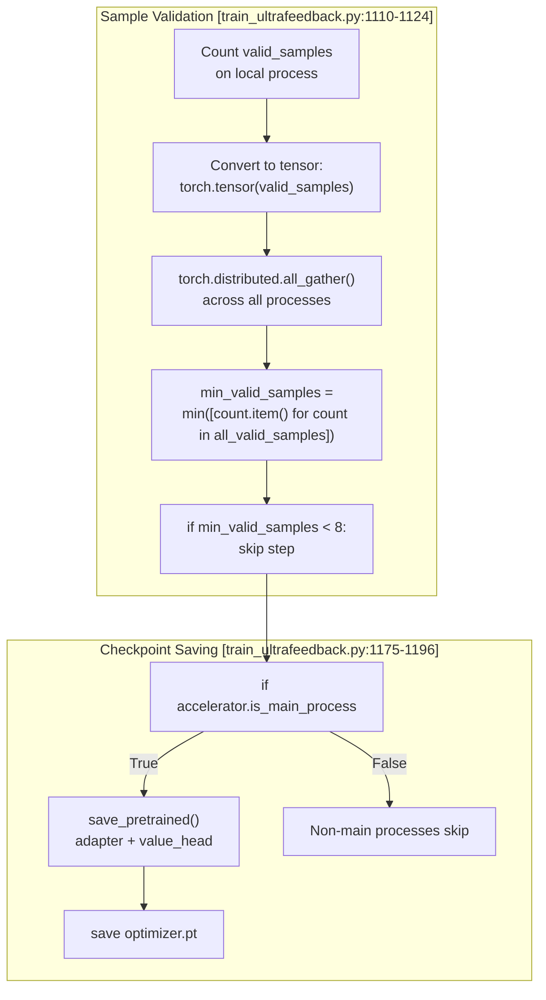

**Synchronization Points:**

1. **Sample Count Validation:** Ensures all processes have sufficient valid samples before proceeding with PPO step
2. **Checkpoint Saving:** Only main process writes to disk to avoid conflicts
3. **Metric Gathering:** TEXT2GRADTrainer handles gathering of statistics across processes

**Environment Variables:**
```bash
NCCL_P2P_DISABLE=1
NCCL_P2P_LEVEL=NVL
```

These settings optimize NCCL communication for specific hardware configurations.

**Sources:** [nl_gradiant_policy_optimization/ultrafeedback/train_ultrafeedback.py:966-967](), [nl_gradiant_policy_optimization/ultrafeedback/train_ultrafeedback.py:1110-1124](), [nl_gradiant_policy_optimization/ultrafeedback/train_ultrafeedback.py:1175-1196]()

## Evaluation Metrics and Benchmarks

The UltraFeedback task evaluates optimized models on multiple benchmarks to assess different aspects of conversational capability.

### Benchmark Overview

| Benchmark | Purpose | Metrics |
|-----------|---------|---------|
| **MT-Bench** | Multi-turn conversation quality | GPT-4 judge scores across 8 categories |
| **ARC-C** | Complex reasoning and science QA | Accuracy on challenge set questions |
| **AlpacaEval 2.0** | Instruction following capability | Win rate against reference models |

### In-Training Evaluation

The training script includes continuous evaluation through similarity-based accuracy measurement.

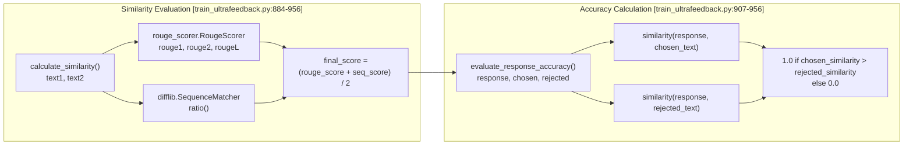

**Logged Metrics:**
- `eval/mean_accuracy`: Average binary accuracy over eval samples
- `eval/accuracies`: Individual accuracy scores per sample

**Sources:** [nl_gradiant_policy_optimization/ultrafeedback/train_ultrafeedback.py:884-956](), [nl_gradiant_policy_optimization/ultrafeedback/train_ultrafeedback.py:1208-1233](), [README.md:346-353]()

## Error Handling and Logging

The implementation includes comprehensive error handling and detailed logging for debugging and monitoring.

### Error Logging System

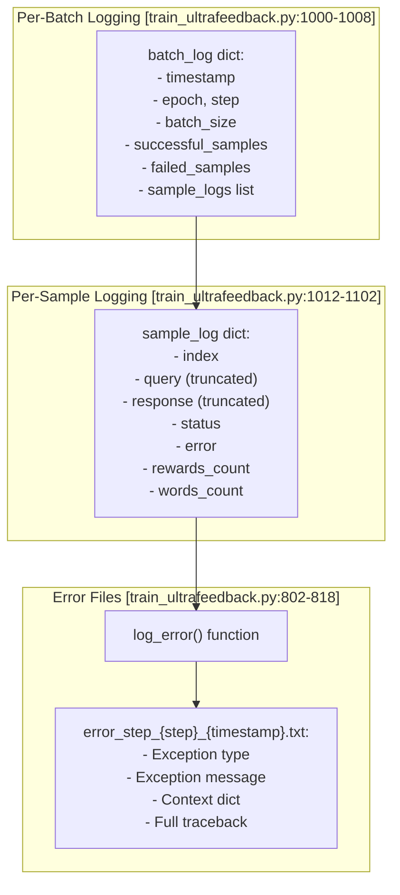

### Common Error Scenarios

| Error Type | Handling Strategy | Location |
|------------|-------------------|----------|
| Invalid `llm_output` format | Skip sample, log warning, increment fail counter | [1020-1027]() |
| Empty `generated_text` | Skip sample, log warning | [1029-1036]() |
| Text too short to parse | Skip sample, log warning | [1041-1047]() |
| Failed span extraction | Skip sample, log parse failure | [1049-1056]() |
| Insufficient valid samples | Skip entire batch, continue to next | [1118-1124]() |
| Save checkpoint failure | Log to separate error file, continue training | [1197-1206]() |

**Sources:** [nl_gradiant_policy_optimization/ultrafeedback/train_ultrafeedback.py:802-818](), [nl_gradiant_policy_optimization/ultrafeedback/train_ultrafeedback.py:1000-1104]()

## WandB Logging and Metrics

The training script logs comprehensive metrics to Weights & Biases for experiment tracking.

### Logged Metrics Categories

**Training Losses:**
- `train/loss_advantage`: PPO policy loss (advantages)
- `train/loss_value_kl`: Combined value function loss and KL penalty
- `train/average_advantages`: Mean advantage values

**Reward Statistics:**
- `rewards/mean`: Average reward across all tokens
- `rewards/max`: Maximum reward value
- `rewards/min`: Minimum reward value
- `rewards/positive_ratio`: Proportion of positive rewards
- `rewards/negative_ratio`: Proportion of negative rewards
- `rewards/zero_ratio`: Proportion of neutral rewards
- `rewards/sample_count`: Total number of reward values
- `rewards/distribution`: Histogram of reward distribution

**Example Logging:**
- `examples/example_{i}/token_rewards`: Table of token-reward pairs
- `examples/example_{i}/query`: Input prompt
- `examples/example_{i}/response`: Generated response
- `examples/example_{i}/avg_reward`: Average reward for the example

**Evaluation:**
- `eval/mean_accuracy`: Mean accuracy compared to chosen/rejected
- `eval/accuracies`: List of individual accuracies

**Sources:** [nl_gradiant_policy_optimization/ultrafeedback/train_ultrafeedback.py:1138-1171](), [nl_gradiant_policy_optimization/ultrafeedback/train_ultrafeedback.py:1228-1231]()

## Summary

The UltraFeedback implementation demonstrates the Text2Grad framework's capability for fine-grained conversational AI optimization. Key technical features include:

1. **Span-Level Feedback:** Identifies specific phrases as good or poor, enabling targeted improvements
2. **Robust Fuzzy Matching:** Multi-strategy span matching handles generation variations
3. **Dual-Feedback Format:** Combines textual critiques with structured span annotations
4. **Comprehensive Error Handling:** Multiple parsing fallbacks and detailed error logging
5. **Multi-GPU Support:** Distributed training with sample synchronization across processes
6. **Continuous Evaluation:** In-training similarity-based accuracy measurement against chosen/rejected pairs

For implementation details on specific components, refer to the child pages: [Dataset Format](#7.2.1), [Reward Model](#7.2.2), [Policy Optimization](#7.2.3), and [Evaluation](#7.2.4).

---

