<!-- source: DeepWiki mcp.deepwiki.com · repo microsoft/Text2Grad · page 7.3 Summarization (SLF5K) · fetched 2026-10-26 -->

# Summarization (SLF5K)

<details>
<summary>Relevant source files</summary>

The following files were used as context for generating this wiki page:

- [README.md](README.md)
- [nl_gradiant_policy_optimization/slf5k/text2grad_trainer.py](nl_gradiant_policy_optimization/slf5k/text2grad_trainer.py)
- [nl_gradiant_policy_optimization/slf5k/train.py](nl_gradiant_policy_optimization/slf5k/train.py)
- [nl_reward_model/slf5k/evaluation/2_infer.py](nl_reward_model/slf5k/evaluation/2_infer.py)

</details>


This page provides a complete guide for using Text2Grad on the summarization task with the SLF5K dataset. It covers dataset format, reward model training and inference, policy optimization with natural language gradients, and evaluation metrics including ROUGE, BLEU, BERTScore, and GPT-4-as-judge.

For dataset annotation procedures that precede reward model training, see [Data Annotation Pipeline](#4). For general reward model concepts applicable across tasks, see [Reward Models](#5). For the underlying PPO training architecture, see [Policy Optimization](#6).

---

## Overview

The SLF5K task applies Text2Grad to Reddit post summarization. The system trains models to generate concise summaries of Reddit posts by providing word-level feedback on each generated summary. Unlike scalar rewards in traditional RLHF, this approach identifies specific words that contribute positively (+1), neutrally (0), or negatively (-1) to summary quality.

The pipeline consists of three phases:

1. **Data Annotation**: Convert natural language feedback into dual-feedback format with word-level scores
2. **Reward Model Training**: Train a model to predict word-level scores and generate textual critiques  
3. **Policy Optimization**: Use TEXT2GRADTrainer to optimize a summarization policy with fine-grained rewards

**Sources:** [README.md:117-331]()

---

## SLF5K Dataset Structure

### Input Format

The SLF5K dataset stores data in JSON format with post IDs as keys. Each entry contains the original Reddit post and a generated summary.

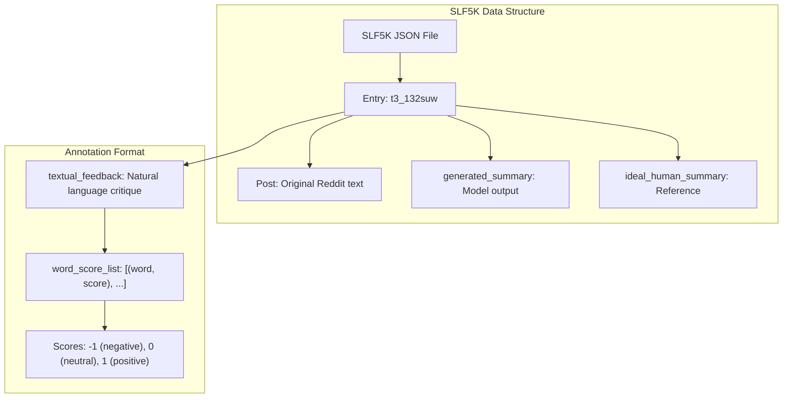

**Dataset Schema:**

| Field | Type | Description |
|-------|------|-------------|
| `Post` | string | Original Reddit post text |
| `generated_summary` | string | Model-generated summary to evaluate |
| `ideal_human_summary` | string | Reference human-written summary |
| `textual_feedback` | string | Natural language critique (after annotation) |
| `word_score_list` | list[tuple] | Word-level scores: `[(word, score), ...]` |

**Example JSON structure:**

```json
{
  "t3_132suw": {
    "Post": "My girlfriend is studying something she won't ever use ...",
    "generated_summary": "My girlfriend is premed and ...",
    "ideal_human_summary": "Girlfriend studying premed but plans different career"
  }
}
```

**Sources:** [README.md:163-171](), [nl_gradiant_policy_optimization/slf5k/train.py:37-83]()

---

## Reward Model Pipeline

### System Prompt and Scoring Rules

The reward model evaluates summaries using a structured prompt that requests both textual feedback and word-level scores.

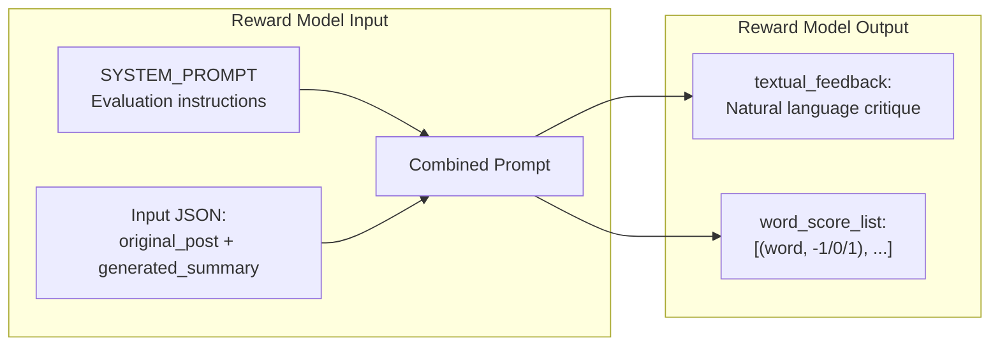

The `SYSTEM_PROMPT` defines three-level scoring:
- **-1**: Negative contribution (incorrect, irrelevant, or misleading)
- **0**: Neutral contribution (redundant or filler)
- **+1**: Positive contribution (accurate, concise, informative)

**Sources:** [nl_reward_model/slf5k/evaluation/2_infer.py:12-40]()

### Inference Pipeline: Code Entities

The inference process loads a merged reward model and generates structured feedback for validation samples.

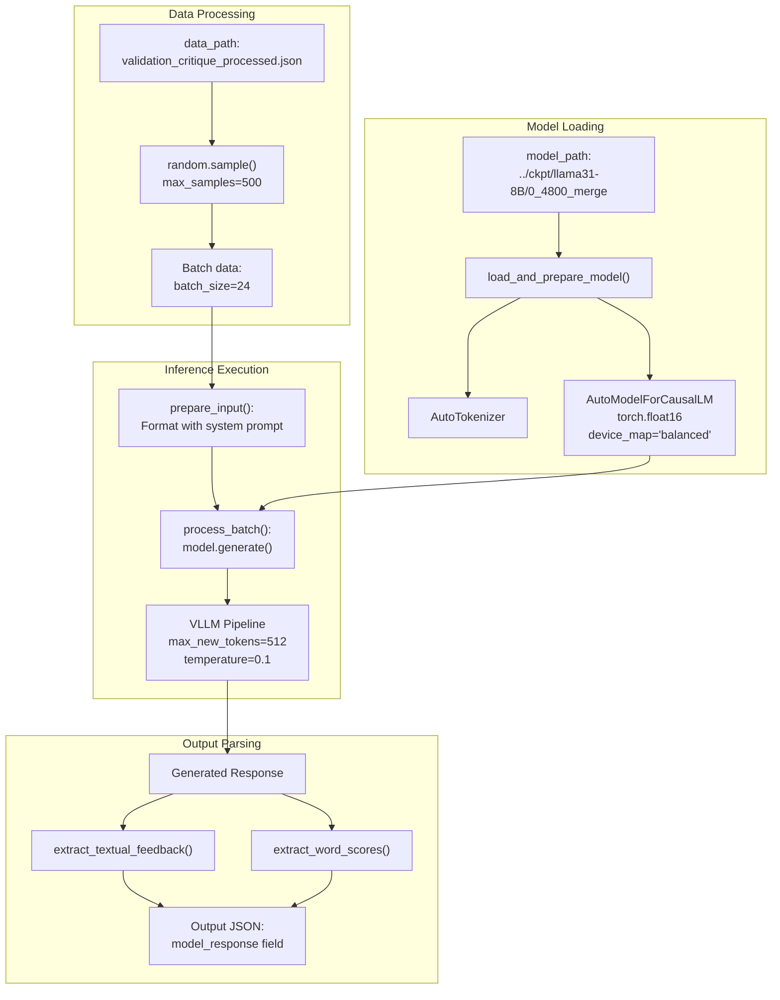

**Key Functions:**

| Function | Location | Purpose |
|----------|----------|---------|
| `load_and_prepare_model()` | [2_infer.py:61-75]() | Load model and tokenizer with float16 precision |
| `prepare_input()` | [2_infer.py:78-91]() | Format post and summary into Llama 3.1 chat template |
| `process_batch()` | [2_infer.py:94-118]() | Run batch inference with sampling |
| `extract_textual_feedback()` | [2_infer.py:121-129]() | Parse textual critique from JSON response |
| `extract_word_scores()` | [2_infer.py:132-201]() | Parse word-score pairs with multiple fallback strategies |

**Sources:** [nl_reward_model/slf5k/evaluation/2_infer.py:1-288]()

### Response Parsing Strategies

The system implements robust multi-level parsing to handle malformed LLM outputs:

```mermaid
graph TD
    RESP["Raw Model Response"]
    
    RESP --> JSON1["JSON Parse Attempt"]
    JSON1 -->|Success| STRUCT["Structured Data"]
    JSON1 -->|Fail| REGEX1["Regex Pattern 1:<br/>\"word\": score"]
    
    REGEX1 -->|Match| STRUCT
    REGEX1 -->|Fail| REGEX2["Regex Pattern 2:<br/>word: score"]
    
    REGEX2 -->|Match| STRUCT
    REGEX2 -->|Fail| REGEX3["Regex Pattern 3:<br/>(word, score)"]
    
    REGEX3 -->|Match| STRUCT
    REGEX3 -->|Fail| EMPTY["Empty Result"]
    
    STRUCT --> VALIDATE["Validate:<br/>type checks + filtering"]
    VALIDATE --> FINAL["Final Word-Score List"]
```

The `extract_word_scores()` function handles multiple response formats:
- Standard JSON: `{"word_score_list": [{"word": "text", "score": 1}, ...]}`
- String format: `"word_score_list": "[(word1, 1), (word2, 0)]"`
- List of tuples: `[["word1", 1], ["word2", 0]]`
- Dictionary variants: `[{"word": "text", "Score": 1}]` (capital S)

**Sources:** [nl_reward_model/slf5k/evaluation/2_infer.py:132-201]()

---

## Policy Optimization with TEXT2GRADTrainer

### Training Script Architecture

The SLF5K training script orchestrates the complete PPO training loop with natural language gradients.

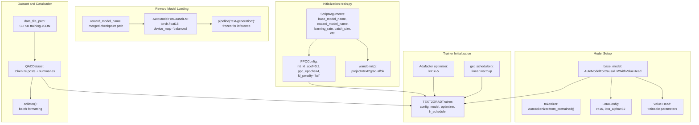

**Key Configuration Objects:**

| Class | File | Purpose |
|-------|------|---------|
| `ScriptArguments` | [train.py:86-134]() | Dataclass holding all hyperparameters |
| `PPOConfig` | [train.py:149-168]() | PPO-specific settings (KL coef, epochs, batch size) |
| `QACDataset` | [train.py:37-83]() | Dataset class for question-answer-critique format |
| `LoraConfig` | [train.py:209-215]() | PEFT configuration (r=16, alpha=32) |

**Sources:** [nl_gradiant_policy_optimization/slf5k/train.py:1-320]()

### Training Loop: Generation and Reward Computation

The main training loop generates summaries, obtains word-level feedback from the reward model, and aligns scores with tokens.

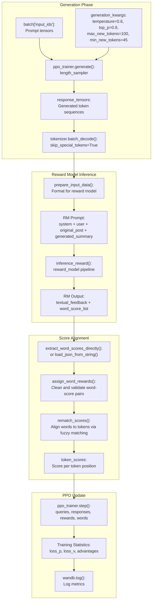

**Critical Functions in Training Loop:**

| Function | Location | Purpose |
|----------|----------|---------|
| `prepare_input_data()` | [train.py:492-517]() | Format queries and responses for reward model |
| `inference_reward()` | [train.py:520-561]() | Run reward model inference with error handling |
| `extract_word_scores_directly()` | [train.py:625-678]() | Fallback regex extraction for word-score pairs |
| `load_json_from_string()` | [train.py:681-745]() | Multi-pattern JSON parsing |
| `assign_word_rewards()` | [train.py:381-449]() | Validate and clean word-score pairs |

**Sources:** [nl_gradiant_policy_optimization/slf5k/train.py:748-1064]()

### Token-Word Alignment Algorithm

A critical component is `rematch_scores()` in TEXT2GRADTrainer, which aligns word-level rewards to token-level training signals.

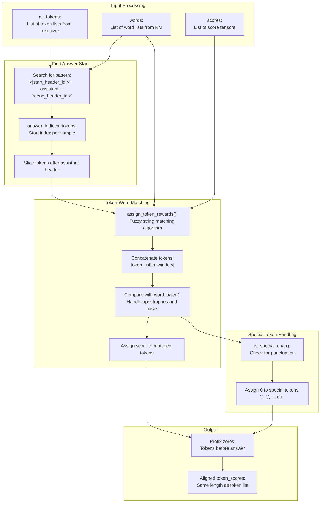

The `assign_token_rewards()` function performs the following:
1. **Filtering**: Remove empty words from word list
2. **Sliding Window**: Try concatenating 1-10 tokens to match each word
3. **Case-Insensitive Comparison**: Normalize apostrophes (`'` → `'`) and case
4. **Special Character Handling**: Assign score=0 to punctuation tokens
5. **Skip Tracking**: Record percentage of words that couldn't be matched

**Sources:** [nl_gradiant_policy_optimization/slf5k/text2grad_trainer.py:1155-1285]()

### Length Penalty Mechanism

The training script applies a length-weighted penalty to encourage summaries of appropriate length.

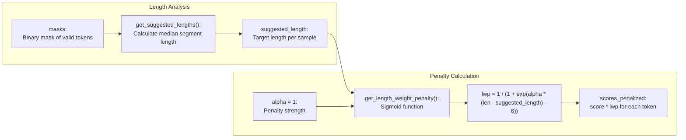

The penalty function creates a smooth sigmoid curve that:
- Applies minimal penalty near the suggested length
- Progressively reduces rewards for tokens beyond the target length
- Encourages concise summaries without hard cutoffs

**Sources:** [nl_gradiant_policy_optimization/slf5k/train.py:558-612](), [nl_gradiant_policy_optimization/slf5k/text2grad_trainer.py:592-612]()

---

## TEXT2GRADTrainer: Core Methods

### Forward Pass and Masking

The `batched_forward_pass()` method computes logits, values, and logprobs while applying sophisticated masking.

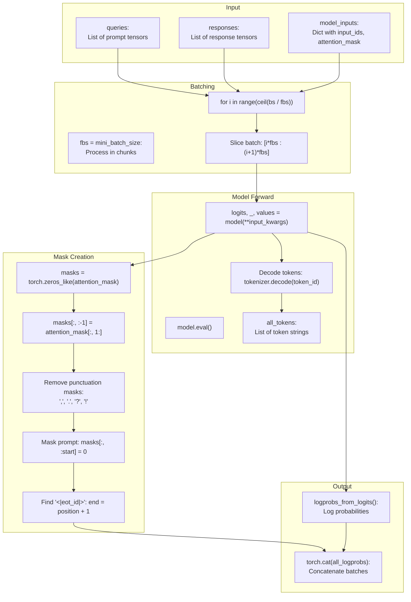

**Masking Logic Details:**

1. **Shift Mask**: `masks[:, :-1] = attention_mask[:, 1:]` aligns with logprob calculation
2. **Punctuation Removal**: Tokens matching `[',', '.', '?', '!']` are masked out to avoid penalizing punctuation
3. **Query Masking**: Only response tokens are trained (`masks[:, :start] = 0`)
4. **EOS Detection**: When `<|eot_id|>` token is found, mask everything after it

**Sources:** [nl_gradiant_policy_optimization/slf5k/text2grad_trainer.py:956-1073]()

### Reward Computation with KL Penalty

The `compute_rewards()` method combines word-level scores with KL divergence penalties.

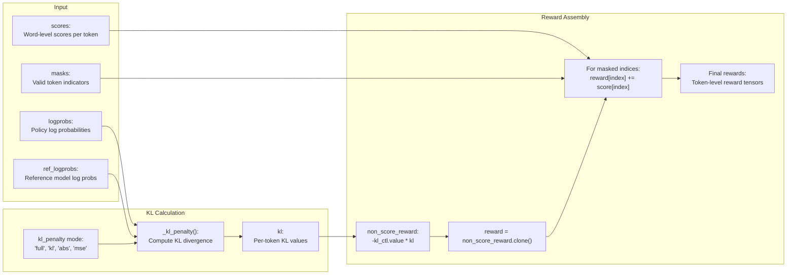

**KL Penalty Modes:**

| Mode | Formula | Purpose |
|------|---------|---------|
| `"kl"` | `logprob - ref_logprob` | Standard reverse KL |
| `"abs"` | `abs(logprob - ref_logprob)` | Penalize any divergence |
| `"mse"` | `0.5 * (logprob - ref_logprob)^2` | Squared difference |
| `"full"` | `F.kl_div(ref_logprob, logprob)` | Forward KL (full distribution) |

**Sources:** [nl_gradiant_policy_optimization/slf5k/text2grad_trainer.py:1287-1329]()

### Advantage Calculation with GAE

The Generalized Advantage Estimation (GAE) algorithm computes advantages for policy gradient updates.

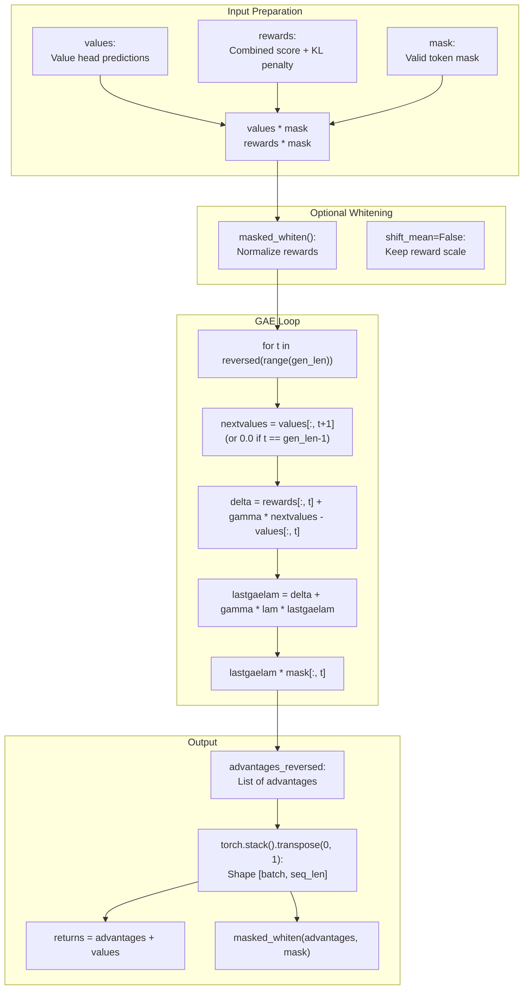

**GAE Parameters:**
- `gamma = 0.99` (default): Discount factor for future rewards
- `lam = 0.95` (default): GAE lambda parameter balancing bias vs. variance

**Sources:** [nl_gradiant_policy_optimization/slf5k/text2grad_trainer.py:1331-1359]()

---

## Evaluation Metrics

### Traditional Summarization Metrics

SLF5K models are evaluated on 500 validation samples using multiple automatic metrics.

| Metric | Type | Measures |
|--------|------|----------|
| **ROUGE-1** | N-gram overlap | Unigram recall between generated and reference |
| **ROUGE-2** | N-gram overlap | Bigram recall for fluency |
| **ROUGE-L** | Sequence matching | Longest common subsequence |
| **BLEU** | Precision-based | N-gram precision (1-4 grams) |
| **BERTScore** | Semantic similarity | Contextual embedding similarity |
| **Perplexity** | Language modeling | Model confidence (lower is better) |

**Sources:** [README.md:303-331]()

### GPT-4 as Judge

In addition to automatic metrics, GPT-4 evaluates summary quality through qualitative assessment. This provides:
- Coherence scoring
- Factual accuracy verification
- Comparison with reference summaries
- Identification of hallucinations or omissions

**Sources:** [README.md:323-327]()

### Reward Model Evaluation

Reward models themselves are evaluated using word-level metrics. See [Evaluation Metrics](#5.5) for detailed documentation on:
- Word-level precision/recall/F1 for score predictions
- ROUGE scores for textual feedback quality

---

## End-to-End Workflow

### Complete Pipeline Execution

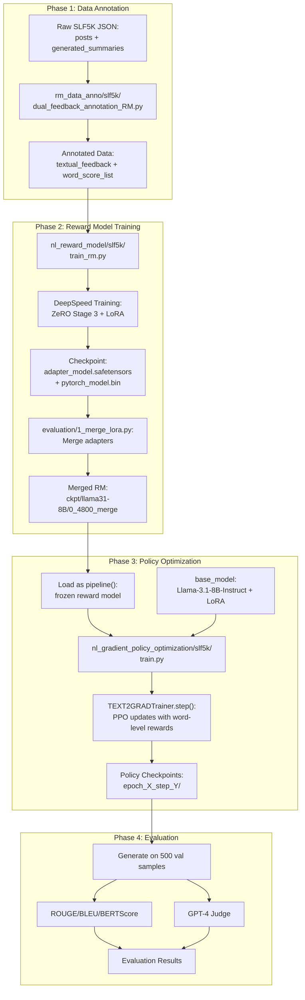

**Sources:** [README.md:147-293]()

### Training Configuration Example

**Shell Script: `train_slf5k.sh`**

```bash
# Key hyperparameters for SLF5K training
--base_model_name "meta-llama/Llama-3.1-8B-Instruct"
--reward_model_name "./ckpt/llama31-8B/0_4800_merge"
--data_file_path "./data/slf5k_train.json"
--learning_rate 1e-5
--batch_size 32
--mini_batch_size 1
--ppo_epochs 4
--init_kl_coef 0.2
--output_max_length 100
--gradient_accumulation_steps 1
```

**Generation Parameters:**

```python
generation_kwargs = {
    "temperature": 0.6,
    "do_sample": True,
    "top_p": 0.9,
    "num_beams": 2,
    "repetition_penalty": 1.2,
    "max_new_tokens": 100,
    "min_new_tokens": 45,
}
```

**Reward Model Inference Parameters:**

```python
sent_kwargs = {
    "batch_size": 32,
    "do_sample": False,
    "temperature": 0.05,
    "num_beams": 3,
    "min_new_tokens": 20,
    "max_new_tokens": 500,
}
```

**Sources:** [nl_gradiant_policy_optimization/slf5k/train.py:352-374]()

---

## Logging and Debugging

### Detailed Sample Logging

The training script creates comprehensive logs for each sample processed during training.

**Log Directory Structure:**

```
output_dir/
├── logs/
│   └── epoch_0/
│       ├── step_0/
│       │   ├── sample_0.txt
│       │   ├── sample_1.txt
│       │   └── batch_summary.json
│       └── step_1/
│           └── ...
└── error_logs/
    └── error_step_X_timestamp.txt
```

**Sample Log Contents (`sample_N.txt`):**

1. **QUERY**: Original Reddit post
2. **RESPONSE**: Generated summary from policy
3. **REWARD MODEL INPUT**: Formatted prompt sent to RM
4. **REWARD MODEL RAW OUTPUT**: Complete RM response
5. **TEXT TO PARSE**: Extracted portion after prompt
6. **JSON PARSING RESULT**: Parsed word-score list
7. **DIRECT EXTRACTION RESULT**: Fallback regex results
8. **REWARD ASSIGNMENT RESULT**: Final token-level rewards

**Sources:** [nl_gradiant_policy_optimization/slf5k/train.py:753-978]()

### Batch Summary JSON

Each training step saves a `batch_summary.json` with:

```json
{
  "timestamp": "2024-01-15 14:32:10",
  "epoch": 0,
  "step": 5,
  "batch_size": 32,
  "successful_samples": 28,
  "failed_samples": 4,
  "sample_logs": [
    {
      "index": 0,
      "query": "My girlfriend is studying...",
      "response": "Girlfriend in premed but...",
      "status": "success",
      "rewards_count": 15,
      "words_count": 15,
      "log_file": "logs/epoch_0/step_5/sample_0.txt"
    }
  ]
}
```

**Sources:** [nl_gradiant_policy_optimization/slf5k/train.py:790-978]()

---

## Checkpoint Management

### Saving Strategy

Checkpoints are saved every `save_freq` steps (default: 5) and include:

1. **LoRA Adapters**: `adapter_model.safetensors`
2. **Value Head**: `pytorch_model.bin`
3. **Optimizer State**: `optimizer.pt`
4. **Training Config**: `adapter_config.json`

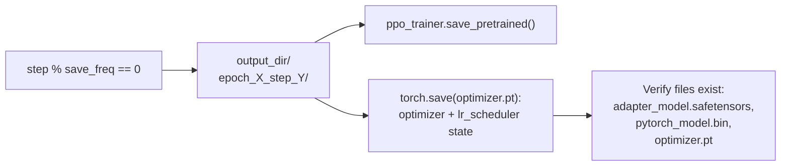

**Sources:** [nl_gradiant_policy_optimization/slf5k/train.py:1001-1038]()

### Loading from Checkpoint

To resume training from a checkpoint:

```python
--base_model_adapter_model "./ckpt/epoch_1_step_50"
```

The script automatically:
1. Loads LoRA adapters from `adapter_model.safetensors`
2. Loads value head from `pytorch_model.bin`
3. Loads optimizer state from `optimizer.pt`
4. Calculates current epoch and step from path
5. Skips already-processed batches by advancing dataloader

**Sources:** [nl_gradiant_policy_optimization/slf5k/train.py:222-280](), [train.py:566-595]()

---

## Common Issues and Solutions

### Issue: Word-Score Mismatch

**Problem**: Number of words from reward model doesn't match response length.

**Solution**: The `assign_word_rewards()` function filters empty words and validates score types. If mismatches persist, check:
- Reward model prompt format matches expected JSON structure
- `extract_word_scores()` fallback patterns are active

**Sources:** [nl_gradiant_policy_optimization/slf5k/train.py:381-449]()

### Issue: Token Alignment Failures

**Problem**: High `skip_word_percentage` in logs indicates fuzzy matching failures.

**Solution**: The `assign_token_rewards()` function uses:
- Sliding window of 1-10 tokens
- Case-insensitive comparison
- Apostrophe normalization (`'` ↔ `'`)
- Maximum 5 retry attempts per word

Adjust `max_attempts` or window size if needed.

**Sources:** [nl_gradiant_policy_optimization/slf5k/text2grad_trainer.py:1155-1240]()

### Issue: Empty Batches After Filtering

**Problem**: Too many samples fail reward extraction, leaving batch size < `batch_size // 2`.

**Solution**: The training loop skips steps when `len(final_question_tensors) < batch_size // 2`. To fix:
- Improve reward model output format consistency
- Adjust fallback regex patterns in `extract_word_scores_directly()`
- Lower the threshold for minimum valid samples

**Sources:** [nl_gradiant_policy_optimization/slf5k/train.py:980-983]()

---

## Related Documentation

- For general reward model training procedures: [Training Reward Models](#5.1)
- For PPO training details: [PPO Training Loop](#6.2)
- For token-reward alignment algorithms: [Token-Reward Alignment](#6.4)
- For checkpoint management across tasks: [Checkpoint Management](#6.7)
- For evaluation metrics details: [Evaluation Metrics](#5.5)

---

