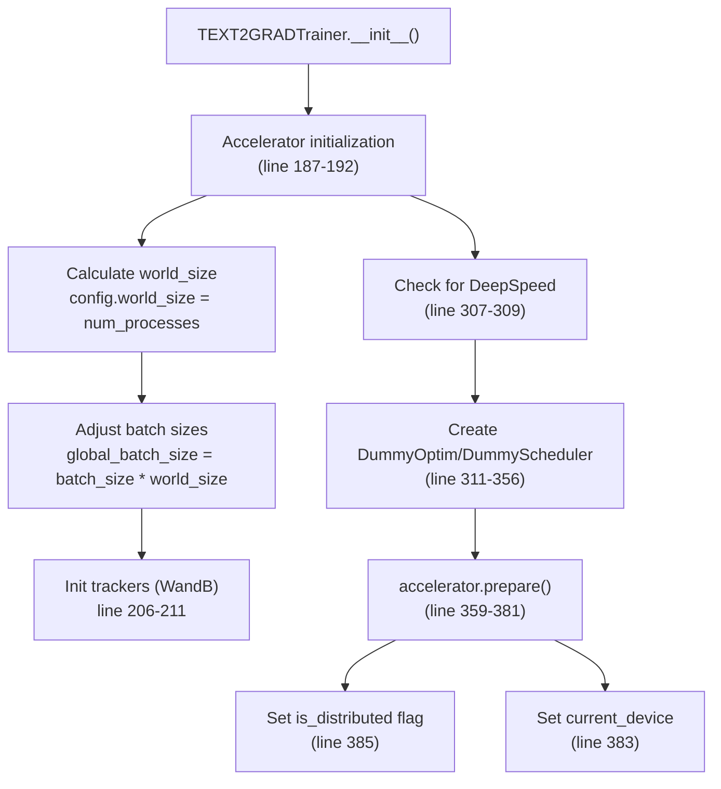
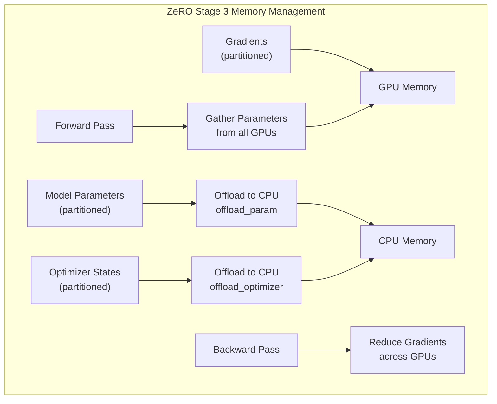
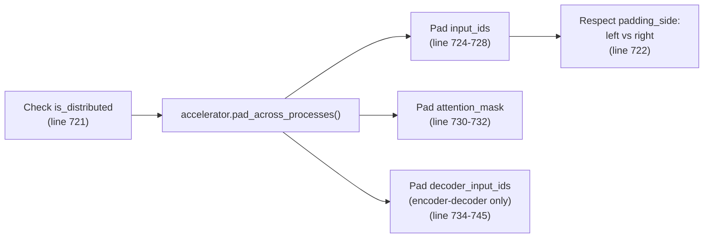
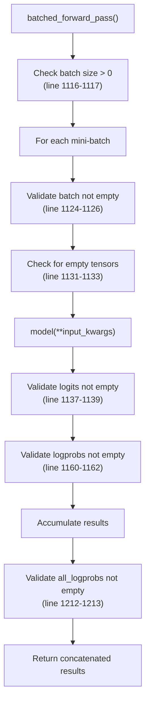
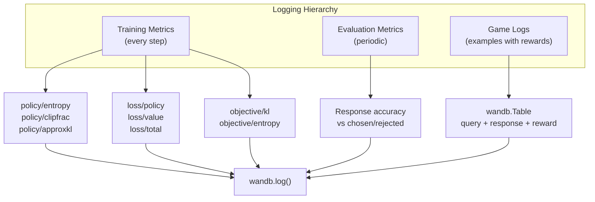
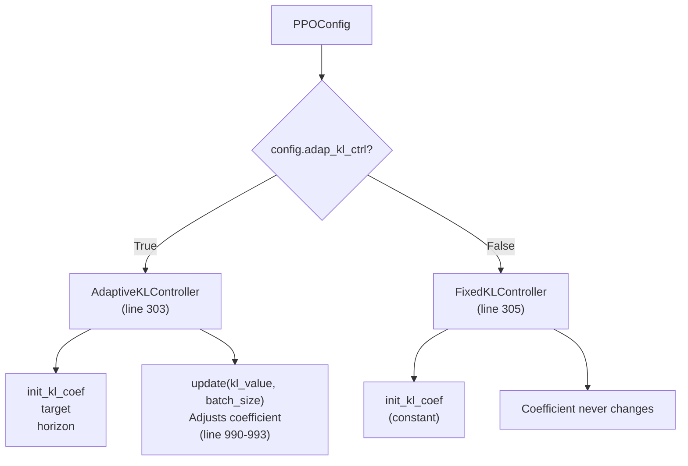
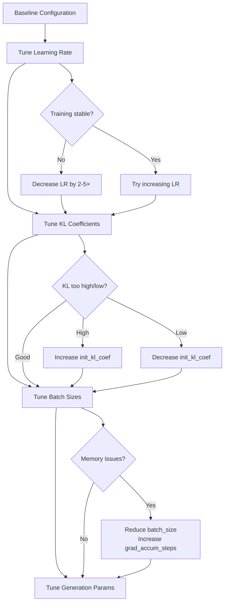
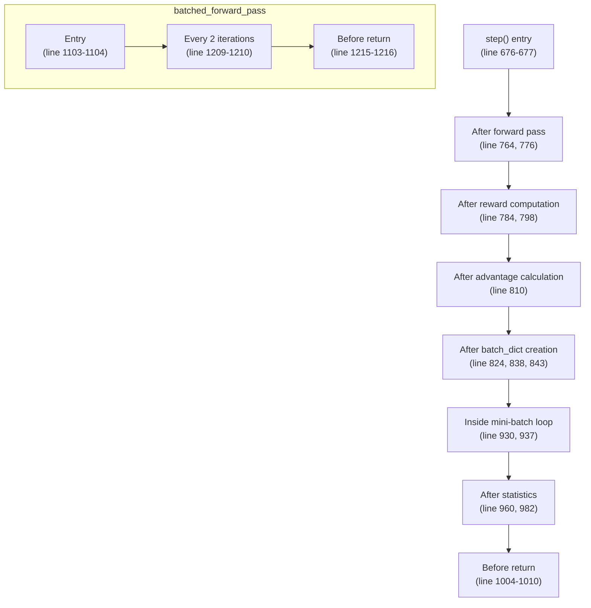
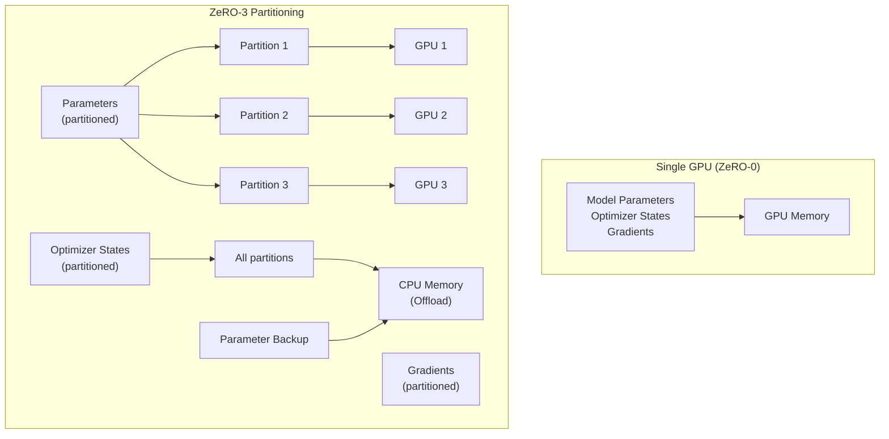

<!-- source: DeepWiki mcp.deepwiki.com · repo microsoft/Text2Grad · page 8 Advanced Topics · fetched 2026-10-26 -->

# Advanced Topics

<details>
<summary>Relevant source files</summary>

The following files were used as context for generating this wiki page:

- [nl_gradiant_policy_optimization/ultrafeedback/text2grad_trainer.py](nl_gradiant_policy_optimization/ultrafeedback/text2grad_trainer.py)
- [nl_reward_model/kodcode/train_rm.py](nl_reward_model/kodcode/train_rm.py)

</details>


This page covers advanced usage patterns, optimization techniques, and troubleshooting strategies for the Text2Grad system. For basic training setup, see [Getting Started](#2). For task-specific configurations, see [Task-Specific Guides](#7).

**Scope:** This document focuses on production-level concerns including multi-GPU training, memory management, error handling, and hyperparameter tuning. These topics are essential for scaling Text2Grad to large models and datasets.

## Multi-GPU Configuration

### Overview

Text2Grad supports distributed training through Hugging Face Accelerator and DeepSpeed ZeRO-3 optimization. The system automatically detects available GPUs and configures distributed communication.

### Accelerator Initialization

The `TEXT2GRADTrainer` initializes distributed training in its constructor:



**Sources:** [nl_gradiant_policy_optimization/ultrafeedback/text2grad_trainer.py:187-192](), [nl_gradiant_policy_optimization/ultrafeedback/text2grad_trainer.py:307-356](), [nl_gradiant_policy_optimization/ultrafeedback/text2grad_trainer.py:359-381]()

### DeepSpeed ZeRO Stage 3 Configuration

The reward model training uses DeepSpeed ZeRO Stage 3 for maximum memory efficiency:

| Parameter | Value | Purpose |
|-----------|-------|---------|
| `stage` | 3 | Partition optimizer states, gradients, and parameters |
| `offload_optimizer.device` | "cpu" | Offload optimizer states to CPU |
| `offload_param.device` | "cpu" | Offload parameters to CPU |
| `overlap_comm` | True | Overlap communication with computation |
| `stage3_max_live_parameters` | 1e9 | Maximum parameters kept in GPU memory |
| `stage3_gather_16bit_weights_on_model_save` | True | Gather FP16 weights when saving |

**Configuration Structure:**



**Sources:** [nl_reward_model/kodcode/train_rm.py:209-260]()

### DummyOptim and DummyScheduler for DeepSpeed

When using DeepSpeed, the trainer creates `DummyOptim` and `DummyScheduler` wrappers that allow Accelerator's `prepare()` method to work correctly:

**Key Implementation:**

- [nl_gradiant_policy_optimization/ultrafeedback/text2grad_trainer.py:311-341](): `DummyOptim` creation with parameter extraction from existing optimizer
- [nl_gradiant_policy_optimization/ultrafeedback/text2grad_trainer.py:343-355](): `DummyScheduler` creation

These dummy objects satisfy Accelerator's interface requirements while DeepSpeed handles the actual optimization internally.

**Sources:** [nl_gradiant_policy_optimization/ultrafeedback/text2grad_trainer.py:311-355]()

### Distributed Data Handling

The trainer implements cross-process padding to ensure all GPUs process tensors of the same shape:



**Padding Parameters:**
- `dim=1`: Pad along sequence dimension
- `pad_index`: Token ID for padding (pad_token_id for input, 0 for masks)
- `pad_first`: Determined by `tokenizer.padding_side`

**Sources:** [nl_gradiant_policy_optimization/ultrafeedback/text2grad_trainer.py:721-745]()

### Statistics Gathering Across GPUs

The `gather_stats` method aggregates training statistics from all processes:

**Process:**
1. `dist.barrier()` ensures all processes reach the synchronization point
2. `dist.all_reduce()` sums tensors across all GPUs
3. Divide by `accelerator.num_processes` to compute mean
4. Handle exceptions for tensors that cannot be reduced

**Sources:** [nl_gradiant_policy_optimization/ultrafeedback/text2grad_trainer.py:1053-1067]()

### Distributed Error Handling

Error handling includes barrier synchronization to prevent deadlocks:

```python
# From text2grad_trainer.py:1014-1018
if self.is_distributed:
    import torch.distributed as dist
    dist.barrier()
print(f"Error in step: {e}")
raise
```

This ensures all processes wait at error points, preventing some GPUs from advancing while others are stuck.

**Sources:** [nl_gradiant_policy_optimization/ultrafeedback/text2grad_trainer.py:1014-1018]()

---

## Error Handling and Logging

### Defensive Batch Processing

The `batched_forward_pass` method implements multiple safety checks:



**Key Validation Points:**

| Line Range | Check | Action |
|------------|-------|--------|
| 1116-1117 | `bs == 0` | Raise `ValueError` |
| 1124-1126 | Empty query/response batch | Print warning, skip batch |
| 1131-1133 | Empty tensor in inputs | Print warning for debugging |
| 1137-1139 | Empty logits | Print warning, skip batch |
| 1160-1162 | Empty logprobs | Print warning, skip batch |
| 1212-1213 | Empty accumulated results | Raise `ValueError` |

**Sources:** [nl_gradiant_policy_optimization/ultrafeedback/text2grad_trainer.py:1090-1224]()

### Exception Handling in Training Step

The main `step()` method wraps all operations in try-except:

```python
# From text2grad_trainer.py:675-1018
try:
    # Clear cache at start
    if torch.cuda.is_available():
        torch.cuda.empty_cache()
    
    # Main training logic...
    
except Exception as e:
    if self.is_distributed:
        import torch.distributed as dist
        dist.barrier()
    print(f"Error in step: {e}")
    raise
```

**Error Propagation Strategy:**
1. Synchronize all processes with `dist.barrier()`
2. Print error message on all ranks
3. Re-raise exception for debugging

**Sources:** [nl_gradiant_policy_optimization/ultrafeedback/text2grad_trainer.py:675-1018]()

### Logging Infrastructure

**WandB Integration:**

The trainer logs metrics at multiple granularities:



**Logging Invocations:**
- [nl_reward_model/kodcode/train_rm.py:382-386](): Training loss logging
- [nl_reward_model/kodcode/train_rm.py:393-398](): Evaluation loss logging
- [nl_gradiant_policy_optimization/ultrafeedback/text2grad_trainer.py:1760-1763](): Step statistics logging

**Sources:** [nl_gradiant_policy_optimization/ultrafeedback/text2grad_trainer.py:1696-1763](), [nl_reward_model/kodcode/train_rm.py:382-398]()

### Warning System

The codebase uses Python's `warnings` module for non-fatal issues:

**Key Warnings:**

1. **Negative KL Divergence** ([text2grad_trainer.py:1675-1680]()):
   ```python
   if mean_kl.item() < -1.0:
       warnings.warn(f"KL divergence is starting to become negative: {mean_kl.item():.2f}")
   ```

2. **High Ratio Threshold** ([text2grad_trainer.py:1607-1613]()):
   ```python
   if avg_ratio > self.config.ratio_threshold:
       warnings.warn(f"The average ratio ({avg_ratio:.2f}) exceeds threshold")
       # Zero out losses to skip batch
   ```

3. **Missing Dataset in Multi-GPU** ([text2grad_trainer.py:251-257]()):
   ```python
   warnings.warn("No dataset is provided. In a multi-GPU setting, this will lead to an error.")
   ```

**Sources:** [nl_gradiant_policy_optimization/ultrafeedback/text2grad_trainer.py:1675-1680](), [nl_gradiant_policy_optimization/ultrafeedback/text2grad_trainer.py:1607-1613](), [nl_gradiant_policy_optimization/ultrafeedback/text2grad_trainer.py:251-257]()

---

## Hyperparameter Tuning

### PPOConfig Parameters

The `PPOConfig` object controls all PPO training hyperparameters. Key parameters and their typical ranges:

**Learning and Optimization:**

| Parameter | Typical Value | Range | Effect |
|-----------|--------------|-------|--------|
| `learning_rate` | 1e-5 to 2e-5 | 1e-6 to 5e-5 | Higher = faster learning, more instability |
| `batch_size` | 4 to 16 | 1 to 32 | Larger = more stable gradients, more memory |
| `mini_batch_size` | 1 to 4 | 1 to batch_size | Smaller = more frequent updates |
| `gradient_accumulation_steps` | 1 to 8 | 1 to 32 | Effective batch size multiplier |
| `ppo_epochs` | 2 to 4 | 1 to 10 | More = more updates per batch |

**KL Divergence Control:**

| Parameter | Typical Value | Range | Effect |
|-----------|--------------|-------|--------|
| `init_kl_coef` | 0.05 to 0.2 | 0.01 to 1.0 | Initial KL penalty weight |
| `target_kl` | 0.1 to 0.3 | 0.01 to 1.0 | Target KL (adaptive mode) |
| `kl_penalty` | "kl" | "kl", "abs", "mse", "full" | KL computation method |
| `adap_kl_ctrl` | True/False | - | Use adaptive KL controller |

**Reward Processing:**

| Parameter | Typical Value | Range | Effect |
|-----------|--------------|-------|--------|
| `use_score_scaling` | True | - | Normalize rewards |
| `use_score_norm` | True | - | Center and scale rewards |
| `score_clip` | None or 10.0 | None, 1.0 to 100.0 | Clip extreme rewards |

**Sources:** [nl_gradiant_policy_optimization/ultrafeedback/text2grad_trainer.py:302-305](), [nl_gradiant_policy_optimization/ultrafeedback/text2grad_trainer.py:687-704]()

### KL Controller Configuration



**Adaptive Controller Logic:**
- Increases `kl_coef` if `kl_value > target`
- Decreases `kl_coef` if `kl_value < target`
- Adaptation rate controlled by `horizon`

**Sources:** [nl_gradiant_policy_optimization/ultrafeedback/text2grad_trainer.py:302-305](), [nl_gradiant_policy_optimization/ultrafeedback/text2grad_trainer.py:990-993]()

### Generation Parameters

Generation kwargs passed to `model.generate()`:

| Parameter | Typical Value | Range | Effect |
|-----------|--------------|-------|--------|
| `max_new_tokens` | 256 to 1024 | 64 to 2048 | Response length |
| `temperature` | 0.7 to 1.0 | 0.1 to 2.0 | Sampling randomness |
| `top_p` | 0.9 to 0.95 | 0.5 to 1.0 | Nucleus sampling threshold |
| `top_k` | 50 | 0 to 100 | Top-k sampling |
| `do_sample` | True | - | Enable sampling vs greedy |
| `num_beams` | 1 | 1 to 5 | Beam search width |

**Sources:** [nl_gradiant_policy_optimization/ultrafeedback/text2grad_trainer.py:452-531]()

### Reward Model Training Hyperparameters

From the LoRA and DeepSpeed configurations:

**LoRA Configuration:**

| Parameter | Value | Notes |
|-----------|-------|-------|
| `r` | 16 | LoRA rank, lower = fewer parameters |
| `lora_alpha` | 32 | Scaling factor, typically 2×r |
| `lora_dropout` | 0.1 | Dropout for LoRA layers |
| `target_modules` | q_proj, k_proj, v_proj, o_proj | Attention matrices |

**Training Parameters:**

| Parameter | Value | Notes |
|-----------|-------|-------|
| `learning_rate` | 2e-5 | From DeepSpeed config |
| `weight_decay` | 0.01 | L2 regularization |
| `batch_size` | 2 | Per-GPU batch size |
| `prompt_max_length` | 900 | Maximum prompt tokens |
| `max_length` | 1250 | Total sequence length |
| `epochs` | 3 | Full training epochs |

**Sources:** [nl_reward_model/kodcode/train_rm.py:183-206](), [nl_reward_model/kodcode/train_rm.py:209-260](), [nl_reward_model/kodcode/train_rm.py:407-422]()

### Hyperparameter Tuning Strategy



**Sources:** Configuration insights from [nl_gradiant_policy_optimization/ultrafeedback/text2grad_trainer.py:302-305](), [nl_reward_model/kodcode/train_rm.py:209-260]()

---

## Memory Optimization

### Aggressive Cache Management

The trainer calls `torch.cuda.empty_cache()` at strategic points throughout execution:

**Cache Clearing Strategy:**



**Frequency:** Cache is cleared approximately 20+ times per training step, preventing OOM from accumulated intermediate tensors.

**Sources:** [nl_gradiant_policy_optimization/ultrafeedback/text2grad_trainer.py:676-1010](), [nl_gradiant_policy_optimization/ultrafeedback/text2grad_trainer.py:1103-1216]()

### Explicit Tensor Deletion

The code explicitly deletes large intermediate tensors:

**Deletion Pattern:**

```python
# Example from step() method
del tensor_to_kwargs, score_scaling_factor  # Line 695
del scores_dtype  # Line 702
del curr_mean_reward  # Line 712
del pad_first  # Line 746
del answers_tokens, answer_indices_tokens  # Line 782
del rewards  # Line 808
del all_logprobs, values, advantages, returns  # Line 822
```

**Common Deletions:**
- After score processing: intermediate scaling tensors
- After forward pass: large activation tensors
- After mini-batch update: gradients and logits
- After statistics gathering: old statistics dictionaries

**Sources:** [nl_gradiant_policy_optimization/ultrafeedback/text2grad_trainer.py:695-1010]()

### ZeRO Stage 3 Memory Distribution



**Memory Savings Calculation:**

For a model with `N` parameters and `G` GPUs:
- **Without ZeRO:** Each GPU stores `N` parameters + `N` optimizer states + `N` gradients = `3N` memory
- **With ZeRO-3 + offload:** Each GPU stores `N/G` parameters + `0` optimizer states (offloaded) = `N/G` memory
- **Reduction factor:** `3G×` memory savings

**Example (8B model, 4 GPUs):**
- Without ZeRO: 8B × 3 × 4 bytes × 4 GPUs = 384 GB total (96 GB per GPU)
- With ZeRO-3: 8B × 4 bytes ÷ 4 GPUs = 8 GB per GPU
- **48× reduction in per-GPU memory**

**Sources:** [nl_reward_model/kodcode/train_rm.py:237-252]()

### Gradient Checkpointing

While not explicitly shown in the provided code, gradient checkpointing can be enabled through model configuration. This trades computation for memory by recomputing activations during backward pass.

**Configuration (typically in model loading):**
```python
model.gradient_checkpointing_enable()
```

This is particularly useful for very long sequences or large batch sizes.

### Mixed Precision Training

DeepSpeed enables FP16 training automatically:

```python
# From train_rm.py:221-227
"fp16": {
    "enabled": True,
    "loss_scale": 0,  # Dynamic loss scaling
    "loss_scale_window": 1000,
    "hysteresis": 2,
    "min_loss_scale": 1
}
```

**Memory Savings:** FP16 uses 2 bytes per parameter vs 4 bytes for FP32, reducing memory by 50%.

**Sources:** [nl_reward_model/kodcode/train_rm.py:221-227]()

### Batch Size Tuning for Memory

**Relationship between batch parameters:**

```
effective_batch_size = batch_size × gradient_accumulation_steps × num_gpus
```

**Strategy for OOM issues:**
1. Reduce `batch_size` (e.g., from 8 to 4)
2. Increase `gradient_accumulation_steps` to maintain effective batch size
3. If still OOM, reduce `mini_batch_size`

**Memory-Batch Size Tradeoffs:**

| Configuration | Memory | Training Speed | Gradient Quality |
|--------------|--------|----------------|------------------|
| batch_size=16, grad_accum=1 | High | Fast | Best |
| batch_size=8, grad_accum=2 | Medium | Medium | Good |
| batch_size=4, grad_accum=4 | Low | Slow | Good |
| batch_size=2, grad_accum=8 | Very Low | Very Slow | Acceptable |

**Sources:** [nl_gradiant_policy_optimization/ultrafeedback/text2grad_trainer.py:194-196]()

### Response Mask Optimization

The trainer supports optional `response_masks` to selectively compute rewards only on relevant tokens:

```python
# From batched_forward_pass:1194-1195
if response_masks is not None:
    masks[j, start:end] = masks[j, start:end] * response_masks_batch[j][start:end]
```

**Memory Benefit:** By masking unnecessary tokens, gradients are not computed for those positions, reducing memory and computation.

**Sources:** [nl_gradiant_policy_optimization/ultrafeedback/text2grad_trainer.py:1194-1195]()

### Periodic Evaluation Subset

The reward model training evaluates on a random subset rather than the full validation set:

```python
# From train_rm.py:263-305
def evaluate_model(model_engine, eval_dataloader, subset_size=200):
    """Evaluate on subset to save memory and time."""
    random_indices = torch.randperm(total_eval_samples)[:subset_size]
    eval_subset = torch.utils.data.Subset(eval_dataloader.dataset, random_indices)
```

**Benefit:** Evaluating on 200 samples instead of 10,000+ reduces evaluation time by 50× and prevents memory accumulation.

**Sources:** [nl_reward_model/kodcode/train_rm.py:263-305]()

---

## Summary

Advanced usage of Text2Grad requires careful attention to:

1. **Multi-GPU Setup:** Proper DeepSpeed and Accelerator configuration with dummy optimizers
2. **Error Handling:** Defensive programming with validation checks and distributed barriers
3. **Hyperparameter Tuning:** Systematic adjustment of learning rates, KL penalties, and batch sizes
4. **Memory Management:** Aggressive cache clearing, ZeRO-3 partitioning, and FP16 training

For troubleshooting specific issues, see [Getting Support](#10.3).

---

