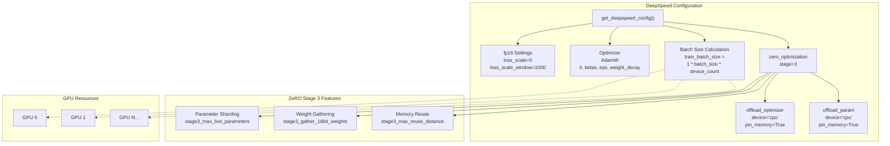
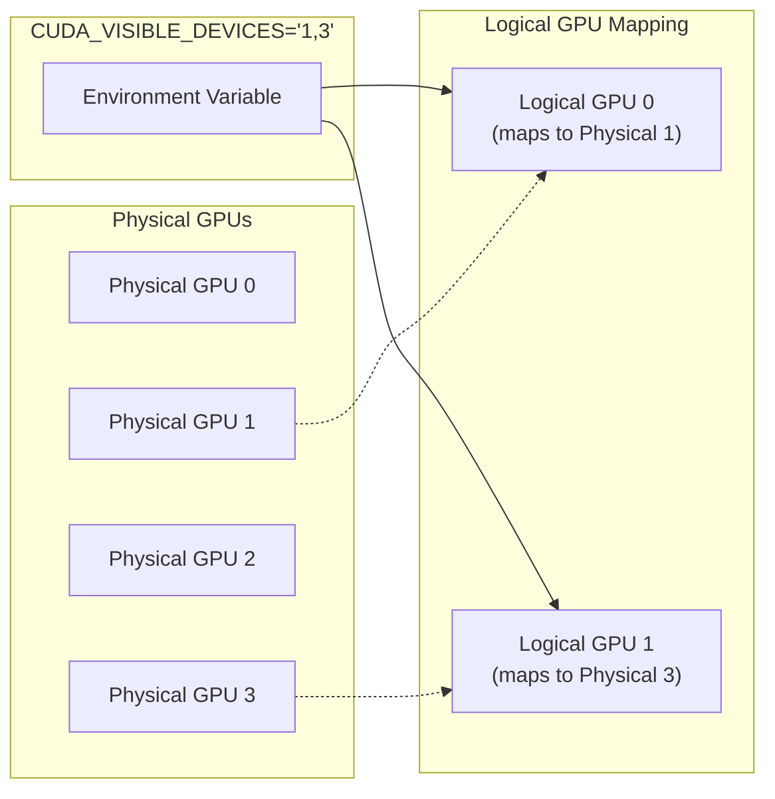
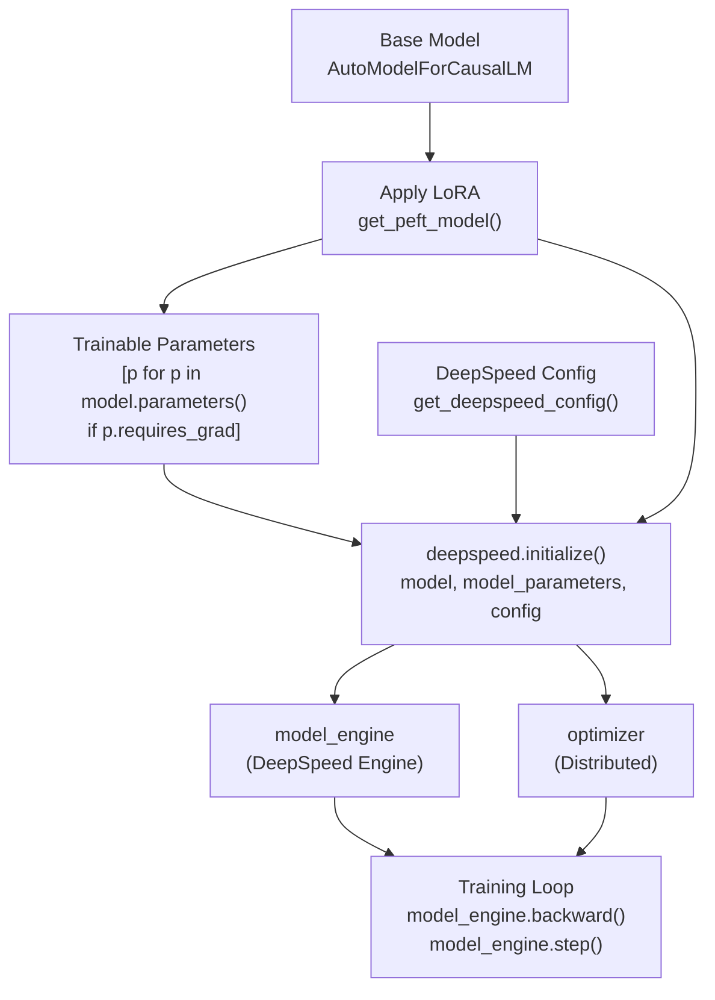
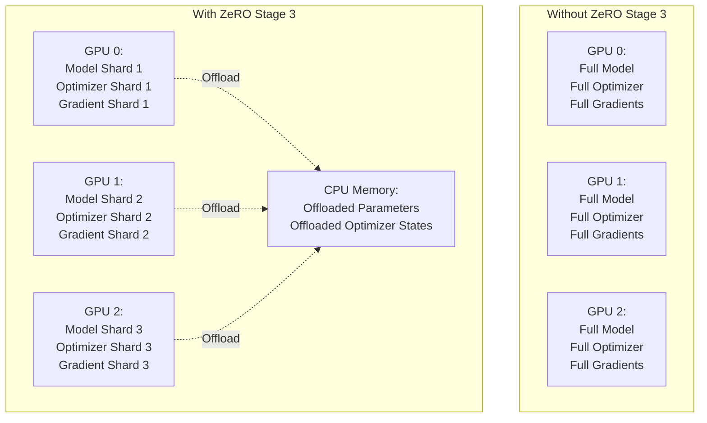
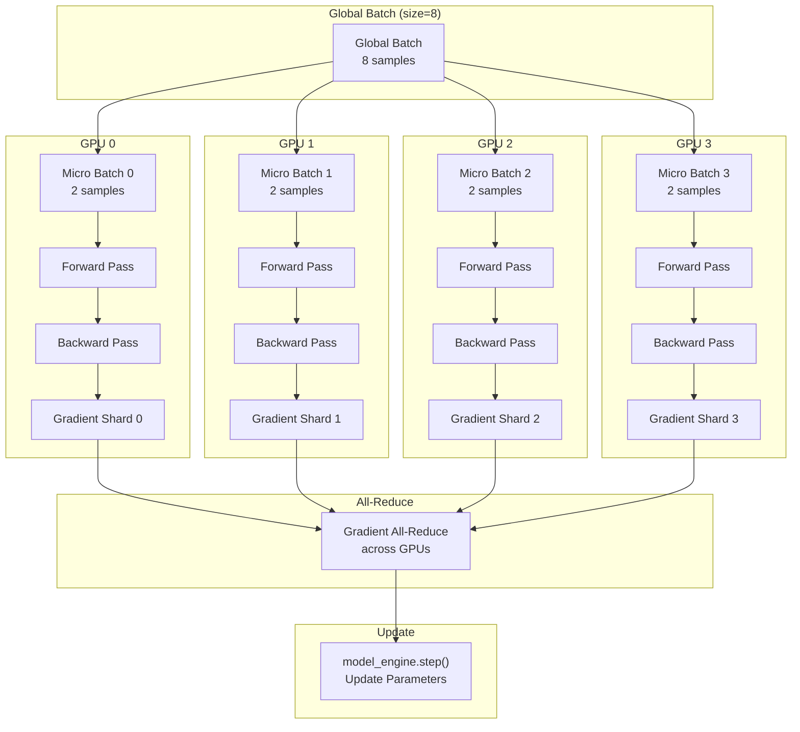

<!-- source: DeepWiki mcp.deepwiki.com · repo microsoft/Text2Grad · page 8.1 Multi-GPU Configuration · fetched 2026-10-26 -->

# Multi-GPU Configuration

<details>
<summary>Relevant source files</summary>

The following files were used as context for generating this wiki page:

- [nl_reward_model/kodcode/train_rm.py](nl_reward_model/kodcode/train_rm.py)
- [nl_reward_model/slf5k/evaluation/2_infer.py](nl_reward_model/slf5k/evaluation/2_infer.py)

</details>


This document provides detailed guidance on configuring and utilizing multiple GPUs for training and inference in the Text2Grad system. Multi-GPU support is implemented through DeepSpeed for training and flexible device mapping strategies for inference.

For information about memory optimization techniques, see [Memory Optimization](#8.4). For distributed training within the PPO loop, see [Distributed Training](#6.8).

## Overview

Text2Grad supports multi-GPU configurations through two primary mechanisms:

1. **DeepSpeed ZeRO Stage 3** for reward model training - enables training large models by partitioning parameters, gradients, and optimizer states across GPUs
2. **Device mapping strategies** for inference - distributes model layers across available GPUs

The system automatically detects available GPUs and scales batch sizes accordingly. Training scripts use DeepSpeed's distributed training capabilities, while inference scripts provide explicit GPU selection through environment variables.

**Sources:** [nl_reward_model/kodcode/train_rm.py:1-427](), [nl_reward_model/slf5k/evaluation/2_infer.py:1-288]()

## DeepSpeed ZeRO Stage 3 Configuration

### Configuration Structure

The `get_deepspeed_config()` function in reward model training scripts defines the DeepSpeed configuration for multi-GPU training:



**Sources:** [nl_reward_model/kodcode/train_rm.py:209-260]()

### Key Configuration Parameters

The DeepSpeed configuration includes several critical parameters:

| Parameter | Value | Purpose |
|-----------|-------|---------|
| `stage` | `3` | Enable ZeRO Stage 3 with full parameter sharding |
| `offload_optimizer.device` | `"cpu"` | Offload optimizer states to CPU memory |
| `offload_param.device` | `"cpu"` | Offload parameters to CPU memory |
| `offload_optimizer.pin_memory` | `True` | Use pinned memory for faster CPU-GPU transfers |
| `stage3_max_live_parameters` | `1e9` | Maximum parameters kept on GPU simultaneously |
| `stage3_max_reuse_distance` | `1e9` | Distance threshold for parameter reuse |
| `stage3_gather_16bit_weights_on_model_save` | `True` | Gather full precision weights when saving checkpoints |
| `overlap_comm` | `True` | Overlap communication with computation |
| `contiguous_gradients` | `True` | Store gradients contiguously for efficiency |
| `sub_group_size` | `1e9` | Size of parameter groups for reduction operations |

**Sources:** [nl_reward_model/kodcode/train_rm.py:237-252]()

### Batch Size Scaling

The training batch size automatically scales with the number of available GPUs:

```python
"train_batch_size": 1 * batch_size * torch.cuda.device_count()
```

This formula calculates the global batch size across all GPUs:
- `batch_size`: Per-GPU micro batch size (e.g., 2)
- `torch.cuda.device_count()`: Number of available GPUs
- Gradient accumulation steps: 1 (no accumulation by default)

For example, with 4 GPUs and `batch_size=2`, the global batch size is 8.

**Sources:** [nl_reward_model/kodcode/train_rm.py:254]()

## GPU Device Management

### Environment Variable Configuration

The `CUDA_VISIBLE_DEVICES` environment variable controls which GPUs are visible to the training or inference process:

```python
os.environ["CUDA_VISIBLE_DEVICES"] = args.gpu_ids  # e.g., "0,1,2,3"
```

This must be set **before** importing PyTorch or loading models. The variable accepts:
- Single GPU: `"0"`
- Multiple GPUs: `"0,1,2,3"` (comma-separated)
- Subset of GPUs: `"1,3"` (use only GPUs 1 and 3)



**Sources:** [nl_reward_model/slf5k/evaluation/2_infer.py:207](), [nl_reward_model/slf5k/evaluation/2_infer.py:57]()

### Device Mapping Strategies

For model loading during inference, the `device_map` parameter controls how model layers are distributed across GPUs:

```python
model = AutoModelForCausalLM.from_pretrained(
    model_path,
    torch_dtype=torch.float16,
    device_map="balanced",  # Distribute layers evenly
    trust_remote_code=True
)
```

Available strategies:

| Strategy | Behavior | Use Case |
|----------|----------|----------|
| `"balanced"` | Distribute layers evenly across GPUs based on layer sizes | Default for inference |
| `"auto"` | Automatically choose optimal distribution | When layer sizes vary significantly |
| `"sequential"` | Place layers sequentially across GPUs | Pipeline parallelism |
| `{"layer.0": 0, "layer.1": 1}` | Manual layer-to-GPU mapping | Fine-grained control |

**Sources:** [nl_reward_model/slf5k/evaluation/2_infer.py:67-72]()

## DeepSpeed Initialization

### Training Setup Flow



The initialization sequence:

1. **Load base model**: `AutoModelForCausalLM.from_pretrained()`
2. **Apply LoRA**: `get_peft_model(model, lora_config)` adds trainable adapter layers
3. **Extract trainable parameters**: Only LoRA parameters require gradients
4. **Initialize DeepSpeed**: `deepspeed.initialize()` creates distributed training engine
5. **Training**: Use `model_engine.backward()` and `model_engine.step()`

**Sources:** [nl_reward_model/kodcode/train_rm.py:340-350]()

### Rank-Based Operations

DeepSpeed assigns each GPU a unique `local_rank` identifier for distributed operations:

```python
# Move data to current GPU
input_ids = batch["input_ids"].to(model_engine.local_rank)
attention_mask = batch["attention_mask"].to(model_engine.local_rank)
labels = batch["labels"].to(model_engine.local_rank)

# Only save checkpoint on rank 0 (primary process)
if model_engine.local_rank == 0:
    checkpoint_dir = os.path.join(exp_dir, f'{epoch}_{step}')
    model_engine.save_pretrained(checkpoint_dir)
```

Common rank-based patterns:

| Pattern | Usage |
|---------|-------|
| `.to(model_engine.local_rank)` | Move tensors to current GPU |
| `if model_engine.local_rank == 0:` | Execute only on primary process (logging, checkpointing) |
| `model_engine.local_rank` | Current GPU index in range [0, num_gpus) |

**Sources:** [nl_reward_model/kodcode/train_rm.py:296-299](), [nl_reward_model/kodcode/train_rm.py:318-322](), [nl_reward_model/kodcode/train_rm.py:371-373]()

## Memory Management

### GPU Cache Clearing

DeepSpeed provides accelerator-agnostic cache clearing:

```python
from deepspeed.accelerator import get_accelerator

# Clear GPU cache after backward pass
get_accelerator().empty_cache()
```

This is particularly important:
- After evaluation steps to free memory before resuming training
- Periodically during long training runs (every 400 steps in the codebase)
- Before checkpoint saving to reduce memory pressure

**Sources:** [nl_reward_model/kodcode/train_rm.py:380](), [nl_reward_model/kodcode/train_rm.py:389](), [nl_reward_model/kodcode/train_rm.py:400]()

### ZeRO Stage 3 Memory Distribution



ZeRO Stage 3 partitions:
- **Parameters**: Each GPU holds 1/N of model parameters
- **Gradients**: Each GPU stores 1/N of gradients
- **Optimizer states**: Each GPU maintains 1/N of optimizer states
- **CPU offloading**: Further reduces GPU memory by moving inactive parameters/states to CPU

**Sources:** [nl_reward_model/kodcode/train_rm.py:237-252]()

## Checkpoint Saving and Loading

### Distributed Checkpoint Format

When saving checkpoints with DeepSpeed ZeRO Stage 3, the checkpoint directory contains:

```
checkpoint_dir/
├── adapter_config.json          # LoRA configuration
├── adapter_model.bin            # LoRA adapter weights
├── zero_to_fp32.py              # DeepSpeed checkpoint consolidation script
└── pytorch_model.bin.index.json # Sharded model index (if applicable)
```

The `save_checkpoint()` function ensures only rank 0 performs I/O:

```python
def save_checkpoint(model_engine, exp_dir, epoch, step):
    if model_engine.local_rank == 0:
        checkpoint_dir = os.path.join(exp_dir, f'{epoch}_{step}')
        os.makedirs(checkpoint_dir, exist_ok=True)
        model_engine.save_pretrained(checkpoint_dir)
```

**Sources:** [nl_reward_model/kodcode/train_rm.py:308-322]()

### Loading for Inference

When loading saved checkpoints for inference, first merge LoRA adapters with the base model (see [Reward Model Inference](#5.3)), then use `device_map` to distribute across GPUs:

```python
tokenizer = AutoTokenizer.from_pretrained(model_path)
model = AutoModelForCausalLM.from_pretrained(
    model_path,
    torch_dtype=torch.float16,
    device_map="balanced",  # Distribute across available GPUs
    trust_remote_code=True
)
```

**Sources:** [nl_reward_model/slf5k/evaluation/2_infer.py:61-75]()

## Batch Processing Across GPUs

### Training Batch Distribution



The DataLoader automatically distributes batches across GPUs:

```python
train_dataloader = DataLoader(
    train_dataset, 
    batch_size=config["batch_size"],  # Per-GPU batch size
    shuffle=True
)

for step, batch in enumerate(train_dataloader):
    # batch is automatically placed on correct GPU by DeepSpeed
    input_ids = batch["input_ids"].to(model_engine.local_rank)
    outputs = model_engine(input_ids=input_ids, ...)
    loss = outputs.loss
    
    model_engine.backward(loss)  # Gradient synchronization handled internally
    model_engine.step()          # Parameter updates coordinated across GPUs
```

**Sources:** [nl_reward_model/kodcode/train_rm.py:358](), [nl_reward_model/kodcode/train_rm.py:370-378]()

### Inference Batch Processing

For inference, batch processing occurs on a single device (or distributed across GPUs with `device_map`):

```python
def process_batch(model, tokenizer, batch_data, max_new_tokens, temperature):
    prompts = [prepare_input(data["post"], data["generated_summary"]) 
               for data in batch_data]
    inputs = tokenizer(prompts, return_tensors="pt", padding=True, truncation=True)
    inputs = inputs.to(model.device)  # Move to model's device
    
    with torch.no_grad():
        outputs = model.generate(
            **inputs,
            max_new_tokens=max_new_tokens,
            temperature=temperature,
            do_sample=True,
            pad_token_id=tokenizer.pad_token_id
        )
```

**Sources:** [nl_reward_model/slf5k/evaluation/2_infer.py:94-105]()

## Troubleshooting

### Common Multi-GPU Issues

| Issue | Symptoms | Solution |
|-------|----------|----------|
| Out of Memory (OOM) | `CUDA out of memory` during training | Reduce `batch_size`, increase `gradient_accumulation_steps`, or enable CPU offloading |
| Uneven GPU utilization | Some GPUs idle while others work | Check `device_map` strategy; use `"balanced"` instead of `"auto"` |
| Checkpoint loading fails | `RuntimeError: Error(s) in loading state_dict` | Ensure ZeRO checkpoint consolidation with `zero_to_fp32.py` before loading |
| Slow training startup | Long delay before first iteration | GPU memory initialization; normal for ZeRO Stage 3 |
| Communication timeout | `NCCL timeout` errors | Check network connectivity between nodes; reduce `stage3_max_live_parameters` |
| Inconsistent gradients | NaN losses or divergence | Verify gradient clipping: `"gradient_clipping": 1.0` in DeepSpeed config |

**Sources:** [nl_reward_model/kodcode/train_rm.py:237-260]()

### Debugging GPU Visibility

To verify GPU detection and visibility:

```python
import torch
print(f"CUDA available: {torch.cuda.is_available()}")
print(f"Number of GPUs: {torch.cuda.device_count()}")
print(f"Current device: {torch.cuda.current_device()}")
for i in range(torch.cuda.device_count()):
    print(f"GPU {i}: {torch.cuda.get_device_name(i)}")
```

Check environment variables:
```bash
echo $CUDA_VISIBLE_DEVICES
nvidia-smi  # Verify GPUs are visible to OS
```

**Sources:** [nl_reward_model/kodcode/train_rm.py:254]()

### Evaluation Memory Management

During evaluation, memory usage can spike because both the model and generated outputs must fit in GPU memory. The codebase implements a random subset evaluation strategy to limit memory usage:

```python
def evaluate_model(model_engine, eval_dataloader, subset_size=200):
    random_indices = torch.randperm(total_eval_samples)[:subset_size]
    eval_subset = torch.utils.data.Subset(eval_dataloader.dataset, random_indices)
    
    # Clear cache before evaluation
    get_accelerator().empty_cache()
    
    with torch.no_grad():
        for batch in eval_subset_loader:
            # Evaluation code...
    
    # Clear cache after evaluation
    get_accelerator().empty_cache()
```

This limits evaluation to a fixed number of samples (default 200) to prevent OOM errors during long training runs.

**Sources:** [nl_reward_model/kodcode/train_rm.py:263-305](), [nl_reward_model/kodcode/train_rm.py:389-401]()

### DeepSpeed Configuration Validation

Verify DeepSpeed configuration by checking initialization output:

```python
model_engine, optimizer, _, _ = deepspeed.initialize(
    model=model,
    model_parameters=trainable_parameters,
    config=ds_config
)

# Check configuration
print(f"DeepSpeed Engine: {model_engine}")
print(f"ZeRO Stage: {ds_config['zero_optimization']['stage']}")
print(f"Offload Optimizer: {ds_config['zero_optimization']['offload_optimizer']}")
print(f"Offload Param: {ds_config['zero_optimization']['offload_param']}")
```

The initialization will print detailed information about:
- ZeRO optimization stage
- Communication backends (NCCL for NVIDIA GPUs)
- Memory optimizations enabled
- Number of GPUs detected

**Sources:** [nl_reward_model/kodcode/train_rm.py:346-350]()

---

