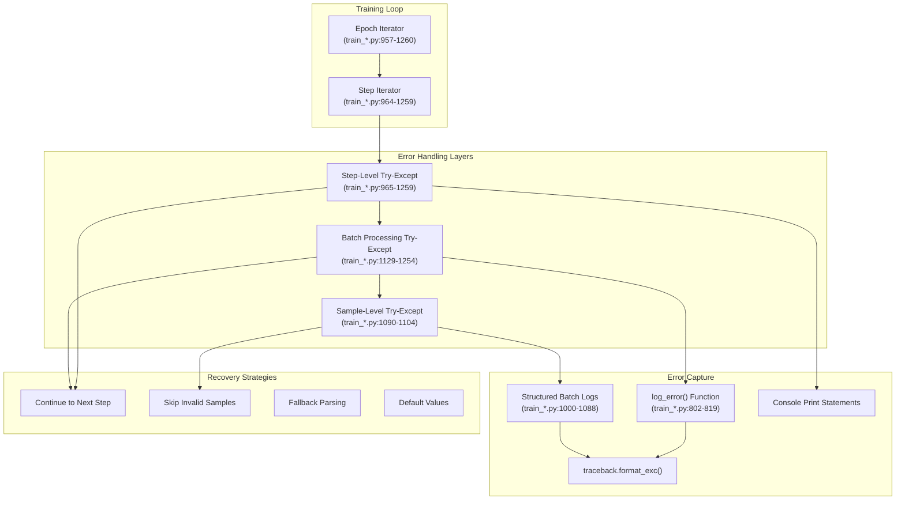
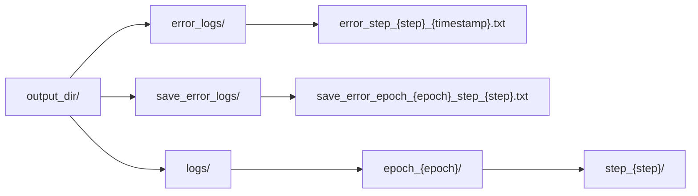
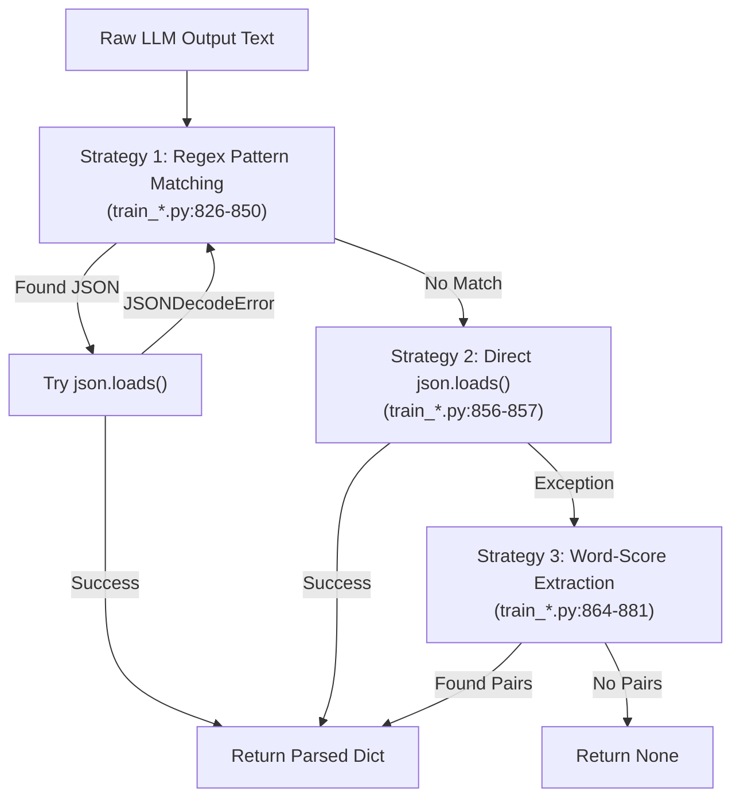
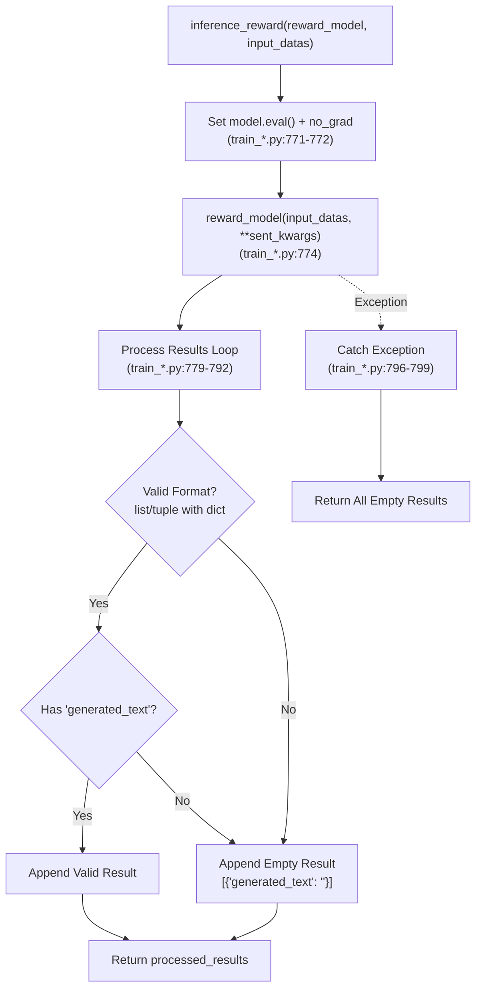
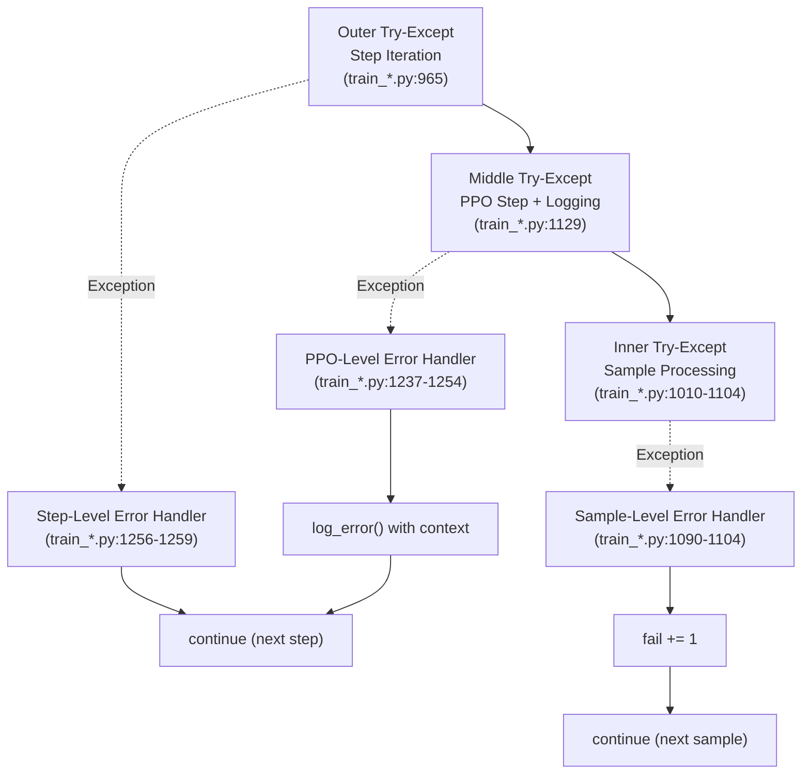
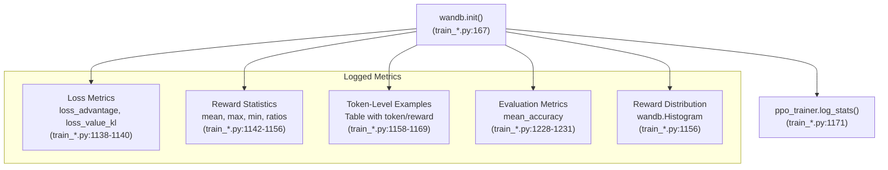
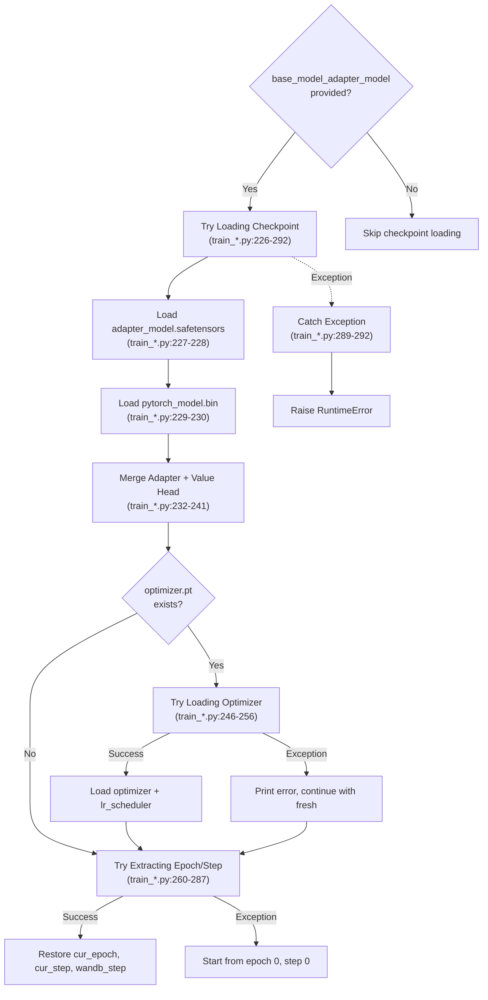
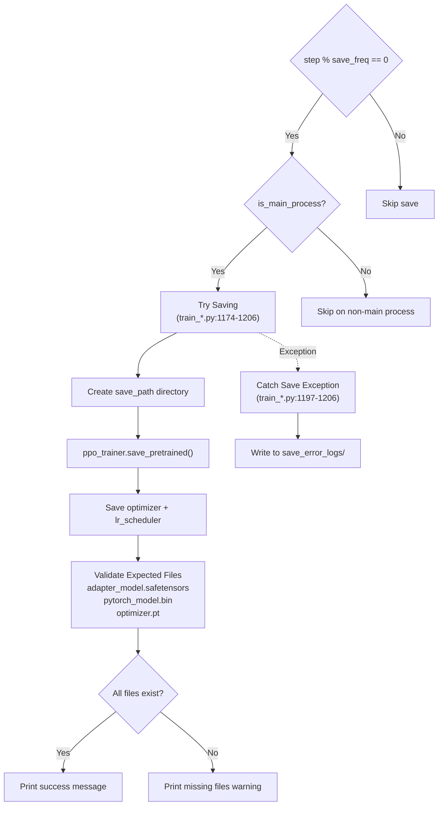
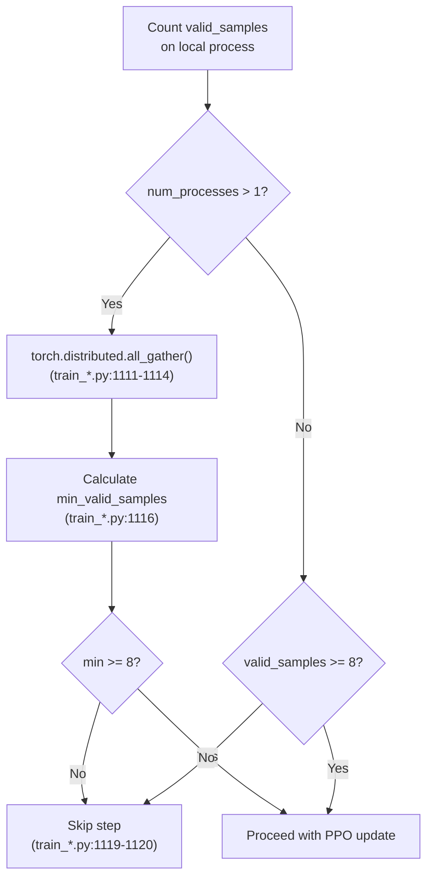

<!-- source: DeepWiki mcp.deepwiki.com · repo microsoft/Text2Grad · page 8.2 Error Handling and Logging · fetched 2026-10-26 -->

# Error Handling and Logging

<details>
<summary>Relevant source files</summary>

The following files were used as context for generating this wiki page:

- [nl_gradiant_policy_optimization/kodcode/train_kodcode.py](nl_gradiant_policy_optimization/kodcode/train_kodcode.py)
- [nl_gradiant_policy_optimization/ultrafeedback/train_ultrafeedback.py](nl_gradiant_policy_optimization/ultrafeedback/train_ultrafeedback.py)

</details>


This document describes the comprehensive error handling and logging strategies implemented throughout the Text2Grad system. These mechanisms ensure robustness during training, provide detailed debugging information, and enable experiment tracking through WandB integration.

For information about the main training workflow, see [PPO Training Loop](#6.2). For checkpoint management details, see [Checkpoint Management](#6.7). For distributed training error handling, see [Distributed Training](#6.8).

---

## System-Wide Error Handling Architecture

The Text2Grad system implements a multi-layered error handling strategy that operates at different granularities: training step level, batch processing level, and individual sample level.



**Sources:** [nl_gradiant_policy_optimization/ultrafeedback/train_ultrafeedback.py:957-1260](), [nl_gradiant_policy_optimization/kodcode/train_kodcode.py:803-1055]()

---

## Error Logging Function

The `log_error()` function provides centralized error logging with rich contextual information for debugging training failures.

### Function Signature and Implementation

```python
def log_error(error_dir, step, error, context=None)
```

Located at:
- [nl_gradiant_policy_optimization/ultrafeedback/train_ultrafeedback.py:802-819]()
- [nl_gradiant_policy_optimization/kodcode/train_kodcode.py:721-738]()

### Log File Structure

Each error log contains:
- **Timestamp**: When the error occurred
- **Step Number**: Training step where error happened
- **Exception Type**: Class name of the exception
- **Exception Message**: Error message string
- **Context Dictionary**: Custom contextual information
- **Full Traceback**: Complete stack trace via `traceback.format_exc()`

### Context Information

The `context` parameter typically includes:

| Context Key | Description | Example Value |
|-------------|-------------|---------------|
| `epoch` | Current training epoch | `0`, `1`, `2` |
| `step` | Current training step | `10`, `20`, `30` |
| `batch_size` | Number of samples in batch | `32`, `16` |
| `wandb_step` | WandB logging step | `125`, `250` |
| `tensor_shapes` | Shapes of tensors involved | `{"question_tensors": [torch.Size([512])]}` |

### Error Directory Structure



**Sources:** [nl_gradiant_policy_optimization/ultrafeedback/train_ultrafeedback.py:802-819](), [nl_gradiant_policy_optimization/ultrafeedback/train_ultrafeedback.py:961-963](), [nl_gradiant_policy_optimization/ultrafeedback/train_ultrafeedback.py:972-973]()

---

## JSON Parsing with Fallback Strategies

The `load_json_from_string()` function implements a robust multi-strategy approach to parse JSON from LLM-generated outputs, which are often malformed.

### Parsing Pipeline



### Strategy Details

**Strategy 1: Regex Pattern Matching**

Uses a nested JSON regex pattern to extract potential JSON objects:
```python
json_pattern = r'\{(?:[^{}]|(?:\{(?:[^{}]|(?:\{[^{}]*\}))*\}))*\}'
```

Iterates through all matches and attempts `json.loads()` on each until one succeeds.

[nl_gradiant_policy_optimization/ultrafeedback/train_ultrafeedback.py:826-850]()

**Strategy 2: Direct JSON Loading**

Attempts direct parsing of the entire text with `json.loads()`.

[nl_gradiant_policy_optimization/ultrafeedback/train_ultrafeedback.py:855-857]()

**Strategy 3: Word-Score Extraction Fallback**

When structured JSON parsing fails, extracts word-score pairs using regex:
```python
word_score_pattern = r'"([^"]+)"\s*:\s*([-+]?\d*\.?\d+)'
```

Returns a minimal dictionary: `{"word_score_list": [(word, float(score))]}`

[nl_gradiant_policy_optimization/ultrafeedback/train_ultrafeedback.py:866-874]()

### Logging Control

The `log_details` parameter (default `False`) controls verbosity:
- When `True`: Prints detailed parsing progress and sample data
- When `False`: Silent operation for production use

**Sources:** [nl_gradiant_policy_optimization/ultrafeedback/train_ultrafeedback.py:821-882](), [nl_gradiant_policy_optimization/kodcode/train_kodcode.py:740-801]()

---

## Reward Model Inference Error Handling

The `inference_reward()` function wraps reward model inference with comprehensive error handling to ensure training continues even when individual samples fail.

### Error Handling Flow



### Validation Checks

The function validates each result with multiple checks:

1. **Type Check**: Result must be a list or tuple
2. **Non-Empty Check**: List must contain at least one element
3. **Dictionary Check**: First element must be a dictionary
4. **Key Check**: Dictionary must contain `generated_text` key

### Error Recovery

When validation fails, the function:
- Prints a warning message with the problematic result
- Appends `[{'generated_text': ''}]` as a placeholder
- Continues processing remaining results
- Never raises an exception that would halt training

[nl_gradiant_policy_optimization/ultrafeedback/train_ultrafeedback.py:759-799]()

**Sources:** [nl_gradiant_policy_optimization/ultrafeedback/train_ultrafeedback.py:759-799](), [nl_gradiant_policy_optimization/kodcode/train_kodcode.py:684-718]()

---

## Training Loop Error Handling

The training loop implements nested error handling at three levels to maximize robustness while capturing diagnostic information.

### Nested Error Handling Structure



### Step-Level Error Handling

Catches errors during the entire training step including generation, reward inference, and PPO update.

```python
for step, batch in tqdm(enumerate(ppo_trainer.dataloader)):
    try:
        # ... entire step logic ...
    except Exception as e:
        print(f"Error in training step {step}: {str(e)}")
        traceback.print_exc()
        continue
```

[nl_gradiant_policy_optimization/ultrafeedback/train_ultrafeedback.py:1256-1259]()

### PPO-Level Error Handling

Wraps the PPO update, logging, and checkpoint saving with detailed error context.

When an error occurs:
1. Calls `log_error()` with contextual information
2. Includes tensor shapes for debugging shape mismatches
3. Prints error location and continues to next step

[nl_gradiant_policy_optimization/ultrafeedback/train_ultrafeedback.py:1237-1254]()

### Sample-Level Error Handling

Processes each sample in a batch independently with error isolation.

When a sample fails:
1. Increments `fail` counter
2. Records error in `batch_log["sample_logs"]`
3. Continues processing remaining samples
4. Sample is excluded from PPO update

[nl_gradiant_policy_optimization/ultrafeedback/train_ultrafeedback.py:1090-1104]()

**Sources:** [nl_gradiant_policy_optimization/ultrafeedback/train_ultrafeedback.py:964-1259](), [nl_gradiant_policy_optimization/kodcode/train_kodcode.py:810-1055]()

---

## Structured Batch Logging

The system maintains detailed structured logs for each batch, tracking sample-level success/failure rates and diagnostic information.

### Batch Log Schema

```python
batch_log = {
    "timestamp": "YYYY-MM-DD HH:MM:SS",
    "epoch": int,
    "step": int,
    "batch_size": int,
    "successful_samples": int,
    "failed_samples": int,
    "sample_logs": [
        {
            "index": int,
            "query": str,          # Truncated to 100 chars
            "response": str,       # Truncated to 100 chars
            "status": str,         # "processing", "success", "failed", "error"
            "error": str,          # Error description (if failed)
            "error_message": str,  # Exception message (if error)
            "traceback": str,      # Full traceback (if error)
            "rewards_count": int,  # Number of rewards (if success)
            "words_count": int     # Number of words (if success)
        }
    ]
}
```

### Sample Status Values

| Status | Meaning | When Set |
|--------|---------|----------|
| `"processing"` | Initial state | Sample processing begins |
| `"success"` | Processed successfully | Valid rewards extracted |
| `"failed"` | Processing failed | Known failure condition |
| `"error"` | Unexpected exception | Caught exception during processing |

### Sample-Level Validation

Each sample undergoes validation checks:

1. **LLM Output Format**: Must be list/tuple with dict containing `generated_text`
2. **Text Length**: Generated text must be at least 20 characters
3. **Parsing Success**: Reward model output must parse correctly
4. **Score List**: Must extract non-empty word-score list

[nl_gradiant_policy_optimization/ultrafeedback/train_ultrafeedback.py:1000-1088]()

**Sources:** [nl_gradiant_policy_optimization/ultrafeedback/train_ultrafeedback.py:1000-1104](), [nl_gradiant_policy_optimization/kodcode/train_kodcode.py:844-948]()

---

## WandB Experiment Tracking

The system integrates Weights & Biases (WandB) for comprehensive experiment tracking with automatic error recovery.

### WandB Integration Points



### Logged Metric Categories

**Training Losses**
- `train/loss_advantage`: PPO advantage loss
- `train/loss_value_kl`: Value function and KL divergence loss
- `train/average_advantages`: Mean advantage values

[nl_gradiant_policy_optimization/ultrafeedback/train_ultrafeedback.py:1138-1140]()

**Reward Statistics**
- `rewards/mean`: Average reward across all tokens
- `rewards/max`: Maximum reward value
- `rewards/min`: Minimum reward value
- `rewards/positive_ratio`: Fraction of tokens with positive rewards
- `rewards/negative_ratio`: Fraction of tokens with negative rewards
- `rewards/zero_ratio`: Fraction of tokens with neutral rewards
- `rewards/sample_count`: Total number of reward values
- `rewards/distribution`: Histogram visualization

[nl_gradiant_policy_optimization/ultrafeedback/train_ultrafeedback.py:1142-1156]()

**Token-Level Examples**

Logs up to 3 examples per step with detailed token-reward mappings:

```python
token_table = wandb.Table(columns=["token", "reward"])
for token, reward in zip(words[i], rewards[i].tolist()):
    token_table.add_data(token, reward)
```

Also logs query, response, and average reward for each example.

[nl_gradiant_policy_optimization/ultrafeedback/train_ultrafeedback.py:1158-1169]()

**Evaluation Metrics**

For UltraFeedback task:
- `eval/mean_accuracy`: Similarity-based accuracy vs chosen/rejected responses
- `eval/accuracies`: Per-sample accuracy list

[nl_gradiant_policy_optimization/ultrafeedback/train_ultrafeedback.py:1228-1231]()

### WandB Step Management

The system maintains a global `wandb_step` counter that:
- Persists across checkpoint restores
- Increments after each successful training step
- Calculated from: `wandb_step = cur_epoch * steps_per_epoch + cur_step`

[nl_gradiant_policy_optimization/ultrafeedback/train_ultrafeedback.py:273]()

**Sources:** [nl_gradiant_policy_optimization/ultrafeedback/train_ultrafeedback.py:167](), [nl_gradiant_policy_optimization/ultrafeedback/train_ultrafeedback.py:1138-1235]()

---

## Checkpoint Loading Error Handling

The checkpoint loading process includes robust error handling for adapter models, value heads, optimizer states, and training state restoration.

### Checkpoint Loading Pipeline



### Adapter Model Loading

Loads LoRA adapter weights from `adapter_model.safetensors` and renames keys to match TRL's expected format:

```python
new_adapter_model_state = {
    "pretrained_model." + k[:-7] + ".default" + k[-7:]: v
    for k, v in adapter_model_state.items()
}
```

[nl_gradiant_policy_optimization/ultrafeedback/train_ultrafeedback.py:232-235]()

### Optimizer State Loading

Attempts to load optimizer and learning rate scheduler state with error handling:

```python
try:
    optimizer_state = torch.load(optimizer_path, map_location="cuda:1", weights_only=True)
    if not optimizer_state:
        raise ValueError("Empty optimizer state")
    optimizer.load_state_dict(optimizer_state['optimizer'])
    if optimizer_state.get('lr_scheduler') and lr_scheduler:
        lr_scheduler.load_state_dict(optimizer_state['lr_scheduler'])
    print("Successfully loaded optimizer state")
except Exception as e:
    print(f"Error loading optimizer state: {str(e)}")
    print("Continuing with fresh optimizer")
```

[nl_gradiant_policy_optimization/ultrafeedback/train_ultrafeedback.py:246-256]()

### Training State Restoration

Extracts epoch and step numbers from checkpoint path (e.g., `epoch_1_step_25`) and calculates `wandb_step`:

```python
path_parts = checkpoint_path.split('/')[-1].split('_')
cur_epoch = int(path_parts[path_parts.index('epoch') + 1])
cur_step = int(path_parts[path_parts.index('step') + 1])
wandb_step = cur_epoch * steps_per_epoch + cur_step
```

[nl_gradiant_policy_optimization/ultrafeedback/train_ultrafeedback.py:262-273]()

**Sources:** [nl_gradiant_policy_optimization/ultrafeedback/train_ultrafeedback.py:224-292](), [nl_gradiant_policy_optimization/kodcode/train_kodcode.py:208-276]()

---

## Checkpoint Saving Error Handling

The checkpoint saving process validates saved files and logs errors to dedicated error directories.

### Save Process with Validation



### Expected Checkpoint Files

| File | Description |
|------|-------------|
| `adapter_model.safetensors` | LoRA adapter weights |
| `pytorch_model.bin` | Value head weights |
| `optimizer.pt` | Optimizer and LR scheduler state |

### Save Error Logging

When checkpoint saving fails:
1. Creates `save_error_logs/` directory
2. Writes detailed error file: `save_error_epoch_{epoch}_step_{step}.txt`
3. Includes exception message and full traceback
4. Training continues without checkpoint

[nl_gradiant_policy_optimization/ultrafeedback/train_ultrafeedback.py:1197-1206]()

**Sources:** [nl_gradiant_policy_optimization/ultrafeedback/train_ultrafeedback.py:1173-1206](), [nl_gradiant_policy_optimization/kodcode/train_kodcode.py:997-1030]()

---

## Distributed Training Error Handling

The system includes special error handling for multi-GPU training scenarios, particularly around sample count synchronization.

### Valid Sample Count Synchronization



### Sample Count Validation Logic

**Multi-GPU Mode:**
1. Creates tensor with local process's valid sample count
2. Gathers counts from all processes using `torch.distributed.all_gather()`
3. Computes minimum across all processes
4. Skips step if any process has fewer than 8 valid samples

[nl_gradiant_policy_optimization/ultrafeedback/train_ultrafeedback.py:1110-1120]()

**Single-GPU Mode:**
- Directly checks if local count is at least 8
- Skips step if insufficient samples

[nl_gradiant_policy_optimization/ultrafeedback/train_ultrafeedback.py:1122-1124]()

### NCCL Configuration

Sets NCCL environment variables at each step to avoid peer-to-peer communication issues:

```python
os.environ["NCCL_P2P_DISABLE"] = "1"
os.environ["NCCL_P2P_LEVEL"] = "NVL"
```

[nl_gradiant_policy_optimization/ultrafeedback/train_ultrafeedback.py:966-967]()

**Sources:** [nl_gradiant_policy_optimization/ultrafeedback/train_ultrafeedback.py:1108-1124](), [nl_gradiant_policy_optimization/ultrafeedback/train_ultrafeedback.py:966-967]()

---

## Console Logging Patterns

The system uses extensive console logging with `print()` statements to provide real-time feedback during training.

### Print Statement Categories

**Progress Indicators:**
- Model loading status
- Inference start/finish markers
- Sample processing counts
- Checkpoint save operations

**Debugging Information:**
- Tensor shapes and sample counts
- Parsing success/failure with text samples
- Fuzzy matching results
- Parameter optimization status

**Error Messages:**
- Exception messages with context
- Failed sample indices
- Invalid data format warnings
- Missing checkpoint files

**Validation Warnings:**
- Insufficient valid samples
- Unmatched spans in fuzzy matching
- Empty or invalid LLM outputs
- Optimizer loading failures

### Example Print Patterns

```python
print(f"Loading adapter model from {script_args.base_model_adapter_model}")
print(f"Restored training state: epoch={cur_epoch}, step={cur_step}, wandb_step={wandb_step}")
print(f"Warning: Invalid llm_output format at index {ind}: {type(llm_output)}")
print(f"Failed {fail} samples in the current step!!! Successfully processed {len(rewards)} samples")
print(f"Error processing output {ind}: {str(e)}")
```

**Sources:** [nl_gradiant_policy_optimization/ultrafeedback/train_ultrafeedback.py:225](), [nl_gradiant_policy_optimization/ultrafeedback/train_ultrafeedback.py:274](), [nl_gradiant_policy_optimization/ultrafeedback/train_ultrafeedback.py:1022](), [nl_gradiant_policy_optimization/ultrafeedback/train_ultrafeedback.py:1106](), [nl_gradiant_policy_optimization/ultrafeedback/train_ultrafeedback.py:1091]()

---

## Debugging Tips

### Common Error Scenarios

**Scenario 1: JSON Parsing Failures**
- **Symptoms**: High rate of failed samples, parsing error messages
- **Debug**: Set `log_details=True` in `load_json_from_string()` calls
- **Location**: [nl_gradiant_policy_optimization/ultrafeedback/train_ultrafeedback.py:710]()
- **Check**: Examine LLM output format and prompt engineering

**Scenario 2: Span Matching Failures**
- **Symptoms**: Warnings about unmatched spans, "No words assigned non-default scores"
- **Debug**: Review fuzzy matching thresholds in `fuzzy_find()`
- **Location**: [nl_gradiant_policy_optimization/ultrafeedback/train_ultrafeedback.py:452-532]()
- **Check**: Compare span text with actual response content

**Scenario 3: Distributed Training Hangs**
- **Symptoms**: Training stops without error, processes hang
- **Debug**: Check minimum valid sample counts across processes
- **Location**: [nl_gradiant_policy_optimization/ultrafeedback/train_ultrafeedback.py:1110-1120]()
- **Check**: Review `all_valid_samples` distribution

**Scenario 4: Checkpoint Loading Failures**
- **Symptoms**: RuntimeError when resuming training
- **Debug**: Check error logs, verify file existence
- **Location**: [nl_gradiant_policy_optimization/ultrafeedback/train_ultrafeedback.py:289-292]()
- **Check**: Validate checkpoint path and file integrity

### Useful Log Files for Debugging

| Log Type | Location | Contains |
|----------|----------|----------|
| Error logs | `output_dir/error_logs/` | Full tracebacks with context |
| Save errors | `output_dir/save_error_logs/` | Checkpoint save failures |
| Step logs | `output_dir/logs/epoch_{e}/step_{s}/` | Per-step detailed logs |
| WandB logs | WandB dashboard | Metrics, examples, distributions |

**Sources:** [nl_gradiant_policy_optimization/ultrafeedback/train_ultrafeedback.py:802-819](), [nl_gradiant_policy_optimization/ultrafeedback/train_ultrafeedback.py:961-973](), [nl_gradiant_policy_optimization/ultrafeedback/train_ultrafeedback.py:1199]()

---

