<!-- source: DeepWiki mcp.deepwiki.com · repo microsoft/Text2Grad · page 8.3 Hyperparameter Tuning · fetched 2026-10-26 -->

# Hyperparameter Tuning

<details>
<summary>Relevant source files</summary>

The following files were used as context for generating this wiki page:

- [nl_gradiant_policy_optimization/kodcode/train_kodcode.py](nl_gradiant_policy_optimization/kodcode/train_kodcode.py)
- [nl_gradiant_policy_optimization/ultrafeedback/train_ultrafeedback.py](nl_gradiant_policy_optimization/ultrafeedback/train_ultrafeedback.py)

</details>


This page provides comprehensive guidance for tuning hyperparameters in the Text2Grad system. Hyperparameter tuning is critical for achieving optimal policy optimization performance across different tasks (code generation, question answering, summarization) and hardware configurations.

**Scope**: This page covers all tunable parameters in the policy optimization phase, including learning rates, KL penalties, batch sizes, generation parameters, and LoRA configurations. For reward model training hyperparameters, see [5.1](#5.1). For multi-GPU configuration details, see [8.1](#8.1).

## Hyperparameter Categories

Text2Grad hyperparameters fall into five main categories that control different aspects of the training pipeline:

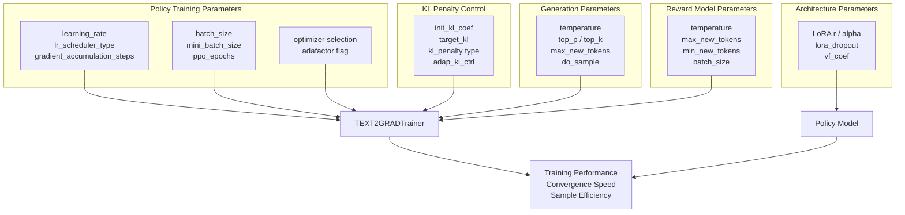

**Sources**: [nl_gradiant_policy_optimization/ultrafeedback/train_ultrafeedback.py:95-163](), [nl_gradiant_policy_optimization/kodcode/train_kodcode.py:78-156]()

## ScriptArguments Configuration

The `ScriptArguments` dataclass centralizes all command-line configurable hyperparameters. Understanding this structure is essential for tuning.

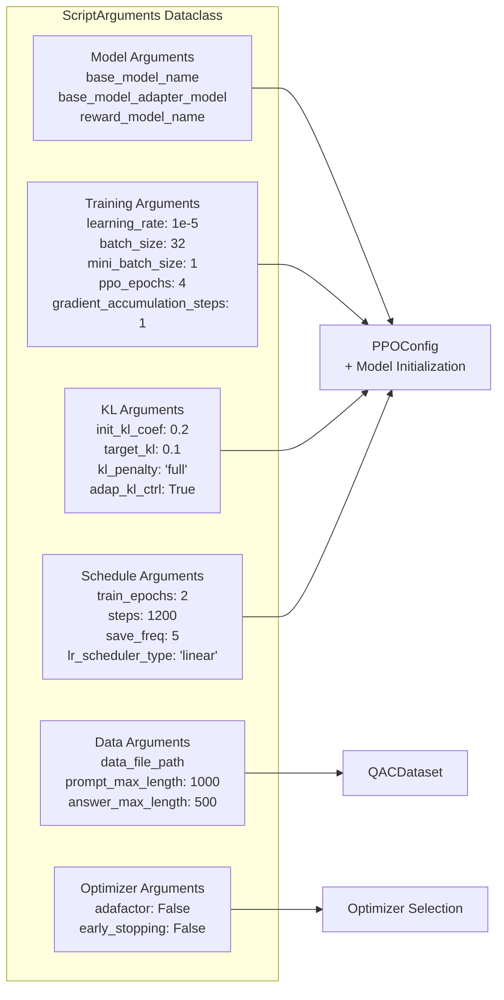

**Default Values Table**:

| Parameter | Default | Type | Description |
|-----------|---------|------|-------------|
| `learning_rate` | 1e-5 | float | Base learning rate for policy updates |
| `batch_size` | 32 | int | Number of samples per training batch |
| `mini_batch_size` | 1 | int | PPO minibatch size for gradient updates |
| `ppo_epochs` | 4 | int | Number of optimization epochs per batch |
| `init_kl_coef` | 0.2 | float | Initial KL penalty coefficient |
| `target_kl` | 0.1 | float | Target KL divergence for early stopping |
| `gradient_accumulation_steps` | 1 | int | Steps to accumulate gradients before update |
| `vf_coef` | 0.1 | float | Value function loss coefficient |

**Sources**: [nl_gradiant_policy_optimization/ultrafeedback/train_ultrafeedback.py:95-130](), [nl_gradiant_policy_optimization/kodcode/train_kodcode.py:78-123]()

## Learning Rate and Optimization

### Learning Rate Selection

The learning rate is the most critical hyperparameter for policy optimization. Text2Grad uses a conservative default of `1e-5` for stability with LoRA fine-tuning.

**Recommended Ranges by Task**:

| Task | Learning Rate | Rationale |
|------|---------------|-----------|
| Code Generation | 5e-6 to 2e-5 | Code requires precise token prediction |
| Question Answering | 1e-5 to 5e-5 | More robust to higher learning rates |
| Summarization | 1e-5 to 3e-5 | Balance between fluency and accuracy |

**Learning Rate Schedule**:

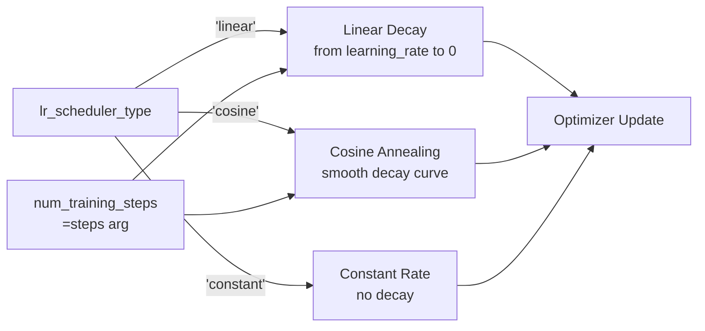

The scheduler is created at [nl_gradiant_policy_optimization/ultrafeedback/train_ultrafeedback.py:314-319]():

```
lr_scheduler = get_scheduler(
    name=script_args.lr_scheduler_type,
    optimizer=optimizer,
    num_warmup_steps=0,
    num_training_steps=script_args.steps,
)
```

**Tuning Strategy**:
1. Start with default `1e-5` and `linear` schedule
2. Monitor `train/loss_advantage` in WandB - should decrease steadily
3. If loss plateaus early, increase learning rate by 2x
4. If loss is unstable (large spikes), decrease by 0.5x
5. For transfer learning (loading adapters), reduce by 0.5x

**Sources**: [nl_gradiant_policy_optimization/ultrafeedback/train_ultrafeedback.py:104-105, 314-319](), [nl_gradiant_policy_optimization/kodcode/train_kodcode.py:88-89, 298-303]()

### Optimizer Configuration

Text2Grad supports two optimizers configured via the `adafactor` flag:

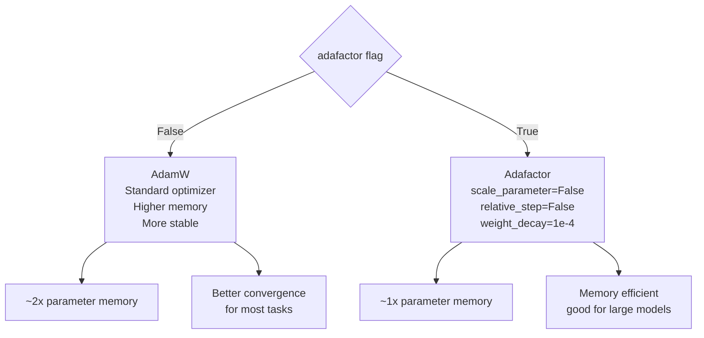

The Adafactor configuration is at [nl_gradiant_policy_optimization/ultrafeedback/train_ultrafeedback.py:304-312]():

```
if script_args.adafactor:
    optimizer = Adafactor(
        filter(lambda p: p.requires_grad, model.parameters()),
        scale_parameter=False,
        relative_step=False,
        warmup_init=False,
        lr=config.learning_rate,
        weight_decay=1e-4
    )
```

**When to use Adafactor**:
- Models > 7B parameters with limited GPU memory
- When optimizer states don't fit in GPU memory
- Accept slightly slower convergence for memory savings

**Sources**: [nl_gradiant_policy_optimization/ultrafeedback/train_ultrafeedback.py:304-312](), [nl_gradiant_policy_optimization/kodcode/train_kodcode.py:288-296]()

## Batch Size and PPO Epochs

### Batch Size Hierarchy

Text2Grad uses a three-level batch size hierarchy that affects memory usage and gradient quality:

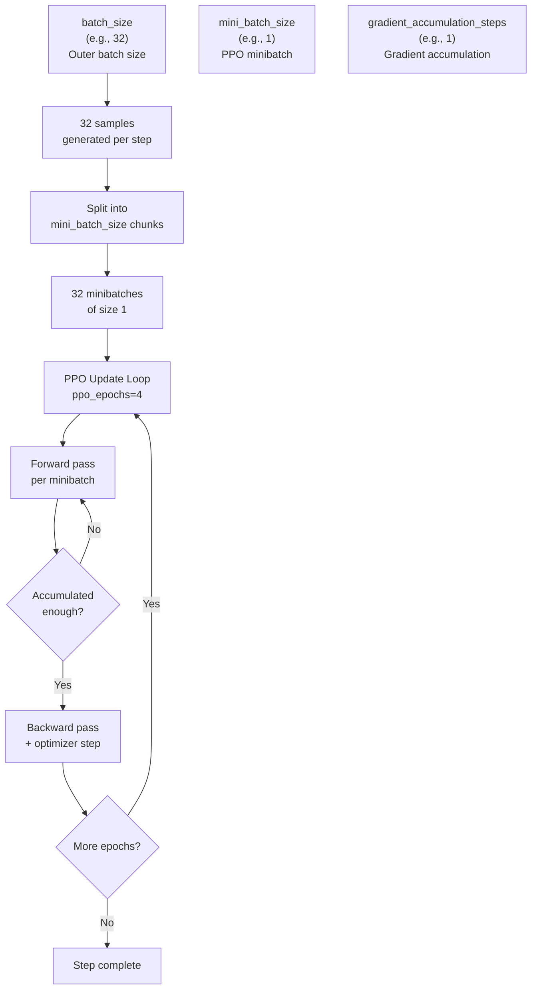

**Configuration at [nl_gradiant_policy_optimization/ultrafeedback/train_ultrafeedback.py:145-163]()**:

```
config = PPOConfig(
    vf_coef=0.1,
    steps=script_args.steps,
    model_name=script_args.base_model_name,
    learning_rate=script_args.learning_rate,
    log_with=script_args.log_with,
    batch_size=script_args.batch_size,
    mini_batch_size=script_args.mini_batch_size,
    gradient_accumulation_steps=script_args.gradient_accumulation_steps,
    ...
    ppo_epochs=script_args.ppo_epochs,
    ...
)
```

**Recommended Configurations by GPU Memory**:

| GPU Memory | batch_size | mini_batch_size | gradient_accumulation_steps | Effective Batch |
|------------|------------|-----------------|----------------------------|-----------------|
| 24GB (3090/4090) | 16 | 1 | 2 | 32 |
| 40GB (A100) | 32 | 1 | 1 | 32 |
| 80GB (A100) | 64 | 2 | 1 | 64 |
| Multi-GPU (4x24GB) | 32 | 1 | 1 | 128 total |

**Tuning Guidelines**:
- Keep `mini_batch_size=1` for most cases (memory efficient)
- Increase `batch_size` to improve gradient estimates
- Use `gradient_accumulation_steps` when memory is limited
- Effective batch size = `batch_size × gradient_accumulation_steps × num_gpus`

**Sources**: [nl_gradiant_policy_optimization/ultrafeedback/train_ultrafeedback.py:106-109, 145-163](), [nl_gradiant_policy_optimization/kodcode/train_kodcode.py:90-93, 137-156]()

### PPO Epochs

The `ppo_epochs` parameter controls how many optimization passes are made over each batch:

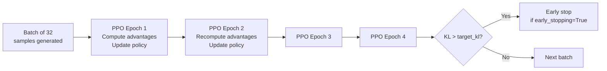

**Default**: `ppo_epochs=4`

**Tuning Strategy**:
- **Lower (2-3)**: Faster training, less sample efficient, less stable
- **Higher (5-8)**: Slower training, more sample efficient, risk of overfitting
- Monitor `ppo/policy/approxkl` in WandB - should stay near `target_kl`

**Sources**: [nl_gradiant_policy_optimization/ultrafeedback/train_ultrafeedback.py:108, 157](), [nl_gradiant_policy_optimization/kodcode/train_kodcode.py:92, 149]()

## KL Penalty Tuning

The KL divergence penalty prevents the policy from diverging too far from the reference (original) policy. This is critical for stable training.

### KL Penalty Mechanisms

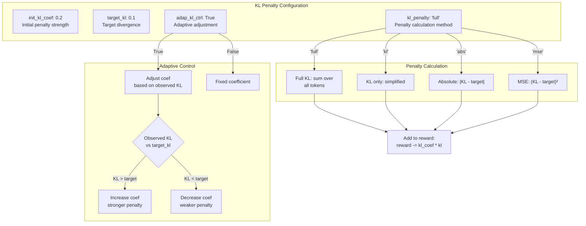

**Configuration at [nl_gradiant_policy_optimization/ultrafeedback/train_ultrafeedback.py:120-121, 159-160, 163]()**:

```
init_kl_coef: Optional[float] = field(default=0.2)
adap_kl_ctrl: Optional[bool] = field(default=True)
...
config = PPOConfig(
    ...
    init_kl_coef=script_args.init_kl_coef,
    adap_kl_ctrl=script_args.adap_kl_ctrl,
    ...
    kl_penalty=script_args.kl_penalty
)
```

### KL Tuning Strategy

**Recommended Values by Task**:

| Task | init_kl_coef | target_kl | kl_penalty | adap_kl_ctrl |
|------|--------------|-----------|------------|--------------|
| Code Generation | 0.15-0.25 | 0.05-0.1 | 'full' | True |
| Question Answering | 0.2-0.3 | 0.1-0.15 | 'full' | True |
| Summarization | 0.2-0.4 | 0.1-0.2 | 'full' | True |

**Diagnostic Guidelines**:

1. **If policy diverges too fast** (high `ppo/policy/approxkl`):
   - Increase `init_kl_coef` (e.g., 0.2 → 0.3)
   - Decrease `target_kl` (e.g., 0.1 → 0.05)
   - Decrease learning rate

2. **If policy doesn't improve** (low reward gains):
   - Decrease `init_kl_coef` (e.g., 0.2 → 0.15)
   - Increase `target_kl` (e.g., 0.1 → 0.15)
   - Check reward model quality

3. **If training is unstable**:
   - Enable `early_stopping=True`
   - Use `kl_penalty='full'` (most stable)
   - Ensure `adap_kl_ctrl=True`

**Monitoring**: Track these WandB metrics:
- `ppo/policy/approxkl` - should stay near `target_kl`
- `ppo/policy/kl` - total KL divergence
- `objective/kl` - KL penalty contribution to loss

**Sources**: [nl_gradiant_policy_optimization/ultrafeedback/train_ultrafeedback.py:112, 120-121, 128, 159-163](), [nl_gradiant_policy_optimization/kodcode/train_kodcode.py:98, 110-114, 121, 151-155]()

## Generation Parameters

Generation parameters control how the policy model generates responses during training. These affect both the quality and diversity of generated samples.

### Policy Model Generation

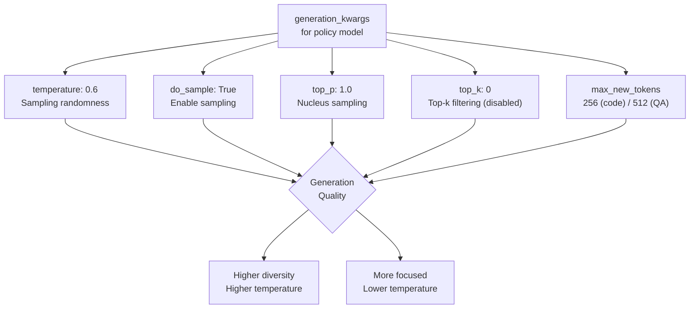

**Configuration at [nl_gradiant_policy_optimization/ultrafeedback/train_ultrafeedback.py:360-368]()**:

```
generation_kwargs = {
    "temperature": 0.6,
    "do_sample": True,
    "top_p": 1,
    "top_k": 0,
    "max_new_tokens": 512,
    "pad_token_id": tokenizer.pad_token_id,
    "eos_token_id": tokenizer.eos_token_id,
}
```

**Task-Specific Recommendations**:

| Parameter | Code Generation | Question Answering | Summarization |
|-----------|-----------------|-------------------|---------------|
| `temperature` | 0.6-0.7 | 0.6-0.8 | 0.5-0.7 |
| `top_p` | 0.9-1.0 | 1.0 | 0.9-1.0 |
| `top_k` | 0 (disabled) | 0 (disabled) | 0 (disabled) |
| `max_new_tokens` | 256-512 | 512-768 | 256-512 |
| `do_sample` | True | True | True |

**Tuning Guidelines**:

- **Temperature**:
  - Lower (0.3-0.5): More deterministic, good for code
  - Medium (0.6-0.7): Balanced exploration
  - Higher (0.8-1.0): More diverse, good for creative tasks
  
- **Top-p (nucleus sampling)**:
  - Keep at 1.0 for maximum diversity during training
  - Reduce to 0.9 if generations are too random
  
- **Max New Tokens**:
  - Code: 256 tokens (shorter functions)
  - QA: 512 tokens (detailed answers)
  - Summarization: Depends on source length

**Sources**: [nl_gradiant_policy_optimization/ultrafeedback/train_ultrafeedback.py:360-368](), [nl_gradiant_policy_optimization/kodcode/train_kodcode.py:346-354]()

### Reward Model Inference Parameters

The reward model has separate generation parameters that affect feedback quality:

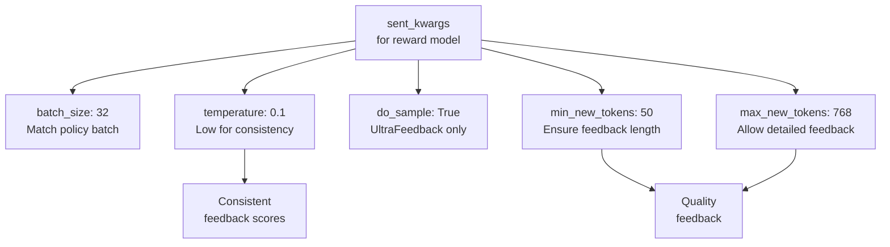

**Configuration at [nl_gradiant_policy_optimization/ultrafeedback/train_ultrafeedback.py:371-379]()**:

```
sent_kwargs = {
    "batch_size": script_args.batch_size,
    "do_sample": True,
    "temperature": 0.1,
    "min_new_tokens": 50,
    "max_new_tokens": 768,
    "pad_token_id": reward_tokenizer.eos_token_id,
    "eos_token_id": reward_tokenizer.eos_token_id,
}
```

**Key Differences from Policy Generation**:

| Parameter | Policy Model | Reward Model | Rationale |
|-----------|--------------|--------------|-----------|
| `temperature` | 0.6-0.7 | 0.1 | Reward model needs consistency |
| `max_new_tokens` | 256-512 | 768 | Feedback includes spans + critique |
| `min_new_tokens` | Not set | 50 | Ensure complete feedback |
| `do_sample` | True | True (UF), False (KodCode) | Task dependent |

**Tuning Strategy**:
- Keep `temperature` low (0.1) for reproducible feedback
- Increase `max_new_tokens` if feedback gets truncated
- Monitor parsing failures - may need longer `min_new_tokens`

**Sources**: [nl_gradiant_policy_optimization/ultrafeedback/train_ultrafeedback.py:371-379](), [nl_gradiant_policy_optimization/kodcode/train_kodcode.py:357-362]()

## LoRA Configuration

LoRA (Low-Rank Adaptation) parameters control parameter-efficient fine-tuning. These affect model capacity and training efficiency.

### LoRA Parameter Space

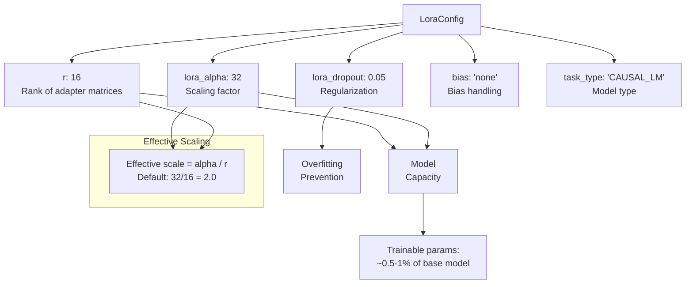

**Configuration at [nl_gradiant_policy_optimization/ultrafeedback/train_ultrafeedback.py:211-217]()**:

```
lora_config = LoraConfig(
    r=16,
    lora_alpha=32,
    lora_dropout=0.05,
    bias="none",
    task_type="CAUSAL_LM",
)
```

**Parameter Effects**:

| Parameter | Low Value | High Value | Trade-off |
|-----------|-----------|------------|-----------|
| `r` (rank) | 4-8 | 32-64 | Capacity vs memory |
| `lora_alpha` | 16 | 64 | Update magnitude |
| `lora_dropout` | 0.0 | 0.1 | Regularization vs capacity |
| `alpha/r ratio` | 1.0 | 4.0 | Conservative vs aggressive |

**Recommended Configurations**:

**Standard (Default)**:
- `r=16`, `lora_alpha=32` (ratio=2.0)
- Good balance for most tasks
- ~0.5% trainable parameters

**Low Memory**:
- `r=8`, `lora_alpha=16` (ratio=2.0)
- Reduced capacity, less memory
- Use when GPU memory is limited

**High Capacity**:
- `r=32`, `lora_alpha=64` (ratio=2.0)
- More expressive adapters
- Better for complex tasks

**Aggressive Updates**:
- `r=16`, `lora_alpha=64` (ratio=4.0)
- Stronger adaptation signal
- Risk of instability

**Tuning Strategy**:
1. Start with defaults (`r=16`, `alpha=32`)
2. If underfitting: increase `r` to 32
3. If overfitting: increase `lora_dropout` to 0.1
4. Keep `alpha/r` ratio between 1.5 and 3.0
5. Monitor trainable parameter count: should be < 1% of base

**Sources**: [nl_gradiant_policy_optimization/ultrafeedback/train_ultrafeedback.py:211-217](), [nl_gradiant_policy_optimization/kodcode/train_kodcode.py:194-200]()

## Training Schedule Parameters

Training schedule parameters control the overall training duration and checkpoint frequency.

### Schedule Configuration

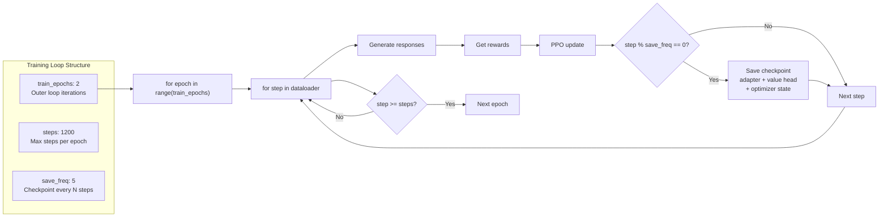

**Configuration at [nl_gradiant_policy_optimization/ultrafeedback/train_ultrafeedback.py:118-119, 115]()**:

```
train_epochs: Optional[int] = field(default=2)
steps: Optional[int] = field(default=1200)
save_freq: Optional[int] = field(default=5)
```

**Calculating Effective Training Steps**:

```
dataset_size = len(dataset)
batch_size_per_gpu = batch_size
num_gpus = torch.cuda.device_count()

steps_per_epoch = dataset_size // (batch_size_per_gpu * num_gpus)
total_steps = min(steps_per_epoch, steps) * train_epochs
```

**Checkpoint Saving Logic at [nl_gradiant_policy_optimization/ultrafeedback/train_ultrafeedback.py:1173-1206]()**:

```
if step != 0 and step % script_args.save_freq == 0:
    if ppo_trainer.accelerator.is_main_process:
        save_path = os.path.join(script_args.output_dir, f"epoch_{epoch}_step_{step}")
        ppo_trainer.save_pretrained(save_path)
        
        torch.save({
            'optimizer': optimizer.state_dict(),
            'lr_scheduler': lr_scheduler.state_dict(),
        }, os.path.join(save_path, "optimizer.pt"))
```

**Tuning Recommendations**:

| Scenario | train_epochs | steps | save_freq | Rationale |
|----------|--------------|-------|-----------|-----------|
| Quick experiment | 1 | 100-200 | 50 | Fast iteration |
| Standard training | 2 | 1200 | 5 | Default balanced |
| High-quality model | 3-4 | 2000 | 5 | More training data |
| Limited disk space | 2 | 1200 | 20 | Fewer checkpoints |
| Unstable training | 2 | 1200 | 2 | Frequent checkpoints |

**Training Resumption**:

The system automatically resumes from checkpoints by:
1. Extracting `cur_epoch` and `cur_step` from checkpoint path
2. Calculating `wandb_step` for continuous logging
3. Skipping already-trained steps

See [nl_gradiant_policy_optimization/ultrafeedback/train_ultrafeedback.py:260-287]() for implementation.

**Sources**: [nl_gradiant_policy_optimization/ultrafeedback/train_ultrafeedback.py:115, 118-119, 260-287, 957-1206](), [nl_gradiant_policy_optimization/kodcode/train_kodcode.py:104, 108-109, 245-271, 803-1055]()

## Task-Specific Tuning Guidelines

Different tasks require different hyperparameter configurations due to their unique characteristics.

### Code Generation (KodCode)

**Characteristics**:
- Precise token sequences required
- Long-range dependencies
- Strict correctness constraints

**Recommended Configuration**:

```
# Policy model
learning_rate: 5e-6 to 1e-5
temperature: 0.6
max_new_tokens: 256
batch_size: 16-32

# KL penalty
init_kl_coef: 0.15-0.2
target_kl: 0.05-0.1

# LoRA
r: 16-32
lora_alpha: 32-64

# Reward model
temperature: 0.0  # Deterministic for code
max_new_tokens: 768
```

**Special Considerations**:
- Lower generation temperature for deterministic code
- Stricter KL penalty to prevent syntax errors
- Monitor code execution metrics alongside rewards

**Sources**: [nl_gradiant_policy_optimization/kodcode/train_kodcode.py:88, 346-354, 357-362]()

### Question Answering (UltraFeedback)

**Characteristics**:
- Variable response length
- Requires reasoning consistency
- Span-level feedback

**Recommended Configuration**:

```
# Policy model
learning_rate: 1e-5 to 3e-5
temperature: 0.6-0.7
max_new_tokens: 512
batch_size: 32

# KL penalty
init_kl_coef: 0.2-0.3
target_kl: 0.1-0.15

# LoRA
r: 16
lora_alpha: 32

# Reward model
temperature: 0.1
min_new_tokens: 50
max_new_tokens: 768
do_sample: True
```

**Special Considerations**:
- Enable `do_sample=True` for reward model
- Monitor span matching success rate
- Track `eval/mean_accuracy` for quality

**Sources**: [nl_gradiant_policy_optimization/ultrafeedback/train_ultrafeedback.py:104, 360-379]()

### Summarization (SLF5K)

**Characteristics**:
- Shorter outputs
- Dense feedback
- Length constraints

**Recommended Configuration**:

```
# Policy model
learning_rate: 1e-5 to 2e-5
temperature: 0.5-0.6
max_new_tokens: 256-384
batch_size: 32

# KL penalty
init_kl_coef: 0.2-0.4
target_kl: 0.1-0.2

# LoRA
r: 16
lora_alpha: 32

# Reward model
temperature: 0.1
max_new_tokens: 768
```

**Special Considerations**:
- Lower temperature for focused summaries
- Higher KL penalty to maintain coherence
- Monitor ROUGE scores alongside rewards

**Sources**: Based on task characteristics described in README

## Common Hyperparameter Issues

### Issue 1: Training Instability

**Symptoms**:
- Large spikes in loss
- Widely varying rewards
- NaN gradients

**Diagnosis Flow**:

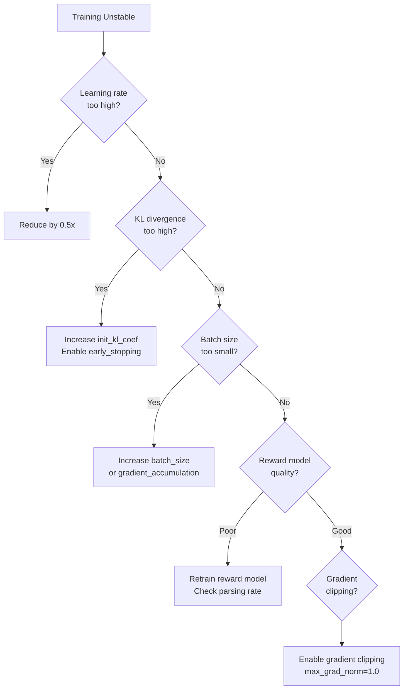

**Solutions**:
1. Reduce learning rate by 50%
2. Increase `init_kl_coef` from 0.2 to 0.3
3. Enable `early_stopping=True`
4. Reduce `ppo_epochs` from 4 to 2-3
5. Check reward model outputs for consistency

**Sources**: Based on error handling in [nl_gradiant_policy_optimization/ultrafeedback/train_ultrafeedback.py:1237-1254]()

### Issue 2: Slow Convergence

**Symptoms**:
- Flat loss curves
- Minimal reward improvement
- Policy not updating

**Diagnosis Flow**:

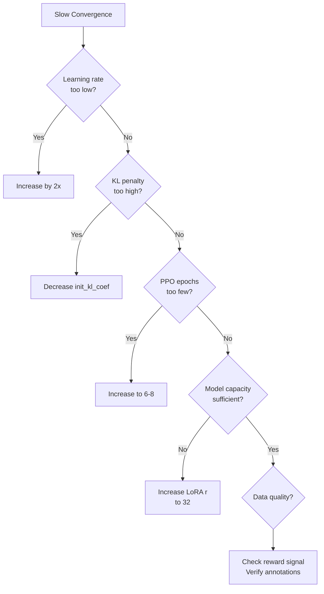

**Solutions**:
1. Increase learning rate by 2x
2. Decrease `init_kl_coef` from 0.2 to 0.15
3. Increase `ppo_epochs` from 4 to 6
4. Increase LoRA `r` from 16 to 32
5. Verify reward model is providing meaningful signals

**Sources**: Based on PPO configuration in [nl_gradiant_policy_optimization/ultrafeedback/train_ultrafeedback.py:145-164]()

### Issue 3: High Memory Usage

**Symptoms**:
- OOM errors
- Slow training speed
- GPU memory saturation

**Solutions by Priority**:

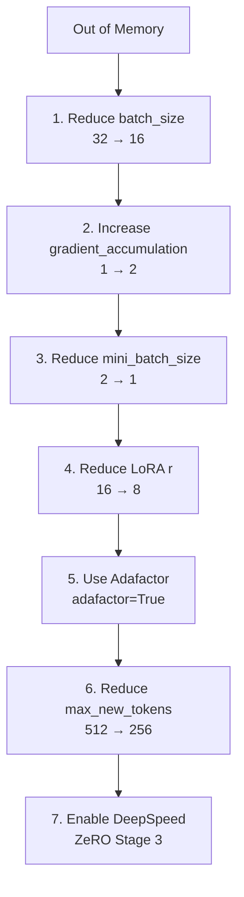

**Estimated Memory Savings**:

| Change | Memory Reduction | Training Speed Impact |
|--------|------------------|----------------------|
| `batch_size` 32→16 | -40% | -50% throughput |
| `gradient_accumulation` 1→2 | -20% | No change (same effective batch) |
| LoRA `r` 16→8 | -10% | Minimal |
| Adafactor | -20% | Minimal |
| `max_new_tokens` 512→256 | -15% | Faster generation |

**Sources**: Based on memory optimization strategies from [nl_gradiant_policy_optimization/ultrafeedback/train_ultrafeedback.py:304-312]()

### Issue 4: Poor Reward Signal

**Symptoms**:
- All rewards near 0
- High parsing failure rate
- Inconsistent feedback

**Diagnosis at [nl_gradiant_policy_optimization/ultrafeedback/train_ultrafeedback.py:1010-1104]()**:

The code logs detailed sample processing information:
- Parsing success/failure per sample
- Number of matched spans
- Reward distribution statistics

**Solutions**:
1. Check reward model temperature (should be ~0.1)
2. Increase `min_new_tokens` for reward model
3. Monitor `failed_samples` count in logs
4. Verify fuzzy matching thresholds
5. Check reward model training quality

**WandB Metrics to Monitor**:
```
rewards/mean
rewards/positive_ratio
rewards/negative_ratio
rewards/zero_ratio
rewards/sample_count
```

Logged at [nl_gradiant_policy_optimization/ultrafeedback/train_ultrafeedback.py:1142-1154]().

**Sources**: [nl_gradiant_policy_optimization/ultrafeedback/train_ultrafeedback.py:1010-1154](), [nl_gradiant_policy_optimization/kodcode/train_kodcode.py:854-992]()

## Hyperparameter Search Strategies

### Grid Search

For systematic exploration of small hyperparameter spaces:

**Example Search Grid**:
```
learning_rates = [5e-6, 1e-5, 2e-5]
kl_coefficients = [0.15, 0.2, 0.25]
temperatures = [0.5, 0.6, 0.7]

Total combinations: 3 × 3 × 3 = 27 runs
```

**Implementation**:
```bash
for lr in 5e-6 1e-5 2e-5; do
  for kl in 0.15 0.2 0.25; do
    for temp in 0.5 0.6 0.7; do
      python train_ultrafeedback.py \
        --learning_rate $lr \
        --init_kl_coef $kl \
        --temperature $temp \
        --output_dir "sweep_lr${lr}_kl${kl}_temp${temp}"
    done
  done
done
```

### Random Search

For efficient exploration of large spaces:

**Sampling Ranges**:
```python
import random

hyperparams = {
    'learning_rate': random.uniform(5e-6, 5e-5),
    'init_kl_coef': random.uniform(0.1, 0.4),
    'temperature': random.uniform(0.5, 0.8),
    'ppo_epochs': random.randint(3, 6),
    'batch_size': random.choice([16, 32, 64]),
}
```

### WandB Sweeps

For automated hyperparameter optimization:

**Sweep Configuration** (create `sweep_config.yaml`):
```yaml
program: train_ultrafeedback.py
method: bayes
metric:
  name: train/average_advantages
  goal: maximize
parameters:
  learning_rate:
    distribution: log_uniform_values
    min: 5e-6
    max: 5e-5
  init_kl_coef:
    distribution: uniform
    min: 0.1
    max: 0.4
  temperature:
    distribution: uniform
    min: 0.5
    max: 0.8
  ppo_epochs:
    values: [3, 4, 5, 6]
```

**Launch Sweep**:
```bash
wandb sweep sweep_config.yaml
wandb agent <sweep_id>
```

**Sources**: Based on WandB integration at [nl_gradiant_policy_optimization/ultrafeedback/train_ultrafeedback.py:103, 167]()

## Best Practices Summary

### Starting Point Configuration

**Conservative defaults for stable training**:
```bash
python train_ultrafeedback.py \
  --learning_rate 1e-5 \
  --lr_scheduler_type linear \
  --batch_size 32 \
  --mini_batch_size 1 \
  --ppo_epochs 4 \
  --gradient_accumulation_steps 1 \
  --init_kl_coef 0.2 \
  --target_kl 0.1 \
  --kl_penalty full \
  --adap_kl_ctrl True \
  --temperature 0.6 \
  --max_new_tokens 512 \
  --train_epochs 2 \
  --steps 1200 \
  --save_freq 5
```

### Monitoring Checklist

**Essential metrics to track**:
1. `train/loss_advantage` - Should decrease steadily
2. `train/loss_value_kl` - Should stabilize
3. `train/average_advantages` - Should be positive
4. `ppo/policy/approxkl` - Should stay near target_kl
5. `rewards/mean` - Should improve over time
6. `rewards/positive_ratio` - Should increase
7. `eval/mean_accuracy` - Should improve

### Iterative Tuning Process

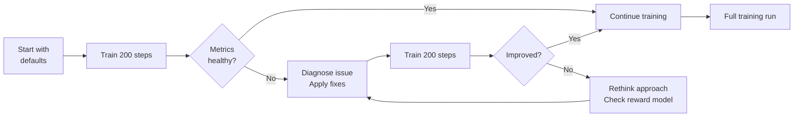

**Iteration Cycle**:
1. Start with conservative defaults
2. Train for 200-300 steps
3. Check key metrics in WandB
4. Adjust one hyperparameter category at a time
5. Validate improvement before continuing
6. Document successful configurations

**Sources**: Based on training loop structure in [nl_gradiant_policy_optimization/ultrafeedback/train_ultrafeedback.py:957-1260](), [nl_gradiant_policy_optimization/kodcode/train_kodcode.py:803-1055]()

---

